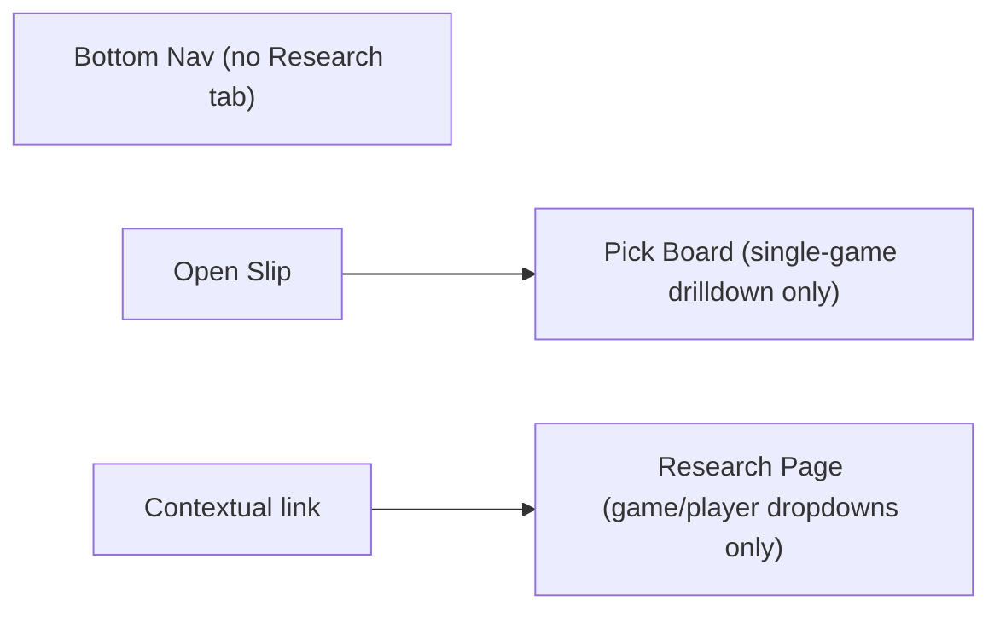
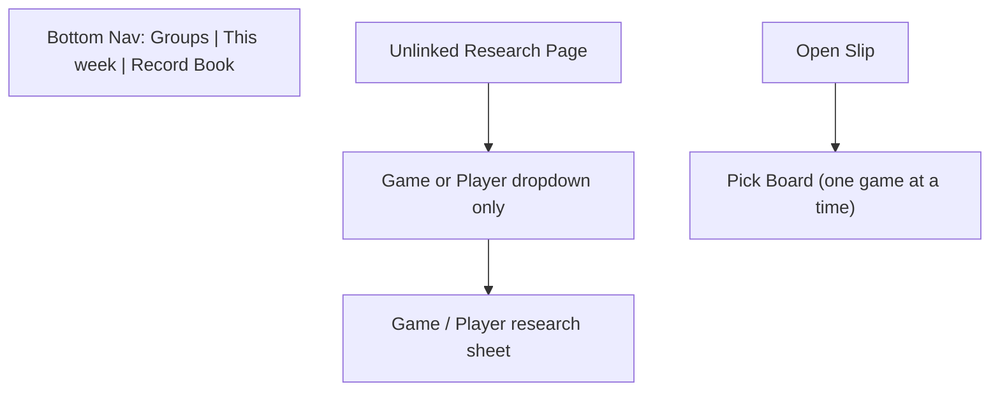
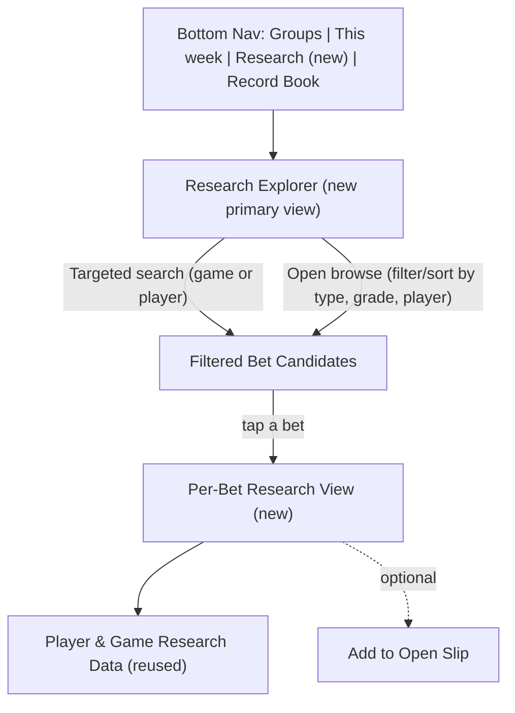

# Dedicated research view for picking legs

## Context

Users pick legs in two ways:

1. **Targeted search.** They already have a game or player in mind and want to inspect that game's or player's bets and
   supporting data.
2. **Open exploration.** They do not have a pick in mind yet and want to browse the week's slate, filtering and sorting
   candidates by bet type, grade, player, or signals to spot strong legs.

Today, neither workflow has a dedicated home. The existing research page is unlinked from the main navigation and only
offers two dropdowns (select a game, select a player) that show a game or player sheet with no bet browsing. The pick
board only exists inside an open slip and forces a game-first drilldown, so you cannot scan across games by bet type,
grade, or player, nor explore bets before a slip is open. Even when a user spots an interesting leg, there is no
dedicated per-bet research view that brings together the stats, matchup context, pricing, and grading factors for that
specific bet.

## Goals and non-goals

**Goals:**

- Add Research as a primary destination in the main navigation, usable both when exploring midweek and while picking for
  an open slip.
- Support both targeted search (jump directly to a game or player) and open exploration (browse bet candidates across
  the slate with filters and sorting by bet type, grade, player/team, and signals).
- Provide a dedicated per-bet research view for each candidate leg, combining the relevant matchup, player/team form,
  pricing, and analyzer factor data in one place alongside existing player and game research.
- Stay within free-tier guardrails by browsing and filtering exclusively over cached odds, stats, and signals, fetching
  on-demand props only when a user opens a game that lacks them.
- Keep the layout phone-first and connected to open slips so a researched bet can be added without losing context.

**Non-goals:**

- Removing the slip-scoped pick board or replacing existing game and player research sheets.
- Adding new paid data providers, new scheduled background jobs, or sportsbook placement/money handling.
- Introducing LLM-generated pick recommendations or blocking any leg from being picked.

## Decision

Promote Research to a primary navigation view built around a dual-mode bet explorer—supporting both targeted game/player
search and slate-wide filtering and sorting by bet type, grade, and player—paired with a dedicated per-bet research
detail view powered by cached odds, analyzer grades, and player/game research data.

### Before

### After

Extending the slip-scoped pick board alone would keep discovery locked behind an open slip and a single-game drilldown.
Leaving Research as a game-and-player dropdown leaves open exploration unsupported. A primary Research view that unifies
targeted lookup, slate-wide filtering/sorting, and per-bet research serves both workflows without duplicating data
fetches.

**Complexity (`medium`):** Coordinates across candidate indexing and grading over the full week's slate, multi-facet
filtering and sorting, per-bet research assembly from existing player/game signals, primary navigation, and optional
handoff into an open slip. **Risk (`medium`):** Slate-wide browsing touches cached odds and props loading paths where an
accidental per-game fetch could burn scarce API credits, and phone-width filter/sort state can regress easily; automated
tests over cache-only browsing, credit guardrails, and filter/sort queries mitigate both.
