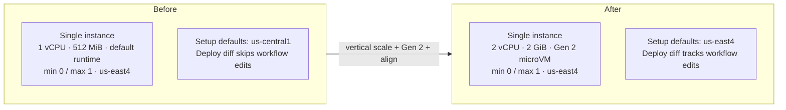

# Close-out

## Overview

## Consequences

- **Easier:** Peak game-day traffic has wide memory headroom (`2 GiB` vs `512 MiB`) for the RAM-backed `tmpfs` SQLite database, WAL segments, Litestream buffers, and Go heap, eliminating OOM crash-loops and 26–63s cold-restore stalls.
- **Easier:** Cloud Run flag or secret-mount edits roll out automatically on merge to `main` because `.github/workflows/deploy.yml` is now in the runtime-change diff allowlist.
- **Easier:** New project setups default to `us-east4`, matching production without extra overrides.
- **Harder:** Staying inside the Cloud Run monthly free tier—`2 vCPU` halves free active compute from `50` to `25` hours/month (~`$5.27/month` expected at ~55 active hours/month), and even comment-only edits to `.github/workflows/deploy.yml` now trigger a deploy outside blackout windows.
- **Revisit:** Check `2 vCPU` vs `1 vCPU` and the `$5` default billing budget in `deploy/setup.sh` after a full billing cycle if actual spend or active hours diverge from estimates.

## Alternatives considered

- **`1 vCPU / 2 GiB / Gen 2` (~$0.52/month at ~55 active hrs):** Stops OOM kills cheaply, but leaves concurrent pick-board rendering, research views, background refreshes, and Litestream competing for a single vCPU during peak windows.
- **`2 vCPU / 1 GiB / Gen 2`:** Saves under `$0.10/month` at ~55 active hours while halving `tmpfs` and heap headroom on a workload that already peaked at `557 MiB`.
- **`4 vCPU / 2 GiB` (~$14.77/month):** Nearly triples monthly cost with diminishing returns because SQLite writes remain serialized on one writer connection.
- **Always-warm `min-instances 1` (~$31+/month):** Adds ~$26.28/month in idle compute only to avoid the first cold start after idle, without improving warm peak throughput.
- **Horizontal scaling (`max-instances > 1`, ~$45–$65+/month):** Breaks the single-writer SQLite/Litestream and in-memory SSE hub invariants and requires managed database and pub/sub infrastructure.

## Implementation notes

- No deviations from the design.
- Local checks (`actionlint`, `bash -n`, `good-vibes docs lint`, and Go tests) validate syntax and docs rather than live Cloud Run flag acceptance or billing; live revision specs and peak memory headroom still require post-merge verification.
- `deploy/setup.sh` keeps `BUDGET_AMOUNT` at `5`, so normal ~55-hour months (~`$5.27`) will trigger the default billing alert thresholds unless operators override `BUDGET_AMOUNT` or raise the budget in GCP Console.

## Follow-ups

- Verify the first post-merge `Deploy` run on `main` does not skip at `Check for runtime changes`, passes `/readyz`, and creates a `parlay-club` revision in `us-east4` with `cpu: "2"`, `memory: 2Gi`, and `execution-environment: gen2`.
- Check Cloud Logging and Cloud Monitoring after the next peak game window to confirm zero `Memory limit ... exceeded` errors and `memory/utilizations` p99 well below `50%`.
- Run the manual production SQLite `VACUUM` from `adr-archive-storage-optimization` during a quiet window to reclaim ~70 MiB from `/data/parlay.db`.
