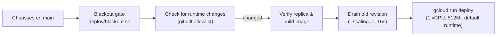
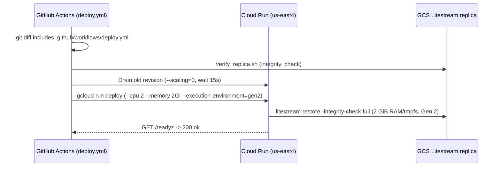

# Design: Scale up Cloud Run instance for peak performance

## Context

Production runs as a single Cloud Run service (`parlay-club`) in `us-east4`, managed by `.github/workflows/deploy.yml`
and bootstrapped once per project by `deploy/setup.sh`. Live deployment documentation is split between
`docs/runbooks/deploy.md` (every deploy, rollback, and spend) and `docs/guides/gcp-setup.md` (one-time project setup).

Two seams in `.github/workflows/deploy.yml` govern how sizing changes roll out:

1. **`Check for runtime changes` (lines 140–159):** On CI-triggered runs, the workflow compares the live revision's
   commit SHA against the tested commit across an explicit path allowlist (`cmd/`, `internal/`, `web/`, `seed/`,
   `deploy/litestream.yml`, `deploy/entrypoint.sh`, `Dockerfile`, `.dockerignore`, `go.mod`, `go.sum`). If nothing in
   that list changed, the deploy is skipped. `.github/workflows/deploy.yml` is currently omitted from that list, so a
   commit that only edits Cloud Run flags would be skipped unless manually dispatched.
2. **`Deploy to Cloud Run` (`run_deploy`, lines 394–409):** Invokes `gcloud run deploy` with `--min-instances 0`,
   `--max-instances 1`, `--concurrency 80`, `--cpu 1`, `--memory 512Mi`, `--timeout 3600`, `--cpu-boost`, and
   `--scaling=auto`, with no `--execution-environment` flag set.

Two invariants remain unchanged:

- **Single writer / single instance:** `--max-instances 1`, `--min-instances 0`, request-based billing, and the
  pre-deploy drain (`--scaling=0` + 15s wait) are preserved because SQLite + Litestream and `internal/live.Hub` require
  exactly one process.
- **Region alignment:** Live GitHub variable `GCP_REGION` is already `us-east4` (Northern Virginia, Tier 1), while
  `deploy/setup.sh`, `docs/runbooks/deploy.md`, and `docs/guides/gcp-setup.md` still default to `us-central1`.

## Approach

Make three targeted configuration and documentation updates, with no Go runtime or database schema changes:

1. **Vertical sizing, Gen 2 runtime, and workflow diff trigger (`.github/workflows/deploy.yml`):**
   - Add `.github/workflows/deploy.yml` to the `git diff --quiet` path list in `Check for runtime changes` so Cloud Run
     flag or secret-mount edits automatically roll out after CI passes on `main`.
   - Update `run_deploy` flags:
     - `--cpu 2` (from `1`)
     - `--memory 2Gi` (from `512Mi`)
     - `--execution-environment=gen2` (explicitly pin Cloud Run's Linux microVM runtime)
   - Leave `--min-instances 0`, `--max-instances 1`, `--concurrency 80`, `--timeout 3600`, `--cpu-boost`, and
     `--scaling=auto` untouched.

2. **Default region alignment (`deploy/setup.sh`):**
   - Change the default `REGION` value and usage text from `us-central1` to `us-east4` so new setups match production
     without requiring an environment override.
   - Keep `BUDGET_AMOUNT` at `5` so the script does not weaken spend alerts silently; operators can override it or raise
     the GCP budget in Console if ~$5/month alerts become noisy.

3. **Living docs (`docs/runbooks/deploy.md` and `docs/guides/gcp-setup.md`):**
   - Update `docs/runbooks/deploy.md` to record `.github/workflows/deploy.yml` in the runtime-change check, the new
     `2 CPU, 2 GiB, gen2` flags, `us-east4` in the rollback example, and updated monthly spend expectations (`us-east4`
     Tier 1, 25 free active hours/month, ~$5/month at ~55 active hours/month).
   - Update `docs/guides/gcp-setup.md` to list `us-east4` as the default `REGION` / `GCP_REGION` across the setup table,
     `gh variable set` snippet, and optional Cloud Scheduler command.

**Trade-offs:**

- **Why `2 GiB` over `1 GiB`:** At ~55 active hours/month, `2 GiB` adds less than $0.10/month over `1 GiB` while giving
  4x the tmpfs + Go heap ceiling (live prod already hit 557 MiB with a 90.2 MiB DB).
- **Why include `.github/workflows/deploy.yml` in the runtime diff list:** Without it, merging this change would skip
  the deploy on `main` and require a manual dispatch. The workflow only changes when deploy behavior changes, so
  redeploying on edits to it is intentional.
- **Complementary operational follow-up:** The manual production `VACUUM` from `adr-archive-storage-optimization` stays
  out of scope here and can be run independently during a quiet window to shrink `/data/parlay.db` from ~90 MiB to
  ~15–20 MiB.

## Verification

- Local automated checks: run `actionlint`, `bash -n deploy/setup.sh`, `deploy/blackout_test.sh`, and
  `good-vibes docs lint` (all must pass with zero errors).
- Post-merge rollout verification (outside the game blackout window):
  - Confirm the `Deploy` workflow does **not** skip at `Check for runtime changes` and completes `GET /readyz` with
    `200 ok`.
  - Inspect the live Cloud Run service
    (`gcloud run services describe parlay-club --project parlay-club --region us-east4`) to confirm `cpu: "2"`,
    `memory: 2Gi`, `run.googleapis.com/execution-environment: gen2`, `maxScale: "1"`, and `startup-cpu-boost: "true"`.
  - After the next peak game window, check Cloud Logging for zero `Memory limit ... exceeded` errors and verify Cloud
    Monitoring `memory/utilizations` p99 stays well below 50%.

## Risks

- **Invalid `gcloud` flag or unsupported combination:** `actionlint` validates YAML and shell syntax, not
  `gcloud run deploy` flags. `2 vCPU / 2 GiB` is explicitly supported by Cloud Run Gen 2 (`2 vCPU` supports
  `512 MiB`–`8 GiB`), and if `gcloud run deploy` rejects any flag after the drain step, the workflow's `if: failure()`
  step re-enables `--scaling=auto` on the previous revision.
- **Higher monthly spend:** Doubling vCPU cuts the monthly free tier from 50 to 25 active hours/month (~$5.27/month at
  the observed 55 active hours/month). Existing GCP billing budget alerts (50%, 90%, 100%) catch unexpected spikes.
- **Unintended deploys on comment-only workflow edits:** Adding `.github/workflows/deploy.yml` to the diff list means
  even comment-only edits to `deploy.yml` trigger a deploy (still gated by the game-window blackout). That is rare and
  preferable to silently skipping real flag changes.

## TODO

### Phase 1: Scale Cloud Run to 2 vCPU / 2 GiB / Gen 2 and align region defaults

Complexity: low (local flag and default edits across the deploy workflow, setup script, and two deploy docs with no Go
code or cross-package invariants)

Risk: medium (an invalid Cloud Run flag breaks production deploys and is not caught by local actionlint, though a failed
revision leaves the prior revision serving and rollback is immediate)

- [x] Update `.github/workflows/deploy.yml` to pass `--cpu 2`, `--memory 2Gi`, and `--execution-environment=gen2` in
      `run_deploy`, and add `.github/workflows/deploy.yml` to the `Check for runtime changes` `git diff` path list;
      verify with `actionlint`.
- [ ] Update the default `REGION` in `deploy/setup.sh` from `us-central1` to `us-east4` (both usage text and fallback
  assignment); verify with `bash -n deploy/setup.sh`.
- [ ] Docs: update `docs/runbooks/deploy.md` and `docs/guides/gcp-setup.md` for the `2 vCPU / 2 GiB / Gen 2` sizing, the
      `deploy.yml` runtime-change trigger, the `us-east4` default region, and updated monthly spend expectations; verify
      with `good-vibes docs lint`.
