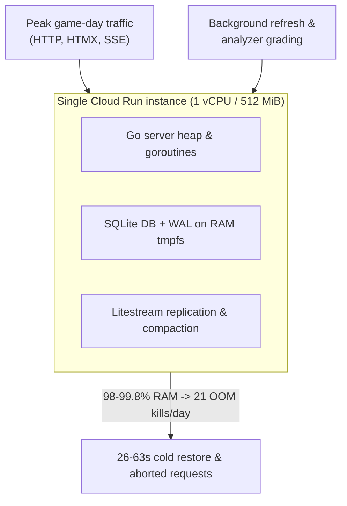
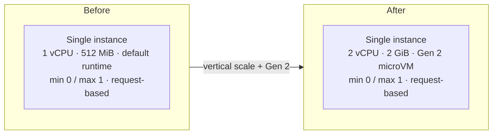

# Scale up Cloud Run instance for peak performance

## Context

The production server runs as a single Cloud Run instance in `us-east4` (Northern Virginia, Tier 1 pricing) with
`1 vCPU`, `512 MiB` of memory, startup CPU boost, concurrency `80`, request-based billing, and automatic scaling bounded
to `min 0 / max 1` instances. No execution environment is pinned, so the service relies on Cloud Run's default sandbox
rather than explicitly selecting the second-generation Linux microVM runtime.

Single-instance hosting is a hard architectural constraint: SQLite with Litestream requires one writer, and live updates
rely on an in-memory SSE hub. Seven days of live Cloud Monitoring and Cloud Logging data show that `512 MiB` RAM is
actively causing OOM crash-loops and multi-second stalls, with `1 vCPU` adding latency on concurrent peak views:

- **21 OOM kills in one day (Nov 27):** Memory utilization sits at `84%–89%` (`p50`), `95.6%–99.0%` (`p95`), and
  `97.7%–99.8%` (`p99`), peaking at `557 MiB` and triggering repeated container kills and aborted requests. Cloud Run's
  writable filesystem is RAM-backed (`tmpfs`), so the SQLite database (currently `90.2 MiB` awaiting a manual `VACUUM`
  from `adr-archive-storage-optimization`), WAL segments, Litestream buffers, and Go heap all share `512 MiB`.
- **26–63s cold-restore stalls:** Every OOM kill forces a full Litestream restore and integrity check, producing 18–41s
  request stalls. Even after `VACUUM` reclaims ~70 MiB, peak usage would remain ~440–485 MiB against a `512 MiB` wall.
- **Peak concurrent latency:** CPU utilization reaches `57.8%` (`p95`) and `62.6%` (`p99`), while warm pick-board and
  research requests take 1.5–4.4s under concurrent load and GC pressure.
- **Observed volume:** `12.8` billable hours over the last 7 days (~51–55 active hours/month).

### Scaling options and estimated monthly Cloud Run costs (`us-east4`, Tier 1)

Request-based billing includes a monthly free tier of `180,000 vCPU-seconds` (`50 vCPU-hours`), `360,000 GiB-seconds`
(`100 GiB-hours`), and `2 million` requests. Beyond the free tier, active compute costs `$0.0864 / vCPU-hour` and
`$0.0090 / GiB-hour` (idle `min-instances` compute costs `$0.0090 / vCPU-hour` and `$0.0090 / GiB-hour`). The
second-generation execution environment carries no extra unit charge.

| Option | Resources & runtime | Free-tier hrs | Overage / active hr | ~40 hrs/mo | ~55 hrs/mo (actual) | ~80 hrs/mo |
| --- | --- | --- | --- | --- | --- | --- |
| Current | 1 vCPU, 512 MiB, default | 50 hrs | $0.091 | $0.00 | ~$0.43 | ~$2.59 |
| RAM + Gen 2 only | 1 vCPU, 2 GiB, Gen 2 | 50 hrs | $0.104 | $0.00 | ~$0.52 | ~$3.13 |
| Vertical 2x + 2 GiB (selected) | 2 vCPU, 2 GiB, Gen 2 | 25 hrs | $0.191 | ~$2.59 | ~$5.27 | ~$10.04 |
| Vertical 4x | 4 vCPU, 2 GiB, Gen 2 | 12.5 hrs | $0.364 | ~$9.50 | ~$14.77 | ~$23.87 |
| Always warm (`min 1`) | 2 vCPU, 2 GiB, Gen 2 | — | +$26.28/mo idle | ~$29+ | ~$31+ | ~$36+ |
| Horizontal (`max > 1`) | Multi-instance + DB + pub/sub | — | — | ~$45–$65+ | ~$45–$65+ | ~$45–$65+ |

## Goals and non-goals

**Goals:**

- Eliminate production OOM crash-loops and memory/GC pressure by quadrupling container RAM (`512 MiB` to `2 GiB`) so the
  in-memory SQLite filesystem, Litestream, and Go heap have wide headroom.
- Double CPU (`1 vCPU` to `2 vCPU`) and pin the second-generation Linux microVM execution environment for faster
  concurrent page rendering, analyzer grading, background refreshes, and SQLite I/O.
- Preserve scale-to-zero request-based billing in `us-east4` so idle days cost nothing and monthly spend stays around
  ~$5 at current usage.

**Non-goals:**

- Horizontal scaling (`max-instances > 1`), migrating off SQLite/Litestream, or replacing the in-memory SSE hub.
- Setting `min-instances` above `0` to eliminate cold starts.
- Running the manual production `VACUUM` follow-up from `adr-archive-storage-optimization` (that is an operational task,
  complementary to this sizing change).
- Application-level query tuning, HTML caching, or analyzer profiling.

## Decision

Scale the Cloud Run service vertically from `1 vCPU / 512 MiB` to `2 vCPU / 2 GiB` and explicitly enable the
second-generation execution environment, while keeping `us-east4` (Northern Virginia, Tier 1), `min 0 / max 1`
instances, request-based billing, and startup CPU boost. Update the deploy setup default and runbook to reflect
`us-east4`, the new sizing, and expected monthly spend.

This beats the alternatives on cost-per-improvement:

- **`1 vCPU / 2 GiB / Gen 2`** fixes OOMs for ~$0.52/month, but leaves concurrent pick-board, research, refresh, and
  Litestream work competing for a single vCPU during peak windows.
- **`2 vCPU / 1 GiB / Gen 2`** saves less than $0.10/month at ~55 active hours/month while giving half the tmpfs and
  heap headroom.
- **`4 vCPU / 2 GiB`** nearly triples monthly cost (~$14.77/month) with diminishing returns because SQLite writes remain
  serialized on one writer connection.
- **`min-instances 1`** adds ~$26/month in idle compute just to avoid the first cold start after idle, without improving
  warm peak throughput.
- **Horizontal scaling** violates the single-writer SQLite and in-memory SSE hub invariants and requires managed
  database and pub/sub infrastructure ($45–$65+/month).

`complexity` is `low` because changing Cloud Run resource flags in the deploy workflow and updating the deploy setup
default and runbook is local configuration work with shallow reasoning depth and no cross-package invariants to
coordinate. `risk` is `medium` because an invalid flag or resource combination breaks production deploys and automated
checks only validate workflow syntax rather than live Cloud Run acceptance or billing, though a failed revision leaves
the prior revision serving and reverting is immediate.
