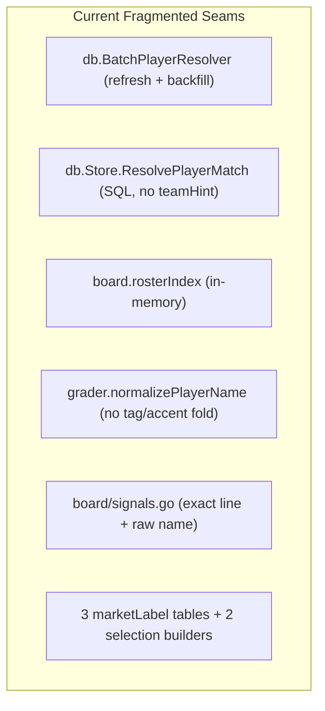
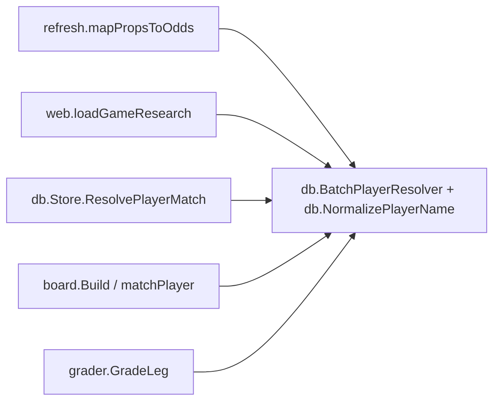

# Design: Consolidate selection and player identity

## Context

`internal/db` already sits at the bottom of the package graph and holds `SelectionKey`, `SameSelection`,
`IsPlayerMarket`, `StripPlayerTag`, `NormalizePlayerName`, and `BatchPlayerResolver`. However, several callers across
`db`, `board`, `grader`, and `web` still maintain parallel implementations of player matching, selection/line-group
equality, and selection display formatting:

1. **Four player matchers with divergent behavior:**
   - `db.BatchPlayerResolver` (`internal/db/canonical_players.go`) strips `(TEAM)` tags, extracts `teamHint`, checks
     `player_matches` (`manual = 1` first, refusing ambiguous non-manual cache hits), and matches `roster_players`.
   - `db.Store.ResolvePlayerMatch` (`internal/db/players.go`) runs raw SQL that ignores `teamHint` from
     `StripPlayerTag`. It is called on leg form submission (`internal/web/slips.go`) and inside a per-player loop in
     `loadGameResearch` (`internal/web/research.go`), even though `loadGameResearch` already preloaded `rosterPlayers`
     and `playerMatches`.
   - `board.rosterIndex` / `matchPlayer` (`internal/board/board.go`) matches `roster_players` in memory without
     stripping `(TEAM)` team hints for disambiguation.
   - `grader.normalizePlayerName` and `grader.IsPlayerMarket` (`internal/grader/grader.go`) duplicate
     `db.NormalizePlayerName` and `db.IsPlayerMarket` but omit `StripPlayerTag` and Latin accent folding (`plainRune`).
2. **Inconsistent moved-line selection checks:**
   - `board/signals.go` (`rowMatchesAnalyzerLeg` and `sameBoardPlayer`) compares raw `row.PlayerName == leg.PlayerName`
     and `lineEqual(row.Line, leg.Line)` instead of `db.SameSelection`, so a picked leg whose line moved by `0.5` is not
     recognized as the same pick when evaluating `Fits slip`.
   - `web/pick.go` (`sameBoardLine`) clones `db.LegSelection` and mutates `.Side = ""` to approximate line-group
     identity.
   - `web/slips.go` (`candidatePrices`) requires `db.SameLine(row.Line, leg.Line)` when computing slip reference odds,
     dropping a member's home book when its line moves by `0.5`, whereas `export.matchOdds`
     (`internal/export/export.go`) prefers an exact line match and falls back to the book's current standard line.
3. **Duplicate selection text formatters:**
   - `board.rowText` + `board.marketLabel` (`internal/board/board.go`), `web.buildSelection` + `web.marketLabels`
     (`internal/web/slips.go`), and `web.marketLabel` (`internal/web/research.go`) each format selection strings
     (`"BUF -3.5"`, `"Josh Allen Over 245.5 Pass Yds"`, `"BUF Team Total Over 24.5"`) from separate tables.

## Approach

### 1. Make `db.BatchPlayerResolver` and `db.NormalizePlayerName` the single player-matching engine

- Extend `db.ResolvedPlayer` (`internal/db/canonical_players.go`) to carry `Position string` and `HeadshotURL string`
  from the matched `RosterPlayer`.
- Refactor `Store.ResolvePlayerMatch(ctx, oddsName, homeTeam, awayTeam)` (`internal/db/players.go`) to load
  `RosterForTeams` and `PlayerMatchesForTeams` for the two teams, delegate resolution to
  `NewBatchPlayerResolver(rosters, matches).ResolveGamePlayer("", oddsName, "", homeTeam, awayTeam)`, and persist any
  `resolver.NewMatches()` via `UpsertPlayerMatches`. This gives form-submitted legs the exact same `(TEAM)` hint
  handling and collision safety as prop ingest.
- Update `loadGameResearch` (`internal/web/research.go`) to build one
  `db.NewBatchPlayerResolver(rosterPlayers, playerMatches)` from its already-loaded slices instead of calling
  `Store.ResolvePlayerMatch` inside the `oddsRows` loop, eliminating N+1 SQL queries per game research view.
- Update `board.matchPlayer` (`internal/board/board.go`) to extract `teamHint` via `db.StripPlayerTag` when `team == ""`
  so tagged names resolve consistently on the board.
- In `internal/grader/grader.go`, delete `normalizePlayerName` and `IsPlayerMarket` and call `db.NormalizePlayerName`
  and `db.IsPlayerMarket` directly so box-score grading benefits from `(TEAM)` tag stripping and accent folding.

### 2. Unify selection and line-group identity across `db`, `board`, `web`, and `export`

- Add `SameLineGroup(left, right SelectionKey) bool` and `SamePlayer(left, right SelectionKey) bool` in
  `internal/db/odds.go`:
  - `SamePlayer` compares `PlayerID` when both carry one, or `NormalizePlayerName(PlayerName)` (with non-conflicting
    `Team`) otherwise.
  - `SameLineGroup` checks `GameID` and `MarketType` equality; returns `true` for game-wide markets (`SPREAD`, `ML`,
    `TOTAL`), checks `Team` equality for `TEAM_TOTAL`, and delegates to `SamePlayer` for player markets.
- Replace `sameBoardLine` in `internal/web/pick.go` with
  `db.SameLineGroup(db.LegSelection(left), db.LegSelection(right))`.
- Update `rowMatchesAnalyzerLeg` and `sameBoardPlayer` in `internal/board/signals.go` to construct `db.SelectionKey`
  values and call `db.SameSelection` and `db.SamePlayer` instead of comparing raw `PlayerName` and
  `lineEqual(row.Line, leg.Line)`.
- Add `MatchBookOdds(leg Leg, odds []Odds, book string) (Odds, bool)` in `internal/db/odds.go` (matching by
  `NormalizeBook` and `MatchesSelection`, preferring `SameLine(row.Line, leg.Line)` and falling back to the first
  matching row for that book). Use it in both `export.matchOdds` (`internal/export/export.go`) and `web.candidatePrices`
  (`internal/web/slips.go`) so reference-odds calculation and sportsbook export resolve moved lines identically.

### 3. Centralize `MarketLabel` and `FormatSelection` in `internal/db`

- Add `MarketLabel(market string) string` and `FormatSelection(market, team, player, side string, line *float64) string`
  in `internal/db/odds.go`.
- Replace `board.rowText` and `board.marketLabel` (`internal/board/board.go`), `web.buildSelection` and
  `web.marketLabels` (`internal/web/slips.go`), and `web.marketLabel` (`internal/web/research.go`) with delegates to
  `db.FormatSelection` and `db.MarketLabel`.
- Note: `web.buildSelection` validates that required fields are non-empty before formatting (e.g., returning `""` when a
  spread has no line or a prop has no line/side so `legFromForm` rejects incomplete custom forms), whereas
  `board.rowText` formats partial rows gracefully when a book omits a line. Provide `db.FormatSelection` (graceful
  display for board rows) and `db.BuildLegSelection` (strict form builder returning `""` when required fields for the
  market are missing) backed by the same `MarketLabel` and number formatting helpers.

## Verification

- Unit tests in `internal/db/players_test.go` verifying `Store.ResolvePlayerMatch` resolves `"Ollie Gordon II (MIA)"`
  using its `(MIA)` team hint even when an opposing roster shares a last/normalized name.
- Unit tests in `internal/grader/grader_test.go` verifying `GradeLeg` matches box-score players when the leg or box
  score carries accented characters (e.g., `"José Ramírez"`) or a trailing `(TEAM)` tag.
- Unit tests in `internal/board/signals_test.go` verifying `FitsSlip` skips an already-picked selection even after the
  board line moves by `0.5` yards and matches same-player correlations across name suffix variants (`"Ollie Gordon"` vs
  `"Ollie Gordon II"`).
- Handler tests in `internal/web/slips_test.go` and `internal/web/research_test.go` verifying `referenceOdds` includes a
  member's home book when its line moved by `0.5`, and `loadGameResearch` resolves prop matches in memory via
  `BatchPlayerResolver`.
- Standard check: `go test -short -race ./...` and `golangci-lint run ./...`.

## Risks

- **`board.rowText` vs `web.buildSelection` empty-line behavior:** `board.rowText` allows `line == nil` on `SPREAD`
  (`"BUF"`), `TOTAL` (`"Over"`), and `TEAM_TOTAL` (`"BUF Team Total Over"`), whereas `web.buildSelection` returns `""`
  so form validation rejects missing lines. Keeping `db.BuildLegSelection` strict while sharing `MarketLabel` and
  formatting helpers preserves both contracts.
- **Ambiguous auto-matches in `ResolvePlayerMatch`:** Delegating `Store.ResolvePlayerMatch` to `BatchPlayerResolver`
  preserves the invariant that `manual = 0` matches are only cached when a single roster player across both teams
  matches `norm`.

## TODO

Effort: medium (coordinates player identity, selection matching, and formatting invariants across db, board, grader,
export, and web)

### Phase 1: Unify player normalization and resolution across `db`, `grader`, `board`, and `research`

- [x] Extend `db.ResolvedPlayer` with `Position` and `HeadshotURL`, refactor `db.Store.ResolvePlayerMatch` in
      `internal/db/players.go` to delegate to `db.BatchPlayerResolver` (honoring `StripPlayerTag` team hints), and
      update `loadGameResearch` in `internal/web/research.go` and `matchPlayer` in `internal/board/board.go` to use it,
      with tests in `internal/db/players_test.go` and `internal/web/research_test.go`.
- [x] Replace `normalizePlayerName` and `IsPlayerMarket` in `internal/grader/grader.go` with `db.NormalizePlayerName`
      and `db.IsPlayerMarket`, and add accent-folded and `(TEAM)`-tagged prop grading tests in
      `internal/grader/grader_test.go`.

### Phase 2: Unify selection, line-group, and book-odds matching

- [x] Add `SamePlayer`, `SameLineGroup`, and `MatchBookOdds` in `internal/db/odds.go`, and wire them into
      `internal/board/signals.go` (`rowMatchesAnalyzerLeg`, `sameBoardPlayer`), `internal/web/pick.go`
      (`sameBoardLine`), `internal/export/export.go` (`matchOdds`), and `internal/web/slips.go` (`candidatePrices`),
      with tests in `internal/db/odds_test.go`, `internal/board/signals_test.go`, and `internal/web/slips_test.go`.

### Phase 3: Centralize market labels and selection text formatting

Effort: easy (mechanical consolidation of selection text and market label helpers with existing test coverage)

- [ ] Add `MarketLabel`, `FormatSelection`, and `BuildLegSelection` in `internal/db/odds.go` and replace the duplicate
      implementations in `internal/board/board.go`, `internal/web/slips.go`, and `internal/web/research.go`, with unit
      tests in `internal/db/odds_test.go`.
- [ ] Docs: update `docs/concepts/slips.md` and `docs/reference/data-sources.md` to reflect unified selection/book
      matching and player resolution across grading and research.
