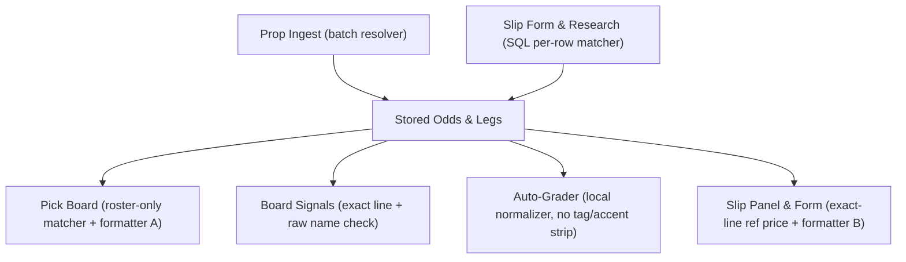
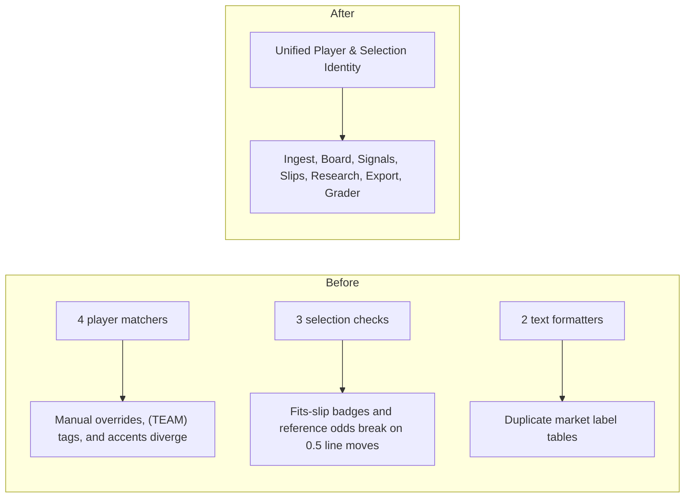

# Consolidate selection and player identity

## Context

Player matching, selection identity, and selection display text are currently duplicated across six modules, and each
copy has drifted on edge cases:

- **Four divergent player matchers:** Prop ingest uses a batch resolver that strips trailing `(TEAM)` tags, folds
  accents, checks manual overrides, and guards against same-name collisions across opposing teams. Meanwhile, the SQL
  single-player matcher drops the `(TEAM)` team hint and runs inside a per-player loop on the game research view; the
  pick board's in-memory roster matcher ignores saved manual overrides; and the post-game auto-grader keeps its own name
  normalizer that omits `(TEAM)` tag stripping and accent folding.
- **Inconsistent moved-line selection rules:** The pick board, slip edits, and sportsbook export match selections across
  half-point line moves, but the board's `Fits slip` signal matcher still requires an exact line and raw player-name
  match. Reference-odds pricing on the slip panel also requires an exact line match, dropping a member's home book
  whenever its line moves by half a point.
- **Duplicate selection formatters:** The pick board and the slip form parser each maintain their own market label
  tables and selection string builders for spreads, totals, moneylines, team totals, and player props.

## Goals and non-goals

**Goals:**

- Unify player name normalization and roster/manual-override resolution behind one shared implementation used by prop
  ingest, leg creation, the pick board, game research, and post-game grading.
- Use one canonical selection and line-group identity across board pairing, `Fits slip` signal evaluation, leg updates,
  sportsbook export, and member reference-odds pricing.
- Format selection display text and market labels in one place so board rows, saved legs, and research views always
  agree.

**Non-goals:**

- Changing the database schema or re-running historical player backfills.
- Altering how post-game grading evaluates win, loss, or push thresholds once a player is matched.
- Redesigning the pick board's UI layout or sportsbook deep-link formats.

## Decision

Consolidate canonical player resolution, selection and line-group identity, and selection text formatting into one deep
domain module that every ingest, board, slip, research, export, and grading path calls.

Centralizing player and selection identity in one module beats patching individual callers because every new sportsbook
quirk or market rule lands once and immediately applies to board grouping, signal badges, reference pricing, and
grading.

The `effort` rating is `medium` because the change coordinates contracts and invariants across six existing modules
without requiring schema migrations or new external integrations.
