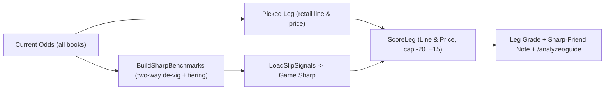

# Close-out

## Overview

## Consequences

- **Easier:** Spot shaded retail lines and heavy vig across game markets and player props without extra API calls or credit spend.
- **Easier:** Adjust all eight sharp-factor weights from `RubricV1` while keeping `ScoreLeg` and `/analyzer/guide` aligned.
- **Harder:** Trace Line & Price score movements at a glance now that sharp line/price factors share the `-20..+15` category clamp with nfelo cushion, hooks, and chalk.
- **Revisit:** Sharp factor weights and Tier 1 bookmaker coverage once historical grading outcomes are evaluated.

## Alternatives considered

- **Add `regions=eu` to The Odds API `/odds`:** Rejected because The Odds API bills `markets × regions`, which would double credit burn per call (3 to 6 credits) and risk exhausting the 500 credits/month cap. Using `lowvig` and `betonlineag` already returned by `regions=us`, plus Tier 3 consensus, costs zero extra credits.
- **Rely on nfelo alone:** Rejected because nfelo only covers pre-game spreads and win probabilities, leaving totals, player props, and late market moves unchecked.
- **Persist sharp benchmarks in a new SQLite table:** Rejected because `odds` already stores every bookmaker's current quote; computing benchmarks in memory avoids schema migrations and stale-cache drift.
- **Show "+EV %" in factor details:** Rejected to preserve the sharp-friend tone; quoting the sharp line or fair American price communicates the same gap in plain language.

## Implementation notes

- `LinePriceMax` lived on `Rubric` (`RubricV1`) rather than as a package constant in `grade.go`, so the cap raise from `10` to `15` was applied to `RubricV1`.
- `PriceEdge` returns `0` when `retailAmerican == 0` or `fairProb` falls outside `(0, 1)` so invalid quotes cannot create false positive edges.
- `BuildSharpBenchmarks` fails soft on one-sided markets (`ANYTIME_TD`), DFS/exchange books in Tier 3, mismatched lines, Tier 3 groups with fewer than three books, and overrounds outside `[0.95, 1.25]`.
- Sharp factors only adjust the Line & Price score; every pick stays allowed.

## Follow-ups

- Propose `grading-evals` to backtest and tune the `RubricV1` sharp factor weights and `LinePriceMax` cap against historical NFL results.
- Verify in production logs which Tier 1 and Tier 2 books appear in Parlay API `/props` and The Odds API `regions=us` responses, and update bookmaker key aliases if provider names drift.
