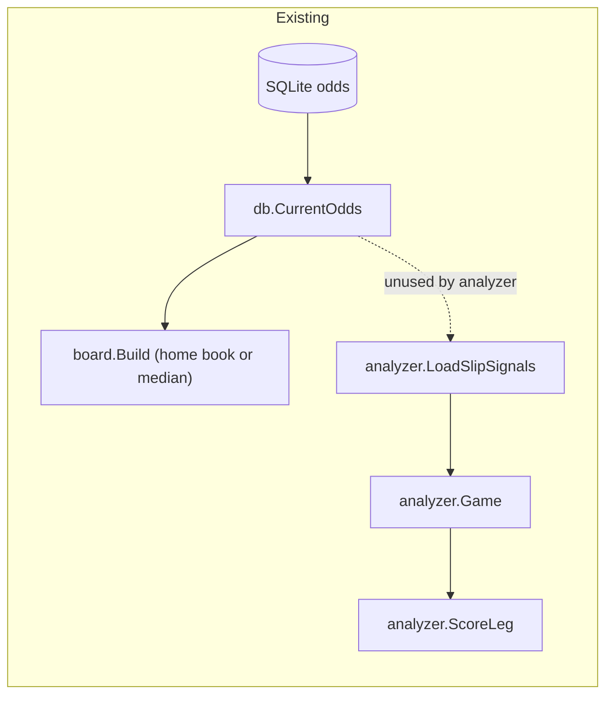
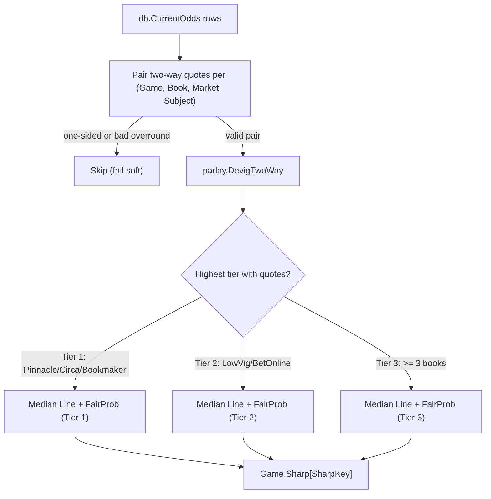

# Design: Sharp bookmaker odds comparison

## Context

`internal/ingest/odds` fetches game lines from Parlay API and The Odds API with `regions=us` and fetches bulk player
props from Parlay API's flat-rate `/props` endpoint. Every bookmaker's quote is persisted in SQLite `odds` as `db.Odds`
(`GameID, Book, MarketType, Team, PlayerName, Side, Line, Price, FetchedAt`) and filtered to the newest sync per group
by `db.CurrentOdds`.

`internal/parlay` holds pure American/decimal conversion and median reference pricing (`AmericanToDecimal`,
`DecimalToAmerican`, `ReferencePrice`) but has no implied-probability or de-vig helpers.

`internal/analyzer` holds pure grading (`ScoreLeg`, `ScoreSlip`), warning rules (`AnalyzeSlip`), rubric docs
(`GradeRubric`), and `LoadSlipSignals` (`internal/analyzer/signals.go`). Today, `LoadSlipSignals` loads nfelo, nflverse
EPA/usage, rosters, injuries, and player game logs, but never reads `odds`. `scoreLineAndPrice`
(`internal/analyzer/grade.go`) only scores `nfelo_cushion`, `hook`, `total_key_number`, and `chalk`, capped at
`[-20, +10]`.

**Key constraint:** The Odds API bills `markets × regions`. Adding `regions=eu` to `/odds` would double credit spend
from 3 to 6 credits per call and violate the 500 credits/month guardrail. The design must therefore extract sharp
benchmarks from books already present in `regions=us` and flat-rate Parlay API `/props` responses without adding paid
API calls or extra regions.



## Approach

### 1. Pure de-vig math (`internal/parlay`)

Add three pure functions to `internal/parlay/parlay.go`:

- `ImpliedProb(american int) float64`: `1 / AmericanToDecimal(american)` (`0` for invalid odds).
- `DevigTwoWay(priceA, priceB int) (probA, probB float64, ok bool)`: computes raw implied probabilities `pA`, `pB` and
  returns `pA/(pA+pB)`, `pB/(pA+pB)`, `true`. Returns `ok=false` when either price is invalid or the overround `pA + pB`
  falls outside `[0.95, 1.25]` (guards against corrupt or mispaired quotes).
- `PriceEdge(retailAmerican int, fairProb float64) float64`: returns `fairProb - ImpliedProb(retailAmerican)`. Positive
  means the retail price pays better than the sharp fair price; negative means the retail price carries extra juice or
  shading.

### 2. Tiered sharp benchmark builder (`internal/analyzer/sharp.go`)

Add a pure `BuildSharpBenchmarks(rows []db.Odds) map[string]map[SharpKey]SharpQuote` that runs over the output of
`db.CurrentOdds`:

```go
type SharpKey struct {
    MarketType string
    Team       string // normalized upper; "" for TOTAL
    PlayerName string // normalized lower; "" for game/team markets
    Side       string // TEAM, OVER, UNDER
}

type SharpQuote struct {
    Line         *float64
    FairProb     float64 // de-vigged probability (0..1)
    FairAmerican int     // DecimalToAmerican(1 / FairProb)
    Source       string  // "Pinnacle", "Circa", "LowVig", "BetOnline", or "market consensus"
    Tier         int     // 1 = sharpest, 2 = sharp US-region, 3 = consensus
}
```

Bookmaker tiering (normalized lowercase `Book` key):

- **Tier 1 (sharpest market makers):** `pinnacle`, `circa`, `bookmaker` (used whenever returned by Parlay API `/props`
  or future credit-neutral feeds).
- **Tier 2 (sharp-leaning US-region books already in `regions=us`):** `lowvig`, `betonlineag`.
- **Tier 3 (fallback):** multi-book consensus across all remaining non-DFS/non-exchange books with complete two-way
  quotes on the same line, requiring at least 3 books.

Two-way pairing rules:

- `ML`: pair `TEAM` A and `TEAM` B within the same `(GameID, Book, MarketType)`.
- `SPREAD`: pair `TEAM` A at `line` with `TEAM` B at `-line` (tolerance `1e-6`).
- `TOTAL`, `TEAM_TOTAL`, and player prop `OVER`/`UNDER`: pair `OVER` and `UNDER` with matching
  `(Team, normalized PlayerName, Line)`.
- One-sided markets (`ANYTIME_TD` `YES`, DFS pick'em lines, or half-quoted books) are skipped cleanly—never de-vigged
  from one side.

When multiple books exist in the winning tier for a selection, take the median `Line` and median de-vigged `FairProb`
across books in that tier.



### 3. Line & Price scoring factors (`internal/analyzer/grade.go`, `docs.go`)

Attach `Sharp map[SharpKey]SharpQuote` to `analyzer.Game`. Raise `linePriceMax` from `10` to `15` so sharp value can
lift a leg alongside nfelo cushion while keeping category balance intact.

In `scoreLineAndPrice(leg, game)`:

1. Look up `sharp, ok := game.Sharp[sharpKeyForLeg(leg)]`. If absent, emit no sharp factor (fail soft).
2. **Line comparison** (when both `leg.Line != nil` and `sharp.Line != nil` and lines differ):
   - Compute bettor-favorable `lineEdge`:
     - `SPREAD`: `*leg.Line - *sharp.Line` (e.g. `-2.5` vs sharp `-3.5` is `+1.0` edge).
     - `OVER`: `*sharp.Line - *leg.Line` (lower over line is easier).
     - `UNDER`: `*leg.Line - *sharp.Line` (higher under line is easier).
   - Minimum threshold: `0.5` for `SPREAD`, `TOTAL`, `TEAM_TOTAL`, `RECEPTIONS`, `PASS_TDS`, `KICKER_PTS`; `2.0` for
     yardage/attempt props (`PASS_YDS`, `RUSH_YDS`, `REC_YDS`, `RUSH_ATT`).
   - `lineEdge >= threshold` → `sharp_line_edge`: `+8` (Tier 1/2) or `+5` (Tier 3). Detail:
     `"Getting BUF -2.5 while LowVig sits at -3.5."`
   - `lineEdge <= -threshold` → `sharp_line_fade`: `-8` (Tier 1/2) or `-5` (Tier 3). Detail:
     `"LowVig sits at -2.5, so -3.5 gives up a full point."`
3. **Price comparison** (when lines match within `1e-6`, or `ML` with nil line, and `sharp.FairProb > 0`):
   - Compute `edge := parlay.PriceEdge(leg.Odds, sharp.FairProb)`.
   - `edge >= +0.025` (≥ 2.5 percentage points better than sharp fair) → `sharp_price_edge`: `+6` (Tier 1/2) or `+4`
     (Tier 3). Detail: `"Strong price at +105 vs. LowVig fair price near -108."`
   - `edge <= -0.045` (≥ 4.5 percentage points worse than sharp fair, clearing standard ~2.4% retail vig on `-110`) →
     `sharp_price_fade`: `-6` (Tier 1/2) or `-4` (Tier 3). Detail:
     `"Steep price at -135 vs. LowVig fair price near -112."`

All four factors (`sharp_line_edge`, `sharp_line_fade`, `sharp_price_edge`, `sharp_price_fade`) are added to
`GradeRubric()` in `internal/analyzer/docs.go` so `/analyzer/guide` stays locked to the engine.

### 4. Signal loader wiring (`internal/analyzer/signals.go`)

`LoadSlipSignals` calls `store.OddsForWeek(ctx, weekID)` (already indexed and filtered through `db.CurrentOdds`, zero
network calls), runs `BuildSharpBenchmarks`, and populates `converted.Sharp` on each `analyzer.Game`. If `OddsForWeek`
errors or returns empty rows, `Sharp` stays nil and grading fails soft.

### Trade-offs & rejected options

- **Rejected: Adding `regions=eu` to The Odds API `/odds`:** Doubles credit burn per call (3 → 6) and risks hitting the
  500/month cap mid-season. Using `lowvig`/`betonlineag` already in `regions=us` plus Tier 3 consensus costs 0 extra
  credits.
- **Rejected: Storing sharp quotes in a new SQLite table:** `odds` already stores every bookmaker's current quote;
  computing `SharpQuote` in memory takes microseconds per week and avoids schema migrations and stale-cache drift.
- **Rejected: Showing "+EV %" in UI copy:** Violates the sharp-friend product rule; showing the actual sharp line or
  fair American price ("vs. LowVig fair price near -112") communicates the exact same value in plain language.

## Verification

- Run `go test ./...` and `good-vibes docs lint`.
- Unit tests in `internal/parlay`: `ImpliedProb`, `DevigTwoWay` (standard `-110/-110` → `0.50/0.50`, asymmetric
  `-150/+130`, invalid/corrupt overround rejection), and `PriceEdge` sign/magnitude.
- Unit tests in `internal/analyzer`:
  - Tier precedence: Tier 1 beats Tier 2 beats Tier 3 consensus; Tier 3 requires `>= 3` books.
  - Two-way pairing on `ML`, `SPREAD`, `TOTAL`, `TEAM_TOTAL`, and player props; one-sided quotes (`ANYTIME_TD`, DFS
    books) fail soft cleanly.
  - Real captured `regions=us` odds payload from `internal/ingest/odds/testdata` produces valid `LowVig`/`BetOnline`
    benchmarks.
  - `ScoreLeg` applies `sharp_line_edge`, `sharp_line_fade`, `sharp_price_edge`, `sharp_price_fade`, respects
    `linePriceMin`/`linePriceMax` clamping, and leaves grades unchanged when `Game.Sharp` is nil.
  - `LoadSlipSignals` populates `Game.Sharp` from SQLite `odds` and surfaces sharp factors on rendered slip and tray
    views plus `/analyzer/guide`.

## Risks

- **Stale sharp quotes vs. fresh retail quotes:** If a sharp book's quote was omitted in the latest sync,
  `db.CurrentOdds` already drops rows from older syncs so stale sharp lines cannot be compared against fresh retail
  lines.
- **Player name mismatch between `db.Leg` and `db.Odds`:** Normalizing player names with the same helper used in
  `db.SelectionKey` prevents silent misses; unit tests will cover punctuation/suffix variants (e.g., `Jr.`, `III`).
- **Over-penalizing normal retail vig:** Standard `-110` retail vs. `50%` fair probability has `-0.0238` edge, safely
  inside the `-0.045` threshold so normal retail lines do not get penalized.

## TODO

### Phase 1: De-vig math and sharp benchmark builder

Complexity: medium (requires accurate two-way pairing across game lines and props, bookmaker tiering, and defensive
overround guards) Risk: low (pure functions in `internal/parlay` and `internal/analyzer` with no live request-path
impact yet)

- [x] Add `ImpliedProb`, `DevigTwoWay`, and `PriceEdge` to `internal/parlay/parlay.go` with table-driven tests in
      `internal/parlay/parlay_test.go`, and document the formulas in `docs/reference/odds-math.md`.
- [x] Add `SharpKey`, `SharpQuote`, and `BuildSharpBenchmarks` in `internal/analyzer/sharp.go` with unit tests covering
      tier precedence, two-way pairing for all markets, one-sided fail-soft, and captured `regions=us` fixture payloads.

### Phase 2: Sharp grading factors, signal wiring, and guide docs

Complexity: medium (integrates sharp benchmarks into `scoreLineAndPrice`, `GradeRubric`, and `LoadSlipSignals` while
preserving fail-soft behavior and category clamping) Risk: medium (changes live A–F leg grades when sharp quotes are
present; bounded by deterministic unit/web tests and fail-soft thresholds)

- [ ] Add `Sharp` to `analyzer.Game`, implement `sharp_line_edge`, `sharp_line_fade`, `sharp_price_edge`, and
      `sharp_price_fade` in `internal/analyzer/grade.go` (raising `linePriceMax` to `15`), register them in
      `GradeRubric()` (`internal/analyzer/docs.go`), and cover all branches and tone rules in
      `internal/analyzer/analyzer_test.go`.
- [ ] Wire `store.OddsForWeek` + `BuildSharpBenchmarks` into `LoadSlipSignals` in `internal/analyzer/signals.go`, add
      integration tests in `internal/analyzer/signals_test.go` and `internal/web/analyzer_test.go` verifying sharp
      factors render in the slip panel, pick tray, and `/analyzer/guide`.
- [ ] Docs: update `docs/concepts/analyzer.md` and `docs/reference/analyzer-rules.md` with the sharp-book benchmark
      tiers, thresholds, deltas, and sharp-friend copy, then run `good-vibes docs lint`.
