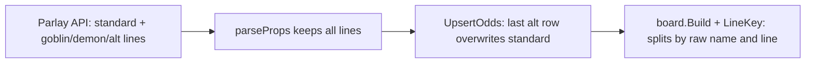
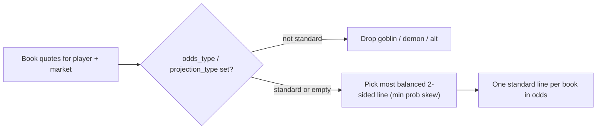

# Design: Show one standard line per player prop

## Context

Inspection of prod `odds` and archived Parlay API response `242` (`401873059`) shows why
`"Ollie Gordon O/U Rushing Yards"` rendered 2–3 times on a single card and displayed distorted medians (`152.5` for
PrizePicks, `89.5` for Novig, `95.5` for Bovada):

1. **Unfiltered alternate/goblin/demon lines overwrite standard lines:** `propResponse` in
   `internal/ingest/odds/props.go` ignores `odds_type` / `projection_type` (`"goblin"`, `"standard"`, `"demon"`).
   Because `odds` has primary key `(game_id, book, market_type, team, player_name, side)`, `UpsertOdds` overwrites
   earlier lines with whichever alternate line appeared last in the JSON array (`152.5` demon on PrizePicks, `89.5` on
   Novig, `95.5` on Bovada).
2. **Board pairing splits by raw name and line text:** `board.Build` (`internal/board/board.go`) groups by
   `(GameID, MarketType, Team, PlayerName, Side)` and `LineKey` keys player props on
   `Market|Team|Player|lineText(Line)`, so differing raw names or lines create multiple O/U rows under the same player
   card.

## Approach

### 1. Keep only the standard/primary line per book at ingest

In `internal/ingest/odds/props.go`:

- Extend `propResponse` with `OddsType string` (`json:"odds_type"`) and `ProjectionType string`
  (`json:"projection_type"`).
- **Explicitly tagged DFS lines:** When `odds_type` or `projection_type` is non-empty, accept only `"standard"`
  (case-insensitive) and drop `"goblin"`, `"demon"`, `"alt"`, etc.
- **Unlabeled multi-line books (e.g. Bovada, Novig):** When `parseProps` sees multiple quotes for the same
  `(book, market_type, normalized_subject)` in one response (excluding `ANYTIME_TD` which has no line), keep the single
  most balanced primary line:
  1. Two-sided quotes beat one-sided quotes.
  2. Among two-sided quotes, minimize `|impliedProb(over) - impliedProb(under)|` (closest to a 50/50 standard line,
     breaking ties toward `-110` / smallest `|over - under|`).
  3. Among one-sided quotes, pick the price closest to `-110`.
- Apply the same per-`(book, market_type, player, side)` primary-line filter after `MergeProps` (preferring linked lines
  from The Odds API when `MergeProps` enriches a book).

### 2. Group and pair board prop rows by canonical player + market

Building on `canonical-player-identity`:

- In `internal/board/board.go` (`Build`), group `odds` for player props by
  `(GameID, MarketType, canonicalPlayerKey, Side)` where `canonicalPlayerKey` is `PlayerID` when matched or
  `normalize(PlayerName) + "|" + Team` when unmatched.
- In `LineKey` / `Pair`, key player props on `(MarketType, canonicalPlayerKey)` rather than raw `PlayerName` and
  `lineText(Line)`:
  - `selectionPrice` picks the viewer's `homeBook` line and price when present, or the median line and median price
    across all books for that player + market + side.
  - Because `OVER` and `UNDER` share `(MarketType, canonicalPlayerKey)`, they always pair into **one** `LineGroup` row
    per player and market (even if `homeBook` only quoted one side or if books span `72.5`–`75.5`).
  - Keep `TOTAL` (game totals) keyed by `lineText(Line)` only if alternate totals exist, or keep existing game-line
    behavior untouched (`SPREAD`, `ML`, `TOTAL`, `TEAM_TOTAL`).

**Trade-off:** Showing an alternate-line picker or keeping all alternate lines in `odds` (adding `line` to the primary
key) would require schema changes, UI redesign for ladders, and would complicate median/export selection. Filtering to
the single standard line per book keeps the database small, fixes consensus medians immediately, and matches the product
focus on `"Player X O/U Stat Y"`.

## Verification

- Unit tests in `internal/ingest/odds/props_test.go` using real sanitized snippets from prod response `242` (PrizePicks
  goblin/standard/demon, Novig 6-line ladder, Bovada 5-line ladder) asserting `parseProps` outputs only the standard
  balanced line (`73.5` for PrizePicks/Novig, `75.5` for Bovada).
- Unit tests in `internal/board/board_test.go` verifying books with differing lines (`72.5` FanDuel, `73.5` HardRock,
  `75.5` DraftKings) and differing raw spellings collapse into **one** `O/U Rushing Yards` `LineGroup` on one player
  card.
- Standard check: `go test -race ./...` and `golangci-lint run`.

## Risks

- **One-sided lines or unusual vig on a book:** If a book prices an alt line near `-110` on one side only, preferring
  two-sided quotes first avoids picking a one-sided alt over the main two-sided O/U market.
- **Future provider field changes:** Live API watch tests (`live_test.go`) or archived responses can confirm if Parlay
  API introduces new `odds_type` values; unknown non-`"standard"` values are safely dropped when `odds_type` is present.

## TODO

Effort: medium (requires book-specific primary-line selection against real Parlay API shapes and updating board
grouping/pairing keys without breaking game lines)

### Phase 1: Filter non-standard lines in prop ingest

- [x] Parse `odds_type` / `projection_type` in `internal/ingest/odds/props.go`, drop non-`"standard"` DFS projections
      (`goblin`, `demon`), and pick the single balanced primary line when a book returns multiple unlabeled lines, with
      tests in `internal/ingest/odds/props_test.go` using prod payload shapes.

### Phase 2: Collapse board prop rows to one line per player market

- [x] Update `internal/board/board.go` (`Build`, `Pair`, `LineKey`) to group and pair player props by
      `(GameID, MarketType, canonicalPlayerKey)` so every player has at most one `LineGroup` per prop market, with tests
      in `internal/board/board_test.go` and `internal/web/pick_test.go`.
- [ ] Docs: update `docs/reference/data-sources.md` covering standard-line filtering and primary-line selection.
