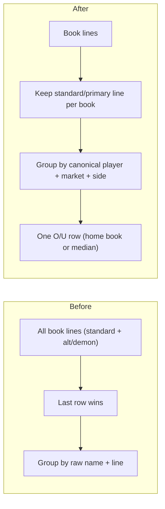

# Show one standard line per player prop

## Context

At launch, a single prop such as `"Ollie Gordon O/U Rushing Yards"` appeared 2–3 times on the same player card with the
same or slightly different lines and odds.

Inspection of prod data and archived Parlay API responses shows two causes:

1. **Line grouping keys on raw player name and line text:** Even when `"Ollie Gordon"` (`73.5`) and `"Ollie Gordon II"`
   (`75.5` / `72.5`) merge onto one player card, each raw name variant forms its own O/U line group instead of
   collapsing into one consensus/home-book row.
2. **Alternate, goblin, and demon lines overwrite standard lines:** In the archived response for `401873059`, PrizePicks
   returned 8 rushing-yard lines (`49.5` goblin to `152.5` demon, all priced `+100/-100`), Novig returned 6 (`59.5` to
   `89.5`), and Bovada returned 5 (`55.5` to `95.5`). Because stored odds hold one row per player/book/market/side,
   ingest overwrote earlier entries with whichever extreme alternate line appeared last (`152.5` for PrizePicks, `89.5`
   for Novig, `95.5` for Bovada), distorting the median line for the `5` of `6` users without a home book.

## Goals and non-goals

**Goals:**

- Show exactly one standard O/U prop row per canonical player and market on the pick board.
- Filter out non-standard (`goblin`, `demon`, and alternate) lines during prop ingest so they do not overwrite standard
  lines or skew consensus pricing.
- Compute the viewer's home-book or median price across all books offering that player's standard prop.

**Non-goals:**

- Adding an alternate-line or milestone ladder selector (e.g., 50+ / 80+ yards).
- Resolving moved lines on already-picked legs and sportsbook export links (covered by `dynamic-line-tracking`).

## Decision

Filter prop feeds to standard lines at ingest (rejecting `goblin`/`demon` tags and picking each book's primary balanced
line when a book returns multiple unlabeled alternates) and pair board rows by canonical player + market + side rather
than raw player name and line number.

Hiding extra rows only in the template would leave `152.5`-yard demon lines corrupting the stored medians. Filtering
non-standard lines at ingest and collapsing by canonical player + market solves both the noisy UI and the bad pricing
data.

The `effort` rating is `medium` because it requires analyzing real provider payload shapes across bookmakers to select
the primary line reliably and aligning ingest filtering with board pairing.
