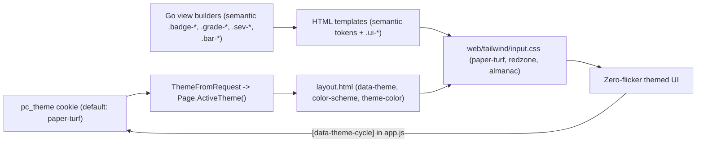

# Close-out

## Overview

## Consequences

- **Easier:** Tuning or trimming themes is isolated to CSS custom properties in `web/tailwind/input.css` and the three-entry allowlist in `internal/web/theme.go`, with no template conditionals or Go view-builder edits.
- **Easier:** Group members can compare `paper-turf`, `redzone`, and `almanac` live on phones via the top-bar switcher without server round-trips or database migrations.
- **Harder:** Templates must separate page/chrome tokens (`bg-page`, `text-page-ink`, `text-page-muted`) from card tokens (`bg-surface`, `text-ink`, `text-ink-muted`), because `paper-turf` pairs a dark felt page with light cream cards.
- **Harder:** Maintaining three palettes and `.ui-*` component styles increases CSS surface area and requires checking contrast on both light and dark themes when adding UI.
- **Revisit:** Remove the temporary `[data-theme-cycle]` top-bar button, the `app.js` cycling handler, and the two unchosen `[data-theme]` blocks once the group settles on a favorite.

## Alternatives considered

- **Duplicating HTML templates per theme:** Rejected because it multiplies layout maintenance; CSS custom properties keep one shared template set.
- **Server `POST /theme` route or database preference table:** Rejected because a client-written `pc_theme` cookie read by SSR gives instant switching with zero latency, no CSRF/HTMX plumbing, and no schema migration for a temporary switcher.
- **Bundling WOFF2 fonts in `web/static`:** Rejected for now to avoid bloating the embedded Go binary and git history with fonts for three experimental themes; Google Fonts (`display=swap`) falls back to system fonts offline.
- **Keeping the old `slate`/`sky` palette as a "Classic" theme:** Rejected because carrying a fourth token set would keep raw Tailwind palette habits around.
- **Patching around raw Tailwind classes in Go view builders:** Rejected because hardcoded color utilities break contrast across light and dark themes; semantic `.badge-*`, `.grade-*`, `.sev-*`, and `.bar-*` classes keep Go code theme-agnostic.

## Implementation notes

- The design omitted `.grade-f` and named `severityBadge` in `internal/web/analyzer.go`; implementation added `.grade-f` to `web/tailwind/input.css` and updated the actual `analyzerSeverity` helper.
- `[data-theme-cycle]` sits before `{{if .User}}` in `web/templates/layout.html` rather than inside the signed-in block so headered unauthenticated pages can also switch themes.
- Per-user avatar swatches (`db.AvatarColor.Class()`, including `bg-sky-500`) and `avatar.html` initials fallback (`text-zinc-950`) intentionally stay outside the theme token system so member identity colors remain stable across themes.
- Display and mono fonts (`Barlow Condensed`, `Space Grotesk`, `IBM Plex Mono`) load from Google Fonts; offline environments fall back to `system-ui` and `ui-monospace`.

## Follow-ups

- Remove the temporary `[data-theme-cycle]` switcher and the two losing themes after group feedback, and self-host the winning theme's fonts in `web/static` if desired.
- Spot-check all three themes on physical phones at 360–390px width across modals and secondary screens during Sunday games.
