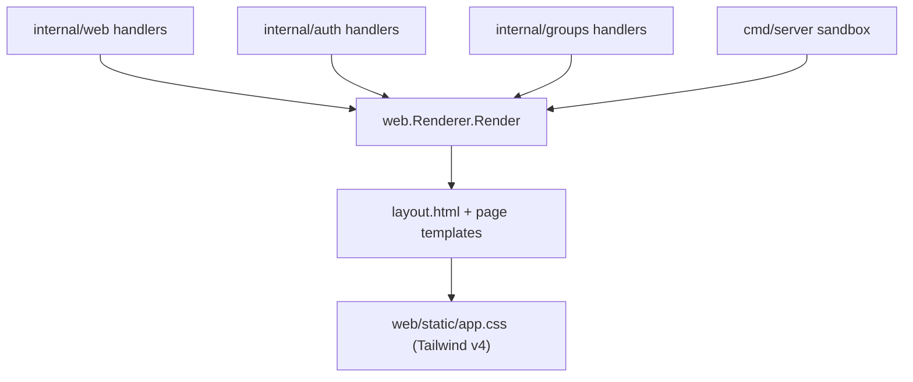
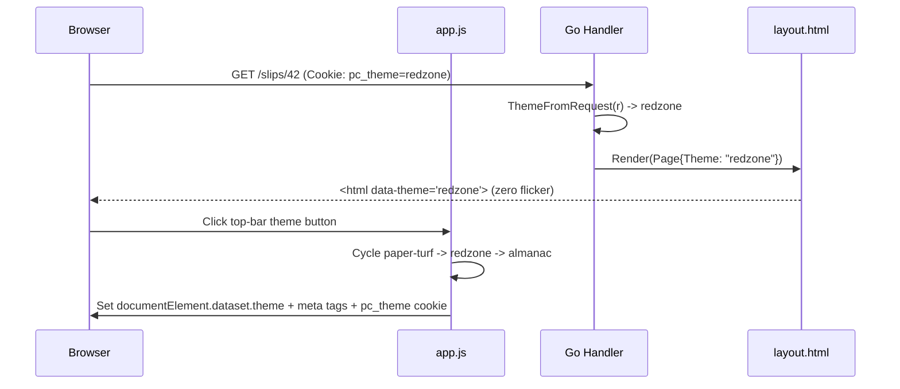

# Design: Semantic theme system and three selectable site styles

## Context

The UI is server-rendered Go `html/template` plus HTMX (`web/templates/*.html`, `web/static/app.js`) styled with Tailwind CSS v4 compiled via `go generate ./...` (`web/embed.go` runs `tailwindcss -i ./tailwind/input.css -o ./static/app.css --minify`).

Today, `web/tailwind/input.css` defines zero custom properties or theme tokens. Every page template hardcodes `slate-*` surfaces/borders/text and `sky-*` accents, and three Go handlers emit raw Tailwind class strings directly into view models:

- `internal/web/slips.go` (`resultClass`)
- `internal/web/analyzer.go` (`gradeClass`, `severityBadge`)
- `internal/web/research.go` (`ResultClass`, `badgeClass`)

Every full-page render flows through `Renderer.Render(name, data)` from four call sites (`internal/web`, `internal/auth`, `internal/groups`, `cmd/server/sandbox.go`), each embedding `web.Page`. `internal/web/layout.html` owns `<html>`, `<meta name="color-scheme">`, `<meta name="theme-color">`, the sticky top bar, and the fixed 3-tab bottom bar.



Constraints:
- Phone-first layout (`max-w-3xl` single column, `max-w-6xl` two-pane pick board at `lg`, fixed bottom nav) stays intact.
- Zero database migrations and zero new server routes for theme switching.
- User avatar colors (`db.AvatarColor.Class()`) remain per-user identity swatches and are not replaced by theme accents.

## Approach

### 1. Theme registry and cookie-backed SSR

Add `internal/web/theme.go` with a strict allowlist of three themes:

```go
const ThemeCookie = "pc_theme"

type ThemeID string

const (
	ThemePaperTurf ThemeID = "paper-turf" // default
	ThemeRedZone   ThemeID = "redzone"
	ThemeAlmanac   ThemeID = "almanac"
)

type Theme struct {
	ID          ThemeID
	Label       string // "Paper & Turf", "RedZone", "90s Almanac"
	ColorScheme string // "dark" or "light"
	ThemeColor  string // browser chrome tint
}
```

- `ThemeFromRequest(r *http.Request) Theme` reads `pc_theme`, validates against the allowlist, and falls back to `ThemePaperTurf`. Because it is a non-sensitive UI preference with a fixed 3-value allowlist, it does not need HMAC signing.
- Add `Theme ThemeID` to `web.Page` with a method `ActiveTheme() Theme` that defaults to `ThemePaperTurf` when empty—so existing tests constructing `web.Page{Title: ...}` keep working unchanged.
- Each full-page handler sets `Theme: web.ThemeFromRequest(r).ID` on `Page`.
- `layout.html` renders `<html lang="en" class="h-full" data-theme="{{.ActiveTheme.ID}}">`, `<meta name="color-scheme" content="{{.ActiveTheme.ColorScheme}}">`, and `<meta name="theme-color" content="{{.ActiveTheme.ThemeColor}}">`.



### 2. Top-bar theme switcher (temporary)

Add a compact button (`data-theme-cycle`) in the `layout.html` header right before the bug-report button, showing a small palette icon and the short active theme label (e.g. `Paper`, `RedZone`, `Almanac`) on `sm+` (icon-only with `aria-label` on narrow phones so the header never wraps).

`web/static/app.js` listens for `[data-theme-cycle]` clicks, cycles `paper-turf -> redzone -> almanac -> paper-turf`, updates `document.documentElement.dataset.theme`, updates `<meta name="color-scheme">` and `<meta name="theme-color">`, updates the button label/title, and writes `pc_theme=<id>; Path=/; Max-Age=31536000; SameSite=Lax` (adding `; Secure` over HTTPS).

Removing or moving the switcher later is isolated to one button in `layout.html` and one handler block in `app.js`.

### 3. Semantic CSS token layer (`web/tailwind/input.css`)

Define Tailwind v4 `@theme` color and font tokens backed by CSS custom properties so templates use semantic utilities (`bg-page`, `bg-surface`, `bg-surface-2`, `text-ink`, `text-ink-muted`, `text-ink-subtle`, `border-line`, `border-line-strong`, `bg-accent`, `text-accent`, `text-accent-ink`, `bg-positive`, `bg-warning`, `bg-danger`, `font-display`, `font-mono`):

| Token group | `paper-turf` (default) | `redzone` | `almanac` |
| --- | --- | --- | --- |
| Page / chrome | Deep stadium felt (`#14261c` / `#0f1e16`) | True obsidian (`#090a0c` / `#111317`) | Warm cream (`#fff8e7` / `#ffd60a`) |
| Card surface | Warm ticket paper (`#faf6ee`) on dark felt | Charcoal panel (`#121419` / `#181b22`) | Crisp white (`#ffffff`) |
| Primary ink | Deep espresso (`#1c1917`) on paper; warm ivory on felt | Crisp zinc (`#f4f4f5`) | Solid black (`#111111`) |
| Accent | Amber/gold (`#d97706`) & turf green (`#15803d`) | Turf green (`#22c55e`) & broadcast gold (`#facc15`) | Black ink on yellow (`#ffd60a`) / mint (`#a7f3d0`) |
| Borders & radii | Soft 6–10px radii, dashed ticket dividers, circular notches | Sharp 4–6px corners, 1px hairlines, 2px top accent bar | 2px solid ink borders, 8–10px radii, 4px hard offset shadows |
| Display / mono | Inter + IBM Plex Mono | Barlow Condensed uppercase + IBM Plex Mono | Space Grotesk bold + IBM Plex Mono |

Because `paper-turf` pairs a dark felt page chrome (`topbar`, `bottom-nav`, `next-banner`, `record-strip`) with light cream ticket cards (`slip-card`), `input.css` exposes separate **chrome** tokens (`--chrome-bg`, `--chrome-ink`, `--chrome-muted`, `--chrome-border`) and **card** tokens (`--surface`, `--surface-2`, `--ink`, `--ink-muted`, `--border`). In `redzone` and `almanac`, chrome and card tokens harmonize naturally without special-casing templates.

Theme-scoped component classes in `input.css` handle the structural flourishes without duplicating HTML:
- `.ui-card` / `.ui-slip-card` (perforated dashed seam + side notches in `paper-turf`; sharp scorebug panel in `redzone`; 2.5px border + hard shadow in `almanac`)
- `.ui-next-card` (felt banner in `paper-turf`; green-left-bar gradient in `redzone`; mint brutalist card in `almanac`)
- `.ui-odds` (mono tabular pill/chip for every American odd and line)
- `.ui-stamp` (tilted rubber-stamp border in `paper-turf`; condensed broadcast tag in `redzone`; bordered badge in `almanac`)
- `.ui-heads-up` (friendly analyzer warning callout)
- Semantic badge/bar classes replacing Go's raw Tailwind strings: `.badge-won`, `.badge-lost`, `.badge-push`, `.badge-void`, `.badge-pending`, `.grade-a`, `.grade-b`, `.grade-c`, `.grade-d`, `.grade-neutral`, `.sev-danger`, `.sev-warn`, `.sev-info`, `.bar-hit`, `.bar-miss`, `.bar-push`, `.bar-neutral`, `.trend-up`, `.trend-down`, `.trend-flat`.

Fonts (`Barlow Condensed`, `Space Grotesk`, `IBM Plex Mono`) load via Google Fonts `<link rel="stylesheet" ... display=swap>` in `layout.html` with clean system fallbacks (`system-ui`, `ui-monospace`) so offline/dev environments and tests never break.

### 4. Trade-offs and rejected options

- **Client-side cookie + SSR read vs. POST `/theme` route:** Writing `pc_theme` in `app.js` and reading it on every Go request gives instant switching with zero latency and zero new routes. A server route would add round-trip delay and CSRF/HTMX plumbing for a temporary switcher.
- **Google Fonts `display=swap` vs. bundling WOFF2 in `web/static`:** Bundling fonts would grow the embedded Go binary and git repo for three experimental themes; Google Fonts keeps the repo lean and falls back cleanly when offline. Once a single winning theme is chosen later, self-hosting its font is trivial.
- **Removing `Classic` vs. keeping it:** Dropping the old slate/sky palette avoids carrying a 4th theme's token set and forces clean separation from raw Tailwind colors.

## Verification

- Standard checks after each phase: `go generate ./... && golangci-lint run ./... && go test -short ./...`
- **SSR & cookie behavior:**
  - Request with no `pc_theme` cookie renders `data-theme="paper-turf"`, `color-scheme="dark"`, and `paper-turf` `theme-color`.
  - Request with `pc_theme=redzone` or `pc_theme=almanac` renders matching `data-theme`, `color-scheme`, and `theme-color`.
  - Request with an invalid/tampered `pc_theme=evil` cookie safely falls back to `paper-turf`.
- **No raw palette leakage:** `rg "bg-slate|text-slate|border-slate|bg-sky|text-sky|border-sky" web/templates/ internal/web/` returns zero non-test hits (excluding `db.AvatarColor` swatches).
- **Visual & phone-width spot-check (local dev / sandbox):**
  - Open Slip, Pick Board, Research, Record Book, Groups, and Login at 390px phone width and desktop width.
  - Cycle through all three themes via the top-bar button, reload the page, and confirm the chosen theme persists with zero flash and legible contrast on cards, inputs, dialogs (`leg-sheet`, `pick-swap`, `pick-tray-sheet`, bug report modal), grades, and Parlay Terrorist badges.

## Risks

- **Contrast regressions in `paper-turf`:** Because `paper-turf` mixes dark felt page chrome with light cream card surfaces, text placed directly on the page background (headings, helper subtitles, empty states) must use page-ink tokens (`text-page-ink` / `text-page-muted`), while text inside cards uses card-ink tokens (`text-ink` / `text-ink-muted`). Mitigated by separating page-chrome and card tokens from Phase 1 and spot-checking empty states and form pages.
- **Test assertions coupled to Tailwind classes:** Several existing tests (`analyzer_test.go`, `research_test.go`, `pick_test.go`, `slips_test.go`) assert exact Tailwind class strings. Mitigated by updating those tests in the same phase that replaces the classes with semantic tokens.
- **Top-bar crowding on narrow phones (360–390px):** Adding the theme button alongside group switcher, week label, slip switcher, bug button, and avatar could crowd the header. Mitigated by keeping the switcher compact (icon-only below `sm`, short label from `sm` up).

## TODO

### Phase 1: Theme registry, cookie plumbing, and CSS token foundation

Complexity: medium (coordinates Go theme registry across four handler packages, root layout SSR attributes, client-side cookie switcher, and the three-theme Tailwind v4 CSS token layer).
Risk: low (additive token layer and allowlisted cookie read; existing templates remain valid and tests verify fallback behavior).

- [x] Add `internal/web/theme.go` (`ThemeID`, `Theme`, allowlist for `paper-turf`, `redzone`, `almanac`, `ThemeCookie`, `ThemeFromRequest`) and `Page.Theme` / `Page.ActiveTheme()` in `internal/web/page.go`; wire `ThemeFromRequest(r)` in `internal/web`, `internal/auth`, `internal/groups`, and `cmd/server/sandbox.go`, with unit tests covering default, valid, and invalid cookies plus `layout_test.go` SSR assertions.
- [x] Define the semantic `@theme` tokens, three `[data-theme="..."]` palettes (`paper-turf`, `redzone`, `almanac`), and shared component/badge classes in `web/tailwind/input.css`; add Google Fonts links, `data-theme`/`color-scheme`/`theme-color` attributes, and the compact top-bar `[data-theme-cycle]` button in `web/templates/layout.html`; implement instant theme cycling and `pc_theme` cookie persistence in `web/static/app.js`; regenerate `web/static/app.css`.

### Phase 2: Semantic status, grade, and result roles in Go view builders

Complexity: medium (replaces raw Tailwind color class strings emitted by server view builders across slips, analyzer, and research with theme-aware semantic classes).
Risk: low (isolated to three view-model helpers and their existing unit/handler test assertions).

- [x] Replace raw Tailwind class strings in `internal/web/slips.go` (`resultClass`), `internal/web/analyzer.go` (`gradeClass`, `severityBadge`), and `internal/web/research.go` (`ResultClass`, `badgeClass`) with semantic CSS classes defined in Phase 1, and update the corresponding assertions in `internal/web/slips_test.go`, `internal/web/analyzer_test.go`, and `internal/web/research_test.go`.

### Phase 3: Migrate shell, slip, and pick-board templates to semantic tokens

Complexity: medium (migrates the primary daily screens—layout chrome, home, week, slip hub, pick board, and shared HTMX partials—while preserving phone-first layout, dialog sheets, and theme-specific slip/scorebug/brutalist treatments).
Risk: low (presentational template updates verified by existing render, layout, slip, and pick tests).

- [x] Migrate `web/templates/layout.html`, `home.html`, `week.html`, `avatar.html`, and `media.html` from hardcoded `slate`/`sky` utilities to semantic page-chrome and card tokens, keeping `internal/web/layout_test.go` and `routes_test.go` passing.
- [ ] Migrate `web/templates/slip.html`, `pick.html`, and `partials.html` (Next banner, slip ticket card, member legs, mono odds chips, vote pills, analyzer heads-up, payout/wager, pick slate/detail/dock, and modal dialogs) to semantic tokens and component classes, update exact-class assertions in `internal/web/pick_test.go` and `analyzer_test.go`, and regenerate `web/static/app.css`.

### Phase 4: Migrate secondary screens and verify zero raw palette leakage

Complexity: low (pattern-following token migration across the remaining standalone templates using the semantic tokens and component classes established in Phases 1–3).
Risk: low (secondary templates covered by existing handler tests and a grep check for leftover raw palette classes).

- [ ] Migrate `web/templates/record.html`, `research.html`, `analyzer_guide.html`, and `analyzer_results.html` to semantic tokens (including tabular mono stats, Parlay Terrorist stamp badge, and hit/miss bar classes) and update exact-class assertions in `internal/web/research_test.go`.
- [ ] Migrate `web/templates/groups.html`, `profile.html`, `join.html`, `login.html`, `dev-login.html`, and `sandbox.html` to semantic tokens, verify zero leftover raw `slate-*`/`sky-*` classes in `web/templates/` and `internal/web/` (excluding avatar swatches), and regenerate `web/static/app.css`.
- [ ] Docs: document the `pc_theme` cookie and semantic theme token convention in `docs/reference/routes.md` (or the relevant UI/reference doc) and run `good-vibes docs lint`.
