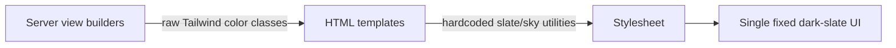
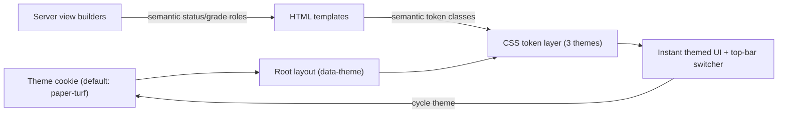

# Semantic theme system and three selectable site styles

## Context

Every screen in Sunday Parlay Club uses default Tailwind dark-mode slate (`slate-950`/`slate-900`) and `sky` accents with system sans-serif typography. The app works, but it looks like a generic developer dashboard rather than a Sunday NFL hangout with friends.

Worse, there is no design-token layer. Raw palette classes are hardcoded across all page templates and even emitted as style strings by several server-side view builders. Trying a new visual direction—or letting the group compare styles before committing—currently requires scattered find-and-replace edits across templates and Go code.

## Goals and non-goals

**Goals:**

- Replace the current dark-slate style completely with a semantic design-token layer (surfaces, ink, borders, accents, status/grade semantics, radii, and typography).
- Ship three cohesive, phone-first themes built on those tokens:
  1. **Paper & Turf** (default): tactile betting-ticket feel—warm cream slip cards on deep stadium-felt dark green, monospace odds, perforated slip dividers, and stamp-style status badges.
  2. **Sunday RedZone**: broadcast scorebug aesthetic—true neutral obsidian dark surfaces so team logos and portraits pop, condensed uppercase display headings, crisp corners, and turf-green/gold accents.
  3. **90s Almanac**: playful neo-brutalist style—high-contrast light surfaces, 2px ink borders, hard offset shadows, chunky vote pills, and bold Record Book badges.
- Add a lightweight theme switcher in the top bar so group members can cycle between all three themes immediately and share feedback, with the choice persisted so the server renders the active theme on first paint without flicker.
- Keep theme switching easy to trim down later: once the group settles on a favorite, removing the other themes or moving/deleting the top-bar switcher should be a small cleanup.

**Non-goals:**

- Keeping the old slate/sky look as a "Classic" theme option.
- Restructuring page layouts, navigation tabs, or user flows.
- Building a custom color picker, per-group branding, or a database-backed theme preference table.
- Adding a frontend JS framework or heavy client-side styling runtime.

## Decision

Introduce a CSS custom-property token layer driven by a single theme attribute on the root document, migrate templates and view models from raw palette utilities to semantic roles, and expose a temporary top-bar switcher backed by a browser cookie.

**Before:**

**After:**

Using one shared template set with CSS tokens beats duplicating templates per style because every screen stays maintainable and switching themes costs zero runtime JS and zero extra requests. Shipping all three styles behind a temporary top-bar switcher beats picking one blind because real group feedback on phones during Sunday games is faster and cheaper than guessing. Dropping raw Tailwind color classes from server view builders beats patching around them because grades and statuses need to stay readable across both light and dark themes.

**Complexity (`medium`):** Coordinates across the stylesheet token system, all HTML templates, layout chrome, and the server view builders that currently emit raw color classes, while requiring visual and contrast judgment across three distinct light/dark aesthetics at phone width.

**Risk (`low`):** The change is purely presentational with no database migrations, auth changes, or betting/grading logic changes; existing handler and template render tests catch broken markup, and visual issues are isolated to CSS tokens.
