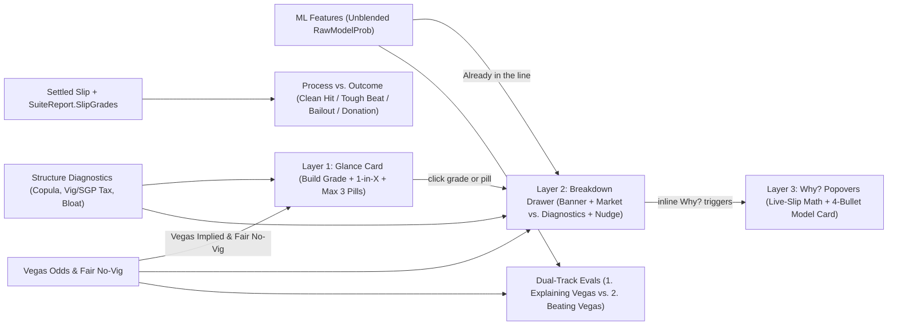

# Close-out

## Overview

## Consequences

- **Easier:** Testing whether the prop model understands Vegas lines before trying to beat them, because `RawModelProb` is now preserved unblended and scored separately in `MarketExplanationMetrics` and `MarketBeatingMetrics`.
- **Easier:** Explaining betting math with a user's real slip numbers, since `BuildDiagnostics`, `parlay.FormatImpliedReality`, and Layer 3 popovers are pure server-rendered Go.
- **Easier:** Backfilling Process vs. Outcome badges onto historical settled slips in `/slips/{id}` and `/record` without a SQLite migration, via `SuiteReport.SlipGrades`.
- **Harder:** Maintaining theme palettes, because all four themes (`paper-turf`, `redzone`, `almanac`, `connor-mode`) must keep dedicated `--grade-clean*` and `--grade-solid*` tokens separated from `--positive`.
- **Harder:** Keeping Layer 1 slip cards compact at 375px phone width now that grades show a 2-word descriptor, `1 in X` reality copy, and up to 3 Signal Pills.
- **Revisit:** Revisit the `AlphaGatePassed` bar (`SampleCount >= 250 && LogLossSkill > 0 && FlatROI > 0`) and add Closing Line Value (CLV) once closing sharp lines are stored.

## Alternatives considered

- **Adding a disclaimer footer to green `A` grades:** Rejected because users read a green `A (91)` visually as a predictive lock and ignore fine print.
- **Removing grades or the ML model:** Rejected because structural checks (script conflicts, SGP correlation tax, heavy-chalk bloat) and priced-in context notes help users spot bad builds.
- **Replacing `EngineV2` scoring math now:** Rejected to keep this change focused on framing, diagnostics, and eval separation instead of mixing in model retraining.
- **Adding a SQLite column for pre-kickoff slip grades:** Rejected in favor of `SuiteReport.SlipGrades` in `eval.Cache`, avoiding a schema migration while backfilling settled slips.
- **Computing Layer 3 live examples in client-side JS:** Rejected to keep all odds math deterministic, unit-testable, and server-rendered in Go.

## Implementation notes

- `ClassifyProcessOutcome(letter, won bool)` could not represent pushes or voids on its own, so `ClassifyProcessResult(letter, parlay.Result)` was added to return zero values for `Push`, `Void`, `Pending`, and `NeedsGrading`.
- One-way markets (such as `ANYTIME_TD`) and games lacking sharp quotes have `MarketProb == 0`; `MarketExplanationMetrics` skips those legs instead of comparing `RawModelProb` against zero.
- Settled-slip Process vs. Outcome badges depend on `eval.Cache` (`SuiteReport.SlipGrades`); slips missing from the cached replay render only their settled result.
- Go template and CSS token tests verify markup and non-green grade rules, but 375px layout ergonomics and visual contrast across all four themes still rely on manual browser checks.

## Follow-ups

- Capture closing sharp lines at kickoff and add Closing Line Value (CLV) to `MarketBeatingMetrics`.
- Persist pre-kickoff `BuildDiagnostics` at slip lock time if `eval.Cache` replay misses live-only slips or grows too slow.
- Calibrate or retrain the prop model against `MarketExplanationMetrics` (Explaining Vegas) before targeting `AlphaGatePassed` (Beating Vegas).
