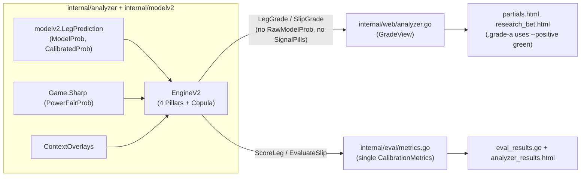
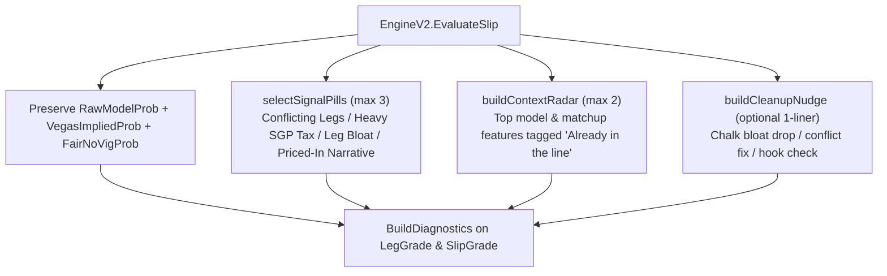
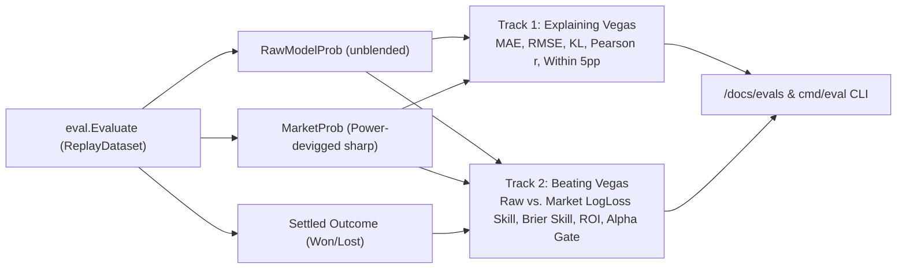
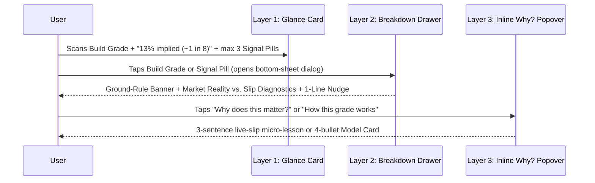

# Design: Reframe grades around slip construction and market reality

## Context

`internal/analyzer` owns pure, deterministic slip warnings (`AnalyzeSlip`) and grading (`ScoreLeg`, `ScoreSlip`,
`EvaluateSlip`). Today `ActiveEngine` is `EngineV2` (`internal/analyzer/grade_v2.go`), which wraps three components:

- `internal/modelv2`: embedded GBDT prop distributions (`v2.json.gz`) returning both standalone `ModelProb` and
  market-blended `BlendedProb` / `CalibratedProb`, plus a deterministic QMC Gaussian copula (`CopulaArtifact`).
- `internal/analyzer/sharp.go` and `internal/parlay/devig.go`: Power/Shin two-way de-vigging over cached sharp and
  consensus books (`Game.Sharp`).
- `internal/analyzer/overlays.go`: 12 extensible `ContextOverlay` checks (injuries, wind, hooks, shrinking role,
  narrative streak traps, model-market divergence, and external signals).



Four technical gaps block the new framing:

1. `LegGrade` drops the standalone unblended `ModelProb` after blending `0.70 * p_market + 0.30 * p_model`, so neither
   the UI nor `internal/eval` can measure how closely the raw model explains Vegas odds.
2. `GradeView` exposes only `CalibratedProb` as unlabeled `Hit chance`, labels `Price & Vig` as `Strong value` /
   `Fair value`, and maps `.grade-a` to `--positive` (green) across all four themes in `web/tailwind/input.css`
   (`paper-turf`, `redzone`, `almanac`, `connor-mode`).
3. Inline `<details>` grade breakdowns link out to `/docs/grading` via `?` bubbles instead of rendering contextual
   live-slip popovers and a Model Card.
4. `eval.Report` computes a single blended `CalibrationMetrics` and `BandStats` view without separating
   **Explaining Vegas** (matching market prices) from **Beating Vegas** (market skill and CLV), and `SuiteReport`
   exposes `LegGrades` but not `SlipGrades` for settled-slip badges.

## Approach

Keep `EngineV2`'s underlying math (Power/Shin de-vigging, GBDT prop distributions, Empirical Bayes shrinkage, QMC
Gaussian copula, and context overlays) intact. Extend its output structs with explicit structural diagnostics and
provenance fields, split `internal/eval` into two explicit scorecards, and replace the grade presentation across all
phone-first surfaces with a 3-layer progressive-disclosure UX.

### 1. Core build-grade diagnostics and provenance (`internal/analyzer`, `internal/parlay`)

Add human-probability formatting to `internal/parlay` (`FormatImpliedReality(prob float64) string`, e.g.,
`"13% implied (hits ~1 in 8 times)"`, handling `<1%` and `>99%` bounds cleanly).

Extend `LegGrade` and `SlipGrade` in `internal/analyzer/grade.go` with additive fields (keeping `Letter`, `Score`,
`Pillars`, `CalibratedProb`, `MarketProb`, `CorrMultiplier`, `Uncertain`, and `Factors` intact for backwards
compatibility):

```go
type SignalPill struct {
    Key      string // "conflicting_legs", "heavy_sgp_tax", "leg_bloat", "priced_in_narrative", ...
    Icon     string // compact symbol token
    Label    string // e.g. "Conflicting Legs", "Heavy SGP Tax", "Leg Bloat", "Priced-In Narrative"
    Tone     string // "warn" | "bad" | "info"
    Target   string // Layer 2 diagnostic row anchor ("synergy", "book_cut", "hit_rate", "context")
    Detail   string // 1-sentence plain-English summary for drawer focus
}

type ContextNote struct {
    Label     string // e.g. "Opponent allows top-5 TE yards"
    PricedIn  string // e.g. "Vegas knows this; the line is already bumped up"
    Tag       string // "Already in the line" | "Likely Priced In"
}

type BuildDiagnostics struct {
    DisplayGrade     string        // e.g. "A-", "B", "C-", "D", "F"
    Descriptor       string        // 2-word reality check: "Tight Build", "Clean Build", "Longshot", "Vig Trap", "Self-Sabotage"
    VegasImpliedProb float64       // 1 / decimalOdds (or combined independent decimal odds)
    FairNoVigProb    float64       // Power-devigged fair prob when sharp/consensus exists (0 if unavailable)
    RawModelProb     float64       // standalone unblended model prob (0 when no model ran)
    HoldPct          float64       // estimated sportsbook vig/hold %
    CorrTaxPct       float64       // SGP payout shave vs. independent math (0 when not an SGP or no tax)
    SignalPills      []SignalPill  // capped at 3, ordered by severity
    ContextRadar     []ContextNote // capped at 2, sourced from top model/matchup features
    CleanupNudge     string        // optional 1-line concrete structural improvement
}
```



- **Descriptor mapping:** Derives `DisplayGrade` (`+`/`-` subdivisions within A–F bands) and a 2-word structural
  descriptor from the dominant diagnostic driver rather than score alone (for example, a D driven by `Price & Vig`
  becomes `D • Vig Trap`; a C driven by low implied hit rate becomes `C- • Longshot`; an F with a `Danger` script
  conflict becomes `F • Self-Sabotage`; a clean A becomes `A- • Tight Build` or `A • Clean Build`).
- **Cleanup nudge:** Deterministically inspects the worst structural drag—such as a heavy chalk leg (`<= -230`) where
  dropping it removes a failure point for minimal payout loss
  (`"Dropping the -450 leg cuts your payout by 12% but removes an extra way to lose"`), or a conflicting leg pair—and
  omits the line when a slip is already clean.
- **Process vs. Outcome classifier:** Add `ClassifyProcessOutcome(letter string, won bool) ProcessOutcome` in
  `internal/analyzer`:
  - `A`–`B` + Won → `Clean Hit` ("Solid math, paid off.")
  - `A`–`B` + Lost → `Tough Beat` ("Good process, bad variance. Don't tilt.")
  - `C`–`F` + Won → `Total Bailout` ("Awful structure, got lucky. Enjoy the cash.")
  - `C`–`F` + Lost → `Book Donation` ("The exact trap we flagged hit.")

### 2. Dual-track evals: Explaining Vegas vs. Beating Vegas (`internal/eval`, `cmd/eval`, `internal/web/eval_results.go`)

Extend `eval.Report` with two explicit structs computed alongside existing `CalibrationMetrics`:

```go
// MarketExplanationMetrics measures how closely the standalone unblended model
// reproduces de-vigged Vegas/sharp market probabilities (match Vegas first).
type MarketExplanationMetrics struct {
    SampleCount       int     `json:"sample_count"`
    MeanAbsError      float64 `json:"mean_abs_error"`       // mean |RawModelProb - MarketProb|
    RMSE              float64 `json:"rmse"`                 // sqrt(mean((RawModelProb - MarketProb)^2))
    MeanKLDivergence  float64 `json:"mean_kl_divergence"`   // D_KL(Market || RawModel)
    CorrelationR      float64 `json:"correlation_r"`        // Pearson r(RawModelProb, MarketProb)
    Within5ppRate     float64 `json:"within_5pp_rate"`      // share with |RawModelProb - MarketProb| <= 0.05
}

// MarketBeatingMetrics measures whether the standalone or blended model beats
// the sharp market baseline (objective alpha gate).
type MarketBeatingMetrics struct {
    SampleCount     int     `json:"sample_count"`
    RawModelLogLoss float64 `json:"raw_model_log_loss"`
    BlendedLogLoss  float64 `json:"blended_log_loss"`
    MarketLogLoss   float64 `json:"market_log_loss"`
    LogLossSkill    float64 `json:"log_loss_skill"`   // MarketLogLoss - RawModelLogLoss (>0 beats market)
    BrierSkill      float64 `json:"brier_skill"`      // MarketBrier - RawModelBrier (>0 beats market)
    FlatROI         float64 `json:"flat_roi"`
    AlphaGatePassed bool    `json:"alpha_gate_passed"` // SampleCount >= 250 && LogLossSkill > 0 && FlatROI > 0
}
```



Also add `SuiteReport.SlipGrades(engineName string) map[int64]string` (mirroring `LegGrades`) so settled slips on
`/record` and `/slips/{id}` can look up their leak-free pre-kickoff Build Grade from `eval.Cache` with zero schema
changes.

### 3. Semantic colors and 3-layer progressive disclosure UX (`web/tailwind`, `internal/web`, `web/templates`)

**Color semantics across all four themes (`paper-turf`, `redzone`, `almanac`, `connor-mode`):**

- Add dedicated CSS custom properties `--grade-clean` / `--grade-clean-soft` / `--grade-clean-ink` (teal/slate) and
  `--grade-solid` / `--grade-solid-soft` / `--grade-solid-ink` (slate/blue) to every theme block in
  `web/tailwind/input.css`.
- Remap `.grade-a` to `--grade-clean*`, `.grade-b` to `--grade-solid*`, `.grade-c` to `--warning*` (amber), and
  `.grade-d` / `.grade-f` to `--danger*` (coral/rose). Reserve `--positive*` (green) strictly for actual settled wins
  and `Clean Hit` outcome stamps.

**3-layer progressive disclosure (phone-first, 375px safe):**



- **Layer 1 (Slip card, pick tray, highlights, research):** Shows Build Grade + 2-word descriptor, human probability
  first (`13% implied · ~1 in 8`, tagged `Vegas Implied`) with American odds secondary, and up to 3 clickable Signal
  Pills. Highlights strip (`highlights-strip`) reframes copy from "Top A-grade ideas" to "Cleanest builds on the board"
  using the new non-green tokens.
- **Layer 2 (Breakdown Drawer):** Clicking the Build Grade or any Signal Pill opens a phone-friendly `<dialog>` drawer
  (reusing the `.leg-sheet` bottom-sheet pattern already in `partials.html`) containing:
  1. Pinned 1-sentence Ground-Rule Banner.
  2. Visually separated **Market Reality** box (`Vegas Implied`, `Fair No-Vig Est.`, hold/vig) vs. **Slip Diagnostics**
     list (Hit-Rate Realism bar from "Coin Flip" to "Lottery Ticket", Leg Synergy, The Book's Cut / Correlation Tax, and
     Context Radar with `Model Context` + `Already in the line` pills).
  3. Optional 1-line "What would make this cleaner?" structural nudge.
- **Layer 3 (Contextual "Why?" Popovers):** Inline `<details>`/popover triggers directly inside Layer 2 for
  `Implied Probability`, `Vig / Hold`, `Correlation Tax`, `Already in the line`, and `How this grade works` (4-bullet
  Model Card). Every explanation interpolates the current slip's live numbers (rendered server-side by Go templates,
  requiring minimal progressive-enhancement JS only for drawer open/close and pill focus).

### 4. Trade-offs and rejected options

- **Replacing `EngineV2` scoring math now:** Rejected. The v2 copula, de-vigging, and overlay stack already computes the
  structural signals we need; replacing the math would mix a UX/framing change with a model retraining change.
- **Persisting pre-kickoff slip grades in a new SQLite column:** Rejected for now. `eval.Cache` already reconstructs
  leak-free pre-kickoff grades for settled slips (just as `/record` already uses `SuiteReport.LegGrades`). Reusing
  `SuiteReport.SlipGrades` avoids a migration and backfills historical settled slips automatically.
- **Client-side JS math for Layer 3 live examples:** Rejected. Rendering live-example copy in Go view models keeps all
  odds math deterministic, unit-testable, and consistent with `AGENTS.md`.

## Verification

- Standard build, generate, lint, and unit/race tests:
  `go generate ./... && golangci-lint run ./... && go test -race ./...`
- **Analyzer & math verification:** Unit tests verify `RawModelProb` is preserved unblended, `BuildDiagnostics` caps
  Signal Pills at 3 and Context Radar at 2, descriptors match dominant traps (`Vig Trap`, `Longshot`, `Self-Sabotage`,
  `Tight Build`), `CleanupNudge` computes accurate payout impact when dropping heavy chalk, and `ClassifyProcessOutcome`
  covers all 4 matrix cells plus ungraded/push edge cases.
- **Dual-track eval verification:** Unit tests in `internal/eval` verify `MarketExplanation` (MAE, RMSE, KL, Pearson r,
  Within 5pp) is zero-error when `RawModelProb == MarketProb` and degrades cleanly when divergent, `MarketBeating`
  distinguishes raw-model skill from blended skill and keeps `AlphaGatePassed == false` below sample/skill thresholds,
  and `cmd/eval` prints both tracks clearly on the benchmark fixture.
- **UI & guardrail verification:** Template/handler tests across slip hub, pick tray, highlights, bet research,
  `/docs/evals`, and `/record` assert:
  - `.grade-a` never references `--positive` in any of the 4 themes.
  - Every displayed probability/estimate carries an explicit provenance label (`Vegas Implied`, `Fair No-Vig Est.`, or
    `Model Context`) and human `1 in X` phrasing before American odds.
  - Layer 2 renders the Ground-Rule Banner, separated Market Reality vs. Slip Diagnostics, `Already in the line` tags,
    and inline Layer 3 popovers with live slip numbers and the 4-bullet Model Card.
  - Settled slips render `Clean Hit`, `Tough Beat`, `Total Bailout`, or `Book Donation` badges.

## Risks

- **Theme contrast regressions across 4 themes:** Adding new cool/neutral grade tokens across `paper-turf`, `redzone`,
  `almanac`, and `connor-mode` could hurt text contrast on dark vs. light cards. Mitigation: define explicit border,
  soft-bg, and ink triples per theme and assert non-empty token definitions in CSS tests.
- **Phone-width overflow on Layer 1 cards and Layer 2 drawers:** Adding descriptor text, `1 in X` reality copy, and up
  to 3 Signal Pills could crowd 375px cards. Mitigation: keep Layer 1 chips wrapping cleanly (`flex-wrap`), cap pills at
  3, and place full diagnostics in the scrollable `.leg-sheet` drawer.
- **Misinterpreting `RawModelProb` when sharp benchmarks are absent:** On one-way markets (`ANYTIME_TD`) or games
  without sharp quotes, `MarketProb` is 0; `MarketExplanation` must skip legs lacking a de-vigged sharp benchmark rather
  than comparing against `0` and skewing MAE/RMSE.

## TODO

### Phase 1: Core build-grade diagnostics, provenance math, and Process vs. Outcome classifier

Complexity: medium (coordinates new diagnostic structs, pill prioritization, cleanup-nudge simulation, and raw-model
probability propagation across `internal/parlay` and `internal/analyzer` without breaking existing `EngineV2` or
`EngineV1` contracts)

Risk: low (pure deterministic Go logic with zero I/O or schema changes, fully covered by unit tests)

- [x] Add human-first implied probability helpers (`FormatImpliedReality` / `1 in X`) in `internal/parlay` and propagate
      unblended `RawModelProb`, `VegasImpliedProb`, `FairNoVigProb`, and `BuildDiagnostics` (2-word descriptor, max 3
      `SignalPills`, max 2 `ContextRadar` notes tagged priced-in, and optional 1-line `CleanupNudge`) onto `LegGrade`
      and `SlipGrade` in `internal/analyzer`, with comprehensive unit tests.
- [x] Add `ClassifyProcessOutcome` (`Clean Hit`, `Tough Beat`, `Total Bailout`, `Book Donation`) in `internal/analyzer`
  with tests covering all 4 matrix states and ungraded/push edge cases.
- [x] Docs: add `Build grade`, `Correlation tax`, and `Process vs. Outcome` terms to `GLOSSARY.md`.

### Phase 2: Dual-track evals — Explaining Vegas vs. Beating Vegas

Parallel: surfaces

Complexity: medium (extends `internal/eval` metrics, `SuiteReport.SlipGrades`, `cmd/eval` CLI output, and `/docs/evals`
view models to separate raw-model market explanation from market-beating skill)

Risk: low (read-only evaluation and reporting code backed by deterministic replay tests and the benchmark fixture)

- [x] Add `MarketExplanationMetrics` (MAE, RMSE, KL divergence, Pearson r, within-5pp rate on `RawModelProb` vs.
      `MarketProb`) and `MarketBeatingMetrics` (raw vs. blended vs. market log loss, skill scores, ROI, and
      `AlphaGatePassed`) plus `SuiteReport.SlipGrades` in `internal/eval`, with unit tests verifying zero-error
      matching, missing-benchmark skipping, and alpha-gate thresholds.
- [x] Surface both "1. Explaining Vegas (Match First)" and "2. Beating Vegas (Alpha Gate)" scorecards in `cmd/eval`
      output and on `/docs/evals` (`internal/web/eval_results.go` and `web/templates/analyzer_results.html`), with
      handler and render tests.

### Phase 3: Semantic grade colors and 3-layer progressive disclosure UI

Parallel: surfaces

Complexity: high (coordinates CSS theme tokens across 4 themes, view-model provenance/live-popover builders, and 3-layer
Glance → Drawer → Inline Why? UX across slip hub, pick tray, highlights, bet research, and grading guide at 375px phone
width)

Risk: medium (changes primary user-facing grade styling and interactive drawer/popover flows where DOM ergonomics and
visual contrast are only partially covered by Go template tests)

- [x] Replace green `.grade-a` tokens with cool/neutral build-grade tokens across all 4 themes in
      `web/tailwind/input.css` (reserving `--positive` strictly for settled wins), run `go generate ./...`, and verify
      no grade badge class maps to `--positive`.
- [x] Update `internal/web/analyzer.go` and templates (`partials.html`, `research_bet.html`, `analyzer_guide.html`) to
      render Layer 1 (Build Grade + 2-word descriptor, human-first `Vegas Implied` `1 in X` copy, max 3 clickable Signal
      Pills), Layer 2 (breakdown drawer with Ground-Rule Banner, separated Market Reality vs. Slip Diagnostics with
      provenance tags, Context Radar `Already in the line` pills, and optional 1-line cleanup nudge), and Layer 3
      (inline live-slip "Why does this matter?" popovers + 4-bullet Model Card), plus reframed highlights strip, with
      full web handler and template tests.

### Phase 4: Post-game Process vs. Outcome badges and living docs

Complexity: low (wires `ClassifyProcessOutcome` and `SuiteReport.SlipGrades` into settled slip and Record Book views
using existing view-model patterns)

Risk: low (read-only display badges over existing settled slip and eval-cache data with handler/template test coverage)

- [x] Render post-game Process vs. Outcome badges (`Clean Hit`, `Tough Beat`, `Total Bailout`, `Book Donation`) on
  settled slip cards (`/slips/{id}`) and Record Book views (`/record` and `/record/members/{id}`), backed by
  `SuiteReport.SlipGrades` and unit/handler tests.
- [x] Docs: update `docs/concepts/analyzer.md`, `docs/reference/analyzer-rules.md`, and `docs/concepts/docs-hub.md` to
  document Build Grades, the 3-layer progressive disclosure UX, Process vs. Outcome badges, and the Explaining Vegas
  vs. Beating Vegas eval tracks, then run `good-vibes docs lint`.

## Reviews

- [x] Final review: agy@gemini-4-neon-medium
