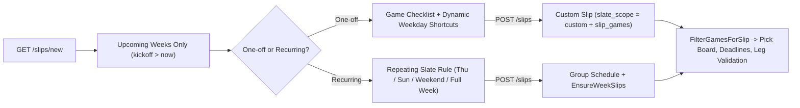

# Close-out

## Overview

## Consequences

- **Easier:** Starting either a one-off slip or a recurring schedule from `/slips/new` without navigating to a separate schedules screen.
- **Easier:** Building custom friend-group slates (primetime pairs, holiday games, or specific Sunday matchups) via explicit per-game selection and dynamic weekday shortcuts.
- **Easier:** Avoiding dead slips for past or completed weeks by restricting week selection to weeks with upcoming games (`kickoff > now`) and removing manual past-week entry.
- **Harder:** Maintaining two eligibility models (`slip_games` rows for `custom` slips and kickoff-day rules for repeating scopes); every pick, deadline, and validation path must go through `FilterGamesForSlip` rather than `FilterGamesByScope`.
- **Harder:** Listing slips for a week or group requires batch-hydrating `GameIDs` for `custom` slips to avoid N+1 queries.
- **Revisit:** Aligning `mode=recurring` on `/slips/new` so that any selected week or member defaults behave consistently with one-off creation when materializing the first slip.

## Alternatives considered

- **Adding more hardcoded `SlateScope` enums (e.g., primetime or holiday slates):** Rejected because fixed enums cannot cover arbitrary friend-group game subsets and require ongoing schema and UI changes.
- **Storing a JSON array of game IDs on `slips`:** Rejected in favor of a normalized `slip_games` join table so SQLite enforces foreign-key integrity against `games(id)`.
- **Keeping recurring schedule creation on a separate screen:** Rejected because members start with the intent to create a slip and decide whether it repeats second.
- **Supporting per-game selection on recurring schedules:** Rejected because future weeks' games are not fixed in advance; recurring schedules stay on repeating slate rules (`ValidForSchedule`).

## Implementation notes

- Implementation matched the design with no deviations.
- **Empty-schedule limit:** When no stored games have `kickoff_utc > now` (such as before a sync or during the offseason), `UpcomingWeeks` returns empty and `/slips/new` hides the creation form.
- **Fixed custom scope after creation:** Once a `custom` slip is created, its `slip_games` rows are fixed; there is no UI to add or remove eligible games on an existing custom slip.
- **Schedule boundary:** `SlateScope.Valid()` permits `custom` for slips, while `SlateScope.ValidForSchedule()` rejects `custom` for recurring schedules at both the store and handler boundaries.

## Follow-ups

- Add an edit-games action for open `custom` slips so creators can adjust eligible games before kickoff without recreating the slip.
- Evaluate whether `mode=recurring` on `/slips/new` should apply the form's selected members when materializing the first upcoming week's slip.
