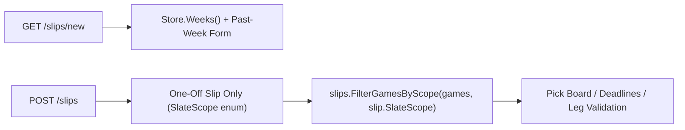
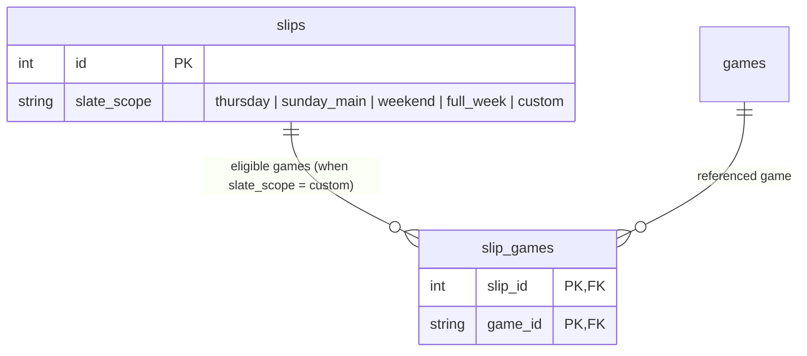
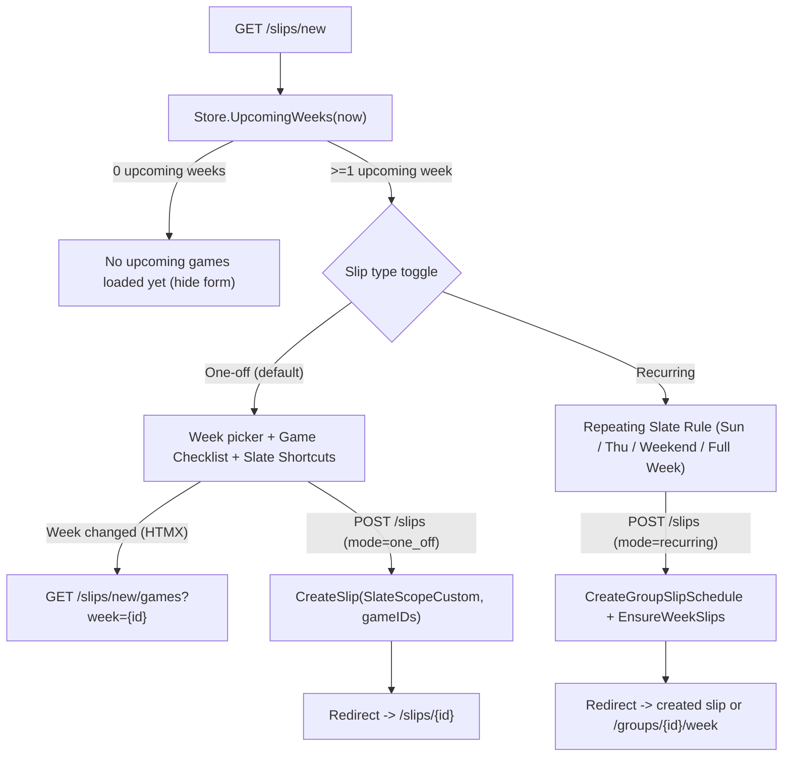

# Design: Redesign slip creation UX

## Context

Slip creation currently lives in `internal/web/slips.go` (`newSlipForm`, `createSlip`, `weekFromCreateForm`) and
`web/templates/slip.html`:

- `newSlipForm` loads every row from `Store.Weeks(ctx)` (including older weeks and completed weeks whose games have all
  finished) and renders an "Or add a past week" `
` block that lets users type arbitrary past seasons/weeks
  (`UpsertWeek`).
- `createSlip` always creates a one-off slip (`scheduleID = nil`) restricted to one of the coarse `db.SlateScope` enums.
  Recurring schedules live on a separate screen (`POST /groups/{id}/schedules`).
- Downstream consumers (`slips.NextStep`, `internal/web/pick.go`, `internal/web/slips.go` leg validation) all call
  `slips.FilterGamesByScope(games, slip.SlateScope)` to determine which games belong to a slip.

This change builds on `dynamic-nfl-schedule-slips` (which introduces `SlateScopeWeekend` and schedule-aware
`EnsureWeekSlips`).

## Approach

### 1. Explicit per-game eligibility and upcoming-weeks query (`internal/db`, `internal/slips`)

- **Migration `0017_slip_games.sql`**:
  - Create
    `slip_games (slip_id INTEGER NOT NULL REFERENCES slips(id) ON DELETE CASCADE, game_id TEXT NOT NULL REFERENCES games(id), PRIMARY KEY (slip_id, game_id))`
    with an index on `slip_id`.
  - Allow `'custom'` in `slips.slate_scope` (while keeping `group_slip_schedules.slate_scope` restricted to repeating
    scopes: `thursday`, `sunday_main`, `weekend`, `full_week`).
- **`internal/db/slips.go`**:
  - Add `SlateScopeCustom SlateScope = "custom"` and `ErrSlipGamesRequired = errors.New("select at least one game")`.
  - Split validation into `SlateScope.Valid()` (valid for slips, includes `custom`) and `SlateScope.ValidForSchedule()`
    (valid for recurring schedules, excludes `custom`).
  - Add `GameIDs []string` to `db.Slip`, hydrated when reading slips with `SlateScope == SlateScopeCustom` (via a helper
    query in `SlipByID` and batch lookup in `SlipsForWeek` / `SlipsForGroup`).
  - Extend `CreateSlip` to accept `gameIDs []string` (or add `CreateSlipWithGames` / update `CreateSlip` signature).
    When `slateScope == SlateScopeCustom`:
    - Deduplicate `gameIDs`, require `len(gameIDs) > 0` (else `ErrSlipGamesRequired`), verify every game exists in
      `weekID`, and insert into `slip_games` in the same transaction.
- **`internal/db/weeks.go`**:
  - Add `Store.UpcomingWeeks(ctx context.Context, now time.Time) ([]Week, error)` returning weeks that have at least one
    game with `kickoff > now`, ordered soonest-first (by `id ASC`). Older weeks and completed weeks (e.g., a finished
    Week 11) are excluded automatically.
- **`internal/slips/next.go`**:
  - Add `FilterGamesForSlip(games []db.Game, slip db.Slip) []db.Game`:
    - If `slip.SlateScope == db.SlateScopeCustom`, retain only games whose `ID` is in `slip.GameIDs`.
    - Otherwise delegate to `FilterGamesByScope(games, slip.SlateScope)`.
  - Update `slips.NextStep`, `internal/web/pick.go`, and `internal/web/slips.go` (leg creation/edit validation and game
    picker) to call `FilterGamesForSlip(games, slip)`.
  - Scope badge for `custom` slips: render `"N Games"` (or `"1 Game"`) from `len(slip.GameIDs)`.

**Trade-off / rejected option:** Storing a JSON array of game IDs in a text column on `slips` was rejected in favor of a
normalized `slip_games` join table with foreign keys, which enforces referential integrity against `games(id)` and stays
idiomatic with the rest of `internal/db`.

### 2. Unified One-off / Recurring slip creation UI (`internal/web`, `web/templates/slip.html`, `web/static/app.js`)

- **`GET /slips/new`** (`internal/web/slips.go`):
  - Queries `Store.UpcomingWeeks(ctx, now)`. Never shows past or completed weeks, and removes the "Or add a past week"
    `
` block completely.
  - Supports `?mode=recurring` (to pre-select the Recurring tab when linked from a schedules section) and `?week={id}`
    (honored only if `id` is in `UpcomingWeeks`).
  - Loads upcoming games (`now.Before(g.Kickoff)`) for the selected week and computes dynamic **slate shortcut chips**
    from the games actually present in that week (in Eastern time):
    - `"All Sunday"`, `"All Thursday"`, `"All Monday"`, `"All Saturday"`, `"All Friday"`, `"All games"` — only rendering
      weekday shortcuts that have ≥1 upcoming game in that week, plus `"Clear"`.
  - Default selection for a one-off slip: if the week has upcoming Sunday games, pre-check all Sunday games (matching
    the group's usual habit); otherwise pre-check all upcoming games in that week.
- **`GET /slips/new/games`** (`internal/web/slips.go`):
  - HTMX partial returning the game checklist and shortcut chips when the user switches the selected upcoming week.
- **Client-side interactions (`web/static/app.js`)**:
  - Small progressive-enhancement handlers for toggling between One-off and Recurring fieldsets and for one-tap slate
    shortcut buttons (`data-slate-shortcut="sunday"`, etc.) that check/uncheck matching `[data-game-day]` checkboxes and
    update a live `"N games selected"` counter.
- **`POST /slips`** (`internal/web/slips.go`):
  - Removes `season`/`week`/`season_type` past-week creation.
  - When `mode == "recurring"`: validates repeating `slate_scope`, `name`, and `legs_per_member`; calls
    `Store.CreateGroupSlipSchedule`; runs `slips.EnsureWeekSlips` for the first upcoming week (if any); redirects to the
    newly created slip if one was materialized, otherwise redirects to `/groups/{id}/week`.
  - When `mode == "one_off"` (default): verifies `week_id` is an upcoming week and every submitted `game_id` is an
    upcoming game in that week; calls `Store.CreateSlip` with `SlateScopeCustom` and `gameIDs`; redirects to
    `/slips/{id}`.

## Verification

- `go test ./internal/db/... ./internal/slips/... ./internal/web/...` and `golangci-lint run`.
- **Upcoming weeks filtering**:
  - With Week 10 (all final), Week 11 (all kicked off/final), and Week 12 (upcoming games) in SQLite, `GET /slips/new`
    lists only Week 12.
  - `POST /slips` targeting Week 11 or past-week `season`/`week` fields is rejected with 422.
  - With zero upcoming weeks stored, `GET /slips/new` shows a clear empty state instead of a past-week form.
- **One-off per-game selection & shortcuts**:
  - Creating a one-off slip with 2 specific Sunday games persists `slate_scope = 'custom'` and 2 `slip_games` rows.
  - Opening `/slips/{id}/pick` shows only those 2 games; `NextStep` computes the deadline from those 2 games only;
    posting a leg for a 3rd game in the same week returns `ErrGameOutsideScope` (422).
  - Submitting a one-off slip with 0 games selected returns 422 (`ErrSlipGamesRequired`).
  - Shortcut buttons rendered on a Thanksgiving week include `"All Thursday"`, `"All Friday"`, `"All Sunday"`,
    `"All Monday"`, `"All games"`.
- **Recurring creation from `/slips/new`**:
  - Submitting `mode=recurring` with `slate_scope=thursday` creates a `GroupSlipSchedule`, materializes the current
    week's slip if Thursday is still upcoming, and redirects to it (or to `/groups/{id}/week` if Thursday already
    passed).
- **Phone-first UI check**: verify `/slips/new` at 375px width (mode toggle, shortcut chips wrap cleanly, game checklist
  rows are easy to tap).

## Risks

- **Legacy past-week slip tests:** Existing tests in `internal/web/slips_test.go` that exercise the old "Or add a past
  week" form will need to be updated to assert rejection of past/completed weeks instead.
- **Unfiltered `FilterGamesByScope` call sites:** Missing any call site that still calls `FilterGamesByScope` directly
  instead of `FilterGamesForSlip` would break `custom` slips on that screen. We mitigate this by grepping all
  `FilterGamesByScope` call sites during Phase 1 and adding end-to-end tests for pick board, leg add, and deadline on
  custom slips.

## TODO

### Phase 1: Custom slip game eligibility and upcoming-weeks storage

Complexity: medium (adds `slip_games` migration, hydrates `Slip.GameIDs`, adds `UpcomingWeeks`, and migrates all
slip-game filtering call sites to `FilterGamesForSlip`) Risk: medium (touches pick-board filtering, deadlines, and leg
validation across `internal/db`, `internal/slips`, and `internal/web`; covered by unit and integration tests for custom
and legacy scopes)

- [x] Add migration `0017_slip_games.sql`, `SlateScopeCustom`, `ErrSlipGamesRequired`, `Slip.GameIDs` hydration,
      `CreateSlip` custom-game persistence, and `Store.UpcomingWeeks(ctx, now)` in `internal/db/slips.go` and
      `internal/db/weeks.go`, with store tests.
- [x] Add `slips.FilterGamesForSlip(games, slip)` in `internal/slips/next.go`, switch `NextStep`,
      `internal/web/pick.go`, and `internal/web/slips.go` leg validation/pickers to use it, and add `"N Games"` scope
      badge formatting, with unit and handler tests.

### Phase 2: Unified one-off/recurring create-slip UI with game checklist and slate shortcuts

Complexity: medium (combines one-off and recurring creation flows in `internal/web/slips.go`, adds HTMX week-games
partial, and adds progressive-enhancement shortcuts in `web/static/app.js`) Risk: low (contained to `/slips/new` and
`POST /slips` with full handler tests covering validation, one-off custom games, and recurring schedule creation)

- [x] Update `GET /slips/new`, add `GET /slips/new/games`, and update `POST /slips` in `internal/web/slips.go` to
      restrict to `UpcomingWeeks`, remove past-week entry, handle `mode=one_off` (per-game selection) and
      `mode=recurring` (schedule creation + `EnsureWeekSlips`), and update `internal/web/slips_test.go`.
- [x] Redesign the create-slip form in `web/templates/slip.html` and add mode-toggle and slate-shortcut checkbox helpers
      in `web/static/app.js` for phone-first usability (One-off/Recurring toggle, dynamic weekday shortcuts, game
      checklist with kickoffs, live selected count).
- [ ] Docs: update `docs/concepts/slips.md` to document upcoming-only slip creation, unified one-off vs. recurring
      creation, and custom per-game slip eligibility.
