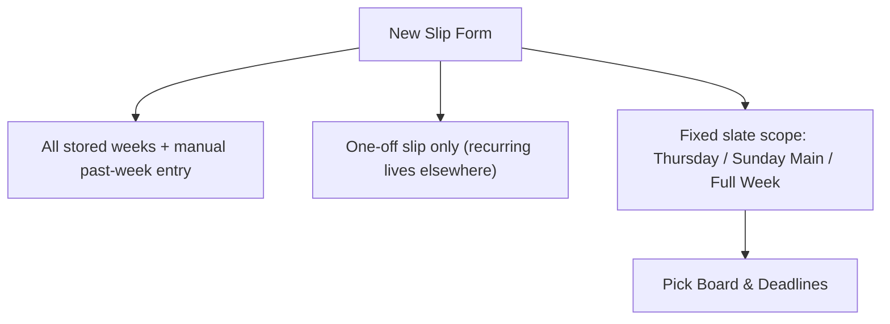
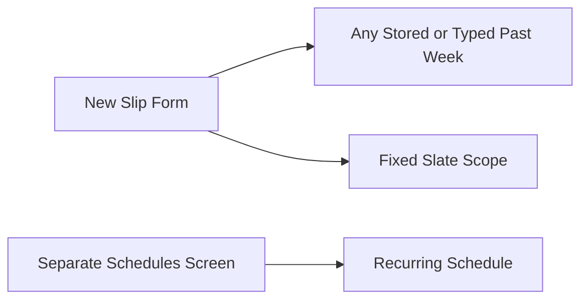
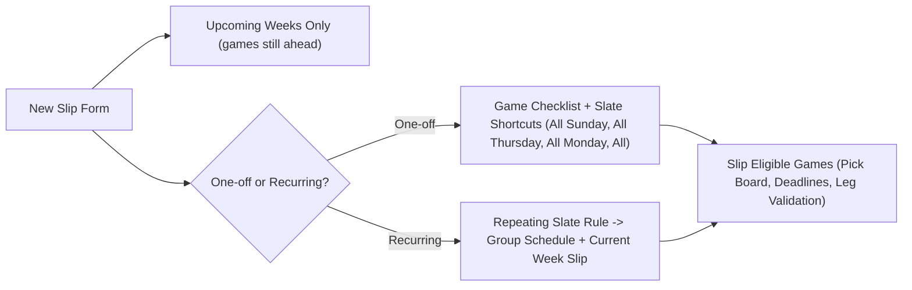

# Redesign slip creation UX

## Context

Creating a new slip feels broken and rigid for how groups actually play:

1. **Past weeks are offered.** The week picker lists every stored week and even includes a manual "add a past week"
   form, letting members create slips for weeks that are long over.
2. **Finished weeks are offered.** A week whose games have already kicked off or finished (such as a completed Week 11)
   still appears as a valid target for a new slip.
3. **One-off vs. recurring is split apart.** The new-slip screen only makes one-off slips. Setting up a recurring weekly
   slip lives on a separate schedules screen, so members have to know where to go before they start.
4. **One-off game selection is too coarse.** One-off slips force a choice between three fixed slate buckets (Thursday,
   Sunday Main, Full Week). A group cannot build a slip for a specific subset of games—like a Sunday afternoon
   doubleheader, a Thanksgiving trio, or two primetime matchups—without opening the whole slate.

## Goals and non-goals

### Goals

- Restrict slip creation to weeks that still have upcoming games; hide older and already-completed weeks and remove
  manual past-week entry from the form.
- Let a member choose **One-off** or **Recurring** directly in the new-slip flow.
- When creating a **One-off** slip, let the member pick the exact eligible games from the chosen week, with one-tap
  shortcuts for common slates (such as "All Sunday", "All Thursday", "All Monday", and "All games").
- Keep deadlines, pick-board filtering, and leg validation aligned with the slip's selected games.

### Non-goals

- Changing how existing historical or graded slips are viewed, archived, or recorded in the Record Book.
- Supporting per-game selection on recurring schedules; recurring slips continue to use repeating slate rules (e.g.,
  Thursday, Sunday Main, Full Week) because future weeks' games are not fixed in advance.
- Changing sportsbook export, analyzer rules, or free-tier API fetch behavior.

## Decision

Unify slip creation around upcoming weeks and split the scope controls by slip type: recurring slips pick a repeating
slate rule, while one-off slips pick exact games with slate shortcuts.

### Before

### After

Restricting the week list to weeks with upcoming games prevents nonsensical slips for past or finished weeks at the
source, rather than letting users create dead slips that immediately land in a closed state. Combining one-off and
recurring creation into one form beats keeping two separate entry points because members think in terms of "start a
slip" first and decide whether it repeats second. Giving one-off slips an explicit game list with quick-select shortcuts
beats adding more hardcoded slate enums because it handles holiday slates, primetime pairs, and custom friend-group
slates without needing new scope types later.

`complexity: medium` fits because the change coordinates week eligibility, recurring schedule creation, and per-game
slip scoping across the creation UI, slip domain rules, pick board, and storage. `risk: medium` fits because changing
how a slip defines its eligible games touches deadlines, pick-board filtering, and leg validation, though existing
slate-scoped slips remain supported and automated tests cover those boundaries.
