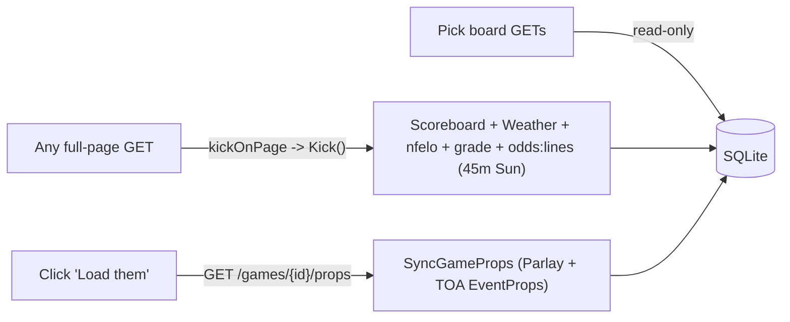
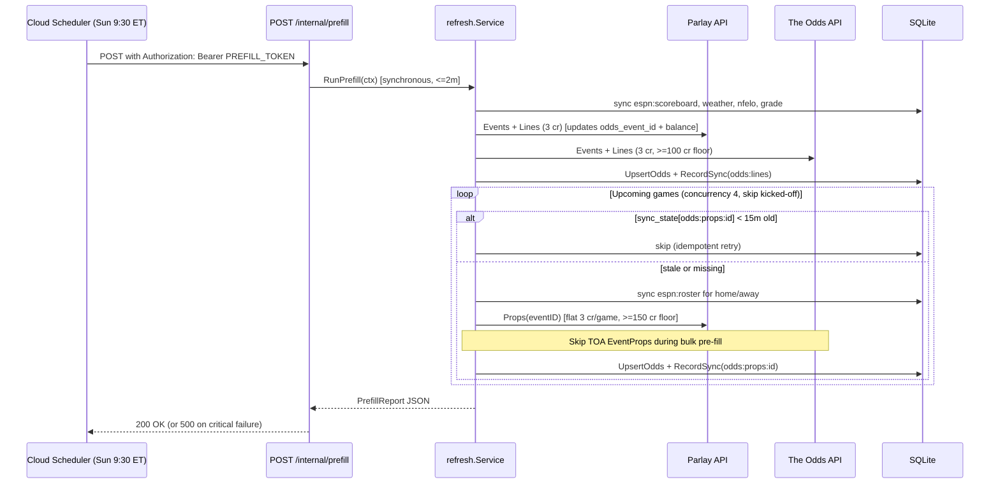

# Design: Sunday morning odds pre-fill and smart refresh

## Context

Today, background refresh and on-demand props are split across four seams:

- **Page-load middleware (`cmd/server/main.go`):** `kickOnPage` wraps all authenticated routes and calls
  `refresher.Kick()` on every full-page `GET`, regardless of whether the viewer is picking on an open slip or reading a
  locked slip or Record Book.
- **Refresh service (`internal/refresh/refresh.go`, `rules.go`, `sources.go`, `research.go`):** `Kick()` and `RunOnce()`
  share `sourcesFor`, which runs `espn:scoreboard`, `weather:{gameID}`, `odds:lines`, `nfelo:projections`, `grade`, and
  `espn:gamelog:{athleteID}`. `oddsStale` polls `odds:lines` every 45 minutes on Sunday. `SyncGameProps(ctx, gameID)`
  runs one game's `espn:roster:{teamID}` and `odds:props:{gameID}` (`2h` window), calling Parlay API `Props` (3
  credits/game) and then The Odds API `EventProps` (up to 9 credits/game) whenever `TheOddsAPIEnrichFloor` (100) holds.
- **Pick board (`internal/web/pick.go`, `internal/web/games.go`, `web/templates/partials.html`):** `pickBoard`,
  `pickResults`, `pickSlate`, and `pickDetail` read SQLite only and trigger no odds or props fetches. Props load only
  when someone clicks **"Load them"** (`GET /games/{id}/props?slip={slipID}`).
- **Cloud Run & SQLite (`deploy/setup.sh`, `.github/workflows/deploy.yml`):** Cloud Run scales
  `--min-instances 0 --max-instances 1` with `--allow-unauthenticated` and a single SQLite writer replicated by
  Litestream. Sandbox mode (`cmd/server/sandbox.go`) calls `RunOnce` during morning bootstrap and stage transitions.



## Approach

### 1. Sunday 9:30 AM ET pre-fill (`internal/refresh`, `cmd/server`, `internal/config`)

Add `RunPrefill(ctx context.Context) (PrefillReport, error)` to `refresh.Service`:



Key design choices:

- **Synchronous HTTP execution:** `POST /internal/prefill` runs `RunPrefill` synchronously inside the request (bounded
  by a 2-minute timeout linked to `stopCtx`) rather than returning `202` and working in the background. Cloud Run
  throttles CPU and can scale down an `--min-instances 0` instance as soon as the response finishes; synchronous
  execution keeps CPU allocated, lets Litestream flush, and gives Cloud Scheduler accurate retry signals.
- **Parlay-only bulk props in pre-fill:** `RunPrefill` syncs `odds:lines` first so `games.odds_event_id` and Parlay
  API's credit balance are already warm, then warms upcoming games' rosters and Parlay API bulk props (worker pool of 4,
  ~40–45 credits for a full Sunday slate) while **skipping** The Odds API `EventProps`. Enriching 13+ games via The Odds
  API during the morning sweep would burn ~117 credits at once; The Odds API prop enrichment/fallback stays reserved for
  per-game pick-time calls.
- **15-minute idempotency window (`prefillIdempotencyAge = 15 * time.Minute`):** `RunPrefill` refreshes `odds:lines` and
  `odds:props:{gameID}` even if they are within normal staleness windows from Saturday or earlier Sunday morning, unless
  already fetched in the last 15 minutes so a Cloud Scheduler retry never double-spends.
- **Fail-closed bearer auth:** Add `Config.PrefillToken` (`PREFILL_TOKEN` env var, optional secret `prefill-token` in
  Secret Manager). `POST /internal/prefill` sits on the outer mux outside session `RequireUser`, `Scope`, and cookie
  `CSRF`, checking `Authorization: Bearer <token>` with `subtle.ConstantTimeCompare`. When `PREFILL_TOKEN` is empty (or
  in `SUNDAY_SANDBOX=1` mode), the endpoint returns `404` / `503` fail-closed.

We rejected an in-process Go cron ticker because `--min-instances 0` scales Cloud Run to zero overnight when nobody
visits, so an in-process timer would never fire at 9:30 AM. We also rejected GCP OIDC token verification on Cloud
Scheduler to avoid an extra scheduler service account and external JWKS fetch during cold start; an optional Secret
Manager bearer token matches the repo's `github-token` pattern and is trivial to test and invoke locally.

### 2. Free sources run more often, and `Kick()` drops `odds:lines` (`internal/refresh`)

Split `sourcesFor` so `Kick()` and `RunOnce()` have clear roles, promote ESPN injury news (`espn:summary:{gameID}`) and
team rosters (`espn:roster:{teamID}`) into background/pre-fill syncs, and tighten staleness windows across every free
unmetered source:

| Source key                 | Data                         | Old window               | New window                                                      | Triggered by                            |
| -------------------------- | ---------------------------- | ------------------------ | --------------------------------------------------------------- | --------------------------------------- |
| `espn:scoreboard`          | Slate, scores, live status   | 10m live / 30m GD / 6h   | **5m live / 15m game day / 2h**                                 | `Kick()`, `RunPrefill()`, `RunOnce()`   |
| `espn:summary:{gameID}`    | Game injuries & news         | 2h (research-only)       | **15m game day or <=4h to kickoff / 1h** (skip `FINAL`)         | `Kick()`, `RunPrefill()`, research      |
| `espn:roster:{teamID}`     | Team roster & headshots      | 24h (props/post-kickoff) | **2h game day / 6h** (deduped per week team, skip `FINAL` games)| `Kick()`, `RunPrefill()`, props, research |
| `weather:{gameID}`         | Kickoff forecast             | 1h (<=48h)               | **15m <=6h to kickoff / 30m <=48h**                             | `Kick()`, `RunPrefill()`, `RunOnce()`   |
| `nfelo:projections`        | Model spreads & QB adj       | 12h                      | **1h game day / 4h**                                            | `Kick()`, `RunPrefill()`, `RunOnce()`   |
| `espn:gamelog:{athleteID}` | Athlete season game logs     | 12h                      | **1h game day / 4h**                                            | `Kick()` (slip legs), player research   |

- `Kick()` (triggered by `kickOnPage`) syncs all free/unmetered sources above plus `grade`, and **drops `odds:lines`**.
  Non-picking screens (`/`, `/groups`, `/record`, `/slips/{id}`, `/research`) and locked/graded slips spend zero odds
  credits while keeping injury news, rosters, weather, and live scores fresh.
- `RunOnce()` (used by `cmd/server/sandbox.go`) retains `odds:lines` so sandbox morning bootstrap and stage transitions
  stay deterministic; `internal/sandbox/registry.go` already registers `summary-empty`, `roster-empty`, and featured
  game fixtures for `Week9`.
- `RunPrefill()` warms `espn:summary:{gameID}` and `espn:roster:{teamID}` for upcoming games alongside `weather` and
  `nfelo` using the same bounded worker pool.

### 3. Pick-time on-demand refreshes (`internal/refresh`, `internal/web/pick.go`, `web/templates/partials.html`)

Extend `web.Refresher` with three methods used exclusively when a player is selecting a line on an `OPEN` slip with
upcoming games (`now.Before(game.Kickoff)`):

```go
type Refresher interface {
	SyncGameProps(ctx context.Context, gameID string) error
	SyncGameResearch(ctx context.Context, gameID string) error
	SyncPlayerResearch(ctx context.Context, athleteID string) error
	SyncPickLines(ctx context.Context, weekID int64) error
	SyncPickGame(ctx context.Context, weekID int64, gameID string) error
	ForcePickRefresh(ctx context.Context, weekID int64, gameID string) error
}
```

```mermaid
flowchart TD
  OpenPick["GET /slips/{id}/pick"] --> Gate{"slip OPEN & upcoming games?"}
  GameSelect["GET /slips/{id}/pick/results or /detail (game != '')"] --> Gate
  Gate -->|No| ReadOnly["Read SQLite only (0 credits)"]
  Gate -->|Yes| Check{"sync_state stale? (15m lines / 30m game props on game day)"}
  Check -->|Fresh (<1ms SQLite)| ReadOnly
  Check -->|Stale| Fetch["singleflight sync (10s timeout)"]
  Fetch --> DB[(SQLite)] --> SSE["publish week:{weekID} if changed"]

  Btn["POST /slips/{id}/pick/refresh"] --> Cooldown{"Last sync >= 2m ago?"}
  Cooldown -->|"< 2m"| ReadOnly
  Cooldown -->|">= 2m"| Fetch
```

Pick-time staleness and trigger rules:

- **Pick-time lines (`oddsPickLinesStale`):** Skipped when no games or all games kicked off. Stale if never fetched,
  after **15 minutes** on game days (`Thursday`, `Sunday`, `Monday` before last kickoff on that day, or within 2 hours
  of next kickoff), and after **2 hours** midweek.
- **Pick-time game props (`oddsPropsStale`):** Skipped once `game.Kickoff` passes. Stale after **30 minutes** on game
  days or within 6 hours of `game.Kickoff`, and **2 hours** earlier in the week.
- **Keystroke & SSE safety:** `pickResults` fires on search typing (`delay:250ms`), and `pickDetail` fires on tab/sort
  clicks and `board-updated` SSE reloads. Both call `SyncPickGame(ctx, slip.WeekID, q.GameID)` *only* when
  `slip.Status == db.SlipOpen`, `q.GameID != ""`, and that game is upcoming. Once synced, `sync_state.fetched_at` is
  fresh, so typing and SSE reloads short-circuit on the indexed SQLite read (`<1ms`, `0` API calls). `pickSlate` stays
  strictly read-only.
- **Explicit refresh control (`POST /slips/{id}/pick/refresh`):** Shown in `pick-slate` and `pick-detail` only when
  `slip.Status == db.SlipOpen` and upcoming games remain. Calls `ForcePickRefresh` with a **2-minute cooldown**
  (`pickRefreshCooldown = 2 * time.Minute`) so double-clicks cannot drain credits while letting a player verify live
  sportsbook movement on demand. Returns the updated `#pick-body` partial.

## Verification

- Run `go test ./...`, `go vet ./...`, `golangci-lint run ./...`, and `good-vibes docs lint` after edits.
- **Pre-fill orchestration & auth:** Integration tests for `RunPrefill` verifying scoreboard-first ordering,
  `odds:lines` populating `odds_event_id` before bulk props, Parlay-only props (zero fallback `EventProps` calls),
  skipping kicked-off games, skipping all props when Parlay balance `< OddsPropsFloor`, 15-minute retry idempotency, and
  shutdown context cancellation. HTTP tests for `POST /internal/prefill` (`404` when `PREFILL_TOKEN` empty, `401` on
  bad/missing token, `200` JSON summary on valid bearer token, `503` in sandbox).
- **`Kick()` vs `RunOnce()` and free-source cadence:** Update `TestRefreshArchivesEveryIngestCall` (`fakeESPN` serving
  `/summary` and `/teams/*/roster` alongside `/scoreboard`, driving `RunOnce`) and add tests proving `KickContext` syncs
  scoreboard, weather, nfelo, grade, summaries (injuries), and unique team rosters at the tighter game-day/idle windows
  without calling `odds:lines`. Verify all `TestSandbox*` tests continue passing unchanged.
- **Pick-time refreshes & cooldowns:** Table-driven tests in `internal/refresh/rules_test.go` for `oddsPickLinesStale`
  (15m game-day vs 2h midweek), tightened `oddsPropsStale` (30m game-day/pre-kickoff vs 2h), and 2m `ForcePickRefresh`
  cooldown. Handler tests in `internal/web/pick_test.go` verifying `pickBoard` refreshes stale lines on `OPEN` slips,
  `pickResults`/`pickDetail` refresh stale props only when a game is selected on an `OPEN` slip, repeated search queries
  make 0 extra sync calls, locked/graded slips and non-picking routes trigger 0 odds syncs, and
  `POST /slips/{id}/pick/refresh` obeys group scope, open-slip rules, and 2m cooldown.
- **Deploy scripts:** Validate `bash -n deploy/setup.sh` and existing `deploy/blackout_test.sh`.

## Risks

- **Cloud Run cold start + pre-fill timeout:** A cold instance restores Litestream before serving `/internal/prefill`.
  Bounding the game worker pool to 4 and capping `RunPrefill` at 2 minutes (under Cloud Scheduler's 3-minute default
  deadline) prevents timeouts; Cloud Scheduler retry logs surface any missed Sunday run.
- **Search latency or SSE echo:** If a player opens a game with stale props (>30m), that first
  `pickDetail`/`pickResults` request waits on the API call (up to `requestTimeout = 10s`). Single-flight deduplication
  and advancing `fetched_at` on success prevent subsequent keystrokes or SSE `board-updated` reloads from blocking or
  looping.
- **Credit floors during heavy Sunday picking:** Tighter 15m/30m pick-time windows spend more credits if friends browse
  every game repeatedly. Existing `OddsLinesFloor` (50), `OddsPropsFloor` (150), and `TheOddsAPIEnrichFloor` (100) still
  protect lines and fallback reserves, and logs record `paused below credit floor` warnings before exhaustion.

## TODO

Effort: medium (multi-seam change spanning refresh orchestration, pick-time web handlers, bearer-authenticated scheduler
endpoint, and GCP deploy wiring while preserving SQLite single-writer, sandbox replay, and dual-provider credit
invariants)

### Phase 1: Sunday pre-fill engine and authenticated endpoint

- [x] Add `RunPrefill` (scoreboard -> lines -> free summaries/rosters + bounded parallel Parlay-only bulk props for
      upcoming games with 15m idempotency), tighten free-source staleness windows (`scoreboard`, `summary`, `roster`,
      `weather`, `nfelo`, `gamelog`), promote `summary` and unique week-team `roster` syncs into `Kick()`, and split
      `Kick` from `RunOnce` so `Kick` omits `odds:lines` in `internal/refresh` (updating
      `TestRefreshArchivesEveryIngestCall` and adding unit/integration tests)
- [x] Add optional `PrefillToken` (`PREFILL_TOKEN`) to `internal/config` and mount `POST /internal/prefill` outside
      cookie/CSRF middleware in `cmd/server` with constant-time bearer auth, synchronous execution, and handler/config
      tests
- [x] Docs: amend the lazy-only sync guardrail in `AGENTS.md` and update `docs/concepts/data-refresh.md`,
      `docs/reference/config.md`, and `docs/reference/routes.md` for pre-fill and `Kick` scope

### Phase 2: Pick-time on-demand refresh rules and UI

- [x] Implement `SyncPickLines`, `SyncPickGame`, `ForcePickRefresh`, pick-time staleness rules (`15m`/`2h` lines,
      `30m`/`2h` props), and the `2m` manual refresh cooldown in `internal/refresh` with unit and single-flight tests
- [x] Extend `web.Refresher`, trigger pick-time syncs on `OPEN` slips with upcoming games in
      `pickBoard`/`pickResults`/`pickDetail` (`internal/web/pick.go`), and add `POST /slips/{id}/pick/refresh` with the
      phone-first refresh button in `web/templates/partials.html` and handler/cooldown/locked-slip tests
- [ ] Docs: update `docs/concepts/data-refresh.md`, `docs/concepts/slips.md`, `docs/reference/data-sources.md`, and
      `docs/reference/routes.md` for pick-time refreshes and the refresh route

### Phase 3: Cloud Scheduler deploy wiring and setup docs

Effort: easy (narrow, pattern-following additions to existing setup script, deploy workflow, and runbooks)

- [ ] Enable `cloudscheduler.googleapis.com`, add the `prefill-token` secret, and print the Sunday 9:30 AM
      `America/New_York` scheduler setup command in `deploy/setup.sh`, plus mount optional `PREFILL_TOKEN` in
      `.github/workflows/deploy.yml` (`bash -n` and `deploy/blackout_test.sh` pass)
- [ ] Docs: update `docs/guides/gcp-setup.md` and `docs/runbooks/deploy.md` for `prefill-token` and the Cloud Scheduler
      job, then run `good-vibes docs lint` and `good-vibes docs index`
