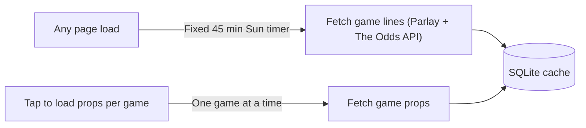
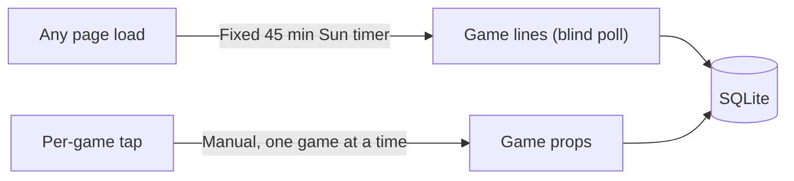
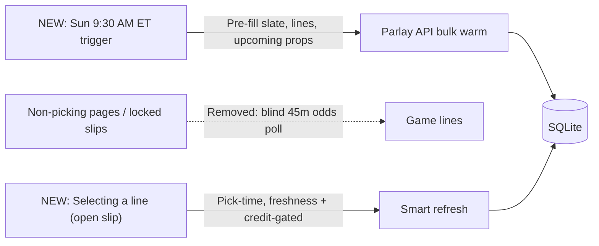

# Sunday morning odds pre-fill and smart refresh

## Context

All external data syncs are lazy today. They run only when someone loads a full page or taps to load props on one game.

On Sunday morning, the first friend to open the app waits for a background sync of the slate and game lines, and player
props are still empty across every game. Friends must open each game one by one to pull props, and pick-board search
misses players in games nobody has opened yet.

After that first visit, every full-page load—even on non-picking screens or locked slips—polls game lines on a fixed
45-minute Sunday timer. Meanwhile, once a game's props are loaded, a player opening that game to pick a leg sees stale
lines until a flat two-hour window expires, with no refresh tied to the act of choosing a line.

The two free-tier budgets split naturally by call cost. Parlay API grants 1,000 monthly credits and serves all nine prop
markets for a game in a single flat 3-credit bulk call (~40–45 credits for a whole Sunday slate). The Odds API grants
500 monthly credits and bills per prop market (up to 9 credits per game), so bulk-enriching every game's props on Sunday
morning would spend over 100 credits in one shot.

## Goals and non-goals

**Goals:**

- Pre-fill the week's slate, game lines, weather, model projections, team rosters, and bulk player props for all
  upcoming games around 9:30 AM Eastern on Sundays.
- Keep Cloud Run at zero minimum instances and a single writer process by waking the server with an authenticated
  scheduled request.
- Trigger post-prefill odds and prop refreshes specifically when a player is trying to select a line on an open
  slip—when opening the pick board, viewing a game's lines and props, or explicitly refreshing while picking—so prices
  are accurate at pick time.
- Stop spending odds credits on non-picking pages, locked slips, or idle background polling, while syncing free sources
  (injury news, rosters, scoreboard, weather, game logs, and nfelo) much more often so context stays fresh.
- Stay well inside the Parlay API (1,000/month) and The Odds API (500/month) free-tier budgets, reserving The Odds API
  prop calls for targeted pick-time enrichment and fallback.
- Amend the project's lazy-only refresh guardrail to allow this weekly pre-fill trigger.

**Non-goals:**

- Polling odds on non-picking screens (such as group lists, the record book, or locked slips) or running continuous
  background timers.
- Keeping Cloud Run warm with minimum instances above zero, or adding a second database writer process or sidecar
  worker.
- Pre-filling props for games that have already kicked off or finished (such as Thursday night games on Sunday morning).
- Bulk-enriching every game's props through The Odds API during the Sunday morning sweep.
- Upgrading to paid odds API plans or changing offline sandbox replay behavior.

## Decision

Add an authenticated Sunday 9:30 AM Eastern pre-fill trigger that warms the slate, game lines, and Parlay API bulk props
for all upcoming games, sync free news and roster sources much more often, and move post-prefill odds and prop refreshes
strictly to when players are selecting a line on an open slip.

### Before

### After

Moving post-prefill refreshes to line selection beats keeping a general page-load odds timer or adding background
tickers because credits are spent only when a friend is actively choosing a pick, prices are fresh right at decision
time, and Cloud Run stays scaled to zero.

The medium effort rating fits because the change spans scheduled deploy wiring and request authentication, refresh
orchestration across two differently priced odds providers, pick-time freshness rules, and pick-board refresh triggers
while preserving SQLite's single-writer and credit-floor invariants.
