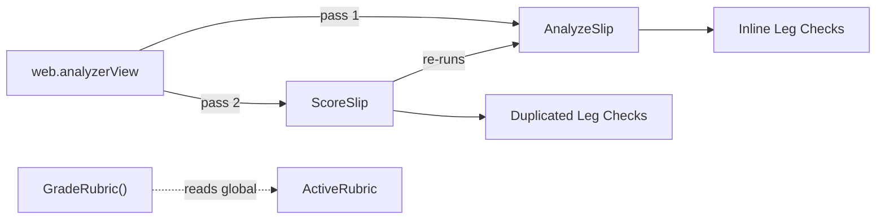
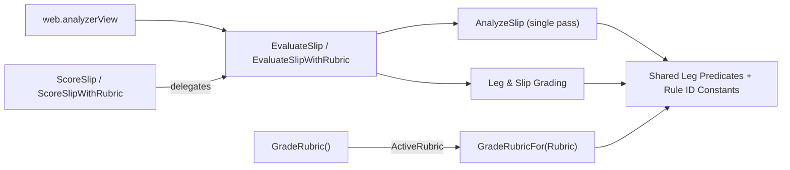

# Close-out

## Overview

### Before

### After

## Consequences

- **Easier:** Slip rendering runs warning analysis once per evaluation instead of twice, while keeping exact warning and score parity.
- **Easier:** Threshold changes for median traps, wind hazards, spread hooks, and heavy chalk update both warnings and leg grades from one set of shared predicates, and factor IDs share `rule*` constants across grading and docs.
- **Easier:** Callers can inspect weights, band cutoffs, and factor labels for any candidate `Rubric` via `GradeRubricFor(r)` without reading or mutating `ActiveRubric`.
- **Harder:** Shared predicates cover condition detection only; warning copy and grade detail strings are still formatted separately in warning rules and leg grading.
- **Revisit:** If standalone leg scoring (such as pick-board candidates) is ever folded into slip evaluation, `ScoreLegWithRubric` could take precomputed warnings instead of evaluating single-leg predicates independently.

## Alternatives considered

- **Deleting `AnalyzeSlip` and `ScoreSlip` immediately:** Rejected because existing callers and dozens of table-driven analyzer tests target warnings or grades directly. Keeping them as thin delegators preserves test coverage and proves zero behavioral drift.
- **Passing `[]Warning` into `ScoreLegWithRubric`:** Rejected because `ScoreLegWithRubric` is called standalone for single-leg and pick-board grading where slip-wide `AnalyzeSlip` is unnecessary. Sharing single-leg predicates keeps standalone leg scoring decoupled.

## Implementation notes

- The design named `GradeRubricDoc` as the return type for `GradeRubricFor`, but `internal/analyzer/docs.go` already defines `RubricDoc`; `GradeRubricFor(r Rubric)` returns `RubricDoc` to match.
- `EvaluateSlip` and `GradeRubric` still default to the package-level `ActiveRubric`; callers evaluating non-active rubrics must use `EvaluateSlipWithRubric` and `GradeRubricFor`.

## Follow-ups

None.
