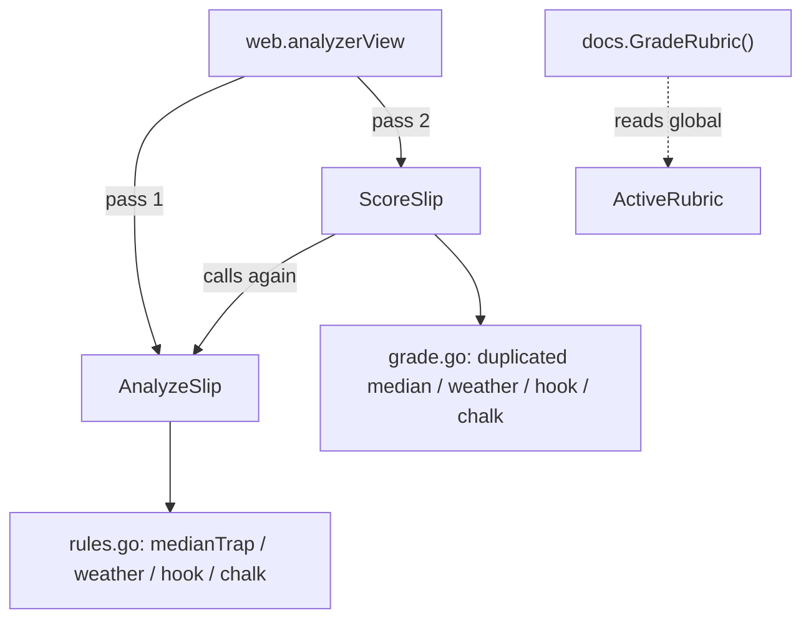
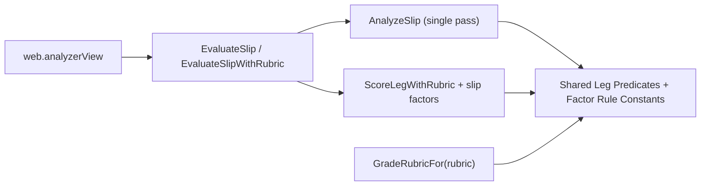

# Design: Unify slip analysis and rubric grading

## Context

In `internal/web/analyzer.go`, `analyzerView` calls `analyzer.AnalyzeSlip(input, gamesByID, stats)` and immediately
calls `analyzer.ScoreSlip(input, gamesByID, stats)`. Inside `internal/analyzer/grade.go`, `ScoreSlipWithRubric` calls
`AnalyzeSlip(legs, games, stats)` a second time to gather correlation stacks, script conflicts, and chalk counts.

Additionally:

- Single-leg checks for median trap (`rules.go:520-555` vs. `grade.go:187-211`), weather (`rules.go:296-327` vs.
  `grade.go:346-356`), spread hook (`rules.go:330-348` vs. `grade.go:374-396`), and heavy chalk (`rules.go:371-391` vs.
  `grade.go:423-431`) are implemented separately in both files.
- Grade-only factor identifiers (`"hit_rate"`, `"rising_usage"`, `"teammate_out_bump"`, `"favorable_matchup"`,
  `"nfelo_cushion"`, `"parlay_drag"`, `"chalk_drag"`) are raw string literals duplicated across `grade.go` and
  `docs.go`.
- `GradeRubric()` in `internal/analyzer/docs.go` takes no arguments and reads the package global `ActiveRubric`,
  preventing callers (like `internal/eval`) from inspecting factor labels or point weights for a non-active candidate
  rubric.



## Approach

### 1. Single-pass slip evaluation interface (`internal/analyzer/grade.go`)

Add a cohesive `SlipEvaluation` result and single-pass entry points:

```go
type SlipEvaluation struct {
    Warnings []Warning
    Grade    SlipGrade
}

func EvaluateSlip(legs []Leg, games map[string]Game, stats map[string]PlayerStats) SlipEvaluation
func EvaluateSlipWithRubric(legs []Leg, games map[string]Game, stats map[string]PlayerStats, rubric Rubric) SlipEvaluation
```

- `EvaluateSlipWithRubric` runs `AnalyzeSlip` once, computes leg grades and slip grade from those warnings and the
  supplied rubric, and returns both in `SlipEvaluation`.
- `ScoreSlipWithRubric` delegates to `EvaluateSlipWithRubric(...).Grade`, and `ScoreSlip` delegates to
  `EvaluateSlip(...).Grade`. Existing callers and tests keep working with zero churn.
- Update `internal/web/analyzer.go` (`analyzerView`) to call `analyzer.EvaluateSlip(input, gamesByID, stats)` once.

### 2. Shared single-leg predicates and typed factor rule constants (`rules.go`, `grade.go`, `docs.go`)

- Define typed/named constants alongside `rule*` for all grade-only factor IDs (`ruleHitRate`, `ruleRisingUsage`,
  `ruleTeammateOutBump`, `ruleFavorableMatchup`, `ruleNfeloCushion`, `ruleParlayDrag`, `ruleChalkDrag`) and use them in
  both `grade.go` and `docs.go`.
- Extract shared internal predicates used by both warning rules (`rules.go`) and leg grading (`grade.go`) so thresholds
  and edge cases have one source of truth:
  - `evalMedianTrap(leg Leg, stats map[string]PlayerStats)` (returns median, threshold hit, sample count)
  - `evalWeatherHazard(leg Leg, g Game)` (returns severity/level and weather detail)
  - `evalSpreadHook(leg Leg)` (returns hook point and direction)
  - `isChalkLeg(leg Leg)` / `chalkBustChance(odds int)`

### 3. Parameterize rubric documentation by explicit `Rubric` (`internal/analyzer/docs.go`)

- Add `GradeRubricFor(r Rubric) RubricDoc` containing the full rubric doc construction using `r` instead of
  `ActiveRubric`.
- Make `GradeRubric() RubricDoc` a one-line wrapper: `return GradeRubricFor(ActiveRubric)`.



### Trade-offs and rejected options

- **Deleting `AnalyzeSlip` and `ScoreSlip` immediately:** Rejected because dozens of focused table-driven tests in
  `analyzer_test.go` and `nflverse_grade_test.go` test warnings or grades directly; keeping them as thin delegators
  preserves test readability while deepening the core seam.
- **Passing `[]Warning` into `ScoreLegWithRubric`:** Rejected because `ScoreLegWithRubric` is also called standalone
  (for pick-board candidates and single-leg grading) where slip-wide `AnalyzeSlip` is unnecessary; sharing the
  single-leg predicates gives locality without coupling standalone leg scoring to slip analysis.

## Verification

- Run `go test -race ./...` and `golangci-lint run`.
- Parity test in `internal/analyzer` verifying `EvaluateSlipWithRubric(legs, games, stats, r)` returns the exact same
  `Warnings` as `AnalyzeSlip` and exact same `Grade` as `ScoreSlipWithRubric` across multi-leg slips with stacks,
  conflicts, weather, hooks, median traps, and chalk.
- Unit test for `GradeRubricFor(customRubric)` verifying point deltas and labels reflect the supplied rubric without
  mutating `ActiveRubric`.
- Existing `TestRuleDocsCoverageAndGradeRubric` and `internal/web` slip/analyzer handler tests pass unchanged.

## Risks

- **Subtle behavioral drift when unifying predicates:** Warning rules and leg grading may have slight differences (for
  example, `medianTrap` warning text vs. grade detail, or `hook` vs. `nfelo_cushion` precedence). Keep the shared
  predicates focused on the threshold/condition check while letting warning messages and grade factor details format
  their own copy, verified against the existing 3,300+ LOC analyzer test suite.

## TODO

### Phase 1: Unify single-leg predicates, factor rule constants, and explicit-rubric docs

Complexity: medium (extracts shared predicates across `rules.go`, `grade.go`, and `docs.go` while maintaining exact
scoring and warning parity) Risk: low (backed by comprehensive table-driven tests in `internal/analyzer`)

- [x] Define constants for all grade factor rule IDs in `internal/analyzer`, extract shared single-leg predicates
      (`medianTrap`, weather hazard, spread hook, heavy chalk) used by both `rules.go` and `grade.go`, and verify exact
      parity against existing analyzer tests.
- [x] Add `GradeRubricFor(r Rubric) GradeRubricDoc` in `internal/analyzer/docs.go` with `GradeRubric()` delegating to
      `ActiveRubric`, and add unit tests confirming non-active rubrics render their own weights and labels without
      touching global state.

### Phase 2: Add single-pass `EvaluateSlip` and switch web callers to it

Complexity: low (adds `SlipEvaluation` entry point and updates `web.analyzerView`) Risk: low (pure delegation verified
by analyzer and web handler tests)

- [x] Add `SlipEvaluation`, `EvaluateSlip`, and `EvaluateSlipWithRubric` in `internal/analyzer/grade.go` (with
      `ScoreSlipWithRubric` delegating to it), update `internal/web/analyzer.go` (`analyzerView`) to call `EvaluateSlip`
      once, and add tests covering single-pass warning and grade parity.
