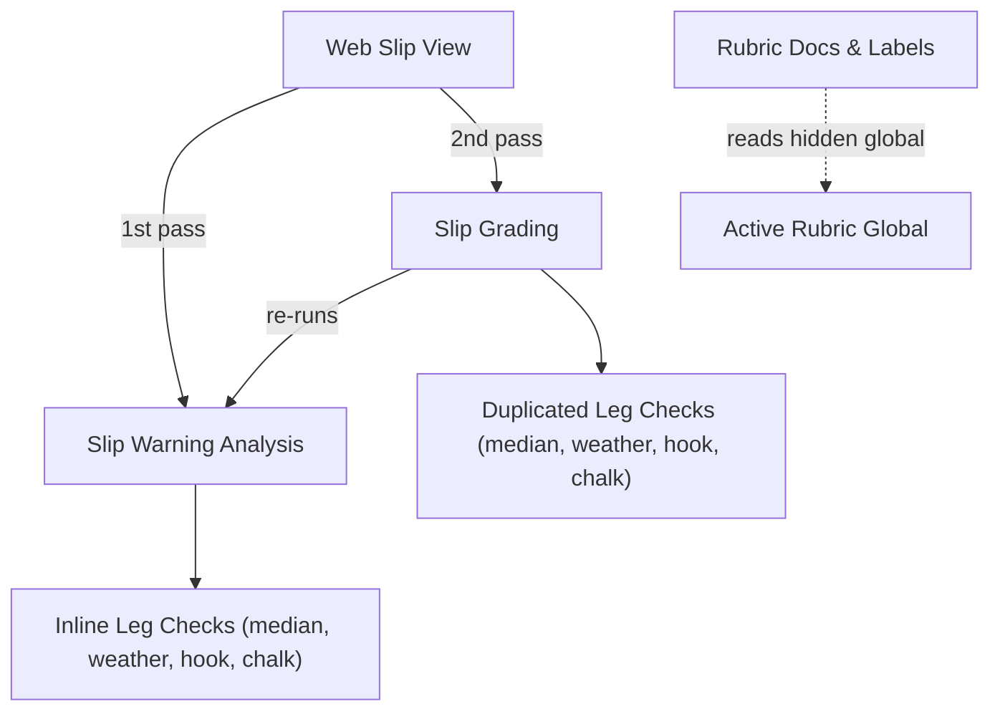
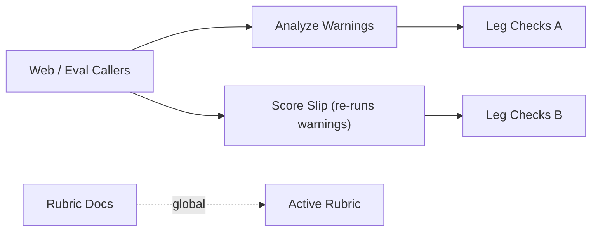
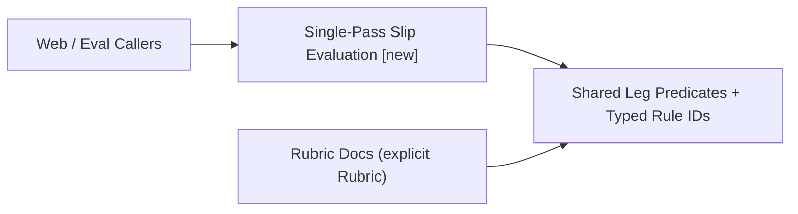

# Unify slip analysis and rubric grading

## Context

Rendering a slip currently evaluates it twice. The web layer runs slip warning analysis first, then runs slip grading,
which internally runs slip warning analysis a second time to collect correlation stacks, script conflicts, and chalk
counts.

At the same time, single-leg checks for median traps, weather hazards, spread hooks, and heavy chalk are implemented
twice—once in the warning rules and again inline inside leg grading. Any threshold tweak has to be kept in sync across
two places.

Finally, rubric documentation and factor-label lookup read a package-global active rubric with no parameter, and
grade-only factor identifiers are scattered as raw string literals. Callers that want labels or rubric docs for a
candidate rubric version cannot ask for them directly.

## Goals and non-goals

**Goals:**

- Expose a single-pass slip evaluation interface that returns both warnings and rubric grades together, eliminating
  duplicate slip analysis on every render.
- Extract shared single-leg rule predicates and typed factor rule identifiers so warning rules, leg grading, and rubric
  docs stay in lockstep.
- Parameterize rubric documentation and factor-label lookup by an explicit rubric instead of reading a package global,
  while keeping convenience entry points for the active rubric.
- Preserve exact warning messages, scores, and letter grades for existing callers and tests.

**Non-goals:**

- Changing any rubric weights, thresholds, or letter-grade cutoffs.
- Rewriting all existing table-driven unit tests that call the convenience entry points.
- Changing the friendly, non-blocking tone of warnings or grade pills.

## Decision

### Before

### After

Add a single-pass slip evaluation entry point returning both warnings and grades for a supplied rubric, unify single-leg
rule checks and factor identifiers behind shared internal predicates and constants, and make explicit-rubric
documentation the core seam with thin delegating conveniences for existing callers.

This beats replacing every existing call site and test in one sweep because web handlers and evals gain the deeper
single-pass and explicit-rubric interface immediately while existing table-driven tests remain green and verify zero
scoring drift.

`complexity: medium` fits because the refactor threads shared predicates, typed rule identifiers, and single-pass
evaluation across warning rules, leg/slip grading, rubric docs, and web views while preserving exact scoring parity.
`risk: low` fits because grading is pure and deterministic, backed by extensive table-driven analyzer tests that catch
any behavioral drift immediately.
