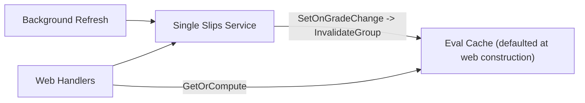

# Close-out

## Overview

## Consequences

- **Easier:** Both manual leg grading and background auto-grading go through one shared `slips.Service` in production and sandbox startup, so any grade change invalidates the group's cached eval report.
- **Easier:** Removing the duplicate nil-cache evaluation branch in the Grading Results handler leaves one cache path owned at web construction.
- **Easier:** Production and sandbox service wiring can be tested end to end from auto-grading through `eval.Cache` invalidation.
- **Harder:** Callers and tests that construct the refresh service must pass `Deps.Slips` explicitly; omitting it causes `syncGrade` to skip auto-grading rather than falling back to a private instance.
- **Revisit:** If eval caching moves out of process or persists across restarts, replace the in-memory `SetOnGradeChange` callback with a durable invalidation signal.

## Alternatives considered

- **Keep the private `slips.New` fallback in `refresh.New` and only fix startup wiring:** Rejected because any future caller or mode that omits `Deps.Slips` would silently reintroduce the split-instance stale-cache bug.
- **Pass `eval.Cache` directly into `slips.New`:** Rejected to keep the slips package decoupled from the eval package; the `func(groupID int64)` callback keeps the dependency direction clean.

## Implementation notes

- `syncGrade` already guarded against a nil `slips.Service`, so no change to the grading loop was needed.
- Direct SQLite edits outside `slips.Service` still bypass `SetOnGradeChange` and leave `eval.Cache` stale until restart or another grade change.

## Follow-ups

None.
