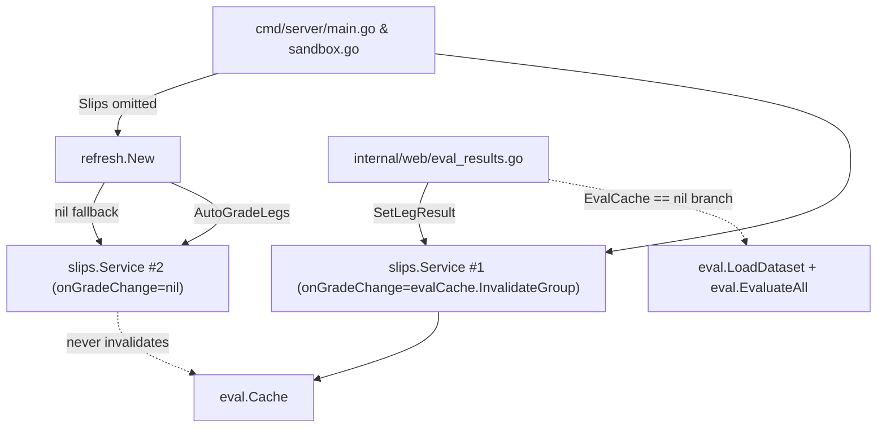
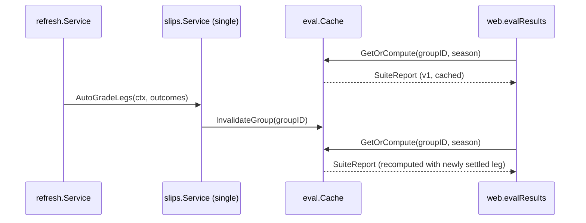

# Design: Unify auto-grade and eval-cache invalidation

## Context

In `cmd/server/main.go` and `cmd/server/sandbox.go`, startup constructs `refresh.Service` without passing `Deps.Slips`, then creates a separate `slips.Service` for HTTP handlers and calls `slipService.SetOnGradeChange(evalCache.InvalidateGroup)` only on that second instance. Inside `internal/refresh/refresh.go`, `refresh.New` silently constructs a private `slips.New(deps.Store, deps.Publisher, now)` whenever `deps.Slips == nil`, leaving `onGradeChange == nil` on the auto-grading path.

Meanwhile, `internal/web/eval_results.go` checks `if h.deps.EvalCache != nil` and falls back to calling `eval.LoadDataset` + `eval.EvaluateAll` inline in the `else` branch, duplicating `eval.Cache.GetOrCompute`.

## Approach

### Single shared slips module across refresh and web

1. **Remove silent fallback in `refresh.New` (`internal/refresh/refresh.go`):**
   - Stop constructing `slips.New(...)` when `deps.Slips == nil`. `s.slips` stays `deps.Slips` directly.
   - In `syncGrade` (`internal/refresh/grade.go`), if `s.slips == nil`, return nil (same guard pattern as optional external clients like `s.forecast == nil`). Existing `refresh` tests that exercise `syncGrade` pass an explicit `slips.New(store, pub, now)` in `refresh.Deps.Slips`.
2. **Wire one `slips.Service` first at startup (`cmd/server/main.go`, `cmd/server/sandbox.go`):**
   - In production mode (`cmd/server/main.go`), construct `slipService := slips.New(store, hub, nil)` and attach `slipService.SetOnGradeChange(evalCache.InvalidateGroup)` *before* calling `refresh.New(refresh.Deps{..., Slips: slipService})`.
   - In sandbox mode (`cmd/server/sandbox.go`), accept `onGradeChange func(groupID int64)` (or construct `slipService` first, pass it into `refresh.Deps.Slips`, and store that same instance on `sandboxRuntime.slips` so `main.go`'s `slipService.SetOnGradeChange(evalCache.InvalidateGroup)` hooks the single shared instance). Passing the same `slipService` to both `refresher` and `sandboxRuntime.slips` keeps sandbox startup minimal and guarantees one instance.
3. **Always own an `eval.Cache` at the web seam (`internal/web/`):**
   - In `web.New` (where `Dependencies` are normalized), default `deps.EvalCache = eval.NewCache()` whenever `deps.EvalCache == nil`.
   - Delete the `else` fallback branch in `internal/web/eval_results.go` (`evalResults`) so all `/analyzer/results` requests go through `h.deps.EvalCache.GetOrCompute(ctx, h.deps.Store, group.ID, selectedSeason)`.

### Trade-offs and rejected options

- **Keeping the `slips.New` fallback in `refresh.New` and only editing `main.go`:** Rejected because any future caller or sandbox mode that omits `Deps.Slips` silently reintroduces the split-instance bug.
- **Passing `eval.Cache` directly into `slips.New`:** Rejected to keep `internal/slips` decoupled from `internal/eval`; the `func(groupID int64)` callback seam keeps the dependency direction clean while one shared `slips.Service` ensures locality.

## Verification

- Run `go test -race ./...` and `golangci-lint run`.
- Integration test across `refresh.Service` → shared `slips.Service` → `eval.Cache`:
  1. Seed a group, final game, and open slip with a pending leg.
  2. Warm `eval.Cache.GetOrCompute` for the group and assert initial empty/pre-grade coverage.
  3. Run `refresh.Service` auto-grading (`syncGrade`) to settle the leg via the shared `slips.Service`.
  4. Call `eval.Cache.GetOrCompute` again and assert the newly settled leg appears in the recomputed `SuiteReport` (proving `InvalidateGroup` fired from `AutoGradeLegs`).
- Verify `sandbox` runtime tests confirm `runtime.refresher` and `runtime.slips` share the same `slips.Service` instance.
- Verify `internal/web/eval_results_test.go` passes both with an explicit `EvalCache` and when `Dependencies.EvalCache` is omitted (defaulted by `web.New`).

## Risks

- **Refresh tests omitting `Deps.Slips`:** Removing the fallback will cause `refresh/grade_test.go` (or any test expecting auto-grading without passing `Deps.Slips`) to skip grading instead of panicking. Updating those tests to pass `Deps.Slips` explicitly makes the seam requirement visible and verified immediately by `go test ./internal/refresh/...`.
- **Direct SQLite edits outside `slips.Service`:** Unchanged from `adr-grading-results`; still documented as bypassing in-memory invalidation.

## TODO

### Phase 1: Require shared slips module in refresh and wire production + sandbox startup

Complexity: low (narrow constructor and wiring changes across refresh, server startup, and sandbox with direct test feedback)
Risk: low (in-memory SQLite integration tests verify auto-grade invalidation end to end)

- [x] Remove the silent `slips.New` fallback from `refresh.New` in `internal/refresh/refresh.go`, guard `s.slips == nil` in `internal/refresh/grade.go`, and update `internal/refresh` tests to pass `Deps.Slips` explicitly alongside a new end-to-end test verifying `AutoGradeLegs` invalidates `eval.Cache` via `SetOnGradeChange`.
- [ ] Construct one shared `slips.Service` before `refresh.New` in `cmd/server/main.go` and `cmd/server/sandbox.go` and pass it into `refresh.Deps.Slips`, with a test verifying sandbox and server wiring share one instance so auto-grading invalidates `evalCache`.

### Phase 2: Default eval cache at web construction and remove handler fallback

Complexity: low (single-package cleanup in `internal/web` removing one duplicate branch)
Risk: low (covered directly by `internal/web/eval_results_test.go`)

- [ ] Default `deps.EvalCache = eval.NewCache()` when nil in `internal/web` constructor and remove the duplicate `eval.LoadDataset` / `eval.EvaluateAll` fallback branch in `internal/web/eval_results.go`, verifying nil-cache construction in `internal/web/eval_results_test.go`.
