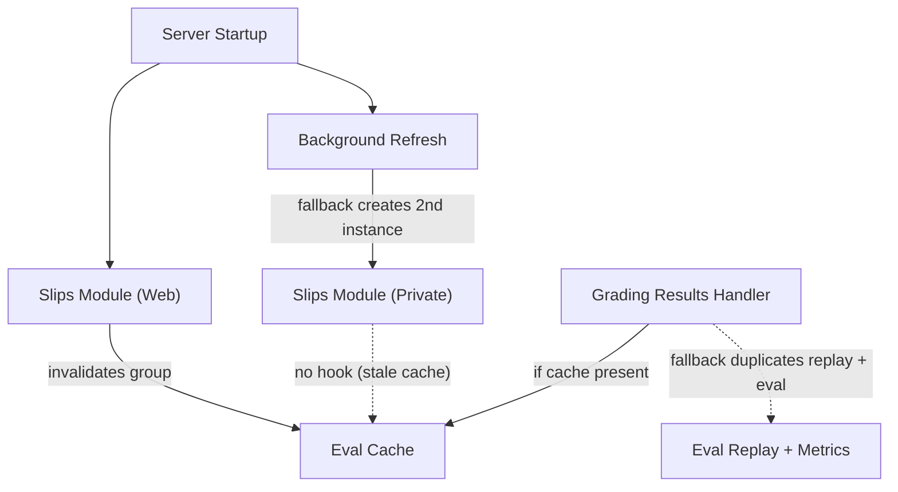
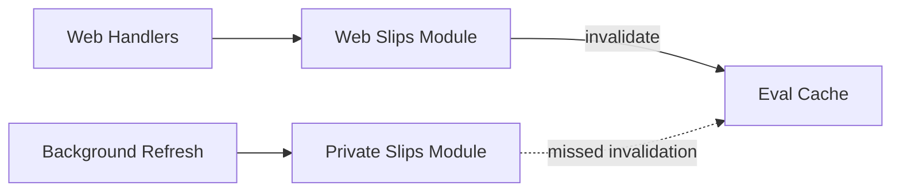
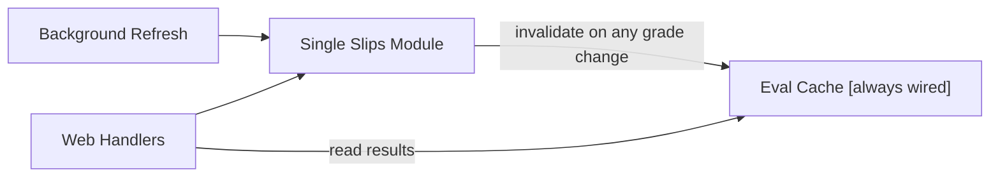

# Unify auto-grade and eval-cache invalidation

## Context

Today, the server builds two separate slips modules at startup. The web handlers talk to one instance, and the background refresh module silently creates a second private instance when no slips module is passed in.

Cache invalidation for the Grading Results page is only attached to the first instance. When a member grades a leg by hand, the cache clears. When background auto-grading settles a leg after a game goes final, the second instance has no invalidation hook, so the Grading Results page keeps serving stale calibration numbers until someone edits a grade manually or restarts the server.

Meanwhile, the web handler for Grading Results also carries a fallback branch that re-runs dataset loading and rubric evaluation inline whenever the eval cache is absent, duplicating the cache module's own orchestration.

## Goals and non-goals

**Goals:**

- Share one slips module across background refresh and web handlers so both manual grading and automatic post-game grading invalidate the group's cached eval report.
- Remove the silent slips-module fallback inside background refresh so a split-instance bug cannot recur silently.
- Give the web layer one consistent cache seam for Grading Results, removing the duplicate nil-cache evaluation branch.
- Cover the end-to-end auto-grade-to-cache-invalidation path with an automated test.

**Non-goals:**

- Changing how auto-grading fetches box scores or evaluates market outcomes.
- Adding cache persistence in SQLite or changing cache eviction policy.
- Changing any calibration metrics or Grading Results UI layout.

## Decision

### Before

### After

Require one shared slips module at the background refresh seam (removing the silent fallback), wire its invalidation hook once at startup for both production and sandbox modes, and default the eval cache at web module construction so handlers never duplicate replay and evaluation.

This beats keeping the fallback and only patching startup wiring because removing the fallback makes split-instance drift impossible by construction and keeps settlement locality in one module.

`complexity: low` fits because the work is narrow, mechanical wiring across startup, background refresh, and the Grading Results handler with no new state machines or schema changes. `risk: low` fits because the blast radius is limited to cache invalidation and constructor wiring, verified directly by an in-memory integration test from auto-grading through the cache seam.
