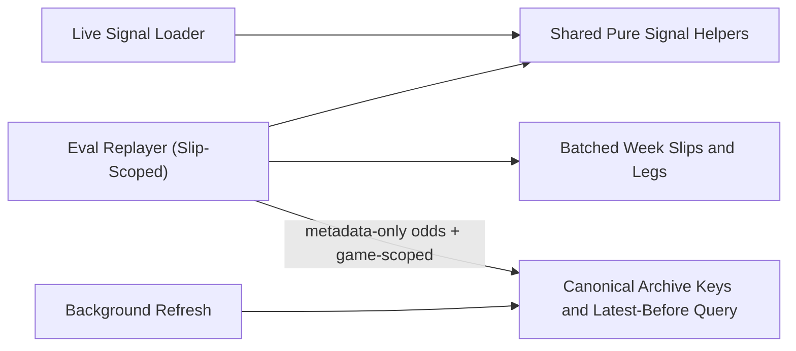

# Close-out

## Overview

## Consequences

- **Easier:** Changing or adding archive source keys without silent replay drift, since refresh and eval share canonical `Archive*Key` builders in `internal/db`.
- **Easier:** Keeping live and historical injury merging, player-ID deduplication, and postseason season-type rules aligned through shared pure helpers in `internal/analyzer`.
- **Easier:** Replaying multi-game slates with less I/O and CPU, because slip/leg reads are batched, archive reads skip unreferenced games, and odds coverage uses metadata-only checks cached per kickoff.
- **Harder:** Callers of `SlipsWithLegsForWeek` must pass a valid `db.SlipStatus` (or empty string) rather than arbitrary status strings.
- **Revisit:** `LatestAPIResponseBefore` queries `fetched_at <= before` at 1-second RFC3339 resolution, so strict `< kickoff` callers still adjust the cutoff timestamp and re-check `FetchedAt.Before(kickoff)` in Go.

## Alternatives considered

- **Moving pre-kickoff archive replay into `internal/analyzer`:** Rejected because it would couple the live analyzer to archive decompression and raw ESPN/odds HTTP JSON parsers. Sharing pure assembly helpers in `internal/analyzer` keeps the boundary clean.
- **Extracting a new `internal/archivekeys` package:** Rejected as a shallow package. `internal/db` already owns `api_responses` reads and writes and is imported by both `internal/refresh` and `internal/eval` without an import cycle.

## Implementation notes

- `NFLverseSeasonTypes` returns `[]int`, not `[]string` as the design originally wrote.
- `SlipsWithLegsForWeek` accepts `db.SlipStatus` instead of `string` and validates non-empty values with `SlipStatus.Valid()`.
- `api_responses` enforces `CHECK (status BETWEEN 200 AND 299)` at the schema level, so non-2xx rows cannot be inserted via `SaveAPIResponse`; `LatestAPIResponseBefore` still includes `status >= 200 AND status < 300` in SQL.
- Because `LatestAPIResponseBefore` uses `fetched_at <= ?` at 1-second RFC3339 resolution, `eval` adjusts the cutoff before querying and verifies `resp.FetchedAt.Before(kickoff)` to preserve strict pre-kickoff leakage guards.

## Follow-ups

None.
