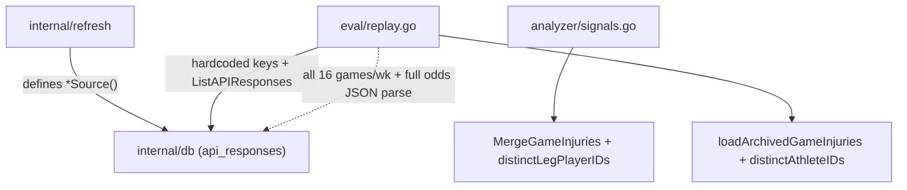
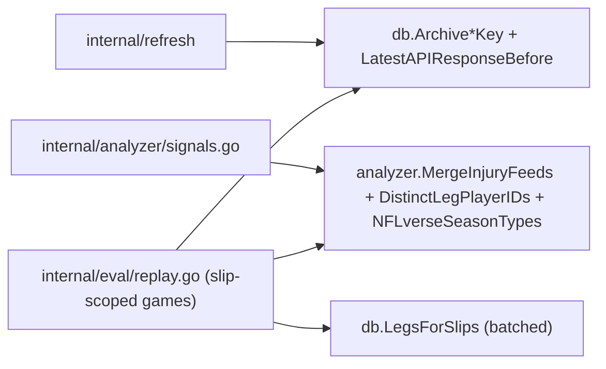

# Design: Unify live and historical signal loading

## Context

`internal/analyzer/signals.go` owns live signal loading (`LoadSlipSignals`, `MergeGameInjuries`, `distinctLegPlayerIDs`,
`nflverseSeasonTypes`, `toAnalyzerInjuries`), while `internal/eval/replay.go` re-implements parallel helpers
(`loadArchivedGameInjuries`, `distinctAthleteIDs`, inline postseason slices, inline injury conversion) against
`api_responses` / `api_bodies`.

Three concrete inefficiencies and drift hazards sit at this seam:

1. **Duplicated archive keys:** `internal/refresh/refresh.go` defines canonical source key builders (`GameLogSource`,
   `SummarySource`, `RosterSource`, `OddsLinesSource`, `OddsPropsSource`), whereas `internal/eval/replay.go` hardcodes
   `"espn:gamelog:"`, `"espn:summary:"`, `"espn:roster:"`, `"odds:props:"`, and `"odds:lines"`.
2. **Inefficient archive & slip reads:** `internal/db/archive_read.go` only exposes `ListAPIResponses` (returning all
   rows oldest-first), so `latestArchivedBodyBefore` loads every historical row `<= kickoff` and walks backwards in Go.
   `loadWeekSlips` issues N+1 `SlipByID` and `LegsForSlip` queries per week.
3. **Full-slate archive scanning:** `LoadDataset` loops over every game in `weekGames` (up to 16/week) even when settled
   slips only reference 2–3 games, and calls `hasArchivedOddsBefore`, which decompresses and runs full
   `odds.ParsePropsJSON` / `odds.ParseLinesJSON` just to return a `bool` that is then OR'd with `rl.DecimalOdds > 1`.



## Approach

### 1. Canonical archive keys and latest-before lookup in `internal/db`

- Add `internal/db/archive_keys.go` (or constants/functions in `internal/db`) holding the canonical archive/sync source
  key builders:
  - `ArchiveOddsLinesKey = "odds:lines"`
  - `ArchiveOddsPropsKey(gameID string) string`
  - `ArchiveRosterKey(teamID string) string`
  - `ArchiveGameLogKey(athleteID string) string`
  - `ArchiveSummaryKey(gameID string) string`

- Have `internal/refresh/refresh.go`'s `OddsLinesSource`, `OddsPropsSource`, `RosterSource`, `GameLogSource`, and
  `SummarySource` delegate to (or alias) these canonical builders so `refresh` and `eval` share one source of truth
  without creating a `refresh` ← `eval` import cycle.

- Add `LatestAPIResponseBefore(ctx context.Context, key string, before time.Time) (APIResponse, bool, error)` to
  `internal/db/archive_read.go` using:

  ```sql
  SELECT id, source, key, method, url, status, fetched_at, duration_ms,
         body_sha256, credits_remaining, credits_used
  FROM api_responses
  WHERE key = ? AND fetched_at <= ? AND status >= 200 AND status < 300
  ORDER BY fetched_at DESC, id DESC
  LIMIT 1
  ```

  This avoids loading and scanning every historical fetch of `odds:lines` or `espn:summary:<id>`.

- Add a batched `SlipsWithLegsForWeek(ctx context.Context, weekID int64, groupID int64, status string)` (or batch
  `LegsForSlips(ctx, slipIDs)`) helper in `internal/db` so `loadWeekSlips` stops issuing per-slip queries.

### 2. Shared pure signal-assembly helpers in `internal/analyzer`

- Export or consolidate pure helpers in `internal/analyzer/signals.go` so `internal/eval/replay.go` calls them directly
  instead of maintaining copies:
  - `DistinctLegPlayerIDs(legs []db.Leg) []string`
  - `NFLverseSeasonTypes(seasonType int) []string`
  - `MergeInjuryFeeds(summaryByTeam map[string][]espn.Injury, rosterByTeam map[string][]espn.Injury) map[string][]Injury`
    (wrapping `espn.MergeTeamInjuries` + conversion to `[]analyzer.Injury`, shared by `MergeGameInjuries` for live DB
    rows and `loadArchivedGameInjuries` for archived JSON payloads).
- Keep `internal/analyzer` completely free of `api_archive` reads, gzip decompression, and raw ESPN/odds HTTP JSON
  parsing.

### 3. Slip-scoped archive reads and lightweight odds coverage in `internal/eval/replay.go`

- Build `referencedGames := map[string]bool` from `rawLegs` before the per-game loop in `LoadDataset`, and only
  fetch/parse archived summaries, rosters, and odds for games actually referenced by the week's settled slips.
- Replace `hasArchivedOddsBefore`'s full JSON decompression + `odds.ParseLinesJSON`/`odds.ParsePropsJSON` with a
  metadata-only check via `store.LatestAPIResponseBefore` on `db.ArchiveOddsPropsKey(gameID)` / `db.ArchiveOddsLinesKey`
  (or check once per unique kickoff timestamp for `odds:lines`), and skip even that metadata lookup when every leg on
  the game already has `rl.DecimalOdds > 1`.



### Trade-offs and rejected options

- **Moving pre-kickoff archive replay into `internal/analyzer`:** Rejected because `internal/analyzer` would have to
  import raw JSON parsers and `api_archive` decompression; keeping replay in `internal/eval` while sharing pure assembly
  helpers preserves a clean seam.
- **Putting archive key builders in a new `internal/archivekeys` package:** Rejected as a shallow package (fails the
  deletion test); `internal/db` already owns `api_responses` reads/writes and is imported by both `internal/refresh` and
  `internal/eval`.

## Verification

- Run `go test -race ./...` and `golangci-lint run`.
- Unit tests in `internal/db` for `LatestAPIResponseBefore` (returns newest 2xx row `<= before`, ignores 4xx/5xx and
  rows `> before`, returns `ok == false` when absent) and batched slip/leg loading.
- Test asserting `refresh.GameLogSource`, `SummarySource`, `RosterSource`, `OddsPropsSource`, and `OddsLinesSource`
  match `db.Archive*Key` outputs.
- Replay tests in `internal/eval/replay_test.go`:
  - Existing pre- vs. post-kickoff leakage tests continue to pass unchanged.
  - New test verifying unreferenced games on a week's slate do not affect replay results or coverage, and that injury
    merging matches `analyzer.MergeGameInjuries` identically.

## Risks

- **Status filtering in `LatestAPIResponseBefore`:** Previously `latestArchivedBodyBefore` checked
  `r.Status >= 200 && r.Status < 300` in Go. Putting `status >= 200 AND status < 300` directly in the SQL `WHERE` clause
  preserves exact parity while letting `LIMIT 1` return the right row.
- **Index coverage on `api_responses(key, fetched_at)`:** Verify the existing schema index on `api_responses` covers
  `(key, fetched_at)` so `ORDER BY fetched_at DESC LIMIT 1` uses an index seek rather than a table scan.

## TODO

### Phase 1: Add canonical archive keys, latest-before query, and batched slip-leg reads in `internal/db`

Complexity: low (focused SQL queries and key constants in `internal/db` with direct unit tests) Risk: low (additive
storage methods; existing queries unchanged)

- [x] Add canonical archive key builders (`ArchiveOddsLinesKey`, `ArchiveOddsPropsKey`, `ArchiveRosterKey`,
      `ArchiveGameLogKey`, `ArchiveSummaryKey`) and `LatestAPIResponseBefore` in `internal/db`, wire
      `internal/refresh/refresh.go` source key helpers to use them, and add unit tests verifying 2xx/cutoff selection
      and key parity.
- [ ] Add batched slip-and-leg loading for a week in `internal/db` with SQLite tests covering group and status
      filtering.

### Phase 2: Share pure signal helpers and scope `eval.LoadDataset` to referenced games

Complexity: medium (coordinates helper extraction in `internal/analyzer` with leak-free replay refactoring in
`internal/eval`) Risk: low (deterministic in-memory SQLite replay tests verify leakage guards and identical graded
outputs)

- [ ] Export shared `DistinctLegPlayerIDs`, `NFLverseSeasonTypes`, and `MergeInjuryFeeds` in
      `internal/analyzer/signals.go`, and update `internal/eval/replay.go` to use them alongside `db.Archive*Key`,
      `LatestAPIResponseBefore`, and batched slip/leg loading.
- [ ] Scope `eval.LoadDataset`'s per-game archive reads to games referenced by settled slips and replace full odds-body
      parsing in `hasArchivedOddsBefore` with metadata-only presence checks, with replay tests covering multi-game
      slates and coverage parity.
