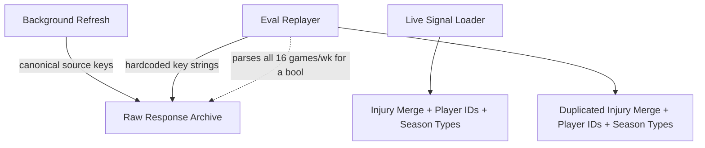
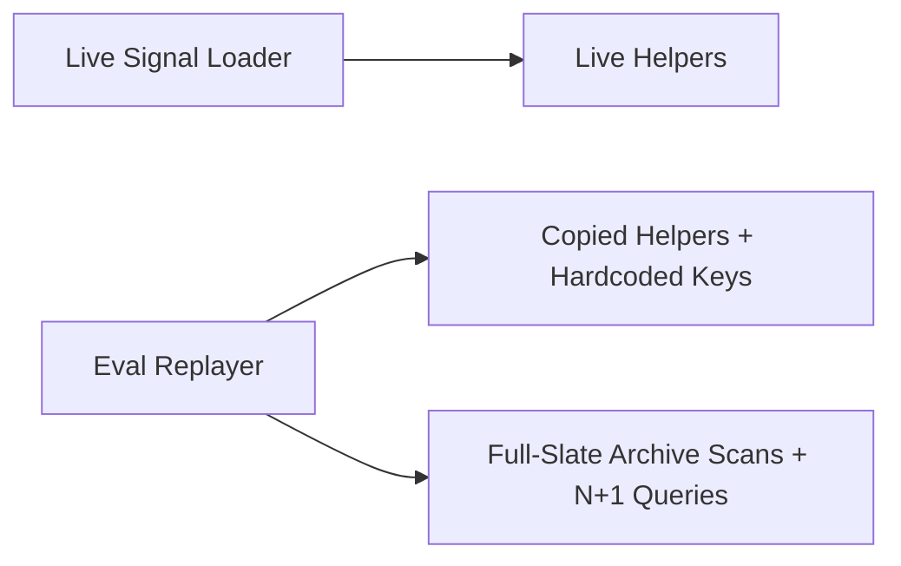
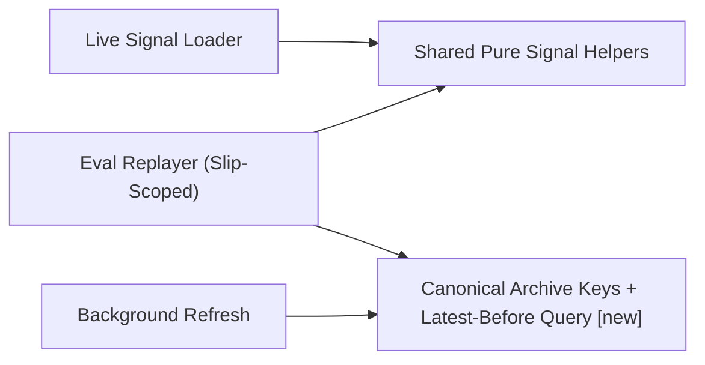

# Unify live and historical signal loading

## Context

Live grading loads player usage, team defense profiles, and merged ESPN injuries through a deepened signal loader.
Historical eval replay re-implements a parallel version of that pipeline against pre-kickoff archived payloads,
duplicating injury merging, player-ID extraction, and postseason season-type rules.

The replay module also hardcodes raw archive key prefixes as string literals instead of sharing the canonical key
builders used during background refresh. If a refresh source key changes, historical replay silently loses archive
coverage without failing a test.

Finally, replay does unnecessary work on every cache miss or CLI run: it scans and parses archived odds payloads for
every game on a week's slate (even games with zero slips) just to compute a coverage boolean, fetches slips and legs
with per-slip queries, and loads every historical archive row before kickoff only to pick the newest one in memory.

## Goals and non-goals

**Goals:**

- Share canonical archive source key builders between background refresh and historical replay so key formats have one
  source of truth.
- Share pure signal-assembly helpers (injury merging, player-ID deduplication, and postseason season-type handling)
  between live grading and historical replay while keeping the analyzer free of archive decompression and raw HTTP
  parsing.
- Add a direct latest-before-timestamp archive lookup at the storage seam and batch slip/leg reads during replay.
- Scope historical archive reads to games actually referenced by settled slips, and stop parsing full odds payloads just
  to report coverage presence.

**Non-goals:**

- Moving raw archive decompression or pre-kickoff replay into the live analyzer module.
- Falling back to live overwritten tables when pre-kickoff archive rows are missing (leak-free rules stay strict).
- Changing any analyzer scoring rules, weights, or calibration formulas.

## Decision

### Before

### After

Place canonical archive key builders and a latest-before-kickoff lookup at the storage seam, share pure injury-merging
and player/season assembly helpers across live and historical callers, and scope replay archive reads to games touched
by settled slips.

This beats pulling historical archive replay into the live analyzer module because live grading stays decoupled from raw
archive formats while two real adapters (live tables and pre-kickoff archive) share one signal-assembly seam with zero
drift.

`complexity: medium` fits because the change spans the storage archive seam, background refresh key naming, live signal
helpers, and leak-free historical replay while preserving strict pre-kickoff cutoff invariants. `risk: low` fits because
all behavior is deterministic and covered by in-memory SQLite replay tests that verify pre- and post-kickoff leakage
guards and identical graded outputs.
