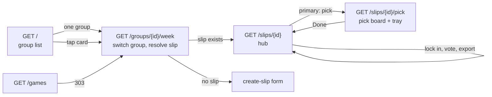
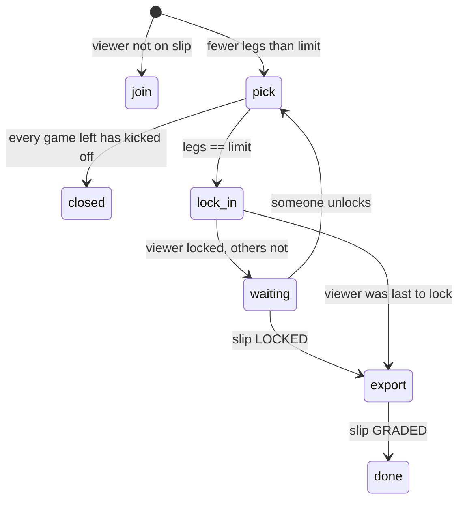

# Design: Make the weekly pick flow the center of the app

## Context

Read before starting:

- `plan/product.md#Screens`: the tab layout this change replaces.
- [Slips](../../docs/concepts/slips.md): editing and locking rules, quick-add, the Games tab, research.
- [Groups](../../docs/concepts/groups.md): `groups.Scope`, the `pc_group` cookie, the switcher.
- [Live updates](../../docs/concepts/live-updates.md): one stream per page, signals only, deadlines.
- [Data refresh](../../docs/concepts/data-refresh.md): `SyncGameProps`, credit floors, `kickOnPage`.
- [Export](../../docs/concepts/export.md), [Analyzer](../../docs/concepts/analyzer.md),
  [Routes](../../docs/reference/routes.md), [Schema](../../docs/reference/schema.md).

How the code is laid out today:

- `internal/web` owns every page. `slipHandlers` (`slips.go`) serves `/` (newest slip of the latest week in the active
  group), `/slips/{id}`, its partials, and every leg route. `gameHandlers` (`games.go`) serves `/games` and
  `/games/{id}/props`, and quick-add targets "the newest slip of the week" through `addSlipTarget`. `page.go` holds the
  four `navTabs`.
- `internal/slips.Service` (`rules.go`) owns every write rule. Each method runs one transaction, writes one activity
  entry, and calls `notify` (publishes `slip:{id}`) after commit. Handlers map its typed errors to 422s.
- `internal/groups` owns the `pc_group` cookie. `web` reads the active group through `Dependencies.GroupFrom`.
  `loadSlip` 404s a slip whose group is not the active one, which contradicts `groups.md` ("opening a slip from another
  of their groups switches the active group"). This change needs the documented behavior.
- `cmd/server/main.go` composes the muxes. `kickOnPage` starts a lazy refresh on full-page GETs only.
- Templates are Go `html/template` plus HTMX; `web/static/app.js` opens the one `EventSource` named by `data-live-url`.

Invariants to keep: rules stay in `internal/slips`; props load only for a game someone asks for; one stream per page;
signals carry no data; every screen is built at phone width first.

## Approach

### Screens and routes



- **Group list (`GET /`).** One card per membership, oldest first, each showing the group name and the viewer's
  `NextStep` on that group's newest slip of the latest week ("Pick 1 more", "Waiting on Ben", "Ready to place", "No slip
  yet"). A person with one group gets a 303 to `/groups/{id}/week`. No stream: the list carries
  `data-refresh-on-visible`, and `app.js` refetches it with HTMX when the tab becomes visible.
- **This week (`GET /groups/{id}/week`).** Checks membership (404 otherwise), sets `pc_group` through a new
  `Dependencies.SetGroup func(http.ResponseWriter, int64)` that `main.go` wires to `cookies.SetGroup`, then 303s to the
  newest slip of the latest week or renders the create form. `loadSlip` uses the same seam: a slip in another of the
  viewer's groups switches the active group instead of 404ing.
- **Hub (`GET /slips/{id}`).** Today's slip page, reordered: the step banner, then members and legs (with votes), then
  export, payout, and activity. Same stream, same partials.
- **Pick board (`GET /slips/{id}/pick`).** A focused page with a back link to the hub and no tab bar. It replaces
  `/games`, which becomes a 303 to the active group's week. `/games/{id}/props` stays as the one props-loading route and
  takes `?slip=` instead of guessing the slip.
- **Bottom bar:** Groups (`/`), This week (`/groups/{active}/week`), Record Book. Research leaves the bar; `/research`
  and its pages stay, linked from players, props, legs, and game rows.
- **Wider screens:** the hub stays one column; the pick board puts the tray in a right column at `lg`.

### Next step (`internal/slips/next.go`)

One pure function decides the banner on the hub and the summary on each group card, so both always agree.

```go
type Step string // pick, lock_in, waiting, export, done, closed, join

type Next struct {
    Step      Step
    Need      int        // legs still to pick
    WaitingOn []string   // names not locked in, in member order
    Deadline  *time.Time // first kickoff after now in the slip's week; nil when none
    Result    parlay.Result
}

func NextStep(slip db.Slip, members []db.SlipMember, legs []db.Leg, games []db.Game,
    viewerID int64, now time.Time) Next
```



`join` offers "Join this slip" (the existing add-member route with the viewer's own ID; the service now lets a group
member add themselves, which it previously refused). `closed` says picks are over
for you this week and still shows the slip. The deadline line reads "Picks close for BUF @ MIA at 1:00 PM" as a
`<time>`, formatted by `app.js` like every other time.

### Pick board (`internal/board`)

A new package turns stored data into searchable rows. It reads nothing itself, so it is easy to test.

```go
type Row struct {
    GameID, Market, Team, PlayerName, PlayerID, Side string
    Line     *float64
    Odds     int       // viewer's home book, else the median, as today
    Category Category  // lines, team_totals, passing, rushing, receiving, tds, kicking
    Window   Window    // sun_morning (<12 ET), sun_early (<16), sun_late (<19), sun_night, monday
    Kickoff  time.Time
    Text     string    // "Josh Allen Over 245.5 Pass Yds"
    Picked   int64     // the viewer's leg ID when this row is already on the slip
}

type Query struct{ Q string; Category Category; Window Window; Sort Sort; GameID string }

type Result struct {
    Rows     []Row
    Unloaded []UnloadedGame // games that match Q but whose props were never fetched
    Started  int            // games hidden because they kicked off
}

func Build(games []db.Game, odds []db.Odds, roster []db.RosterPlayer, homeBook string,
    mine []db.Leg, now time.Time) []Row
func Search(rows []Row, games []db.Game, roster []db.RosterPlayer, q Query) Result
```

- Search is case- and accent-insensitive over row text, team abbreviation and name, and matchup, using
  `db.NormalizePlayerName`. A query that matches a stored roster player or a team whose game has no props sync yet adds
  that game to `Unloaded`, rendered as "Props for BUF @ MIA aren't loaded yet. Load them". The button calls
  `/games/{id}/props?slip=`, which runs the existing `SyncGameProps` (floors and all), then retriggers the search.
- Sorts: kickoff (default), player, category, odds (shortest price first). Filters are chips that show only categories
  and windows with rows.
- Rows come from one `OddsForWeek` read (new store method) filtered through the existing `currentOdds`, instead of a
  query per game. `cardView`, `pickGameLine`, and the prop grouping in `games.go` move behind `board.Build` so the board
  and the old helpers do not drift.
- `GET /slips/{id}/pick/results?q=&cat=&win=&sort=&game=` returns the results partial. The search input uses
  `hx-trigger="input changed delay:250ms"`; chips and sort are links that swap the same partial and push the URL.
  `game=` shows one game with both sides of each line in one row.
- Tapping an unpicked row posts the existing add-leg route with `quick=1&from=board`. Tapping a picked row deletes that
  leg. Both answer with the row and `HX-Trigger: tray-updated`.

### Tray and replace

- The tray partial (`GET /slips/{id}/tray`) shows the viewer's legs with remove buttons, progress ("1 of 2"), the
  analyzer warnings that name one of the viewer's legs (filtered from the existing `analyzerView`), and one action:
  "Done" back to the hub, or "Review and lock in" at the limit. It refreshes on `tray-updated` and `slip-updated`.
- At the limit, tapping a row opens a sheet: "Swap which pick?" with the viewer's legs that are not kickoff-locked.
  Choosing one sends `PUT /legs/{old}` with the new pick's fields. `UpdateLeg` already enforces owner, lock in, and
  kickoff on both the old and the new game, and its activity entry reads "Adam changed X to Y". `ErrLegLimit` stays as
  the fallback for a race.
- The pick board page carries the slip's `data-live-url`, so it is still one stream per page; `board-updated` refreshes
  the results.

### Votes

```sql
CREATE TABLE leg_votes (
  leg_id     INTEGER NOT NULL REFERENCES legs(id) ON DELETE CASCADE,
  user_id    INTEGER NOT NULL REFERENCES users(id),
  value      INTEGER NOT NULL CHECK (value IN (-1, 1)),
  updated_at TEXT NOT NULL,
  PRIMARY KEY (leg_id, user_id)
);
```

- `Service.Vote(ctx, actorID, legID int64, value int) error` with value -1, 0 (clear), or 1. Rules: the actor is on the
  slip (`ErrNotMember`); the leg is not theirs (`ErrOwnVote`, "you can't vote on your own pick"); the slip status is
  `OPEN` (`ErrVotesClosed`, "votes closed once everyone locked in"). Kickoff does not close a vote. Unlock reopens
  voting because it sets the slip back to `OPEN`.
- The same value again is a no-op and publishes nothing. A change publishes `slip:{id}` but writes **no** activity
  entry; a feed full of thumbs would bury the picks. `slips.md` rule 9 records this one exception.
- `UpdateLeg` deletes the leg's votes in the same transaction when the pick changes (game, market, team, player, side,
  or line). An odds-only edit keeps them: it is the same pick at a new price. `DeleteLeg` clears them by cascade.
- The hub shows "▲ 2 ▼ 1" on every leg, with the viewer's own vote highlighted. Others' legs get tap targets while the
  slip is `OPEN`; the owner sees the tally only. Votes are kept after the week for the Record Book.

### Hand-off

- The `export` step puts the existing export panel at the top as the primary action, with "Prices may have moved since
  {lines as of}" from the existing lines note.
- The `waiting` step shows "Nudge {name}", which calls `navigator.share` with "Waiting on you for {slip}. Picks close
  {time}. {url}" and falls back to copying the text. Nothing is sent by the server.

### Rejected options

- **Client-side search over a JSON blob.** It would put a second rendering path in `app.js`. Server-side partials keep
  the logic in Go, where the tests are.
- **A live stream on the group list.** It would hold an instance open for a glance page. Refetch on visible is enough.
- **A separate `ReplaceLeg` method.** `UpdateLeg` already has the right checks; replace is an edit.
- **Votes as activity entries.** Noise, and it would make the feed the source of truth for a tally.

## Verification

- **Landing.** A new sign-up with only "Just me" lands on its create form in one redirect hop. A person in "Just me" and
  one club sees two cards with correct steps. Tapping the club card sets `pc_group`, and the Record Book then shows that
  club. Opening a slip URL from the other group switches the group instead of 404ing; a non-member still gets 404.
- **Steps.** Table tests for `NextStep` cover every state, the unlock path back to `pick`, `closed` when every remaining
  game has kicked off, `join` for a group member off the slip, past-week slips (no deadline), and a London 9:30 a.m. ET
  first kickoff as the deadline.
- **Board.** `board` tests cover each category and window mapping, the Monday-night UTC-Tuesday kickoff landing in
  `monday`, each sort, accent-insensitive search ("Chase" finds "Ja'Marr Chase"), started games hidden and counted, the
  home-book price over the median, and `Unloaded` naming a game when the query matches only its roster.
- **Credits.** Opening the board, typing, filtering, and sorting call `SyncGameProps` zero times (a counting fake
  `Refresher`); tapping "Load them" calls it once for that game.
- **Tray and replace.** Add, remove, and replace update the tray and the row; replace at the limit swaps the leg, writes
  one "changed" entry, and refuses a kickoff-locked leg and a locked-in member with the existing messages. A tray
  heads-up appears when a weather or correlation rule names the viewer's leg.
- **Votes.** Up, down, clear, repeat no-op, own-leg refusal, non-member refusal, closed after everyone locks, reopened
  after unlock, cleared by a line change, kept by an odds-only change, cascaded by delete, and a second browser's tally
  refreshing from `slip-updated`.
- **Live.** The board and hub each open one stream; the group list opens none (assert no `data-live-url`).
- **Sandbox.** Walk the whole flow on the sandbox's week 9 as two personas: list, hub, board, replace, lock in, vote,
  export. `/games` redirects. Check every screen at 375 px wide, then at `lg`.
- `go test ./...`, `golangci-lint run ./...`, `good-vibes docs lint`, `good-vibes check weekly-pick-flow`.

## Risks

- **Route churn breaks tests and bookmarks.** `/` and `/games` change meaning, and `cmd/server` and sandbox tests
  request both. Redirects keep old links working; the phase that moves a route updates its tests.
- **Group switching on GET.** Setting `pc_group` from a slip link changes which group other tabs see. That matches the
  documented rule and only ever picks a group the person belongs to.
- **Board cost per keystroke.** Each search rebuilds rows from one week of odds. A full week with a few games' props is
  a few thousand rows in SQLite on one instance; the 250 ms debounce and one `OddsForWeek` read keep it cheap. If it
  shows in latency, cache built rows per (week, odds fetch time).
- **Someone hits "Load them" on every game.** Each tap is a person asking for one game, the same as opening a card
  today, and the credit floors still apply. The board never loops over games.
- **Votes read as pressure.** A downvote on a friend's pick can sting. No names, no sorting by score, and no effect on
  anything keep it a tally; watch how the group uses it.
- **The group list reads four queries per card.** Each summary needs the group's slips, members, legs, and games, so a
  person in many groups pays that on every landing and every refetch-on-visible. The counts are small on one SQLite
  instance; if it shows, read the week's slips once and group them in Go.

## TODO

Effort: hard (navigation, a new search module, a new table, and live updates all move at once while credit and
single-instance limits hold)

### Phase 1: Land on groups and the hub

Effort: medium (new routes and a pure step function over existing data)

- [x] Serve the group list at `/` (one-group redirect, refetch on visible), add `GET /groups/{id}/week` with the
      `SetGroup` seam, switch the active group when a member opens another group's slip, and change the bottom bar to
      Groups, This week, Record Book with Games still reachable from the hub; test landing, switching, and non-member
      404s, and update `groups.md`, `routes.md`, and `access.md` where they describe the landing page
- [x] Add `slips.NextStep` and reshape the hub around its banner, deadline, and one primary action (pick links to
      `/games` until the board lands); test every step with an injected clock and update `slips.md`

### Phase 2: Build the pick board

Parallel: surfaces

- [ ] Add `internal/board` (`Build`, `Search`) and `Store.OddsForWeek`, serve `GET /slips/{id}/pick` and its results
      partial with search, category and window chips, sorts, the one-game view, toggle add and remove, and the "Load
      them" prompt; point the hub's pick action at it, make `/games` a 303, take `?slip=` on `/games/{id}/props`, and
      test search, sorts, windows, and zero prop syncs; update `slips.md`, `routes.md`, and `data-refresh.md`
- [ ] Add the tray (progress, remove, heads-ups on your legs, Done or Review and lock in) and replace at the limit
      through `PUT /legs/{id}`; test add, remove, replace, the kickoff and lock-in refusals, and the tray warning;
      update `slips.md` and `analyzer.md`

### Phase 3: Add votes

Parallel: surfaces

- [ ] Add the `leg_votes` migration, store methods, `Service.Vote`, and vote clearing in `UpdateLeg`; test every rule in
      the Votes verification list; update `schema.md` and the editing rules in `slips.md`
- [ ] Draw tallies and vote buttons on the hub's leg rows, read-only once the slip locks; test the views and a second
      client's refresh from `slip-updated`; update `slips.md` and `live-updates.md`

### Phase 4: Finish the hand-off and first-run states

Effort: medium (copy, states, and a full walk through the sandbox)

- [ ] Put export first in the `export` step with the prices note, and add the share-sheet nudge in the `waiting` step;
      test both and update `export.md`
- [ ] Give each empty state a real screen (only "Just me", a group with no slip, a week with no lines, a member still
      missing at the deadline) and walk the full flow in the sandbox as two personas at phone width; update
      `local-dev.md` and `sandbox-replay.md` where they name `/` or `/games`
- [ ] Docs: rewrite `plan/product.md#Screens` for the new flow, delete what `docs/` now covers, and run
      `good-vibes docs lint` and `good-vibes docs index`
