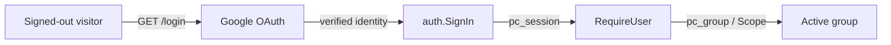

# Access

## Overview

People sign in with Google. Google proves the email, and the app accepts any verified account. One signed session cookie
keeps a browser signed in. A separate signed cookie remembers the active group. There are no passwords, no account
forms, and no name picker.

## Sign-in flow

1. `GET /login` is public. It shows a "Sign in with Google" button, plus a dev-only link when Google is not configured.
2. `GET /auth/google/start` makes a random `state`, `nonce`, and PKCE verifier, writes them to a signed `pc_oauth`
   cookie, and redirects to Google. The request asks for `openid email profile` with online access and PKCE `S256`.
3. Google returns the browser to `GET /auth/google/callback`. The handler checks `state` against the cookie, exchanges
   the code with the PKCE verifier, and verifies the ID token's signature, issuer, audience, expiry, and nonce.
4. An ID token with `email_verified` false is refused. Google must prove the address before it can name a user.
5. The verified identity goes through `auth.SignIn`. A known or new person gets a `pc_session` cookie, the round-trip
   cookie is cleared, and the browser lands on `/` or on the invite path they came from. `/` is the group list; a person
   in one group is sent straight on to that group's week.

A missing or expired `pc_oauth`, a wrong `state`, a failed exchange, or an identity with no subject or email returns the
sign-in page with a 400 and "Sign-in didn't work. Try again." No case sets a session cookie.

## Who gets in

Sign-up is open. Any Google account with a verified email can sign in. There is no allow list, and `RequireUser` does
not check one. What limits what a person sees is group membership, not the door.

`auth.SignIn` resolves a verified identity inside one transaction, in this order:

1. A user with this Google subject (`google_sub`): refresh the picture and finish.
2. A user with this email, ignoring case: attach the subject and picture to that user.
3. Otherwise create a user from Google's name and picture, then create a group named "Just me" and make them its first
   member.

A linked user keeps the name they already have. Google's name is used only when creating a user, so a changed Google
display name never renames someone's history. The picture refreshes on every sign-in.

`RequireUser` re-reads the user row on every request and refuses a missing or inactive user. It puts the user on the
request context, and handlers read it with `auth.UserFrom`. An inactive user (`users.active = 0`) is refused on their
next request.

## Joining from an invite

A signed-out visitor who opens `/join/{token}` is sent to `/login`, and the invite path is kept in the signed `pc_oauth`
cookie. After sign-in the browser lands back on the invite. Only a `/join/` path is accepted as a return target, so a
forged cookie cannot redirect off-site.

The invite path is signed but not tied to a user. The first sign-in replaces it with a real Google round trip, and the
callback always clears it. See [Groups](groups.md) for the invite, join, reset, and leave rules.

## Cookies

| Cookie       | Value                                                    | Proves                                 |
| ------------ | -------------------------------------------------------- | -------------------------------------- |
| `pc_session` | `{userID}.{expiryUnix}.{mac}`                             | The browser is signed in as that user. |
| `pc_oauth`   | `{state}.{nonce}.{verifier}.{issuedUnix}.{return}.{mac}`  | This browser started a Google trip.    |
| `pc_group`   | `{groupID}.{expiryUnix}.{mac}`                            | This browser's active group choice.    |

All three cookies are `HttpOnly` and `SameSite=Lax`, and carry `Secure` in prod. The server compares each MAC in
constant time. `SESSION_KEY` signs all three.

`pc_session` lives for 30 days at `Path=/`. Its MAC covers `"session:" + userID + "." + expiryUnix`, so a changed ID or
expiry breaks the cookie. `pc_oauth` lives for 10 minutes at `Path=/`, so a join path can be saved before the round trip
starts. Its MAC covers `"oauth:" +` the rest of the value, and its return field is base64 inside the cookie. `pc_group`
lives for 30 days at `Path=/`, and its MAC covers `"group:" + groupID + "." + expiryUnix`.

`pc_group` is a preference, not a permission. A forged or stale value only falls back to a group the person belongs to.
Opening `/groups/{id}/week` or a slip from another of their groups writes a fresh choice, and only after membership is
checked. The session and group cookies are cleared together on logout.

The session cookie's name changed from the foundation's `pc_auth` and `pc_user`. Old cookies are simply ignored, so the
first request after this change sends every browser back to `/login`. Rotating `SESSION_KEY` likewise invalidates every
session, round trip, and group choice.

## Middleware

The app passes through three wrappers, outermost first:

| Middleware    | Rejects                                                                  | Sends them to |
| ------------- | ------------------------------------------------------------------------ | ------------- |
| `CSRF`        | A non-GET request without `HX-Request: true`                              | 403           |
| `RequireUser` | A missing, tampered, expired, inactive, or unknown session               | `/login`      |
| `Scope`       | Nothing for a cookie; a signed-in person with no group gets a 500        | —             |

`CSRF` exempts two plain forms: `POST /logout` and `POST /dev/login`. Every other non-GET request must come from HTMX. A
custom header cannot be sent cross-site without CORS, and `SameSite=Lax` covers the exempt forms.

`RequireUser` sends an HTMX request a 200 with `HX-Redirect: /login` instead of a 302, because HTMX would swap a
redirect's empty body into the page. `Scope` sits inside `RequireUser`, so new authenticated routes inherit the active
group.

Several routes sit outside both wrappers: the health and readiness probes, `/static/`, the web app manifest, the service
worker, screenshot capability URLs, the sign-in routes, and the prefill endpoint. The manifest and the worker have to
be readable before a person signs in, which is what lets an installed app start at the sign-in page. The prefill route
sits on an outer mux, outside CSRF as well, and authenticates with a bearer token instead of a cookie. See
[Notifications](notifications.md) and [Routes](../reference/routes.md#public-routes).

Auth pages send `Cache-Control: no-store` because they show sign-in state.

## Avatars

One `avatar` partial draws a user. When `picture_url` is set it shows the Google picture with
`referrerpolicy="no-referrer"`. Otherwise it shows initials on the user's palette color. A new user gets the next color
from the fixed eight-color rotation. A linked history user keeps the name and color already stored, and Google only
refreshes the picture.

## Dev sign-in

`GET /dev/login` and `POST /dev/login` exist only when `APP_ENV=dev` and `GOOGLE_CLIENT_ID` is empty. The form takes an
email (required) and a name (optional). It calls `SignIn` with `Sub: "dev:" + email`, so user resolution, the solo
group, and the invite return path all run the same code as Google.

A dev with real client values uses the real Google flow, and the dev routes are not registered. Prod requires the Google
values and never registers them, so a misdeploy cannot expose a local sign-in form.

## Sandbox personas

`SUNDAY_SANDBOX=1` adds fixed people so a tester can move between perspectives without typing emails. Their addresses
end in `.test` and never look real: Ada, Ben, and Cleo share the **Sunday Sandbox** group, and Dex stays outside it with
their own group. The sandbox creates them through `auth.SignIn` with `dev:{email}` subjects, so they are ordinary user
rows with ordinary session cookies. The shared members join through the real invite operation, and the outsider joins
only when a tester opens the invite themselves.

`GET /dev/sandbox` shows the current persona, active group, stage, scenario time, and a switch button for each person.
`POST /dev/sandbox/persona` calls `auth.SignIn` again and sets both `pc_session` and `pc_group`. It does not inject a
user into the request context or grant extra permissions. `Scope` still checks the group against live membership, so a
forged group cookie falls back to a real group. Activity and grading therefore name the selected person, shared personas
see the slip, and the outsider gets the normal 404 until they accept the shared invite.

The controls page and its reset and persona posts are mounted only in sandbox mode. They sit inside `RequireUser`,
`Scope`, and the HTMX CSRF check like every other authenticated route. Normal dev and prod do not register them.

## Trade-offs

- Sign-up is open. Adding someone to a group takes an invite link, not a config change. A stranger can still reach the
  app and gets a solo group of their own.
- A signed cookie cannot be revoked per device. Deactivating the user stops their next request; rotating `SESSION_KEY`
  signs everyone out at once.
- A stolen session cookie works until it expires. There is no server-side session table to delete.
- Google is the only identity provider. A Google outage blocks new sign-ins, while already signed-in browsers keep
  working because each request reads SQLite.
- The app stores only what sign-in returns: subject, email, display name, and picture URL. It requests no Google API
  scopes beyond `openid email profile`, keeps no refresh token, and calls no Google API after sign-in.
- A linked user keeps their history name. Their Google display name can differ, which is intentional.

## Related

- [Groups](groups.md): membership, invites, the active group, and what a group scopes.
- [Local development](../guides/local-dev.md): the dev sign-in and how to test the real Google flow.
- [Configuration](../reference/config.md): the Google client values and `SESSION_KEY`.
- [Database schema](../reference/schema.md): the `users`, `groups`, and `group_members` tables.
- [Google OAuth setup](../runbooks/google-oauth-setup.md): the Web client, redirect URIs, consent screen, and secrets.
