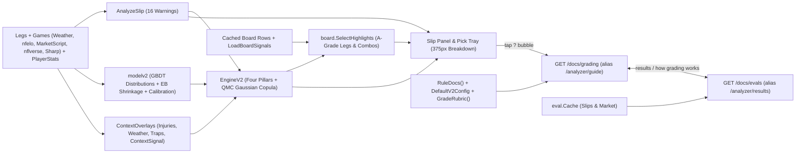

# Analyzer

## Overview

The analyzer is the sharp-friend layer on every slip. It reads the picks people made and points out where they fight
each other, the weather, key numbers, price, player history, nfelo's model, or nflverse team and usage trends. It also
computes deterministic calibrated A–F quality grades for each leg and for the slip as a whole. It never blocks a pick:
every leg stays allowed.

`internal/analyzer`'s rule and grading functions (`AnalyzeSlip`, `EvaluateSlip`, `ScoreLeg`, `ScoreSlip`) are pure Go:
no I/O, no clock, no network calls, and no LLM. The active engine is `EngineV2` (the calibrated four-pillar model,
with `EngineV1` kept for side-by-side comparison and offline evals). Grading runs on every slip and tray render, and
the same engine powers board-wide A-grade highlights using cached SQLite data only. Exact thresholds, pillar weights,
overlay rules, and the v1 rubric live in [Analyzer rules](../reference/analyzer-rules.md).

## What the banner shows

The slip panel renders the Analyzer section under the legs, with a "How grading works" link to `/docs/grading`:

- **Overall slip grade**: a clickable A–F pill with a one-line sharp-friend summary. Tapping it opens an inline
  `
` breakdown formatted for 375px phone width: an optional "High uncertainty" badge, a copula Script
  multiplier summary on multi-leg slips, the four 0–100 pillar meters (Price & Vig, Script Fit, Stability & Tail Risk,
  Context & Traps), up to three plain-English "Why" bullets from the strongest drivers, and a `?` bubble to
  `/docs/grading#slip-grade`. When `Pillars` is empty (such as under `EngineV1`), the popover falls back to the factor
  list.
- **Per-leg grade pills**: each graded leg row displays its A–F pill; tapping it opens the same compact four-pillar
  breakdown for that leg and a `?` bubble to `/docs/grading#leg-grades`. Legs with market `OTHER` or an unmatched game
  show no grade pill.
- **Warning cards**: with no warnings it shows a green "Looks clean". Otherwise it shows one card per warning, sorted
  Danger, Warn, then Info and colored red, amber, and blue. Each card carries the message, the severity, a chip for
  every leg involved with its owner's name, and a `?` bubble to `/docs/grading#rule-<id>`.

Other inline annotations pair with the same `?` bubble: the `nfelo` model chip points at `#term-nfelo`, implied chance
at `#term-implied-prob`, reference odds at `#term-reference-odds`, live hit chance at `#sys-live`, and the pick detail's
badge row at `#suggestions`. Every bubble carries the current screen as `?from=` so the docs page can link back. Tapping
outside an open grade breakdown closes it, so popovers never stack on a phone.

The banner is part of the slip panel, so it refreshes with the panel on `slip-updated` and `board-updated`. A weather or
nflverse update needs no separate wiring: the next board refresh re-renders the slip, and the rules and grades see the
new data. See [Live updates](live-updates.md).

## The pick dock's tray

The pick board's fixed dock shows your count and the combined price of your legs. Its "Slip" button opens a sheet with
`#pick-tray`, which renders the same clickable per-leg grade pills, overall four-pillar slip breakdown, and the warnings
that name one of your own legs. `internal/web/pick.go` runs the analyzer over the whole slip, then keeps a warning card
when any leg it names belongs to the viewer. A heads-up about a friend's pick stays on the hub and out of your tray,
where it would only be noise while you pick. A warning that names both your leg and theirs still appears, because it
bears on the pick you are making.

The dock and the tray inside its sheet refresh with the pick board on `tray-updated` and `slip-updated`, so a new leg or
a fresh forecast brings its grade and warning without a reload. See [Slips](slips.md#the-pick-board).

## Calibrated four-pillar grading (v2)

Instead of collapsing every signal into one flat additive checklist, `EngineV2` separates pricing, script correlation,
distributional stability, and situational context into four 0–100 pillars. A coherent same-game stack with steep leg
juice shows green Script Fit alongside red Price & Vig instead of hiding one inside the other.

### Distributional prop models and market blending

`internal/modelv2` loads a self-contained embedded JSON artifact built offline in `ml/` with zero runtime Python or
external I/O. For each supported player prop market (passing yards, rushing yards, receiving yards, receptions, rush
attempts, passing TDs, and anytime TD), flat gradient-boosted trees predict full outcome distribution parameters rather
than a single point estimate:

- **Continuous yardage** uses zero-adjusted Gamma (or Log-Normal) curves so alt lines and boom-or-bust skewness come
  directly from the survival function.
- **Discrete counts and touchdowns** use Negative Binomial, Poisson, or Bernoulli distributions.
- **Early-season Empirical Bayes shrinkage**: during Weeks 1–5 (fewer than 5 prior games played), observed EWMA usage
  and production features shrink smoothly toward role-archetype priors (QB, WR1, WR2, TE1, RB1, RB2) so small-sample
  spikes do not overfit.
- **Market anchor and post-hoc calibration**: survival probabilities blend with Power-devigged sharp or consensus market
  probabilities (accounting for favorite-longshot bias better than multiplicative normalization), then pass through a
  learned Platt or isotonic calibrator. Game lines (spread, moneyline, total, and team total) blend Power-devigged sharp
  anchors with nfelo and cached `MarketScript` normal-model baselines.

### Copula script scoring

Multi-leg tickets score game-script fit using a deterministic Gaussian copula rather than hardcoded pair bonuses alone:

- **Independent games multiply**: legs in different games multiply independently.
- **Same-game legs share a latent correlation matrix**: the copula maps each leg to a canonical role-market node,
  selects a regime matrix (heavy favorite, shootout, or neutral) from cached spread and total, applies within-player
  overrides (such as receptions with receiving yards) and Under sign flips, and runs Cholesky decomposition.
- **Zero-jitter determinism**: evaluating 8,192 precomputed quasi-Monte-Carlo (Sobol/Halton) normal vectors gives
  sub-millisecond joint probabilities that never jitter across page reloads.
- **Script multiplier and SGP tax**: the joint-to-independent ratio (`CorrMultiplier`) drives Script Fit on multi-leg
  slips, while Price & Vig checks whether the book's combined SGP price already charges for that positive correlation.

### Extensible context and injury overlays

Weekly statistical features cannot see Sunday morning inactive reports, late weather shifts, or narrative recency traps.
`EvaluateOverlays` runs an ordered slice of pure `ContextOverlay` checks on every leg without touching model weights:

- **Retained v1 intelligence**: player injury status (Out, Doubtful, Questionable), same-position teammate-out volume
  bumps, nfelo QB drag, wind headwinds, light-rain myths, spread hooks, total key numbers, shrinking snap/target roles,
  and TD spike risk.
- **New v2 trap checks**: a narrative streak trap (when a 5-game streak pushes the line past recent averages or leaves
  fair odds under 50/50) and a model-vs-market divergence check (when model and sharp market odds disagree widely).
- **Zero-retrain context seam**: `external_context_signals` consumes structured `ContextSignal` items attached to a game
  or player stats (injuries, inactives, line moves, or news).

When any active overlay flags heightened uncertainty (injuries, teammate-out bumps, shrinking roles, wide model-market
gaps, or uncertain external signals), `EngineV2` shifts the market blend weight +15 percentage points toward the live
market anchor (up to 95%) and surfaces the "High uncertainty" badge in the UI.

### Rolling up the four pillars

Legs combine Price & Vig (40%), Stability & Tail Risk (25%), and Context & Traps (35%) — or 30/15/25/30% when
single-leg script alignment applies. Slips combine Price & Vig (35%), Script Fit (25%), Stability & Tail Risk (20%),
and Context & Traps (20%). Severe Danger overlays, strong negative correlation (multiplier below 0.85), or extreme vig
cap scores below B, while Warn conflicts or uncertainty cap slips below A. Scores map to A (85–100), B (73–84),
C (60–72), D (48–59), and F (0–47).

## A-grade highlights

While a slip is open and the viewer still needs picks, `board.SelectHighlights` (`internal/board/highlights.go`)
surfaces top A-grade plays from cached SQLite odds without triggering any external API calls:

- **Batched board signals**: `LoadBoardSignals` loads games, weather, nfelo, nflverse team EPA, role-defense profiles,
  EWMA usage, `MarketScript` anchors, sharp-book benchmarks, and player game logs in batched SQLite queries.
- **Leg selection**: `SelectHighlights` scores unpicked, non-OTHER board rows with `ScoreLeg`, keeps A-grade legs
  (score >= 85), ranks by score and payout, and caps at 1 leg per player (up to 3 legs by default).
- **Bounded combo generation**: from up to 12 top A-grade legs (plus up to 6 B-grade same-game stack partners), it
  evaluates conflict-free 2- and 3-leg combos with `ScoreSlip`, rejects any combo with a Warn or Danger conflict, and
  keeps A-grade combos (up to 2 on the hub, or 1 same-game combo in `#pick-detail`).
- **Consistency**: because highlights run through `ActiveEngine`, adding a highlighted leg or combo lands on the slip
  with the exact same grade. When nothing reaches A, the strip hides cleanly.

### Offline evals and engine comparison

Both `EngineV2` (active) and `EngineV1` (additive `RubricV1` baseline) stay registered in `BuiltInEngines` so offline
evals and in-app results can compare them on identical pre-kickoff data. To prevent post-kickoff data leakage,
`internal/eval` reads nflverse rows strictly prior to the target week and reconstructs overwritten inputs (game logs,
injury statuses, rosters, and odds) only from pre-kickoff archive payloads, failing soft and reporting coverage counts
when an archive entry is missing.

Two shared signal reconstructions keep replay aligned with live scoring:

- **Pre-kickoff sharp benchmarks**: archived `odds:lines` and `odds:props:{gameID}` responses recorded before kickoff
  are matched to each game, resolved against pre-kickoff rosters and prior-week nflverse rows, and passed through
  `BuildSharpBenchmarks` to compute Power-devigged `SharpQuote` benchmarks.
- **Prior-week nflverse L5 fallback**: when no pre-kickoff game-log archive exists for a player, `PlayerStats.Games`
  falls back to strictly prior-week `nflverse_player_weeks` rows in the same season.

Eval supports user slips (`ModeSlips`, default, keeping all pre-kickoff slip legs for copula/script evaluation while
counting settled legs for calibration) and market-wide replay (`ModeMarket`, consensus pre-kickoff lines graded
deterministically across final games). Evaluation computes proper scoring rules (Log Loss, Brier Score, Classwise ECE,
10-bin reliability spread targeting at least 80% populated bins, Market Log Loss, and SGP Log Loss vs. naive
independence) alongside A–F band calibration, lift, flat ROI, weekly progression, factor attribution, and band
migrations. In CI, `.github/workflows/ci.yml` runs `cmd/eval` against the real 2025 Weeks 7–10 replay fixture
`internal/eval/testdata/benchmark_dataset.json`. See [Local development](../guides/local-dev.md#offline-grading-evals)
for CLI and `mise run eval-prod` usage.

## In-app grading guide and results

`GET /analyzer/guide` renders the four v2 pillars, uncertainty badge behavior, active engine badge, live A–F bands,
v1 rubric reference, and every warning rule (`RuleDocs`) directly from `internal/analyzer`, so the guide cannot drift
from live thresholds. Stable anchors (`#pillars`, `#leg-grades`, `#slip-grade`, `#suggestions`, `#rule-<id>`) let any
warning card or grade breakdown link straight to its explanation, with a safe `?from=` back link and a "Grading results"
link to `/analyzer/results`.

`GET /docs/grading` and `GET /analyzer/guide` share one handler, as do `GET /docs/evals` and `GET /analyzer/results`.
Every path sets `page.Tab = TabDocs` and renders the docs section switcher (`Overview`, `Glossary`, `Grading & Rules`,
`Eval Results`), so the Docs tab stays lit and an older `/analyzer/...` bookmark still lands on the same page.

`GET /analyzer/results` shows live calibration across `?source=slips|market` and `?engine=v2|v1`:

- **Probability calibration & SGP lift**: displays Log Loss, Brier Score, Classwise ECE, 10-bin spread, market
  baselines, a 10% reliability table, and SGP Correlation Lift comparing copula joint log loss against naive leg
  multiplication on settled SGPs.
- **User slips (`?source=slips`, default)**: aggregates settled slips across all groups for A–F leg and slip bands,
  side-by-side Engine Comparison, engine diffs/migrations, weekly progression, leg and slip factor attribution, and
  pre-kickoff data coverage.
- **Market-wide (`?source=market`)**: replays pre-kickoff consensus lines across final games, hides slip-only sections,
  and adds Sharp benchmarks and nflverse L5 fallback coverage tiles.

`eval.Cache` (`internal/eval/cache.go`) memoizes suite reports in memory by mode, group ID, and season. Settlement in
`internal/slips` invalidates slip entries via `SetOnGradeChange` without evicting market entries;
`refresh.Service.SetOnMarketDataChange` calls `InvalidateMarket` when games reach `FINAL` or `syncNFLverse` commits; and
sandbox transitions clear the cache.

## Tone

Warnings, pillar summaries, and "Why" bullets read like a sharp friend's heads-up: short, specific, and free of
lectures. They name the people, teams, odds, and fair prices (for example, "Paying -130 vs. fair price near -105"),
never say "don't", and never expose raw "+EV %" copy. The tone rules live in `plan/analyzer.md`.

## Inputs

`AnalyzeSlip`, `EvaluateSlip`, `ScoreLeg`, and `ScoreSlip` take three plain values:

| Input   | Fields the rules and scorer read |
| ------- | -------------------------------- |
| `legs`  | owner name, game, market, team, player, side, line, American odds |
| `games` | teams, indoor flag, weather, nfelo model, nflverse team EPA & pace, role-specific defense allowed, consensus `MarketScript` (spread, total, implied totals), merged injuries, Power-devigged sharp benchmarks, and optional `ContextSignals` |
| `stats` | per-player ESPN game logs per market (most recent first, this season), position, role archetype, nflverse usage, EWMA opportunity metrics, and optional `ContextSignals` |

`LoadSlipSignals`, `LoadBoardSignals`, `LoadGameSignals`, and `LoadPlayerResearchSignals` build these maps in batched
SQLite queries. Team injuries merge `games.injuries_json` (primary) with key-position injuries from `roster_players`,
and external models fail soft: nfelo requires a `SCHEDULED` game and under 72-hour freshness, nflverse requires under
7-day freshness (including optional expected-opportunity rows), and sharp benchmarks pair two-way quotes across Tier 1
(Pinnacle, Circa, Bookmaker), Tier 2 (LowVig, BetOnline), and Tier 3 (at least 3 traditional books, excluding DFS apps
and exchanges) using Power de-vigging.

Legs with market `OTHER`, an empty `GameID`, or a `GameID` missing from `games` are skipped cleanly. Output order is
deterministic and stable across reloads.

## Related

- [Analyzer rules](../reference/analyzer-rules.md): every warning rule, trigger, four-pillar formula, model family,
  copula threshold, overlay table, and v1 rubric reference.
- [Odds math](../reference/odds-math.md): Power and Shin de-vigging, fair EV, and live progress math.
- [Slips](slips.md): the legs, highlights, and games the banner reads.
- [Data refresh](data-refresh.md): where weather, nfelo, nflverse, and expected-opportunity signals come from.
