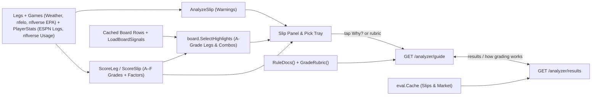

# Analyzer

## Overview

The analyzer is the sharp-friend layer on every slip. It reads the picks people made and points out where they fight
each other, the weather, key numbers, price, player history, nfelo's model, or nflverse team and usage trends. It also
computes deterministic A–F quality grades for each leg and for the slip as a whole. It never blocks a pick: every leg
stays allowed.

`internal/analyzer`'s rule and grading functions (`AnalyzeSlip`, `ScoreLeg`, `ScoreSlip`) are pure Go: no I/O, no clock,
no network calls, and no LLM. They run on every slip and tray render, and their output is not stored. The same
`ScoreLeg` and `ScoreSlip` engine also powers board-wide A-grade highlights on the hub and pick board using cached
SQLite data only. The rule list, thresholds, and grading rubric live in
[Analyzer rules](../reference/analyzer-rules.md).

## What the banner shows

The slip panel renders the Analyzer section under the legs, with a `"How grading works"` link to `/analyzer/guide`:

- **Overall slip grade**: a clickable A–F pill with a one-line sharp-friend summary. Tapping it opens an inline
  `
` breakdown of slip-level factors (positive stacks, script conflicts, parlay drag, and extra chalk drag)
  plus a "See full rubric" link to `/analyzer/guide#slip-grade`.
- **Per-leg grade pills**: each graded leg row displays its A–F pill; tapping it opens an inline `
` breakdown
  of that leg's exact score factors and a link to `/analyzer/guide#leg-grades`. Legs with market OTHER or an unmatched
  game show no grade pill.
- **Warning cards**: with no warnings it shows a green "Looks clean". Otherwise it shows one card per warning, sorted
  Danger, Warn, then Info and colored red, amber, and blue. Each card carries the message, the severity, a chip for
  every leg involved with its owner's name, and a "Why?" link to `/analyzer/guide#rule-<id>`.

The banner is part of the slip panel, so it refreshes with the panel on `slip-updated` and `board-updated`. A weather or
nflverse update needs no separate wiring: the next board refresh re-renders the slip, and the rules and grades see the
new data. See [Live updates](live-updates.md).

## The pick dock's tray

The pick board's fixed dock shows your count and the combined price of your legs. Its "Slip" button opens a sheet with
`#pick-tray`, which renders the same clickable per-leg grade pills, overall slip grade breakdown, and the warnings that
name one of your own legs. `internal/web/pick.go` runs the analyzer over the whole slip, then keeps a warning card when
any leg it names belongs to the viewer. A heads-up about a friend's pick stays on the hub and out of your tray, where it
would only be noise while you pick. A warning that names both your leg and theirs still appears, because it bears on the
pick you are making.

The dock and the tray inside its sheet refresh with the pick board on `tray-updated` and `slip-updated`, so a new leg or
a fresh forecast brings its grade and warning without a reload. See [Slips](slips.md#the-pick-board).

## Leg and slip grades

`ScoreLeg` starts every matched leg at a baseline of 75 (B) and applies adjustments across three capped categories:

- **Form & usage (-20 to +15)**: recent L5 hit rate (+10), rising snap/target share (+5), teammate-out role bump (+5
  when a same-position WR/TE/RB teammate is Out), L5 median trap (-15, softened to -5 with a same-position teammate
  Out), and shrinking role (-15).
- **Matchup & environment (-20 to +15)**: weak opposing EPA defense (+10), tough matchup (-12), wind (-8 or -18), QB
  drag (-8), and fake weather (-3).
- **Line & price (-20 to +15)**: nfelo spread cushion (+8), hook (-10, softened to -4 with cushion), total key number
  (-5), heavy chalk (-10 to -18), and sharp-book line/price comparisons (+8/+6 from Tier 1/2 sharp books or +5/+4 from
  market consensus when beating the line or de-vigged fair price; -8/-6 or -5/-4 when giving up line value or paying
  steep juice).

The clamped 0–100 score maps to A (85–100), B (73–84), C (60–72), D (48–59), or F (0–47).

`ScoreSlip` averages the numeric scores of all graded legs, then applies slip-level adjustments: +8 per positive stack
(shootout or clock-drain), -12 per Warn script conflict (blowout passing), -20 per Danger conflict (trailing RB, total
contradiction), -3 per leg beyond 3 legs, and -5 per heavy chalk leg beyond the first.

## A-grade highlights

While a slip is open and the viewer still needs picks, `board.SelectHighlights` (`internal/board/highlights.go`)
surfaces top A-grade plays from cached SQLite odds without triggering any external API calls:

- **Batched board signals**: `LoadBoardSignals` loads games, weather, nfelo, nflverse team EPA and usage, sharp-book
  benchmarks, and player game logs for all matched players on the board in batched SQLite queries.
- **Leg selection**: `SelectHighlights` scores unpicked, non-OTHER board rows with `ScoreLeg`, keeps A-grade legs
  (score >= 85), ranks by score and payout, and caps at 1 leg per player (up to 3 legs by default).
- **Bounded combo generation**: From a bounded pool of up to 12 top A-grade legs (plus up to 6 B-grade same-game stack
  partners for shootout or clock-drain stacks), it evaluates conflict-free 2- and 3-leg combos with `ScoreSlip`, rejects
  any combo with a Warn or Danger conflict, and keeps A-grade combos (up to 2 on the hub, or 1 same-game combo in
  `#pick-detail`).
- **Consistency**: Because highlights run through `ScoreLeg` and `ScoreSlip`, adding a highlighted leg or combo lands on
  the slip with the exact same grade. When nothing reaches A, the strip hides cleanly.

### Versioned rubrics and offline evals

Scoring weights, category clamps, slip adjustments, and A–F cutoffs live in Rubric (`internal/analyzer/rubric.go`)
rather than hardcoded constants. RubricV1 holds the baseline production weights, ActiveRubric selects the live rubric,
and BuiltInRubrics exposes all registered rubrics in order. ScoreLeg, ScoreSlip, and GradeRubric all read from
ActiveRubric, while ScoreLegWithRubric and ScoreSlipWithRubric accept any rubric value without mutating live state.

To test weight changes against settled outcomes before promoting a new rubric, the eval package replays historical weeks
read-only from SQLite. To prevent post-kickoff data leakage, the replayer reads nflverse rows strictly prior to the
target week and reconstructs overwritten inputs (game logs, injury statuses, rosters, and odds) only from archived API
responses recorded before kickoff, failing soft and reporting coverage counts when an archive entry is missing.

Two shared signal reconstructions keep replay aligned with live scoring:

- **Pre-kickoff sharp benchmarks**: Archived `odds:lines` and `odds:props:{gameID}` responses recorded before kickoff
  are matched to each game (by `odds_event_id` or team names and kickoff) and resolved against pre-kickoff archived
  rosters plus prior-week nflverse rows, then passed through BuildSharpBenchmarks to populate `Game.Sharp` (`WithSharp`
  coverage).
- **Prior-week nflverse L5 fallback**: When no pre-kickoff `espn:gamelog:{id}` archive exists for a player,
  `PlayerStats.Games` falls back to strictly prior-week `nflverse_player_weeks` rows in the same season (and backfills
  missing player positions), tracked separately as `WithL5Fallback` coverage alongside `WithGameLogs`.

Eval supports two replay modes:

- **User slips (`ModeSlips`, default)**: Every leg on a graded slip—including unsettled legs on an early-busted
  parlay—stays on the replayed slip so ScoreSlipWithRubric sees the full pre-kickoff slip (parlay drag, chalk drag,
  stacks, and script conflicts), while leg calibration bands, leg factor attribution, and band migrations count only
  settled legs.
- **Market-wide (`ModeMarket`)**: For each `FINAL` game with pre-kickoff archived odds, `board.Build` (with an empty
  home book) deduplicates multi-book quotes into one median-line, median-price candidate leg per selection side. Game
  lines and team totals grade deterministically from `FINAL` scores via `grader.GradeLeg`; player props prefer
  completed archived ESPN box scores (preserving true DNPs as `Void`) and fall back to same-week `nflverse_player_weeks`
  rows when no completed box score is archived, dropping unmatched players (`NeedsGrading`) rather than emitting false
  voids. `Evaluate` scores market candidates with ScoreLegWithRubric and populates leg bands, weekly progression, leg
  factors, and leg band migrations while leaving slip-level bands and factors empty.

Evaluation computes leg and slip calibration by band, lift over implied odds, flat ROI, Brier score, week-over-week
progression, and both leg-level and slip-level factor attribution (`Factors` and `SlipFactors`, labeled via
GradeRubricFor). EvaluateAll evaluates all built-in rubrics and compares subsequent rubrics against the baseline,
matching leg outcomes by `(SlipID, LegID)` (or synthetic market-leg coordinates) to build the leg band migration matrix
(with CompareRubrics as the dataset-driven comparison entry point). The eval CLI (`cmd/eval`) prints both leg and slip
factor attribution in text, Markdown, and JSON outputs when present, omitting empty slip calibration and slip factor
sections cleanly.

In CI, `.github/workflows/ci.yml` runs the eval CLI against the synthetic fixture
`internal/eval/testdata/benchmark_dataset.json` and appends the Markdown benchmark summary to the workflow job summary
without accessing production data or credentials. See [Local development](../guides/local-dev.md#offline-grading-evals)
for CLI and `mise run eval-prod` usage.

## In-app grading guide and results

`GET /analyzer/guide` renders the live rubric (GradeRubric) and every active warning rule (RuleDocs) directly from
`internal/analyzer`, so the guide page cannot drift from the engine's thresholds. Stable anchors (`#leg-grades`,
`#slip-grade`, `#suggestions`, `#rule-<id>`) let any warning card or grade breakdown link straight to its explanation,
with a safe `?from=` back link to return to the slip or pick board, plus a "Grading results" link to
`/analyzer/results`.

`GET /analyzer/results` shows live calibration in two views via `?source=slips|market`:

- **User slips (`?source=slips`, default)**: Aggregates every group's settled slips to show A–F leg and slip bands
  (record, hit %, implied %, lift, flat ROI), side-by-side rubric comparison when multiple built-in rubrics exist,
  chronological week-over-week progression, ranked leg factor attribution, Slip Factor Attribution (sample count N, record
  W-L, Hit %, Lift, and Avg Δ for parlay-level rules when non-empty), and pre-kickoff data coverage.
- **Market-wide (`?source=market`)**: Replays pre-kickoff consensus lines across `FINAL` games, hides the slip-only
  sections (`Slip Calibration` and `Slip Factor Attribution`, linking back to `User slips`), and adds `Sharp benchmarks`
  and `nflverse L5 fallback` coverage tiles.

To avoid replaying SQLite on every page load without persisting derived tables, `eval.Cache` (`internal/eval/cache.go`)
memoizes each suite report in memory by `(mode, groupID, season)`. Normal settlement and re-grading in `internal/slips`
invalidate the affected group's slip entries (and global `0` slip entries) after commit via `SetOnGradeChange` without
evicting market entries; `refresh.Service.SetOnMarketDataChange` calls `InvalidateMarket` when `syncScoreboard` sees a
game newly reach `FINAL` or `syncNFLverse` commits changes without evicting slip entries; and sandbox stage transitions
or resets clear the whole cache.

## Tone

Warnings and grade summaries read like a sharp friend's heads-up: short, specific, and free of lectures. They name the
people, the teams, and the numbers, and they suggest a better pick or a safer number. They never say "don't," and they
never explain expected value—even sharp-book price notes cite the actual sharp line or fair American odds (such as
"Strong price at +105 vs. LowVig fair price near -108.") rather than "+EV %". A warning on two people's legs names both
owners, such as "Adam's BUF -7.5 + Sam's Josh Allen Over 245.5."

The tone rules live in `plan/analyzer.md`. Every message is checked against them before an analyzer change ships.

## Inputs

AnalyzeSlip, ScoreLeg, and ScoreSlip take three plain values:

| Input | Fields the rules and scorer read |
| ----- | -------------------------------- |
| legs  | owner name, game, market, team, player, side, line, American odds |
| games | home and away teams, indoor flag, weather (wind, gusts, precipitation, temperature), nfelo model (spread, win probability, QB adjustments), nflverse team EPA & pace, merged team injuries, de-vigged sharp-book benchmarks |
| stats | per-player ESPN game logs per market (most recent game first, this season only), ESPN position, and nflverse weekly snap/target/opportunity usage |

`internal/analyzer` (`LoadSlipSignals`) builds games and stats from the week's games, stored odds, player game logs,
`roster_players`, `nfelo_games`, and nflverse tables when `internal/web` renders the panel or tray (with
`LoadBoardSignals`, `LoadGameSignals`, and `LoadPlayerResearchSignals` serving highlights, the pick board, and player
research). It keys the games map by the same GameID each leg carries, so no leg loses its game.

For team injuries, `LoadSlipSignals` (via `MergeGameInjuries` and `espn.MergeTeamInjuries`) merges `games.injuries_json`
from ESPN's game summary with key-position injuries from `roster_players.injury_status`. Summary entries stay primary
for their richer detail and 15-minute game-day refresh, while roster injuries backfill any key-position player truncated
past ESPN's 5-per-team summary cap. `ScoreLeg` uses the merged `Game.Injuries` list and `PlayerStats.Position` for
deterministic teammate-out grading.

stats maps ESPN athlete IDs to season game logs across markets (PASS_YDS, RUSH_YDS, REC_YDS, RECEPTIONS, PASS_TDS,
RUSH_ATT, ANYTIME_TD, KICKER_PTS) and optional nflverse usage weeks. `internal/analyzer` loads player game logs and
nflverse player weeks for every distinct matched PlayerID on the slip. An unmatched player, a missing game log, or a
market/usage history with fewer than 3 games leaves player-stat and usage rules quiet.

External models and efficiency data are optional inputs, not requirements:

- **nfelo**: `internal/analyzer` attaches it only when the game is SCHEDULED and a successful nfelo projections fetch is
  under 72 hours old. Otherwise the model is nil and QB drag / model sentences stay quiet.
- **nflverse**: `internal/analyzer` attaches HomeEPA, AwayEPA, and Usage only when the season nflverse sync is under 7
  days old. Missing or stale nflverse rows leave those fields nil so nflverse warnings and EPA/usage grade factors fail
  soft.
- **Sharp benchmarks**: LoadSlipSignals builds Game.Sharp in memory from current two-way odds rows in three tiers: Tier
  1 (Pinnacle, Circa, Bookmaker), Tier 2 (LowVig, BetOnline), and Tier 3 (market consensus across at least 3 traditional
  sportsbooks quoting the same line, excluding DFS pick'em apps and peer-to-peer exchanges). One-sided markets (like
  anytime TD), unpaired quotes, and missing odds fail soft cleanly.

The underlying rows come from [Data sources](../reference/data-sources.md) through [Data refresh](data-refresh.md).

Legs the analyzer skips:

- market OTHER;
- an empty GameID;
- a GameID missing from the games map.

Output order is stable: severity first (Danger before Warn before Info), then the slip position of the first leg named.
The same slip and data always produce the same warnings and grades.

## Related

- [Analyzer rules](../reference/analyzer-rules.md): every rule, its severity, trigger, example message, and the full
  `A`–`F` grading rubric.
- [Slips](slips.md): the legs and games the banner reads.
- [Data refresh](data-refresh.md): where the weather, nfelo, and nflverse signals come from.
