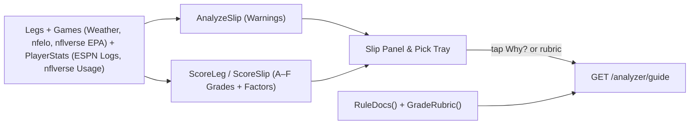

# Analyzer

## Overview

The analyzer is the sharp-friend layer on every slip. It reads the picks people made and points out where they fight each other, the weather, key numbers, price, player history, nfelo's model, or nflverse team and usage trends. It also computes deterministic `A`–`F` quality grades for each leg and for the slip as a whole. It never blocks a pick: every leg stays allowed.

`internal/analyzer`'s rule and grading functions (`AnalyzeSlip`, `ScoreLeg`, `ScoreSlip`) are pure Go: no I/O, no clock, no network calls, and no LLM. They run on every slip and tray render, and their output is not stored. The rule list, thresholds, and grading rubric live in [Analyzer rules](../reference/analyzer-rules.md).

## What the banner shows

The slip panel renders the Analyzer section under the legs, with a `"How grading works"` link to `/analyzer/guide`:

- **Overall slip grade**: a clickable `A`–`F` pill with a one-line sharp-friend summary. Tapping it opens an inline `
` breakdown of slip-level factors (positive stacks, script conflicts, parlay drag, and extra chalk drag) plus a `"See full rubric"` link to `/analyzer/guide#slip-grade`.
- **Per-leg grade pills**: each graded leg row displays its `A`–`F` pill; tapping it opens an inline `
` breakdown of that leg's exact score factors and a link to `/analyzer/guide#leg-grades`. Legs with market `OTHER` or an unmatched game show no grade pill.
- **Warning cards**: with no warnings it shows a green `"Looks clean"`. Otherwise it shows one card per warning, sorted `Danger`, `Warn`, then `Info` and colored red, amber, and blue. Each card carries the message, the severity, a chip for every leg involved with its owner's name, and a `"Why?"` link to `/analyzer/guide#rule-<id>`.

The banner is part of the slip panel, so it refreshes with the panel on `slip-updated` and `board-updated`. A weather or `nflverse` update needs no separate wiring: the next board refresh re-renders the slip, and the rules and grades see the new data. See [Live updates](live-updates.md).

## The pick dock's tray

The pick board's fixed dock shows your count and the combined price of your legs. Its `"Slip"` button opens a sheet with `#pick-tray`, which renders the same clickable per-leg grade pills, overall slip grade breakdown, and the warnings that name one of your own legs. `internal/web/pick.go` runs the analyzer over the whole slip, then keeps a warning card when any leg it names belongs to the viewer. A heads-up about a friend's pick stays on the hub and out of your tray, where it would only be noise while you pick. A warning that names both your leg and theirs still appears, because it bears on the pick you are making.

The dock and the tray inside its sheet refresh with the pick board on `tray-updated` and `slip-updated`, so a new leg or a fresh forecast brings its grade and warning without a reload. See [Slips](slips.md#the-pick-board).

## Leg and slip grades

`ScoreLeg` starts every matched leg at a baseline of `75` (`B`) and applies adjustments across three capped categories:

- **Form & usage (`-20` to `+15`)**: recent L5 hit rate (`+10`), rising snap/target share (`+5`), `median_trap` (`-15`), and `shrinking_role` (`-15`).
- **Matchup & environment (`-20` to `+15`)**: weak opposing EPA defense (`+10`), `tough_matchup` (`-12`), `wind` (`-8` or `-18`), `qb_drag` (`-8`), and `fake_weather` (`-3`).
- **Line & price (`-20` to `+10`)**: `nfelo` spread cushion (`+8`), `hook` (`-10`, softened to `-4` with cushion), `total_key_number` (`-5`), and `chalk` (`-10` to `-18`).

The clamped `0..100` score maps to `A` (`85–100`), `B` (`73–84`), `C` (`60–72`), `D` (`48–59`), or `F` (`0–47`).

`ScoreSlip` averages the numeric scores of all graded legs, then applies slip-level adjustments: `+8` per positive stack (`stack_shootout`, `stack_clock_drain`), `-12` per `Warn` script conflict (`blowout_passing`), `-20` per `Danger` conflict (`trailing_rb`, `total_contradiction`), `-3` per leg beyond 3 legs, and `-5` per heavy chalk leg beyond the first.

## In-app grading guide

`GET /analyzer/guide` renders the live rubric (`GradeRubric()`) and every active warning rule (`RuleDocs()`) directly from `internal/analyzer`, so the guide page cannot drift from the engine's thresholds. Stable anchors (`#leg-grades`, `#slip-grade`, `#suggestions`, `#rule-<id>`) let any warning card or grade breakdown link straight to its explanation, with a safe `?from=` back link to return to the slip or pick board.

## Tone

Warnings and grade summaries read like a sharp friend's heads-up: short, specific, and free of lectures. They name the people, the teams, and the numbers, and they suggest a better pick or a safer number. They never say "don't," and they never explain expected value. A warning on two people's legs names both owners, such as "Adam's BUF -7.5 + Sam's Josh Allen Over 245.5."

The tone rules live in `plan/analyzer.md`. Every message is checked against them before an analyzer change ships.

## Inputs

`AnalyzeSlip`, `ScoreLeg`, and `ScoreSlip` take three plain values:

| Input   | Fields the rules and scorer read                                                                                                                               |
| ------- | -------------------------------------------------------------------------------------------------------------------------------------------------------------- |
| `legs`  | owner name, game, market, team, player, side, line, American odds                                                                                              |
| `games` | home and away teams, indoor flag, weather (wind, gusts, precipitation, temperature), nfelo model (spread, win probability, QB adjustments), nflverse team EPA & pace (`HomeEPA`, `AwayEPA`) |
| `stats` | per-player ESPN game logs per market (most recent game first, this season only) and nflverse weekly snap/target/opportunity usage (`Usage`)                     |

`internal/analyzer` (`LoadSlipSignals`) builds `games` and `stats` from the week's games, stored player game logs, `nfelo_games`, and `nflverse_*` tables when `internal/web` renders the panel or tray (with `LoadGameSignals` and `LoadPlayerResearchSignals` serving the pick board and player research). It keys the games map by the same `GameID` each leg carries, so no leg loses its game.

`stats` maps ESPN athlete IDs to season game logs across markets (`PASS_YDS`, `RUSH_YDS`, `REC_YDS`, `RECEPTIONS`, `PASS_TDS`, `RUSH_ATT`, `ANYTIME_TD`, `KICKER_PTS`) and optional `nflverse` usage weeks (`Usage`). `internal/analyzer` loads `player_gamelogs` and `nflverse_player_weeks` for every distinct matched `PlayerID` on the slip. An unmatched player, a missing game log, or a market/usage history with fewer than 3 games leaves player-stat and usage rules quiet.

External models and efficiency data are optional inputs, not requirements:

- **nfelo**: `internal/analyzer` attaches it only when the game is `SCHEDULED` and a successful `nfelo:projections` fetch is under 72 hours old. Otherwise the model is nil and `qb_drag` / model sentences stay quiet.
- **nflverse**: `internal/analyzer` attaches `HomeEPA`, `AwayEPA`, and `Usage` only when `nflverse:season:{year}` is under 7 days old. Missing or stale `nflverse` rows leave those fields nil so `tough_matchup`, `shrinking_role`, `pace_clash`, `td_spike_risk`, and EPA/usage grade factors fail soft.

The underlying rows come from [Data sources](../reference/data-sources.md) through [Data refresh](data-refresh.md).

Legs the analyzer skips:

- market `OTHER`;
- an empty `GameID`;
- a `GameID` missing from the games map.

Output order is stable: severity first (`Danger` before `Warn` before `Info`), then the slip position of the first leg named. The same slip and data always produce the same warnings and grades.

## Related

- [Analyzer rules](../reference/analyzer-rules.md): every rule, its severity, trigger, example message, and the full `A`–`F` grading rubric.
- [Slips](slips.md): the legs and games the banner reads.
- [Data refresh](data-refresh.md): where the weather, nfelo, and nflverse signals come from.
