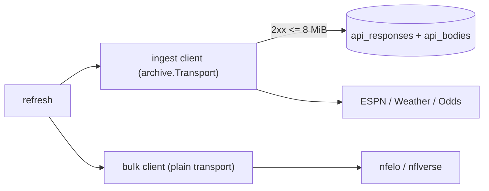

# Response archive

## Overview

Every successful call to ESPN, Open-Meteo, Parlay API, or The Odds API is saved before the client parses it. The
archive keeps the raw bytes, not a guess at which fields a model will want later. It lives in the same SQLite file as
the rest of the app, so Litestream backs it up with everything else.

Bulk season datasets (`nfelo` and `nflverse`) are excluded from the raw archive. Refresh parses them and upserts them
directly into their parsed tables, and offline eval replay reads them from those tables rather than `api_bodies`.

## Where it sits

`archive.Transport` is an `http.RoundTripper` that wraps the ingest HTTP client's base transport in `cmd/server`. The
clients in `internal/ingest/{espn,weather,odds}` do not know it exists and still never touch the database.

The transport reads a successful body into memory, puts the same bytes back for the client, and hands one `Record` to
`Store.SaveAPIResponse`. It must wrap the base transport, not sit beside it, so no archived client can forget a call.

`nfelo.NewClient` and `nflverse.NewClient` receive a separate plain `*http.Client` (`newBulkClient` in `cmd/server/main.go`)
without `archive.Transport`, so large season CSVs are never buffered for archiving or written to `api_responses` /
`api_bodies`. `internal/auth` also builds its own client and stays unwrapped so OAuth tokens never reach the archive.

## What is kept

A response is archived only when all of these hold:

- the request reached the source and returned a 2xx status;
- the body could be read;
- the uncompressed body is at most 8 MiB.

Everything else passes through unrecorded: non-2xx responses, transport errors, timeouts, unreadable bodies, and bodies
over the cap. The client sees its original result in every case.

Each kept call writes one `api_responses` row with:

| Column              | Value                                                              |
| ------------------- | ------------------------------------------------------------------ |
| `source`            | `espn`, `weather`, `odds`, or the host for an unknown source.     |
| `key`               | The label from the request context, or `host + path` as a fallback. |
| `method`            | The HTTP method.                                                   |
| `url`               | The request URL with the odds API's `apiKey` value replaced by `REDACTED`. |
| `status`            | The 2xx code.                                                      |
| `fetched_at`        | When the response finished being read, in RFC 3339 UTC.            |
| `duration_ms`       | Time from sending the request to finishing the body read.          |
| `body_sha256`       | Hex SHA-256 of the uncompressed body.                              |
| `credits_remaining` | `x-requests-remaining`, odds only; `NULL` otherwise.               |
| `credits_used`      | `x-requests-last`, odds only; `NULL` otherwise.                    |

The body goes to `api_bodies`, gzipped, keyed by the hash of the uncompressed bytes. Identical payloads share one body
row, so a scoreboard polled every ten minutes adds small response rows and no duplicate bytes. A changed payload adds a
second body row.

Only the `apiKey` value is redacted. Other query parameters stay, because `markets`, `regions`, and `week` are what make
the URL meaningful. Bodies are stored as the source sent them; none of the three sources echoes credentials today.

Rows are append-only. The app never updates or deletes an archived response or body, and there is no retention job.

## Labels

The transport cannot tell `odds:props:401` from `odds:lines` by looking at the URL, so `refresh` attaches the key to
the request context via `archive.WithKey(ctx, key)`.

The key is the same string `sync_state.source` uses. `source` comes from the part before the first colon, lowercased.
Without a label, the transport falls back to `host + path` and derives `source` from the host: `espn.com`,
`open-meteo.com`, and both `parlay-api.com` and `the-odds-api.com` map to `espn`, `weather`, and `odds`; any other host
becomes its own source.

Labelled rows join cleanly with `sync_state`. Fallback rows are still kept but are harder to group, so every client
should set a label. The constants `archive.SourceESPN`, `archive.SourceWeather`, and `archive.SourceOdds` name the three
sources in code.

## How to query it

Nothing in a page, route, or request path reads the archive. The read API exists for tests and later modeling work.
`db.Store` offers:

- `ListAPIResponses(ctx, db.APIResponseFilter{KeyPrefix, Since, Until})` returns metadata rows, oldest first, never a
  body. A zero filter keeps everything. `KeyPrefix` compares the literal prefix, so `%` and `_` in a key are not
  wildcards, and `Since` and `Until` are inclusive.
- `APIResponseBody(ctx, sha)` returns one body decompressed and checks it against the stored uncompressed size. A
  missing hash wraps `db.ErrAPIBodyNotFound`.

Plain SQL against a Litestream restore works too; see the [archive size check](../runbooks/archive-size.md) for the
`sqlite3` queries that measure `api_responses` and `api_bodies` by source key. Because `api_bodies.body` holds raw
gzipped bytes, `APIResponseBody` is the safest way to read and replay stored responses in Go.

## Growth

Bodies are gzipped and deduplicated, and bulk season datasets (`nfelo` and `nflverse`) are excluded from the archive, so
a season of lines, props, and weather stays small. Watch `SELECT sum(size) FROM api_bodies` and the database file size
at the end of the first season. The [archive size check](../runbooks/archive-size.md) has the thresholds and the prune
and `VACUUM` steps. The archive rides the replicated database file, so any growth is also replication traffic.
