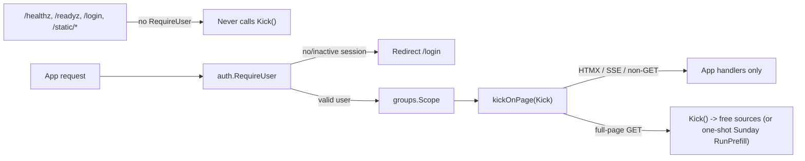

# Data refresh

## Summary

`internal/refresh` owns when outside data comes in. Free/unmetered sources (slate, weather, game summaries/injuries,
unique week-team rosters, nfelo projections, auto-grading, and slip-leg game logs) refresh lazily on authenticated
full-page `GET`s via `Kick()`, which returns at once and does the work in the background. Metered odds calls are
reserved for the one-shot Sunday morning pre-fill (`RunPrefill`, triggered automatically on the first authenticated
Sunday full-page visit at or after 6:00 AM `America/New_York` while Sunday games remain, or via the optional
`POST /internal/prefill` fallback), synchronous `RunOnce` in sandbox bootstrap, pick-time syncs on `OPEN` slips with
upcoming games, and on-demand game prop views. Each source has its own staleness window, its own single-flight, and
its own failure backoff. Parlay API and The Odds API are the metered sources, so each free event list runs before its
balances gate the paid calls.

## What kicks a sync

`kickOnPage` wraps the app inside `auth.RequireUser` and `groups.Scope`, with `CSRF` outermost. It calls `Kick()` only
for an authenticated full-page `GET`:

- not an unauthenticated request (redirected to `/login` before reaching `kickOnPage`);
- not a non-`GET` request;
- not an HTMX partial (`HX-Request: true`);
- not an SSE stream (`Accept: text/event-stream`, or a path ending in `/events`).

Partials and streams skip it because the page load that mounted them already kicked, and an SSE reconnect must not spend
credits. Health (`/healthz`, `/readyz`), static files, and the sign-in screens (`/login`) sit outside `auth.RequireUser`
and never call `Kick()`.

`Kick()` returns immediately and normally runs **free/unmetered sources only** (omitting `odds:lines` and props). Its
work detaches from the request with `context.WithoutCancel`, so a finished response does not cancel a sync, and every
source gets its own 30 second timeout. Tests wait for the background work through a `WaitGroup`; the server waits only
at shutdown.

On the first authenticated full-page `GET` that enters the Sunday morning window (`sundayPrefillWindow`: Sunday at or
after 6:00 AM `America/New_York` while at least one Sunday game has not yet kicked off), `Kick()` checks
`sync_state["prefill:sunday"]` (`SundayPrefillSource`). When `prefill:sunday` has not yet been recorded for that
`America/New_York` calendar date (`sundayPrefillStale`), `Kick()` deduplicates via `singleflight` (re-checking
`sync_state` inside the flight) and runs `RunPrefill` asynchronously with a 2-minute timeout:

- **Success or partial odds progress:** `RunPrefill` records `prefill:sunday` in `sync_state` (when not shutting down and
  either there are no errors or `LinesSynced || PropsSynced > 0`), so later Sunday visits and Cloud Run cold starts skip
  re-running pre-fill and fall back to free sources only.
- **Zero-progress failure:** If `RunPrefill` fails without syncing lines or props, `prefill:sunday` is left unset,
  `prefill:sunday` enters a 5-minute in-memory backoff, and `Kick()` still runs `freeSourcesFor` so free data is not
  starved.

`RunOnce(ctx)` is the synchronous counterpart used by sandbox bootstrap and tests. It runs the scoreboard-first pass
followed by all free sources plus `odds:lines`, waits for every source it starts, and returns the failures joined.

`RunPrefill(ctx)` is the Sunday morning pre-fill sweep, invoked automatically once per Sunday by `Kick()` or on demand
via the optional `POST /internal/prefill` endpoint (with a 2-minute timeout linked to server shutdown). It warms the
scoreboard, `odds:lines` (with a 15-minute idempotency window so retries do not double-spend), all free sources
(`weather`, `espn:summary`, unique week-team `espn:roster`, `nfelo`, `grade`, and slip-leg `espn:gamelog`, bounded to 4
concurrent workers), and Parlay-only bulk props (`odds:props:{gameID}`) for upcoming games (bounded to 4 concurrent
workers, 15-minute idempotency, skipping kicked-off games and The Odds API `EventProps` enrichment/fallback). When it
completes without shutting down and either succeeds or syncs at least some odds (`LinesSynced || PropsSynced > 0`), it
records `prefill:sunday` in `sync_state`, so an optional Cloud Scheduler hit to `POST /internal/prefill` also marks
Sunday done for subsequent page loads. It returns a `PrefillReport` JSON summary.

On-demand user actions also trigger syncs directly with a 10-second timeout, sharing the same single-flight
deduplication, staleness windows, and failure backoff as background syncs:

- **Pick-time lines and props (`OPEN` slips only):** Opening `GET /slips/{id}/pick` on an `OPEN` slip with upcoming
  games in its slate scope calls `SyncPickLines(ctx, weekID)` (or `SyncPickGame(ctx, weekID, gameID)` when an upcoming
  game is selected). `GET /slips/{id}/pick/results` and `GET /slips/{id}/pick/detail` call
  `SyncPickGame(ctx, weekID, gameID)` only when the slip is `OPEN` and an upcoming game is selected. Once synced,
  `sync_state.fetched_at` is fresh, so repeated search keystrokes, tab/sort clicks, and `board-updated` SSE reloads
  short-circuit in SQLite with zero API calls. `GET /slips/{id}/pick/slate` and locked or graded slips stay strictly
  read-only.
- **Manual pick refresh:** Tapping "Refresh odds" (`POST /slips/{id}/pick/refresh`) on an `OPEN` slip with upcoming
  games calls `ForcePickRefresh(ctx, weekID, gameID)`, bypassing the normal staleness windows subject to a 2-minute
  cooldown (`pickRefreshCooldown`).
- **Prop load and research:** Tapping "Load them" on the pick board calls `SyncGameProps(ctx, gameID)`. Loading game
  research calls `SyncGameResearch(ctx, gameID)`. Loading player research calls `SyncPlayerResearch(ctx, athleteID)`.

## One pass

1. Read the latest week and its games. Before the first slate sync there is no week, which is not an error.
2. Sync `espn:scoreboard` first, because it may add or change the week's games.
3. Read the week's games again. Inside `Kick()`, check `maybeRunSundayPrefill`: on the first visit in the Sunday
   morning window (`06:00+ America/New_York` before the last Sunday kickoff) when `prefill:sunday` is stale, `Kick()`
   runs `RunPrefill()` (which runs `odds:lines`, free sources, and Parlay-only bulk props for upcoming games). Otherwise
   `Kick()` runs `freeSourcesFor` only: one weather source per game, one `espn:summary:{gameID}` and deduped week-team
   `espn:roster:{teamID}` per non-`FINAL` game, the `nfelo:projections` source, the `grade` source, and
   `espn:gamelog:{athleteID}` for any matched athletes on current-week slip legs. `RunOnce()` runs `freeSourcesFor` plus
   `odds:lines`.

Within a source, `singleflight` keyed by its `sync_state` source key lets concurrent page loads share one fetch. The
work inside the flight re-reads the staleness state before fetching, so a load that joined after the first run finished
does not fetch stale data twice.

## Sandbox clock and replay

Refresh reads its clock from an injected `Clock` rather than `time.Now`. The server passes the wall clock normally and
the sandbox's scenario clock in sandbox mode. Slips and the web handlers read the same scenario clock, so staleness,
kickoff locks, the game picker, the export card, and nfelo freshness all agree on the fixed Sunday morning. Auth cookies
and SSE timers stay on real time.

Sandbox ingest clients use the replay transport in `internal/sandbox` instead of the archived ingest client. A request
that is not registered fails with the request and stage, with no network fallback. Replayed calls never enter
`api_responses`, so the sandbox does not fill the archive with fixture traffic. A restart restores the saved stage and
clock and does not rerun the morning. See [Sandbox replay](../reference/sandbox-replay.md).

## Archive

Each source labels its requests with `archive.WithKey(ctx, src.key)` in `refresh`, using the same string it writes to
`sync_state`. The shared ingest client in `cmd/server` wraps its transport with `archive.Transport`, so every successful
response is saved under that key before the client parses it. See [Response archive](archive.md).

The save sits beside the sync, not inside its transaction. A failed archive write is logged and dropped, so it never
fails a sync or changes the parsed rows. Parlay API's free `/events` list and paid `/odds` call both use `odds:lines`.
The Odds API's calls use `odds:theoddsapi`, so its rows archive under that key with `source = "odds"`.

## Staleness rules

Each source records its last successful sync in `sync_state.fetched_at`. A source that has never run is always stale.

| Source key         | Data                                    | Stale after                                                                                                             | Skipped when                                                       |
| ------------------ | --------------------------------------- | ----------------------------------------------------------------------------------------------------------------------- | ------------------------------------------------------------------ |
| `espn:scoreboard`  | Latest week's slate, scores, and status | 5 min while any game is live; 15 min on Thursday, Sunday, or Monday; 2 h otherwise                                      | Never                                                              |
| `weather:{gameID}` | Kickoff-window forecast for one game    | 15 min within 6 h of kickoff; 30 min otherwise                                                                          | Indoor, unknown venue, more than 48 h before kickoff, or kicked off |
| `odds:lines`       | The week's game lines                   | `RunOnce`: 24 h Monday–Friday; 12 h Saturday; 45 min Sunday before the last Sunday kickoff; 3 h after that and all day Monday. Pick-time (`SyncPickLines`/`SyncPickGame`): 15 min on game days before the day's last kickoff or within 2 h of an upcoming kickoff; 2 h otherwise. (15 min idempotency in `RunPrefill`; 2 min cooldown in `ForcePickRefresh`) | No games, or every game has kicked off |
| `odds:props:{gameID}` | Game prop odds                       | 30 min on game days (Thursday, Sunday, Monday) or within 6 h of kickoff; 2 h otherwise (15 min idempotency in `RunPrefill`; 2 min cooldown in `ForcePickRefresh`) | Once game has kicked off               |
| `espn:roster:{teamID}`| NFL team roster                      | 2 h on Thursday, Sunday, or Monday; 6 h otherwise                                                                       | Never (skipped for `FINAL` games in `Kick()`/`RunPrefill()`/`RunOnce()`) |
| `espn:summary:{gameID}`| Game summary and key injuries        | 15 min on Thursday, Sunday, or Monday or within 4 h of kickoff; 1 h otherwise                                           | Game status is FINAL                                               |
| `espn:gamelog:{athleteID}`| Athlete season game log and stats | 1 h on Thursday, Sunday, or Monday; 4 h otherwise                                                                       | Never                                                              |
| `nfelo:projections`| The week's model spreads, win probabilities, and QB adjustments | 1 h on Thursday, Sunday, or Monday; 4 h otherwise                                                       | Not a regular-season week, no games, or every game has kicked off  |
| `grade`            | Auto-grade `PENDING` legs on `FINAL` games | Every pass when `PENDING` legs exist on `FINAL` games                                                                   | No `PENDING` legs on `FINAL` games                                 |
| `prefill:sunday`   | One-shot Sunday morning pre-fill marker (`RunPrefill`) | Once per `America/New_York` calendar day (`sundayPrefillStale`)                                           | Outside Sunday 06:00 ET – last Sunday kickoff (`sundayPrefillWindow`), or already recorded for today's Eastern date |

"Thursday", "Sunday", and "Monday" mean `America/New_York`. The zone database is embedded in the binary, so it resolves
in the container without a separate `tzdata` package. The scoreboard's live flag comes from the stored games: any game
with status `LIVE` shortens the window to 5 minutes.

`odds:theoddsapi` is not a scheduled source. The Odds API calls ride inside the `odds:lines` pass, and refresh records
their balance under that key so the next pass can enforce the fallback and enrichment floors.

Weather is per game, not per week. A game inside its 48-hour window refreshes every 30 minutes (or every 15 minutes
within 6 hours of kickoff) until kickoff; an indoor game or one with no coordinates in the venue map never gets a
forecast. See [Data sources](../reference/data-sources.md) for the endpoint and the venue map.

nfelo is per week, not per game. One fetch of the whole CSV covers every NFL week since 2021, and refresh keeps only the
rows that match the current week's games. A game with no matching row keeps its last projection, or has none. A
non-regular-season week is skipped because the CSV's playoff week numbers are unverified, and a week whose games have
all kicked off is skipped because the projections are pre-game numbers that no longer change. The source spends no Odds
API credits, so it has no floor and does not wait on the odds sync.

## Auto-grading

The `grade` source (`GradeSource = "grade"`) runs during each pass when a week exists:

1. **Zero wasted fetches:** `due` calls `PendingLegsOnFinalGames()`. Once every leg on `FINAL` games has left `PENDING`
   (including `NEEDS_GRADING` or `VOID`), the query returns zero rows and the source is skipped.
2. **Game-only optimization:** `syncGrade` groups pending legs by `FINAL` game. If a game has only game/team/other legs
   (no `grader.IsPlayerMarket` legs), it grades directly from the stored `games` scores without calling ESPN.
3. **Player props and backoff:** If a `FINAL` game has at least one pending player-prop leg, `syncGrade` fetches
   `BoxScore(ctx, gameID)` through `singleflight` keyed by `SummarySource(gameID)` (`espn:summary:{gameID}`), tagging
   the request with `archive.WithKey`. A failed `BoxScore` fetch records a 5-minute in-memory backoff under
   `SummarySource(gameID)` and skips that game without blocking other `FINAL` games.
4. **Safe writes:** Non-`PENDING` outcomes from `grader.GradeLeg` pass to `slips.Service.AutoGradeLegs`, which updates
   only rows matching `WHERE id = ? AND result = 'PENDING'` with `graded_by = "auto"`. Manual grades and prior
   `NEEDS_GRADING` marks are never overwritten on re-runs. Each slip with at least one updated leg recomputes its
   result/status, receives a system activity entry (`user_id = NULL`), and publishes `slip:{id}`. See
   [Slips](slips.md#grading).

## Odds credits

Parlay API is primary and The Odds API enriches it or serves as fallback. The budgets are in
[Data sources](../reference/data-sources.md). Refresh enforces them in this order:

1. Call both free `/events` lists and match each provider to the week's games on its own. The matches are stored even
   when no lines will be bought.
2. Store the primary balance under `odds:lines` and The Odds API balance under `odds:theoddsapi`.
3. Below 50 Parlay API credits, skip its paid `/odds` call and log a warning. Cached rows keep serving. This is not a
   failure, so it does not trigger backoff.
4. The Odds API buys lines when Parlay API bought them and The Odds API has at least 100 credits. It also buys them when
   Parlay API is unconfigured, failed, or below its floor, provided The Odds API has at least 25. Otherwise it stops
   after the free event list.
5. Merge the rows. A primary row with no link adopts The Odds API's link, sid, and event sid; when the linked line
   differs, it also adopts the linked line and price. A linked primary row keeps its line, price, and link. Secondary
   rows that fill a missing book or market are appended.
6. Record the primary fetch and write the merged rows in one transaction. A fallback event ID fills
   `games.odds_event_id` only when the game has no stored ID, so a transient primary failure does not churn it.

The paid responses carry every upcoming event, not just the synced week. Refresh writes only lines for matched games and
drops the rest, so the `odds` table never takes a row for a game that does not exist locally. Team names arrive as
provider display names and are converted to the game's ESPN abbreviation before the write.

A missing or unreadable remaining count is a sync failure, not a guessed balance. `odds.ErrNoAPIKey` means a provider is
disabled, not failed. If one provider fails while the other succeeds, refresh logs a warning and commits the surviving
rows, so `odds:lines` does not enter backoff. If every configured provider fails, the sync returns the joined error and
the source backs off with cached rows still served.

Props and research data run on demand through `SyncGameProps`, `SyncPickLines`, `SyncPickGame`, `ForcePickRefresh`,
`SyncGameResearch`, and `SyncPlayerResearch`, and bulk upcoming-game props also warm during `RunPrefill`. The pick
board's "Load them" prompt, "Refresh odds" button, pick-time views on `OPEN` slips, or a research partial trigger an
on-demand sync with a short 10-second timeout. The board never loops over games on page load: each tap or game selection
targets at most that one game.

- `odds:props:{gameID}`: Stale after 30 minutes on game days or within 6 hours of kickoff, and 2 hours otherwise
  (15-minute idempotency window in `RunPrefill`; 2-minute manual cooldown in `ForcePickRefresh`), skipped once kickoff
  has passed. Before matching players, it syncs rosters (`espn:roster:{teamID}`) for both teams. It enforces the Parlay
  API 150-credit floor (`OddsPropsFloor`). In `SyncGameProps`, `SyncPickGame`, and `ForcePickRefresh`, when The Odds API
  is configured and Parlay API bought props, it calls `EventProps` at or above 100 credits (`TheOddsAPIEnrichFloor`) and
  merges via `odds.MergeProps` to populate DraftKings prop deep links; if Parlay API is unconfigured, errors, returns no
  props, or sits below 150 credits, it falls back to The Odds API when at least 25 credits remain
  (`TheOddsAPIFallbackFloor`). During `RunPrefill`, bulk props are Parlay-only (skipping The Odds API `EventProps`
  enrichment/fallback). Prop players are matched against team rosters via `ResolvePlayerMatch`.
- `espn:roster:{teamID}`: Stale after 2 hours on game days (Thursday, Sunday, Monday) and 6 hours otherwise. Upserts
  team roster players into `roster_players` with normalized names. Promoted into `Kick()`, `RunPrefill()`, and
  `RunOnce()` (deduped per week team for non-`FINAL` games).
- `espn:summary:{gameID}`: Stale after 15 minutes on game days or within 4 hours of kickoff, and 1 hour otherwise;
  skipped when game status is `FINAL`. Stores raw `injuries_json` on `games`. Promoted into `Kick()`, `RunPrefill()`,
  and `RunOnce()` for non-`FINAL` games.
- `espn:gamelog:{athleteID}`: Stale after 1 hour on game days and 4 hours otherwise. Upserts `player_gamelogs` with
  market stats. In addition to on-demand research lookups, `Kick()`, `RunPrefill()`, and `RunOnce()` scan slip legs in
  the current week and sync stale game logs.

## Failure and backoff

A failed fetch or write logs the error, keeps the old rows, leaves `fetched_at` unchanged, and pauses that source for 5
minutes. The pause lives in memory, keyed by source key, so one bad forecast does not pause the slate or the lines. A
successful run clears it. The server never records a failure in the database.

A source's row writes run inside one transaction, so a failure part way through leaves no partial rows. A sync that
succeeds with no row changes still records `fetched_at`, so a repeated response is not fetched again until the next
window.

## Shutdown

`Service.Shutdown(ctx)` stops new passes, cancels the sources in flight, and waits for them. The stop runs in this
order: end the SSE streams, drain HTTP handlers, drain refresh, then close the database. Sharing one 8 second budget
keeps the whole stop inside Cloud Run's 10 second kill window, and no sync can write through a closing database. See
[Persistence](persistence.md) and [Live updates](live-updates.md).

- `Kick()` returns at once once a stop has begun, so a page load during the drain starts no new pass. The stop check and
  the goroutine start happen together, so no pass can slip in just after the wait begins.
- Every source's context cancels on the stop, so a fetch already in flight ends instead of waiting out its 30 second
  timeout. That counts as a stop, not a failure: it logs no outage and leaves no failure backoff behind.
- The drain still runs when the HTTP drain expires, because a sync mid-write is the worst thing to leave open while the
  database closes.
- A source that ignores its context past the caller's deadline makes `Shutdown` return `context.DeadlineExceeded` and
  the process exits non-zero, so the stop is never held open past Cloud Run's kill window.
- Sandbox mode drains the same way. `sandboxRuntime.Shutdown` cancels the serialized page-load pass, waits for it, and
  then drains the refresher it owns. Stage and reset syncs run inside their HTTP handlers, so the HTTP drain covers
  them.

## Publishing changed weeks

After a transaction commits and only when it changed rows, refresh publishes live topics:

- `week:{weekID}` for the game board;
- `slip:{id}` for every slip in that week.

The scoreboard, weather, odds, and nfelo syncs all use the same helper. Publishing after commit means a listener never
refetches a write that might roll back. A no-op rerun publishes nothing. See [Live updates](live-updates.md) for the hub
and the client.

## Live window

`Service.LiveWindow(weekID)` is the rule behind the SSE stream's longer deadline. A week is live when any game is
`LIVE`, or any `SCHEDULED` game kicks off within the next 30 minutes. A `FINAL` game is never live, even when its
kickoff was recent, and a scheduled game whose kickoff has passed is not either.

The check reads the week's games with a 5 second timeout. A read error returns false, so the stream falls back to the
idle deadline rather than staying open on a guess. The stream itself uses a 55 minute deadline inside the live window;
see [Live updates](live-updates.md).

## Guardrails

- `Kick()` runs on authenticated full-page loads only, syncing free/unmetered sources outside the one-shot Sunday morning
  pre-fill (`prefill:sunday`). Scheduled jobs are limited to the optional `POST /internal/prefill` fallback; adding
  other cron or scheduled jobs needs a plan change, because it spends free-tier credits and keeps the instance warm.
- Keep the work detached from the request and bounded by its own timeout.
- Put background writes in the service's `WaitGroup`, so the shutdown drain waits for them before the database closes.
- Check each provider's credit floor after its free event list and before its paid call. Never buy lines on a stale or
  missing balance.
- Publish once per committed change, never inside the transaction.
- Keep one single-flight per source. The server injects the wall clock, tests inject a fixed clock, and sandbox mode
  injects its scenario clock. Never read `time.Now` inside a staleness rule.
