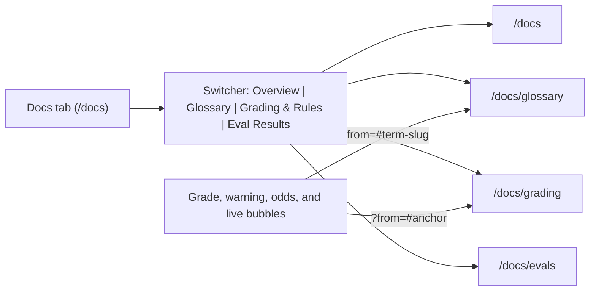

# Docs hub

## Overview

The Docs tab is the standing explanation for every annotation, and one switcher spans its four screens:

The overview and glossary render from static Go structs and read no database; the grading and eval screens read the
analyzer package and the eval cache.

- **Overview (`GET /docs`)**: quick jumps, seven plain-language "How systems work" sections with stable anchors
  (`#sys-grading`, `#sys-odds`, `#sys-badges`, `#sys-live`, `#sys-autograde`, `#sys-sources`, `#sys-export`), and
  common questions.
- **Glossary (`GET /docs/glossary`)**: a static term list at `#term-<slug>` covering odds, usage, and betting ideas.
  `?q=` filters the terms in memory by name, category, summary, or example.
- **Grading & Rules (`GET /docs/grading`)**: the live four-pillar rubric, uncertainty badge behavior, active engine
  badge, `A`–`F` bands, v1 rubric reference, and every warning rule (`RuleDocs`), so the guide cannot drift from live
  thresholds.
- **Eval Results (`GET /docs/evals`)**: calibration and performance across settled legs and slips.

Every path sets `page.Tab = TabDocs` and renders the switcher, so the Docs tab stays lit and an older `/analyzer/...`
bookmark still lands on the same page with the right section marked.

## Eval Results

`GET /docs/evals` (alias `/analyzer/results`) shows live calibration across `?source=slips|market` and `?engine=v2|v1`:

- **Probability calibration & SGP lift**: displays Log Loss, Brier Score, Classwise ECE, 10-bin spread, market
  baselines, a 10% reliability table, and SGP Correlation Lift comparing copula joint log loss against naive leg
  multiplication on settled SGPs.
- **User slips (`?source=slips`, default)**: aggregates settled slips across all groups for A–F leg and slip bands,
  side-by-side Engine Comparison, engine diffs/migrations, weekly progression, leg and slip factor attribution, and
  pre-kickoff data coverage.
- **Market-wide (`?source=market`)**: replays pre-kickoff consensus lines across final games, hides slip-only sections,
  and adds Sharp benchmarks and nflverse L5 fallback coverage tiles.

`eval.Cache` (`internal/eval/cache.go`) memoizes suite reports in memory by mode, group ID, and season. Settlement in
`internal/slips` invalidates slip entries via `SetOnGradeChange` without evicting market entries;
`refresh.Service.SetOnMarketDataChange` calls `InvalidateMarket` when games reach `FINAL` or `syncNFLverse` commits; and
sandbox transitions clear the cache.

## Help bubbles

Each annotation is a two-step help surface. The first tap opens the item's own popover, with this leg's pillars, this
slip's rollup, or this warning's legs. The round `?` bubble in that panel then opens the standing explanation in Docs.
The bubble sits inside the expanded panel or beside the annotation, never inside a `
`, because a nested link
there double-fires on mobile Safari. Tapping outside an open grade breakdown closes it, so only one stays open on a
phone.

| Annotation | `?` bubble target |
| --- | --- |
| Slip grade breakdown | `/docs/grading#slip-grade` |
| Leg grade breakdown | `/docs/grading#leg-grades` |
| Warning card | `/docs/grading#rule-<id>` |
| Pick-board badges | `/docs/grading#suggestions` |
| `nfelo` model chip | `/docs/glossary#term-nfelo` |
| Implied chance | `/docs/glossary#term-implied-prob` |
| Reference odds | `/docs/glossary#term-reference-odds` |
| Live hit chance | `/docs#sys-live` |

Each bubble appends the current screen as `?from=`. The docs page renders a `← Back` link only when `safeReturnPath`
accepts that path, so a forwarded external URL is dropped, and the switcher forwards the same path across its four
sections.

## Related

- [Analyzer](analyzer.md): the rules, grades, and banner the Docs screens explain.
- [Slips](slips.md): the screens that carry the help bubbles.
- [Routes](../reference/routes.md): the docs and analyzer routes and their query parameters.
