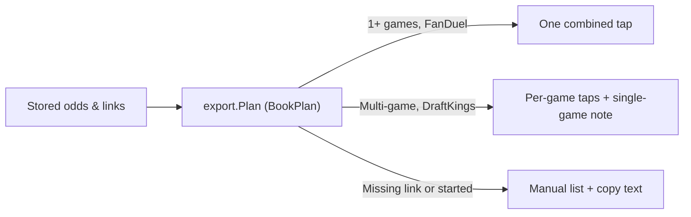
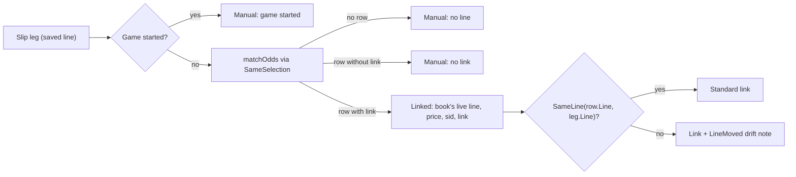

# Export

## Overview

A locked slip shows an export card. It offers DraftKings and FanDuel. When a book has two or more linked picks, one
tap opens them all in that book's betslip (DraftKings combines per game because its betslip URL is scoped to one event;
FanDuel combines across games); otherwise it lists one tap per pick. A plain list holds every pick that needs
adding by hand, and the whole slip copies as text. In the export step the card leads the hub, because placing the picks
is the one thing left to do. The app still only tracks bets; the person places them at their own book. Nothing here
places a bet or moves money.

## Where the links come from

Both game-lines calls send `includeLinks=true&includeSids=true`. Each eligible outcome then arrives with a link and a
selection ID (`sid`), and each bookmaker block carries its own event ID (`event_sid`). The odds client maps them onto
`odds.link`, `odds.sid`, and `odds.event_sid`. Refresh writes all three in the same upsert as price, so a link is as
fresh as the price beside it. A book that returns no link stores NULL, which is normal. See
[Data sources](../reference/data-sources.md) and [Database schema](../reference/schema.md).

Parlay API populates validated links and sids on FanDuel only, and only while a matching native quote is open.
DraftKings and other books omit them. The Odds API enrichment in the same sync fills those gaps: a DraftKings row gains
its `link`, `sid`, and `event_sid`, and a FanDuel row missing a link gains one too. When the enrichment's line differs
from the unlinked primary row, refresh stores the linked line and price so the row and its deep link agree. A row that
already has a link keeps Parlay API's line, price, and link. A book or market only The Odds API quotes is stored as
well. See [Data refresh](data-refresh.md) for when enrichment pauses at its credit floor.

FanDuel single and combined links work unchanged because its combiner reads the market ID from each leg's stored link
and pairs it with `odds.sid`; it never uses `event_sid`. DraftKings uses both the stored selection ID and the
bookmaker's `event_sid`.

The export card reads those stored rows. It never calls either provider and never writes to the database, so rendering
it, tapping a link, and copying the slip spend no credits.

## Planning a book's export

`internal/export` is pure. For one book it builds a `BookPlan`:

| Field           | Meaning                                                                                    |
| --------------- | ------------------------------------------------------------------------------------------ |
| `Book`          | The book key, `draftkings` or `fanduel`.                                                   |
| `Linked`        | Legs the book can open from a link, with the book's line, price, and sids.                 |
| `Manual`        | Legs to add by hand, each with one reason, the book's current line, and `PropsSynced`.     |
| `Combined`      | One URL for all linked legs, set only for a verified format; else empty.                   |
| `Groups`        | Per-event `LinkGroup` entries when a single-event book's linked legs span multiple games.  |
| `MultiGameNote` | True when DraftKings cannot combine all linked legs because they span multiple games.      |

`Plan(slip, legs, odds, book, now)` returns an empty plan unless the slip is `LOCKED`. `now` is injected so the kickoff
rule stays testable. Every leg lands in exactly one of `Linked` or `Manual`, so no pick disappears.

A leg is linked when all of these hold:

- its game has not kicked off;
- an odds row for the book matches the leg's selection (`db.Odds.MatchesSelection` via `db.SameSelection`):
  - player props match game, market type, side, and canonical player (athlete ID when both carry one, otherwise
    normalized player name and team);
  - game markets (`SPREAD`, `ML`, `TOTAL`, `TEAM_TOTAL`) match game, market type, team, and side;
  - line is ignored for matching, though an exact line match (`db.SameLine`) is preferred when multiple rows match;
- the row has a non-empty link.

Everything else is manual, with one reason:

| Reason         | When                                                                                                                  |
| -------------- | --------------------------------------------------------------------------------------------------------------------- |
| `no line`      | No row for the book, or a leg with no game such as a hand-typed `OTHER` leg. Prop legs set `PropsSynced` if the game already has stored prop rows for other markets or books. |
| `no link`      | The row matches, but `link` is NULL or blank.                                                                         |
| `game started` | `now` is at or past kickoff; this check runs before the row lookup.                                                   |

Matching on `db.SameSelection` keeps "the same selection" consistent across the export card, the pick board, and the
slip's reference prices, even when a book uses a player name variant (such as "Ollie Gordon II" for "Ollie Gordon")
or moves the line after the leg was picked. When a line moves, the linked leg carries the book's live link, selection
ID, event ID, line, and price, and sets `LegLink.LineMoved` so the card can warn the bettor without dropping the deep
link. Price drift alone does not block a link or trigger `LineMoved`: the sportsbook shows its own price, and the person
decides.

## Combined links

`BookPlan.Combined` holds one URL for every linked leg when the book has a verified multi-selection format.
`PlanWithCombiner` takes a `Combiner`, and `Plan` looks one up in the book's registry. Both DraftKings and FanDuel have
one, so a slip with two or more linked legs at a book gets a single "Open in ..." button. Fewer than two linked legs
keep the per-leg list, because one tap is already one tap.

The Odds API enrichment supplies the DraftKings links, so a locked slip with two or more linked DraftKings legs on one
game gets a single event-page URL in `Combined`. When linked DraftKings legs span multiple games, `Combined` stays empty,
`MultiGameNote` is set to true, and `draftKingsCombiner` groups the linked legs by event (in first-appearance slip order)
into `BookPlan.Groups`. Any game group with two or more linked legs that share an `event_sid` and carry `sid`s gets a
per-game combined URL in `LinkGroup.Combined`; single-leg groups (or legs missing `sid` or `event_sid`) keep per-leg
taps. FanDuel combined links work across games as before.

A `Combiner` returns `ok = false` when it cannot build the whole URL, which leaves `Combined` empty and the per-leg
links in place. That happens when a linked leg has no stored `sid`, or, for FanDuel, its stored link has no `marketId`,
or, for DraftKings, the legs do not all share one stored event ID. The card never drops a pick to make a combined link
work.

### Verified formats

FanDuel and DraftKings were both checked on a phone on 2026-11-07. A combined link only adds selections; the book still
applies its own parlay rules. FanDuel, for example, rejects a moneyline and a spread on the same team as correlated.

| Book       | Combined URL shape                                                                                                                                                       |
| ---------- | ------------------------------------------------------------------------------------------------------------------------------------------------------------------------ |
| DraftKings | `https://sportsbook.draftkings.com/event/{eventSid}?outcomes={sid1},{sid2}`                                                                                              |
| FanDuel    | `https://sportsbook.fanduel.com/addToBetslip?marketId%5B0%5D={marketId1}&selectionId%5B0%5D={sid1}&marketId%5B1%5D={marketId2}&selectionId%5B1%5D={sid2}` |

DraftKings uses the event page, not the root `?outcomes=` link, which only ever opened one selection in the phone check.
Every linked leg must belong to the same DraftKings event, so a slip that spans games keeps per-leg taps. The event ID
comes from the bookmaker block and is stored as `odds.event_sid`; the selection IDs are the outcome `sid`s,
comma-separated and each URL-encoded on its own. A prop sid's `#` becomes `%23`.

FanDuel indexes each `marketId` and `selectionId` pair from zero, and the brackets are percent-encoded (`%5B` and `%5D`)
so a share sheet keeps the whole URL together. The market ID lives only in the stored per-leg link, so the FanDuel
`Combiner` reads it from there; the selection ID comes from `odds.sid`.

The stored links are the shapes the providers return, not URLs the app composes. Parlay API and The Odds API use the
same FanDuel link shape. DraftKings sends `https://sportsbook.draftkings.com/?outcomes={sid}`, and FanDuel sends
`https://sportsbook.fanduel.com/addToBetslip?marketId={marketId}&selectionId={sid}`. Both hold one selection and are the
fallback when a combined link cannot be built. The full probe notes live in
[Data sources](../reference/data-sources.md).

## The card

Only a locked slip draws the card. `GET /slips/{id}/export` returns the same card, and the wrapper listens for
`slip-updated` and swaps itself, so an unlock makes the card disappear on the next event.

In the slip's export step the card is the primary action, so the hub draws it above the step banner and the picks. The
wrapper sits first in the page at every step and renders empty until the slip locks, which keeps that order when a lock
in arrives over `slip-updated` without a reload.

The card shows, in order:

- the prices note, "Prices may have moved since <time>", from the newest `odds.fetched_at` among the slip's games;
- one block per book. When `MultiGameNote` is true, DraftKings shows a heads-up under its heading: "DraftKings links load
  one game at a time — tap each game below to add its legs."
  - With a `Combined` URL it is one "Open in DraftKings" or "Open in FanDuel" button, followed by any `LineMoved` drift
    callouts ("<Selection>: Book at <live> · slip <saved>").
  - Without `Combined`, when `Groups` has at least one combined game group, each game renders in order: games with two or
    more combinable legs show one "Open <Away> @ <Home> (<N> legs)" button with each leg's selection, price, and drift
    note underneath, while single-leg games show their per-leg tap.
  - Without `Combined` or any combined group, it falls back to a numbered list of per-leg taps, each labeled with the
    selection, the book's price, and an inline drift note ("Book at <live> · slip <saved>") whenever `LineMoved` is true.
- under each book, every manual leg by selection, with a friendly note that says why it needs a hand. For `no line` on a
  prop leg (`TEAM_TOTAL`, player prop, or named player), `PropsSynced` distinguishes an unquoted market from an unsynced
  game: when the game already has stored prop rows for other markets or books, the note says the book "isn't offering
  this prop right now, so add it by hand if it appears on their board"; otherwise it says the book "has no line for
  this pick yet, so add it by hand."
- "Copy slip as text", always shown.

A moved spread keeps its sign (`-3` or `+3.5`). A moved total or prop prints the bare number (`47.5`), matching how the
rest of the app writes those lines.

The copy text is one line per leg: the member, the selection, and the price at lock, such as "Adam: BUF -3.5 (-110)".
Selections and notes render through `html/template`, so free-text `OTHER` legs are escaped. Every link opens in a new
tab with `rel="noopener"`.

## Staleness

A link is offered only while its game is unstarted. The card's prices note reads the newest `odds.fetched_at` among the
slip's games, in UTC, and says "Prices may have moved since" because the book shows its own price when the link opens. It
reads only the rows from each game's newest sync, the same rule the pick board and the slip's reference prices use. A
market a book stopped quoting therefore becomes `no line` instead of offering a dead link. Rows from the current sync are
still shown past the cache window, because the book corrects the price when the leg opens; the note tells the person how
old the prices are. Nothing blocks a leg.

## Related

- [Slips](slips.md): members, legs, and the locking rules.
- [Data refresh](data-refresh.md): lazy odds syncs and the credit floors.
- [Data sources](../reference/data-sources.md): the deep-link flags, cost, and link shapes.
- [Database schema](../reference/schema.md): the `odds` and `legs` tables.
- [Routes](../reference/routes.md): the export partial and the rest of the slip routes.
