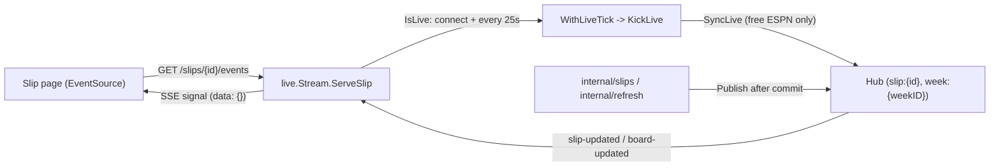

# Live updates

## Overview

A slip page keeps one `EventSource` open. Events carry no HTML; they only say that something changed. The page then
refetches the partials it already shows, so every person gets fresh data without per-person HTML crossing the hub.

## Signals, not payloads

A change signal never includes slip data. It names a topic, and the browser reacts by asking HTMX to refresh.

- `slip-updated` refreshes the slip panel and its activity. Every committed slip mutation sends it, including a vote, so
  each open hub refetches its tallies.
- `board-updated` refreshes the game board.

This keeps the hub small, avoids leaking one person's view to another, and means a missed event does no harm: the next
refetch catches up.

## Hub (`internal/live`)

The hub is an in-memory fan-out keyed by string topics. It knows nothing about slips, weeks, or groups.

- `Subscribe(topic)` returns a receive-only channel and an unsubscribe func. The channel holds one signal.
- `Publish(topic)` never blocks. If a listener's buffer is already full, the signal is dropped because one wake-up is
  enough for a burst.
- Unsubscribe is safe to call more than once and removes the topic when its last listener leaves.
- The zero value `Hub` is ready to use.

Topics are plain strings:

| Topic           | Published by               | Meaning                             |
| --------------- | -------------------------- | ----------------------------------- |
| `slip:{id}`     | `internal/slips`           | A mutation committed on that slip   |
| `week:{weekID}` | `internal/refresh`         | Games or odds changed for that week |

`internal/slips` publishes `slip:{id}` once, after the transaction commits. A `Publisher` is one method,
`Publish(topic string)`, so `*live.Hub` satisfies it and tests can record topics. Group scoping later means prefixing a
group id; the hub does not need to change.

The hub lives in the process. It only works because the app runs as a single Cloud Run instance.

## Sandbox stages

The Sunday sandbox uses the same hub and the same signals. A stage change rebuilds the morning, runs the real refresh,
and records its scripted grades; the refresh publishes `week:{weekID}` when games or odds change, and the slip service
publishes `slip:{id}` for each committed lock or grade. The acting browser reloads from the route's `HX-Refresh`, while
other connected clients refetch committed state after those signals.

A reset publishes an explicit final `week:{weekID}` and `slip:{id}` after its writes commit. Deleting and recreating
equivalent rows need not look like a source change, so the explicit signal tells every subscriber that the baseline is
ready. The same explicit signal follows a stage that rebuilds the slip. Signals are still sent only after the writes
commit; auth cookies and SSE deadlines stay on real time even while the stage clock moves.

## Stream (`GET /slips/{id}/events`)

`live.Stream.ServeSlip` serves one connection for one slip and its week.

- If the slip is already `GRADED`, the handler sends `event: bye` and returns at once without opening a stream.
- It subscribes to `slip:{id}` and `week:{weekID}` and unsubscribes when the request ends.
- It sends `event: slip-updated` or `event: board-updated` with `data: {}`.
- It sends a `: ping` comment every 25 seconds so proxies keep the connection open.
- When configured with `WithLiveTick` (25 seconds calling `KickLive` in production, omitted in sandbox mode) and the
  week is in its live window, it invokes the tick callback on connect and every 25 seconds while the stream remains
  open, stopping its timer on client disconnect, `bye` deadline, or `Shutdown`.
- It sets `Content-Type: text/event-stream`, `Cache-Control: no-cache`, `Connection: keep-alive`, and
  `X-Accel-Buffering: no`, and flushes every frame.

### Deadlines

An open stream keeps the instance billed, so every stream ends itself.

- **Live window:** when a game in the week is live or kicks off soon, the stream may live 15 minutes. The window is
  fixed from the start; events do not extend it.
- **Otherwise:** the stream closes after 3 minutes without an event. Each `slip-updated` or `board-updated` resets that
  idle timer.

At either deadline the server sends `event: bye` and returns. The `bye` tells the client this was planned, not a
failure, so it pauses and waits for user interaction, window focus, or the tab to become visible instead of reconnecting
at once.

### Shutdown

When the instance stops, the server calls `Stream.Shutdown` before `http.Server.Shutdown` begins. The call closes the
stream's `done` channel once, and every open `ServeSlip` returns at its next loop step without sending `bye`. The
browser's `EventSource` then reconnects on its own after the usual retry delay, landing on the replacement instance.
`bye` stays reserved for the stream's own deadlines. Calling `Shutdown` twice is safe, and a stream that starts after it
returns is closed at once.

This order matters. `http.Server.Shutdown` waits for active handlers but does not cancel their request contexts, so an
open stream would hold the drain until its deadline expired. Ending the streams first leaves the whole stop inside the 8
second budget that Litestream needs to sync; see [Persistence](persistence.md). The refresh drain runs after the HTTP
drain, on the same budget. See [Data refresh](data-refresh.md).

The `IsLive` func passed to `live.NewStream` is `refresh.Service.LiveWindow`: a week is live when a game is live or a
scheduled game kicks off within 30 minutes. A read error falls back to the idle deadline. The stream takes its timers
from a `Clock` interface, so tests can fire deadlines by hand. See [Data refresh](data-refresh.md).

## Client (`web/static/app.js`)

For `OPEN` and `LOCKED` slips, the page marks its body with `data-live-url`; `GRADED` slips omit it. When
`data-live-url` is present, the client opens one `EventSource`.

- `slip-updated` and `board-updated` call `htmx.trigger(document.body, ...)`. Partials listen with
  `hx-trigger="slip-updated from:body"`.
- `bye` closes the stream without retrying and marks a visible tab as idle-paused.
- A 3-minute inactivity timer resets on `pointerdown`, `keydown`, `scroll`, `touchstart`, and `htmx:beforeRequest`
  (captured so non-bubbling container scrolls count). When it fires on a visible tab, the client closes the stream and
  pauses until the next interaction or focus.
- When the tab becomes hidden or `pagehide` fires, the stream closes. When the tab becomes visible again, the window
  gets focus, or the user interacts after an idle pause, the client reopens the stream and triggers both refresh events
  to cover anything missed.
- After every `htmx:afterSwap`, `<time>` elements are formatted in local time with `Intl.DateTimeFormat`.

Closing on hide matters on iOS Safari, which drops background connections and would otherwise leave a dead stream.

## Guardrails

- An open stream keeps the instance billed, so keep the deadlines, idle pause, and visibility close.
- Set the anti-buffering headers and flush every write, or Cloud Run and proxies hold events back.
- Publish once per committed mutation. Publishing inside a transaction can tell clients about a write that rolls back.
- Keep per-person data out of events. Send a signal and let the page fetch its own view.
