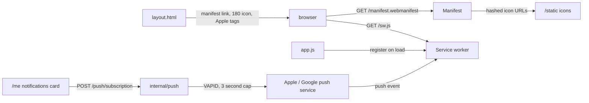

# Notifications

## Overview

The app is installable. A person can add it to a phone's home screen or a desktop launcher, and it opens in its own
window without browser chrome. The pieces are a public manifest, four generated PNG icons, a service worker at the site
root, and a few Apple tags in the shared layout.

Web Push rides on the same worker. A person turns notifications on for one device at a time from `/me`. The server
stores that device's endpoint and keys, then sends through the browser's push service with a VAPID key pair. Push stays
off unless both VAPID keys are configured.

## Installing the app

- **Android Chrome:** open the browser menu and choose **Install app** (older builds say **Add to Home screen**). The
  installed app opens standalone with the launcher icon and the paper-turf splash color.
- **iPhone and iPad:** open the page in Safari, tap **Share**, then **Add to Home Screen**. iOS does not offer a browser
  install prompt, so this is the only route. The home-screen icon comes from the 180 PNG.
- **Desktop Chrome, Edge, and Safari:** use the install control in the address bar, or the browser's Apps menu. The app
  gets its own window and dock entry.

Install does not change sign-in. The installed app runs the same Google OAuth flow and keeps the same kind of session
cookie as a browser tab.

The manifest sets the start URL and scope to `/`, so an installed app opens the group list or the person's only group's
week. The display mode is `standalone`. The name is "Sunday Parlay Club" and the short name is "Parlay Club". The
background color matches the paper-turf page, which is what the splash screen shows while the app boots. The theme color
is the paper-turf theme color, whatever theme the person has picked.

## Manifest

`GET /manifest.webmanifest` is public and sits outside every session check, because an installed app reads it before
anyone signs in. It answers `application/manifest+json` with `Cache-Control: no-cache`.

The handler builds the JSON in Go instead of serving a checked-in file. That lets every icon URL carry the existing
`/static` content hash. The static route caches for a year, so without the hash a changed icon would stay stale on an
installed device.

The icon list has three entries:

| Sizes     | Purpose    | File                      |
| --------- | ---------- | ------------------------- |
| `192x192` | `any`      | `icon-192.png`            |
| `512x512` | `any`      | `icon-512.png`            |
| `512x512` | `maskable` | `icon-maskable-512.png`   |

## Icons

The PNGs come from `cmd/genicons`, which `go generate ./...` runs through the directive in `web/embed.go`. The program
draws a football mark from the paper-turf colors and writes four files into `web/static`:

- `icon-180.png` for the Apple touch icon, full bleed because iOS applies its own mask;
- `icon-192.png` and `icon-512.png` as the rounded-square manifest icons;
- `icon-maskable-512.png`, full bleed with the mark inside the platform's safe zone.

Do not hand-edit the PNGs. Change the generator, then regenerate. A new size is a new entry in `cmd/genicons` and, for
manifest sizes, a new icon in the handler.

## Service worker

`GET /sw.js` is public too. It answers `text/javascript` with `no-cache` and `nosniff`, so a deploy's new worker is
picked up on the next load.

The worker lives at the site root because a worker only controls pages under its own path. A copy under `/static/` could
not control `/slips/{id}`. It has three listeners:

- `install` calls `skipWaiting`, so a new worker takes over without waiting for every tab to close.
- `push` shows a notification from the JSON payload `{title, body, url, tag}` that `internal/push` sends. The app icon
  is `/static/icon-192.png`, and a `tag` replaces an older notification with the same tag on the device.
- `notificationclick` closes the notification, focuses an open app tab, and navigates it to the payload's URL, or opens
  a new window.

There is no `fetch` handler and no cache. Page loads still come straight from the server, so a stale worker can never
serve an old page, and offline support stays out of scope.

`app.js` registers `/sw.js` on `window.load` when the browser has service workers. A browser without them, or one that
refuses registration, leaves the app working normally.

## Turning notifications on

`/me` renders the Notifications card only when the server has both VAPID keys. The card starts hidden, then `app.js`
binds it and reads the browser: permission, the service worker registration, and `pushManager.getSubscription()`. The
state lives on the device, so the server never says whether a particular phone is on.

- **On.** The card shows Turn off and Send test.
- **Off.** It shows Turn on.
- **Blocked.** When permission is `denied`, it shows the site-settings hint and hides Turn on. An existing subscription
  can still be turned off.
- **Unsupported.** Without a secure context, service workers, `Notification`, or `PushManager`, it says so. On iPhone
  Safari outside the installed app, it shows the Add to Home Screen hint instead.

The turn-on sequence:

1. The tap calls `Notification.requestPermission()` before any other await, because iOS and Chrome only prompt inside a
   user gesture.
2. With permission granted, the browser subscribes with `userVisibleOnly: true` and the server's VAPID public key.
3. `app.js` posts the browser's `subscription.toJSON()` to `POST /push/subscription` with the `HX-Request: true` header
   CSRF needs.
4. A 204 swaps the card to On. If the post fails after creating a new subscription, the browser drops that subscription
   rather than leaving the card On with nothing stored.

The server stores the endpoint, `p256dh`, and `auth`, and refreshes `created_at` when the endpoint already exists. That
makes a second person subscribing on a shared phone the owner. Each person may keep 10 endpoints; an 11th drops the
oldest. The endpoint must be `https` on `push.apple.com`, `fcm.googleapis.com`, `push.services.mozilla.com`, or
`notify.windows.com`, including their subdomains, so a signed-in person cannot point the server at an arbitrary URL.

Turn off calls `subscription.unsubscribe()` first, then sends `DELETE` with the endpoint. A missing row is fine, so
turning it off twice is harmless. The sign-out form on `/me` runs the same two steps before the plain logout post, so a
signed-out shared phone stops receiving the previous person's notifications. A browser that signs out by cookie expiry
does not, until it signs in again or turns notifications off.

An expired session answers an HTMX request with `HX-Redirect: /login`. The card follows that header instead of showing
On or Off, so it never claims a state the server did not accept. A non-HTMX post gets 403 from `CSRF`, and every push
route answers 404 when VAPID is unset.

## Sending

`internal/push` owns the subscriptions, the message, and the send. It wraps `github.com/SherClockHolmes/webpush-go`,
which does the RFC 8291 encryption and the VAPID signing. A message is JSON: a title, body, the path to open on tap, and
a tag. The worker shows it with the app icon, and a tap focuses an open app window on that path or opens a new one.

`SendToUsers` loads the subscriptions of the named active users and sends to all of them at once under one 3 second
deadline. Each request sets:

| Setting        | Value                                             | Why |
| -------------- | ------------------------------------------------- | --- |
| `TTL`          | 6 hours                                           | A push service keeps an undelivered message that long. |
| `Urgency`      | `normal`                                          | Deliver promptly without waking a device out of a low-power state. |
| `Topic`        | the tag, reduced to URL-safe characters and at most 32 | An undelivered message with the same topic is replaced, so a burst collapses. |
| VAPID subject  | `BASE_URL`                                        | Apple requires a contact URL, and prod uses `https`. |

A `404` or `410` from the push service deletes that endpoint. Any other status or transport error is logged and the row
is kept: a missed nudge is better than a request that waits on a push service.

Sends run inside the request that caused them, before the handler answers. Cloud Run bills CPU by request, so work
started after the response can stall until the next request. The send uses `context.WithoutCancel` with its own timeout,
so the work survives a client disconnect. Send test sends "Notifications are on for this device." to the caller's own
devices. Slip events send the same way, described below. Kickoff reminders arrive later in this change.

The `push_log` table exists for dedupe: a sender reserves a row before it sends, so a retried event never sends twice.
Slip grades use it now, one slip-wide row per grade, and reminders will use it later.

## Slip events

`slips.Service` raises one event after a transaction commits, through a small `Notifier` seam. The seam knows nothing
about push: it carries the kind, the slip, the actor, the number of legs added, and the one pick when only one was
added. `internal/push` implements it and decides who hears about the change.

| Event         | Raised when                                                     | Goes to               | Body                                                   |
| ------------- | --------------------------------------------------------------- | --------------------- | ------------------------------------------------------ |
| `legs_added`  | `AddLeg`, or an `AddLegs` that inserted at least one leg         | members but the actor | "{name} added Bills -3.5" or "{name} added 3 legs"    |
| `slip_locked` | `LockIn` moves the slip to `LOCKED`                              | members but the actor | "Everyone's locked in. Time to place it."              |
| `slip_graded` | `SetLegResult` or `AutoGradeLegs` moves the slip to `GRADED`     | every member          | "{slip} cashed!", "{slip} came up short.", or "{slip} pushed. Stakes back." |

- Every title is the slip's name, every tap opens `/slips/{id}`, and every tag is `slip-{id}`, so a burst of leg adds
  collapses to the newest one on the device.
- Recipients are always members of the slip, so a message never shows one group's picks to an outsider. The send drops
  inactive people.
- A grade reserves its `push_log` row before sending. A later manual correction re-grades the slip without a second
  push. An unlock and re-lock does send `slip_locked` again: it is rare and still true news.
- Nothing sends when the transaction rolls back. A no-op, such as an `AddLegs` that only repeats existing picks or a
  lock in by someone who is not the last, raises nothing.
- `AutoGradeLegs` runs inside a page load's refresh pass, so its grade push shares that pass's CPU. A slip can cash
  before anyone opens the app, and the push follows the next visit.

`cmd/server` passes an untyped `nil` notifier when push is off, never a nil `*push.Service`, because a typed nil inside
an interface is not `== nil`.

## iPhone layout

`layout.html` adds the manifest link, a 180 `apple-touch-icon`, and the Apple standalone tags. The status bar style is
`black-translucent`, so the installed app paints under it.

Because the installed app owns the whole screen, the sticky header and the bottom bars carry `env(safe-area-inset-top)`
and `env(safe-area-inset-bottom)` padding. The notch and the home indicator sit over that padding instead of over the
header or the tab bar. The viewport already sets `viewport-fit=cover`, which turns those insets on.

## Tests

Route tests ask for the manifest and the worker without a session cookie and check their content types, the manifest's
name, start URL, display mode, and icon sizes, and the worker's listeners and its missing `fetch` handler. The layout
test checks the manifest link, the touch icon, and the Apple meta tags.

Push route tests cover auth, the HTMX CSRF header, reassigning an endpoint, the push-host allowlist, the 10-device cap,
the expired-session redirect, and the VAPID-off 404. The handler tests also check that `/me` renders the card when push
is on. `internal/push` tests point a stand-in server at the service and check one request per subscription, the TTL,
Topic, and Urgency headers, the 3 second cap, a 410 pruning the row while a 500 keeps it, and inactive users getting
nothing. Notify tests cover each event: the actor is left out, an outsider gets nothing, a grade reaches every member
once across two passes, and the message text matches the table above. A recording notifier in `internal/slips` checks
that each mutation raises its event only after the commit, and that a rolled-back transaction or a no-op raises nothing.

Real-phone behavior stays manual: the permission prompt inside the tap, the iOS install flow, and a dropped subscription
showing Off.

## Trade-offs

- There is no offline mode. A worker with no `fetch` handler cannot serve a page from a cache, and that is deliberate: a
  stale slip or price is worse than a spinner.
- The manifest ignores the chosen theme. Splash and theme colors stay on paper-turf so the install shell looks the same
  for everyone; the page itself still follows `pc_theme`.
- iOS install is manual. Safari offers no prompt, so the app has to tell people where the Share button is when it wants
  them to install.
- iOS treats the home-screen app as its own container. A person may have to sign in once inside it, and a permission
  granted in Safari does not carry into the installed app.
- Notifications are one switch per device, not per account and not per category. A person who wants fewer has to turn a
  device off. Per-category settings are the follow-up if the noise gets old.
- Sends are best effort. An error is logged and dropped, and only a `404` or `410` retires an endpoint, so a rotated
  VAPID key leaves rows behind until each device subscribes again.
- A send can add up to 3 seconds to the request that caused it, in the worst case where a push service hangs. The cap is
  the dial if that bites.
- A new browser push host is refused until the allowlist grows. That device sees a 400 and a log line, not a server
  pointed at an arbitrary URL.
- On a shared phone the last person to subscribe owns the endpoint. Signing out clears it, but a session that simply
  expires leaves the previous person's notifications arriving until someone turns them off.

## Related

- [Access](access.md): the public routes and the session checks everything else runs through.
- [Routes](../reference/routes.md): the manifest, worker, push, and static route table.
- [Configuration](../reference/config.md): `VAPID_PUBLIC_KEY` and `VAPID_PRIVATE_KEY`.
- [Database schema](../reference/schema.md): `push_subscriptions` and `push_log`.
- [Push setup](../runbooks/push-setup.md): generating a key pair and turning push on in dev and prod.
- [Live updates](live-updates.md): the `EventSource` stream the worker deliberately does not sit in front of.
- [Local development](../guides/local-dev.md): serving the app on `localhost`, which browsers treat as a secure context.
