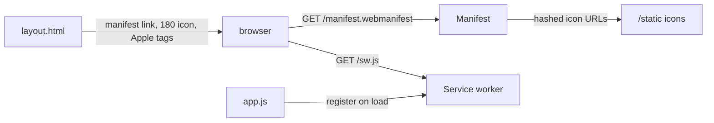

# Notifications

## Overview

The app is installable. A person can add it to a phone's home screen or a desktop launcher, and it opens in its own
window without browser chrome. The pieces are a public manifest, four generated PNG icons, a service worker at the site
root, and a few Apple tags in the shared layout.

Install works today. Push notifications are not wired up yet: the worker has the listeners, but nothing on the server
sends a message.

## Installing the app

- **Android Chrome:** open the browser menu and choose **Install app** (older builds say **Add to Home screen**). The
  installed app opens standalone with the launcher icon and the paper-turf splash color.
- **iPhone and iPad:** open the page in Safari, tap **Share**, then **Add to Home Screen**. iOS does not offer a browser
  install prompt, so this is the only route. The home-screen icon comes from the 180 PNG.
- **Desktop Chrome, Edge, and Safari:** use the install control in the address bar, or the browser's Apps menu. The app
  gets its own window and dock entry.

Install does not change sign-in. The installed app runs the same Google OAuth flow and keeps the same kind of session
cookie as a browser tab.

The manifest sets the start URL and scope to `/`, so an installed app opens the group list or the person's only group's
week. The display mode is `standalone`. The name is "Sunday Parlay Club" and the short name is "Parlay Club". The
background color matches the paper-turf page, which is what the splash screen shows while the app boots. The theme color
is the paper-turf theme color, whatever theme the person has picked.

## Manifest

`GET /manifest.webmanifest` is public and sits outside every session check, because an installed app reads it before
anyone signs in. It answers `application/manifest+json` with `Cache-Control: no-cache`.

The handler builds the JSON in Go instead of serving a checked-in file. That lets every icon URL carry the existing
`/static` content hash. The static route caches for a year, so without the hash a changed icon would stay stale on an
installed device.

The icon list has three entries:

| Sizes     | Purpose    | File                      |
| --------- | ---------- | ------------------------- |
| `192x192` | `any`      | `icon-192.png`            |
| `512x512` | `any`      | `icon-512.png`            |
| `512x512` | `maskable` | `icon-maskable-512.png`   |

## Icons

The PNGs come from `cmd/genicons`, which `go generate ./...` runs through the directive in `web/embed.go`. The program
draws a football mark from the paper-turf colors and writes four files into `web/static`:

- `icon-180.png` for the Apple touch icon, full bleed because iOS applies its own mask;
- `icon-192.png` and `icon-512.png` as the rounded-square manifest icons;
- `icon-maskable-512.png`, full bleed with the mark inside the platform's safe zone.

Do not hand-edit the PNGs. Change the generator, then regenerate. A new size is a new entry in `cmd/genicons` and, for
manifest sizes, a new icon in the handler.

## Service worker

`GET /sw.js` is public too. It answers `text/javascript` with `no-cache` and `nosniff`, so a deploy's new worker is
picked up on the next load.

The worker lives at the site root because a worker only controls pages under its own path. A copy under `/static/`
could not control `/slips/{id}`. It has three listeners:

- `install` calls `skipWaiting`, so a new worker takes over without waiting for every tab to close.
- `push` shows a notification from a JSON payload of `{title, body, url, tag}`. The payload shape is already fixed;
  nothing sends one yet.
- `notificationclick` closes the notification, focuses an open app tab, and navigates it to the payload's URL, or
  opens a new window.

There is no `fetch` handler and no cache. Page loads still come straight from the server, so a stale worker can never
serve an old page, and offline support stays out of scope.

`app.js` registers `/sw.js` on `window.load` when the browser has service workers. A browser without them, or one that
refuses registration, leaves the app working normally.

## iPhone layout

`layout.html` adds the manifest link, a 180 `apple-touch-icon`, and the Apple standalone tags. The status bar style is
`black-translucent`, so the installed app paints under it.

Because the installed app owns the whole screen, the sticky header and the bottom bars carry `env(safe-area-inset-top)`
and `env(safe-area-inset-bottom)` padding. The notch and the home indicator sit over that padding instead of over the
header or the tab bar. The viewport already sets `viewport-fit=cover`, which turns those insets on.

## Tests

Route tests ask for the manifest and the worker without a session cookie and check their content types, the manifest's
name, start URL, display mode, and icon sizes, and the worker's listeners and its missing `fetch` handler. The layout
test checks the manifest link, the touch icon, and the Apple meta tags.

## Trade-offs

- There is no offline mode. A worker with no `fetch` handler cannot serve a page from a cache, and that is deliberate:
  a stale slip or price is worse than a spinner.
- The manifest ignores the chosen theme. Splash and theme colors stay on paper-turf so the install shell looks the same
  for everyone; the page itself still follows `pc_theme`.
- iOS install is manual. Safari offers no prompt, so the app has to tell people where the Share button is when it wants
  them to install.
- iOS treats the home-screen app as its own container. A person may have to sign in once inside it, and a permission
  granted in Safari does not carry into the installed app.

## Related

- [Access](access.md): the public routes and the session checks everything else runs through.
- [Routes](../reference/routes.md): the manifest, worker, and static route table.
- [Live updates](live-updates.md): the `EventSource` stream the worker deliberately does not sit in front of.
- [Local development](../guides/local-dev.md): serving the app on `localhost`, which browsers treat as a secure context.
