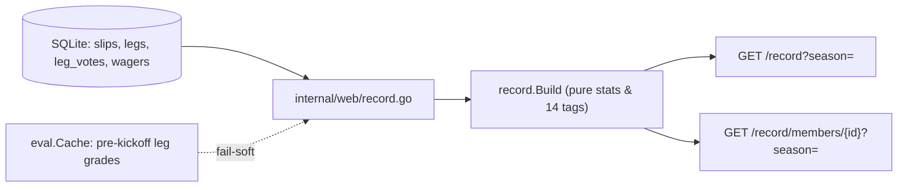

# Record Book

## Overview

The Record Book (`GET /record?season=`) turns a group's graded slips for one NFL season into a group summary, a
member leaderboard with earned tags, and per-member bet history drill-downs (`GET /record/members/{id}?season=`). All
aggregation and tag evaluation live in the pure `internal/record` package (`record.Build`), with no database, HTTP, or
clock dependencies.

## Season selection and group scope

Every query (`internal/db/record.go`) is scoped to the active group:

- `SeasonsForGroup` and `GradedSeasonsForGroup` list seasons with slips (newest first) for the season selector.
- When `?season=` is omitted, `GET /record` and `GET /record/members/{id}` default to the latest season with graded
  slips, falling back to the latest season with any slip, the latest loaded week's season, or the current calendar year.
  An invalid or non-positive `?season=` returns 400 Bad Request.
- `RecordUsersForGroupSeason` includes every current group member and any user who authored a leg on a graded slip in
  that group and season, so members who leave a group keep their historical stats on the leaderboard.
- `VotesForGroupSeason` sums net vote tallies per leg on graded slips in that group and season.
- Pre-kickoff leg grades (A–F) come from `eval.Cache.GetOrCompute` via `SuiteReport.LegGrades`. If replay fails or
  no cache is configured, the handler logs a warning and passes nil grades so non-grade stats and tags still render.

## Group totals and streaks

`record.Build` considers only `GRADED` slips with a WON, LOST, or PUSH result:

- **Group record and Units P/L:** Counts Wins, Losses, and Pushes, and sums `parlay.Units(slip.Result, parlay.CombinedOdds(activeLegs))`
  across all graded slips. Units P/L uses active leg odds (VOID and PUSH legs drop out), independent of personal
  wager odds.
- **Chronological streaks:** Slips are sorted by (Season, SeasonType, WeekNum, CreatedAt, ID). LongestWin and
  LongestLoss track the longest consecutive runs of WON and LOST slips. A PUSH slip resets both running streak
  counters to 0.

## Member leaderboard

Every user with at least one leg on a graded slip in the season gets a row:

- **Hit% and qualification (`MinDecidedLegs = 6`):** HitPct is WON / (WON + LOST) * 100 once a member reaches 6
  decided legs. Below 6 decided legs, HitPct renders "–" and the member sorts after all qualified members. Ordering
  is qualified first by HitPct descending, then WonLegs descending, DecidedLegs descending, Name ascending
  (case-insensitive), and UserID ascending.
- **Implied-odds lift (`ImpliedLift`):** Once a member reaches 6 decided legs with valid odds, `ImpliedLift` measures
  HitPct minus the mean sportsbook implied win probability across those legs (in percentage points).
- **Avg leg odds:** Arithmetic mean of `parlay.AmericanToDecimal` over WON, LOST, and PUSH legs
  (excluding VOID, PENDING, and NEEDS_GRADING), converted back via `parlay.DecimalToAmerican`.
- **Parlay Terrorist:** Counts graded slips with Result == LOST where *exactly one* leg was LOST, credited to that
  leg's owner. Multi-loser slips do not count. Every member tied for the highest count (> 0) receives the Parlay
  Terrorist badge.
- **Personal Dollar P/L:** Sums net wager outcome across the member's logged wagers on graded slips (WON adds
  `parlay.Payout(stake, parlay.AmericanToDecimal(w.Odds), w.BoostPct) - stake`, LOST subtracts stake, and PUSH
  adds 0). Members with zero logged wagers show "–", distinct from "$0.00".

On phones (below `sm:`), each member renders as a compact card; at `sm:` and wider, the leaderboard renders as a table.
Each member links to `/record/members/{id}?season=`.

## Member tags and clickable explanations

`internal/record/tags.go` evaluates 14 deterministic season tags (7 praise, 7 insult). Every tag requires both a minimum
sample size and a clear performance threshold. Earned tags are ordered deterministically: praise tags in catalog order,
followed by insult tags with Parlay Terrorist first.

| Tag | Tone | Qualification rule |
| --- | --- | --- |
| Natural | Praise | Win >= 60.0% of 3+ decided D/F-graded legs (min 3 wins) |
| Ball Knower | Praise | ImpliedLift >= +12.0 pts across 6+ decided legs with valid odds |
| Film Room God | Praise | Win >= 75.0% of 4+ decided A/B-graded legs |
| Sniper | Praise | Win >= 50.0% of 3+ decided +120 or longer legs (min 2 wins) |
| The Backpack | Praise | Hit >= 65.0% across 8+ decided legs with TerroristCount == 0 |
| Heater | Praise | Active consecutive decided leg win streak >= 5 (PUSH/VOID skipped) |
| Told You So | Praise | Win >= 60.0% of 3+ decided net-downvoted legs (min 2 wins) |
| Parlay Terrorist | Insult | Tied for group max TerroristCount > 0 (sole losing leg on lost slip) |
| Certified Donkey | Insult | ImpliedLift <= -12.0 pts across 6+ decided legs with valid odds |
| Glue Eater | Insult | Win <= 35.0% of 4+ decided A/B-graded legs |
| Vegas's Favorite Idiot | Insult | Win <= 20.0% of 4+ decided +120 or longer legs |
| Scared Money | Insult | Average leg odds <= -220 across 6+ decided legs |
| Stinker | Insult | Active consecutive decided leg loss streak >= 5 (PUSH/VOID skipped) |
| Fraud | Insult | Win <= 35.0% of 3+ decided net-upvoted legs |

Each tag renders as a clickable `<button type="button" data-tag-explain>` chip—kept outside the member profile link so
tapping a tag never triggers navigation. Tapping any tag opens the shared `#tag-explain-dialog` sheet
(`web/templates/partials.html` and `web/static/app.js`), showing the tone pill, tag name, the member's specific
qualifying stats (Explanation), and the plain-English Rule.

## Member bet history

`GET /record/members/{id}?season=` (`web/templates/record_member.html`) drills into one member's season performance:

- **Group privacy:** Only users returned by `RecordUsersForGroupSeason` for the active group and resolved season are
  visible; any other user ID returns 404 Not Found.
- **Header and summary:** Shows a back link to `/record?season=`, season selector, member avatar and leaderboard rank,
  clickable Tags strip, and a 4-stat summary strip (Legs, Hit % with implied-odds lift, Avg odds, Dollar P/L).
- **Graded leg log:** Lists every leg authored by the member on graded slips in that season, ordered newest week and
  slip first (Season DESC, SeasonType DESC, WeekNum DESC, CreatedAt DESC, SlipID DESC, LegID ASC). Each card links to
  `/slips/{id}` and shows the week label, slip name and result, selection, market label, odds, pre-kickoff grade badge
  (omitted when ungraded), net vote tally (when non-zero), a Sole killer badge when that leg was the sole loser on a
  lost slip, and the leg result.

## Related

- [Slips](slips.md): auto-grading, manual overrides, votes, and personal wagers.
- [Groups](groups.md): how the active group scopes the Record Book.
- [Odds math](../reference/odds-math.md): `CombinedOdds`, `Payout`, and `Units` formulas.
- [Routes](../reference/routes.md#record-book): `GET /record?season=` and `GET /record/members/{id}?season=` behavior.
- [Database schema](../reference/schema.md): `slips`, `legs`, `leg_votes`, and `wagers` tables.
