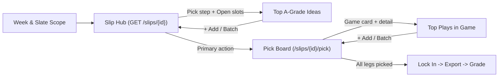

# Slips

## Overview

A group builds shared parlays for each week. A **week** is an ESPN NFL week: a season, a season type (regular or
postseason), and a week number. Its id is `season*1000 + season_type*100 + week_num`, so Week 9 of the 2026 regular
season is `2026209`.

A **slip** is one shared parlay inside a group and a week. Every slip has a **slate scope** (`thursday`, `sunday_main`,
`weekend`, or `full_week`) that isolates its games and deadline. A week usually has one slip, but a group can make more, and a
person can belong to several in the same week. The app tracks the picks. Each person places the bet at their own book
with their own stake, and no money passes through the app.

## The hub

`GET /slips/{id}` is the hub. A step banner leads, then the slip header card, the members and their legs, the export card,
the payout calculator, the **My wager** form (`slip-wager`), and the activity feed. The header shows the slip title,
its scope badge (`Thursday Slate`, `Sunday Slate`, `Weekend Slate`, `Full Week`, or `1 Game` / `N Games` for custom
slips), status, and a `+ New slip` link to `/slips/new?week={id}`. On a single-slip week, `+ New slip` sits in the header metadata row. When a group has multiple
slips in the active week, one horizontal sibling pill switcher bar (`[data-sibling-switcher]`) sits below the title
with links to each sibling slip, their status summary (`(Locked)`, `(1/2 Picks)`, `(Won)`), and `+ New slip` as a
trailing pill. In the `export` step the export card moves above the banner, because placing the picks is the one thing
left. `slip-wager` sits outside `slip-panel`, so live `slip-updated` refreshes do not wipe out in-progress wager inputs.
The bottom bar keeps Groups, This week, Research, Record Book, and Docs; the hub's one primary action is the way into
picking. The hub stays one column at every width. Docs (`/docs`) holds the standing explanation; a `?` bubble beside an
annotation opens the matching section with `?from=`, and [Docs hub](docs-hub.md#help-bubbles) maps every bubble.

When the slip is `OPEN` and the viewer is in the `pick` step (has remaining leg slots), `#slip-panel` renders a compact
**"Top A-grade ideas"** strip below the step banner. It runs `analyzer.LoadBoardSignals` and `board.SelectHighlights`
over cached SQLite odds and signals—making zero external API calls—to surface up to 3 A-grade legs and up to 2 A-grade
2–3 leg parlay combos. Each card shows its `A` pill, a concise reason, odds with a muted implied percentage chance (and
combined implied chance on combo headers), an inline `
` [four-pillar grade breakdown](analyzer.md), and
one-tap `+ Add` (or `"Add all N"` via `POST /slips/{id}/legs/batch`, which disables as `"Needs N open slots"` when fewer
than `N` slots remain). When no A-grade plays exist or the viewer finishes picking, the strip hides cleanly.

`slips.NextStep` is one pure function over the slip, its members, its legs, the week's games, the viewer, and `now`. It
returns the step, the legs still needed, the names the slip waits on, the first kickoff still ahead, and the slip's
result. The hub banner and each group card read its label, so the two always agree.

| Step      | When                                                      | Banner             | Primary action                                      |
| --------- | --------------------------------------------------------- | ------------------ | --------------------------------------------------- |
| `join`    | The viewer is in the group but not on the slip.           | Join this slip     | Adds the viewer through `POST /slips/{id}/members`. |
| `pick`    | The viewer has fewer legs than `legs_per_member`.         | Pick N more        | Opens `/slips/{id}/pick`.                           |
| `closed`  | The week's picks are over before the slip could finish.  | Picks are closed   | None; the slip stays visible.                       |
| `lock_in` | The viewer has every leg and has not locked in.           | Ready to lock in   | Posts `/slips/{id}/lock`.                           |
| `waiting` | The viewer is locked in and someone else is not.          | Waiting on {names} | Nudge {name} shares or copies the message.          |
| `export`  | Everyone is locked in.                                    | Ready to place     | The export card leads the hub.                      |
| `done`    | The slip is `GRADED`.                                     | Won, Lost, or Push | None.                                               |

The deadline is the earliest game in the slip's slate scope whose kickoff is still ahead of `now`. It renders as
`Picks close for BUF @ MIA at <time>`, and `app.js` formats the time in the reader's zone. Scoping isolates deadlines: a
Thursday slip's deadline is Thursday kickoff, while a Sunday Main slip ignores Thursday kickoffs and sets its deadline
to the earliest Sunday game. A past week or a scope with no games left has no deadline. Unlocking clears every lock, so
the banner reopens the pick step; a member who already has every leg sees `lock_in` instead.

`closed` is the empty state when picking ends before the slip could lock in. `slips.NextStep` evaluates games within the
slip's slate scope. A Thursday slip closes when Thursday kicks off without full picks, even while Sunday games remain
open. A Sunday Main slip stays open through Thursday and Friday. The viewer sees `closed` when they are short of legs
and every game in the slip's scope has kicked off, or when they are locked in and another member never finished picking.
In the second case the banner names who never finished and says the slip cannot lock in this week, instead of offering a
nudge for a pick that cannot arrive. If everyone has their legs and only a lock is missing, `waiting` stays and the
nudge still works, with no picks-close time.

In `waiting` each person still picking gets a **Nudge** button. It opens the browser's share sheet with "Waiting on you
for {slip}. Picks close {time}. {url}", with the time in the sender's zone and an absolute link, and copies the text
when the browser has no share sheet. The server sends nothing; a slip with no deadline drops the picks-close sentence.

Opening a slip from another of the viewer's groups switches the active group, the same as opening that group's week. A
group member who is not on the slip sees `join`; a person outside the group gets a 404.

## Creating a slip

Opening a group's week (`GET /groups/{id}/week`) switches the active group, picks the first upcoming week from
`Store.UpcomingWeeks` (or `LatestWeek`), and runs `slips.EnsureWeekSlips` for active recurring schedules. When games
already exist, `EnsureWeekSlips` skips missing schedules whose `slate_scope` has no upcoming non-final game
(`now < kickoff`), avoiding empty or dead slips while leaving existing slips untouched (cold weeks create all active
schedules). The route always renders the per-group overview page:

- **Spotlight slips:** Active or upcoming slips from that week appear in the hero spotlight (`isSpotlightSlip`): any
  non-graded slip whose next step is `pick`, `lock_in`, `join`, `waiting`, or `export`, or a locked slip with an
  eligible live or upcoming game (`now < kickoff`). Cards sort by urgency and earliest deadline, show a compact live
  progress bar and `Live X%` hit chance when any leg is live or settled, and offer a primary button ("Pick N more" to
  `/slips/{id}/pick` when in `pick`, otherwise "Open slip" to `/slips/{id}`).
- **Quiet state & overview sections:** With no spotlight slips, the hero shows "No active slip right now", notes the
  next upcoming week if loaded, and offers "+ Start a slip" (`/slips/new`). Below it sit the group record snapshot
  (`/record`), recent non-spotlight slips, recurring schedules (`+ Add recurring slip` to `/slips/new?mode=recurring`),
  and the members strip (`/groups`).

A member can create either a one-off slip or a recurring schedule at `/slips/new` (with optional `?week=`, `?mode=`, and
`?slate_scope=` or `?scope=`). `GET /slips/new` queries `Store.UpcomingWeeks` (`kickoff_utc > now`, soonest first) and
never shows past or completed weeks.

The create screen adapts to whether upcoming weeks and existing slips are present:

- **No upcoming weeks:** When `UpcomingWeeks` is empty, it displays *"No upcoming games are loaded yet"* and hides the
  form.
- **Empty week:** With an upcoming week and no slips yet, it reads *"Start {Week}'s slip"* and *"No slip for {Week} yet"*.
- **Existing-slip week:** When the target week already has at least one slip, it reads *"Add a slip for {Week}"* and
  *"Pick a mode, games or slate, legs per member, and who's in."*
- **Solo group:** A group with only the viewer adds *"It's just you for now"* and points at Groups for an invite.

A mode toggle switches between **One-off** (default) and **Recurring**:

- **One-off (`mode=one_off`):** Picks an upcoming week (switching weeks loads `GET /slips/new/games` via HTMX), shows
  dynamic weekday shortcut chips derived from that week's upcoming games in Eastern time (`All Sunday`, `All Thursday`,
  `All Monday`, `All Saturday`, `All Friday`, `All games`, `Clear`), pre-selects Sunday games when present (otherwise all
  upcoming games), and persists `SlateScopeCustom` with the selected `game_id` rows via `db.Store.CreateSlipWithGames`.
  Submitting zero games returns 422 (`ErrSlipGamesRequired`).
- **Recurring (`mode=recurring`):** Picks a repeating `slate_scope` (`ValidForSchedule`: `sunday_main`, `thursday`,
  `weekend`, `full_week`), creates a `GroupSlipSchedule`, runs `slips.EnsureWeekSlips` on the first upcoming week, and
  redirects to the materialized slip (or `/groups/{id}/week` if no matching game is upcoming).
- Name defaults to the week label, `Week 9`, then `Week 9 #2`. `legs_per_member` defaults to 2 and allows 1–5. Members
  default to the previous slip's members via `slips.CreateDefaults`.

## Slate scopes

Every slip belongs to a **slate scope** (`internal/db/slips.go`):

| Scope | Value | Games included |
| ----- | ----- | -------------- |
| Thursday | `thursday` | Games kicking off on Thursday in Eastern time. |
| Sunday Main | `sunday_main` | Games kicking off on Sunday or Monday in Eastern time (default). |
| Weekend | `weekend` | Games kicking off on Saturday, Sunday, or Monday in Eastern time. |
| Full Week | `full_week` | Every game in the week. |
| Custom | `custom` | Explicit `slip_games` rows chosen at one-off creation (not allowed on recurring schedules). |

Scopes isolate deadlines and pick boundaries through `slips.FilterGamesForSlip`:

- **Deadlines:** `slips.NextStep` filters games with `FilterGamesForSlip` before finding the earliest upcoming kickoff. A
  Thursday game does not pull a Sunday Main or custom Sunday slip's deadline forward.
- **Picks:** A pick must belong to a game allowed by the slip's scope (or `slip_games` for `custom`). Adding a pick for
  an ineligible game returns `ErrGameOutsideScope`.
- **Closure:** Once all eligible games in a slip's scope kick off, an incomplete slip enters `closed`. Other slips in
  the same week stay open if their own games have not kicked off.

## Members

A slip has **members**: a subset of the group's users, guests included. `slip_members` pairs a slip with a person and
holds `locked_at` for a lock in.

Members and `legs_per_member` can change only while the slip is `OPEN`. A member with legs cannot be removed until their
legs are deleted. Adding someone already on the slip changes nothing. A group member who is not on the slip can join it
themselves through the same add-member route while it is `OPEN`.

## Legs

A **leg** is one pick. It holds an owner, an optional game, a market, a team, an optional player, a side, an optional
line, American odds, and a display `selection` generated from those fields.

| Market       | Fields                         | Selection example                   |
| ------------ | ------------------------------ | ----------------------------------- |
| `SPREAD`     | team, line                     | `BUF -3.5`                          |
| `ML`         | team                           | `BUF ML`                            |
| `TOTAL`      | side (OVER/UNDER), line        | `BUF@MIA Over 47.5`                 |
| `TEAM_TOTAL` | team, side, line               | `BUF Team Total Over 27.5`          |
| `PASS_YDS`   | player, team, side, line       | `Josh Allen Over 245.5 Pass Yds`    |
| `PASS_TDS`   | player, team, side, line       | `Josh Allen Over 1.5 Pass TDs`      |
| `RUSH_YDS`   | player, team, side, line       | `James Cook Over 64.5 Rush Yds`     |
| `RUSH_ATT`   | player, team, side, line       | `James Cook Over 14.5 Rush Att`     |
| `REC_YDS`    | player, team, side, line       | `Khalil Shakir Over 52.5 Rec Yds`   |
| `RECEPTIONS` | player, team, side, line       | `Khalil Shakir Over 4.5 Receptions` |
| `ANYTIME_TD` | player, team (side `YES`)      | `James Cook Anytime TD`             |
| `KICKER_PTS` | player, team, side, line       | `Tyler Bass Over 7.5 Kicking Pts`   |
| `OTHER`      | free-text selection, team opt. | whatever the user typed             |

- Team is the ESPN abbreviation of the team the leg is about. For `TOTAL`, team is empty.
- Odds default to -110 in the form. Quick-add pills prefill the price; the formulas are in
  [Odds math](../reference/odds-math.md).
- The game picker lists the week's games that have not kicked off and match the slip's slate scope. A current week
  requires a matching game; a past week lists every game and allows no game. `?game_id=` preselects one when a card
  opens the form.
- The leg form provides a `<datalist>` of player names for autocomplete, drawn from the week's rosters and prop boards.
  Saving a player market leg resolves the player's ESPN athlete ID and team automatically through player matching.
- A leg needs a game, except on a slip for a past week, where the game is optional and `OTHER` is the usual market.
- `OTHER` legs skip the analyzer and grade by hand.

The slip panel draws each leg as a row: a leading media badge when available, then the selection, the odds with a muted
implied percentage chance (e.g., `-110 (52%)`), a "Research &rarr;" link when the leg has a resolved player or game, the
model chip, the grade pill, and the result. The grade pill opens that leg's four-pillar breakdown, and its `?` bubble
opens the standing explanation in Docs; the implied chance and the nfelo model chip carry glossary bubbles. A matched
player leg shows the player's portrait (or the team logo, or player initials); a team-scoped leg shows the team logo; a
game `TOTAL` leg shows paired away and home logos; and an unlinked custom or historical leg stays plain text. A `SPREAD`
or `ML` leg with a fresh nfelo model shows it beside the odds, from that leg's team's side: `nfelo -5.0` for a spread or
`nfelo 76%` for a moneyline. Totals and props show no chip, and a missing row, a fetch older than 72 hours, or a live
game leaves it off. `db.Store.CreateLeg` starts every leg `PENDING` and treats an odds value of 0 as -110.

The slip's **reference odds** multiply each leg's reference price: the median of the prices the slip members' home books
carry for that leg via `db.MatchBookOdds` (one price per book, preferring an exact `Line` match and falling back to the
book's current line for the same selection). A leg whose members' books do not price it keeps its own price. The payout calculator shows muted implied percentage chances inline beside both **Combined** and **Reference** odds, omitting them when no legs count (empty or all-`PUSH`/`VOID` slips). Each chance pairs with a `?` bubble. The formulas are in [Odds math](../reference/odds-math.md).

### Selection identity

`db.SameSelection` (`internal/db/odds.go`) defines when two selections are the same pick, ignoring sportsbook, `Line`,
price, and link:

- **Player props (`db.SamePlayer`):** Match on `GameID`, `MarketType`, and `Side`, plus ESPN `PlayerID` when both carry
  one, or normalized player name (`db.NormalizePlayerName`) with non-conflicting `Team` otherwise.
- **Game markets (`SPREAD`, `ML`, `TOTAL`, `TEAM_TOTAL`):** Match on `GameID`, `MarketType`, `Team`, and `Side`.

The pick board (`board.Row.MatchesLeg`), `Fits slip` signal evaluation (`internal/board/signals.go`), sportsbook export
matching and slip reference odds (`db.MatchBookOdds`), and open-slip vote preservation all share this rule.
`db.SameLineGroup` pairs sides of the same line or player market on the pick board (`sameBoardLine`), and
`db.MarketLabel`, `db.FormatSelection`, and `db.BuildLegSelection` provide the shared market labels and selection text
formatting across the pick board, slip leg forms, and research. A saved leg's `Line` is never mutated automatically in
the background, so locked and final slips continue grading against the exact line recorded on the slip.

## The pick board

The hub's pick step opens `GET /slips/{id}/pick`, a focused screen with a back link to the hub and no bottom bar. It is
a game slate with the open game's picks beside it. On a phone the slate fills the screen and a game opens a drilldown
with an "All games" back link; at `lg` the slate and detail sit in a `22rem + 1fr` grid and scroll on their own while
the page body stays put. A fixed dock sits at the bottom at every width, so the picks stay in reach while the slate
moves, and the page reserves bottom padding for it so the last row is never hidden. The page sets `Page.Wide`, so the
header, main, and dock widen to `max-w-6xl`, and carries the slip's `data-live-url`, so it still opens one stream per
page. The dock is only on this screen; the hub keeps its panel and banner.

`internal/board` turns the week's stored odds into rows. It reads nothing itself. Before building rows and cards, the
pick board filters the week's games for the active slip using `slips.FilterGamesForSlip`. Games outside
the slip's scope are omitted from the slate, window chips, and detail drilldowns. `db.CurrentOdds` (applied by
`Store.OddsForWeek` and `Store.OddsForGame`) drops rows from older odds syncs at the storage seam, then `board.Build`
folds one row per selection, using the viewer's home book when it prices the selection and the median across every book
otherwise. A game that has kicked off is left out and counted. Each row carries its game, market, team, player, the
roster athlete ID and position, side, line, price, display text, a category, and a kickoff window, plus picked-leg drift
fields (`PickedLine`, `PickedOdds`, `Drifted`, `BoardDriftNote`, `TrayDriftNote`) when bound to a viewer leg.

`board.BuildSlate` (using `board.Slates`) shapes those rows into one card per game still ahead. It filters by the
search text and the kickoff window, orders cards by kickoff, resolves the open game, counts rows per kickoff window,
flags games with lines but no loaded props (`Unloaded`), and derives each card's spread, total, moneyline, and slate
empty-state flags. A game with no stored odds still gets a card, with no lines and no props. The prop count is every row
outside the lines category, so team totals count as props.

The slate leads with one search box and the kickoff-window chips. Search is case- and accent-insensitive and matches a
matchup, a team, a venue, or a roster player on the game. The input debounces at 250 ms and swaps the body partial, and
the response pushes the full page URL so `q` survives a refresh or a shared link. Window chips filter by Eastern-time
kickoff (Thursday, Sunday morning before noon, Sunday early before 4, Sunday late before 7, Sunday night, Monday); a
Thursday- or Monday-night game that lands on the next day in UTC still reads by its local Eastern day. A chip shows how
many rows it covers and appears only when it has rows. Each card shows paired away and home team logos beside the
matchup, venue, kickoff, spread, total, moneyline, an `"N A-grade"` pill when that game has unpicked A-grade legs, and
either "Explore N props" or "No props yet", and the open game is highlighted. Cards are links: a plain `href` to the full page and an `hx-get` that swaps `#pick-body` and pushes the
full page URL.

A card opens the detail: a pinned header with paired matchup logos, the matchup, kickoff, venue, a Research link, an
"All games" back link, and a horizontal tab bar. Below the pinned header and tab bar—when the slip is `OPEN` and the
viewer has open slots—sits a **"Top plays in this game"** strip (up to 3 A-grade legs and up to 1 same-game A-grade
parlay combo with one-tap `+ Add`), followed by the sort chips. The header and tab bar stay below the top bar while
the rows scroll, and the tab bar scrolls sideways on a phone with no visible scrollbar.

The tabs are Lines, Passing, Rushing, Receiving, TDs, and Kicking. Team totals fold into Lines, so they have no tab of
their own. A tab appears only when it has rows or is open, and its badge counts the rows it holds, so the Lines count
includes both sides of a spread and both team totals. An empty or unknown `cat` opens Lines when it has rows, otherwise
the first tab that does. An unknown game, a kicked-off game, or a game the window hides falls back to the slate instead
of a 404.

The Lines tab shows the game lines first (spread, moneyline, total) and then team totals grouped by team. Each line sits
with its sides beside each other: away before home on a spread or moneyline, Over before Under on a total or a prop, and
the one Yes on an anytime touchdown. A side with no stored price leaves one full-width button instead of a dead half.

A prop tab clusters that tab's rows by player. One card carries the player's portrait (or initials), name, position, and
team (with team logo), and every market that player has in the tab sits under it, so Receiving Yards and Receptions
share a card. Prop buttons stay text-only and read short ("Over 245.5", "Yes") because the card already names the
player; the pick they post is unchanged. Every pick-board option button (`tap to add`, `tap to remove`, `tap to switch`,
and `swap in`) pairs its price with its implied percentage chance (e.g., `-110 (52%)`).

The search text also filters the open game's rows. Sorts are player (default), odds (shortest price first), line
(highest line first), and matchup (strongest suggestion signal and softest opposing defense EPA rank first). Kickoff and
category drop out because one game has one kickoff. Tab and sort chips swap `#pick-detail` only, so the slate keeps its
scroll and search; the back link drops `game` and `cat`, keeps `q` and `win`, and swaps the whole body. A live board
signal refreshes the detail and the slate on their own URLs, so the open tab and sort stay put. A tab or sort swap also
syncs the search form's hidden tab and sort for the next search.

When fresh nflverse stats, ESPN injury lists, or open-slip legs are present, `internal/board` passes `BoardSignals`
through `ApplySignals` and `Detail` to attach suggestion pills (`Row.Badge` on options and up to two `PlayerGroup.Tags`
per player card in priority order):

- **Smash matchup:** player `OVER` prop with >= 20% `TargetShare` or >= 12 carries/game against a bottom-6 opposing
  defense (EPA allowed rank >= 27).
- **Fits slip:** line or prop that pairs positively with an existing leg on the open slip (such as a receiver `OVER` with
  that team's QB passing yards `OVER`, or an opposing receiver or same-team RB `OVER` with a `-7.0` or larger favorite
  spread).
- **Role bump:** player `OVER`/`YES` prop where a same-position teammate is marked `Out` in the merged game injury list
  (`games.injuries_json` plus key-position `roster_players` injuries via `analyzer.MergeGameInjuries`) and the player
  posted >= 15 percentage points higher `OffensePct` in a prior game this season.
- **High volume:** player `OVER`/`YES` prop with top-quartile `WOPR`, `TargetShare`, `OffensePct`, or carries for their
  position.

The pinned detail header carries one `?` bubble that explains all four, because each badge sits inside an option button
where a nested link is invalid. Missing or stale signals omit badges cleanly without hiding any pick.

Game selection replaces `#pick-body`, which can reset the slate's scroll. `app.js` saves the `scrollTop` of the
`[data-keep-scroll]` pane before an HTMX swap and restores it after. Times keep the existing contract: a `<time>`
element with a UTC ISO value, a neutral ET fallback from the server ("Mon 3:04 PM ET"), and the reader's local zone from
`app.js` after each swap.

`board.Row.MatchesLeg` matches each viewer leg by `db.SameSelection` (ignoring `Line`), so a picked leg stays bound
to its board row with remove and swap controls even if the consensus or home-book line moves after picking.

`board.Pair` is the one pairing rule, shared by the detail and every refreshed row (`board.LineGroupForLeg` applies
`BoardSignals`, pairs the game's rows, and locates the matching `LineGroup` via `LineGroup.HoldsLeg`). It folds rows
that share a line into one group: a spread or moneyline keys on the market alone so both teams sit together, a game total
on the market and number, a team total on its market, team, and number, and a player prop on its market and canonical
player. `board.LineKey` names that identity, so the row's element id and the update path agree. Options come back in a
fixed order, never in input order: away then home on a spread or moneyline, Over then Under on a total or prop, and the
single Yes on an anytime touchdown. A line with no stored price on one side keeps one option, and a line with both sides
picked, which the custom form can produce, paints both and lets either be removed.

Tapping a side of an unpicked line adds it with the normal add-leg route (`quick=1&from=board`), and tapping a picked
side removes that leg. Tapping the other side of a line that already holds a pick sends `PUT /legs/{id}` with the new
side's fields, so the pair holds one leg instead of two; `UpdateLeg` enforces the owner, the lock in, and kickoff on
both games, and its activity entry reads "Adam changed X to Y". Add, update, and delete answer the same way: the
refreshed pair row for that line, both sides with their current picks, plus `tray-updated`. Only that row swaps, and the
dock and the tray refresh without a reload. A switch that moves the leg to another line also fires `board-updated`,
because the old line's row is still on screen and must lose its delete button. At the limit, a line with neither side
picked opens "Swap which pick?" and lists the viewer's legs that are not kickoff-locked. Choosing one sends
`PUT /legs/{old}` with the new pick's fields; a line that already holds a pick switches sides in place and needs no free
slot.

When a saved non-`OTHER` leg's `Line` or `Odds` differ from the current board row (`board.Row.Drifted`), `board.Build`
populates `BoardDriftNote` (`Slip ... · now ...`) and `TrayDriftNote` (`Now ...`) so both the board option and the pick
tray show a drift notice. While the slip is `OPEN` and the leg is not kickoff-locked (and the viewer is not locked in on
the board), a one-tap **Sync line** form (`PUT /legs/{id}` with `from=board` or `from=tray`) updates the leg's `line`,
`odds`, and regenerated `selection` text to match the board.

A game that has stored lines but no prop rows offers "Load them" on its slate card and again in its open detail: "Props
for BUF @ MIA aren't loaded yet." The button calls `GET /games/{id}/props?slip=`, which runs `SyncGameProps` for that
one game (credit floors and all) and then fires `board-updated`, so the body refreshes in place and the open game stays
open. A week with no odds at all keeps the one week-level "No lines" state instead of a button per game.

While the slip is `OPEN` and upcoming games remain in its slate scope, opening `/slips/{id}/pick` syncs stale week lines
via `SyncPickLines` (or `SyncPickGame` when an upcoming game is open), and selecting or refreshing an upcoming game in
`/pick/results` or `/pick/detail` syncs stale lines and props for that game via `SyncPickGame` (15m lines / 30m props on
game days; 2h otherwise). Once `sync_state` is fresh, typing, filtering, sorting, and `board-updated` SSE reloads read
SQLite only and spend no credits. A phone-first "Refresh odds" button (`POST /slips/{id}/pick/refresh`) appears in the
slate and detail header on `OPEN` slips with upcoming games, calling `ForcePickRefresh` with a 2-minute cooldown and
returning `#pick-body` (returning 422 on locked slips). Locked or graded slips and `/pick/slate` refreshes trigger no
odds syncs. See [Data refresh](data-refresh.md).

The board has its own empty states. A week with no stored games says the slate has not synced. A week with games but no
odds says the lines have not synced, once, instead of offering "Load them" for every game. Once every game has kicked
off, it says picks are closed. A search or filter that matches nothing keeps "Nothing matches that search." An open game
with no rows in the current search says the same inside the detail; with no search it says the game's lines have not
synced. When only some games have started, one line says how many are hidden.

The dock shows "Your picks", `Picked of Limit`, the combined price, and its implied percentage chance (e.g.,
`1 of 2 · 1.91x (-110) · 52%`), plus a "Slip" button. The combined price uses `parlay.CombinedOdds` and
`parlay.DecimalToAmerican`, matching the payout card; an empty slip shows only the count and omits the implied chance.
The button loads `GET /slips/{id}/tray` into a `dialog` sheet showing the viewer's legs (each with odds and muted implied
chance), remove buttons (or "Locked" after kickoff), progress ("1 of 2"), analyzer warnings for those legs, and "Done"
or "Review and lock in" at the limit. Both the dock (`GET /slips/{id}/pick/dock`) and tray watch `tray-updated` and
`slip-updated` so any leg change updates the count and price without a reload.

`GET /games` is a 303 to the active group's week, so old links still land somewhere useful. `GET /games/{id}/props`
without `?slip=` still renders the standalone prop partial for one game, with team totals and player props grouped under
each athlete (with player portrait) and links to game research and player research.

## Votes

Members can react to each other's picks with an up or down vote. The hub shows `▲ 2 ▼ 1` on a leg, highlights the
viewer's own vote, and makes the tallies tap targets while the slip is `OPEN`. The owner of a leg sees the tally only,
and once the slip leaves `OPEN` every leg is read-only: the buttons go and the tally stays.

`slips.Service.Vote` (`internal/slips`) takes the leg, the member, and `1`, `-1`, or `0` to clear. Only slip members vote
(`ErrNotMember`), never on their own pick (`ErrOwnVote`), and only while the slip is `OPEN` (`ErrVotesClosed`). Kickoff
does not close a vote, and unlocking reopens voting because it sets the slip back to `OPEN`. Voting the same value again
changes nothing and publishes nothing. A change publishes `slip:{id}` and writes no activity entry.

A changed pick loses its votes: `UpdateLeg` deletes them in the same transaction when the canonical selection changes
(game, market, team, canonical player, or side) or when an `OTHER` pick changes. Odds-only edits and board-synced line
or price updates on the same canonical selection (`db.SameSelection`) keep votes, because it is the same pick tracking
market drift. `DeleteLeg` clears them by cascade, and `RemoveMember` deletes the leaving member's votes on every leg of
the slip in its own transaction, so the tally drops with them and rejoining starts clean. Votes are kept after the week
for the Record Book.

## Research

Research (`GET /research`) is a primary tab: a slate-wide explorer of every cached bet this week, with a targeted game or
player sheet below it when a link names one.

- **Explorer and per-bet view:** `board.Build` and `board.Explore` score cached rows with `analyzer.ScoreLeg`, so browsing,
  searching, filtering, and sorting spend no paid API credits. Each card opens `/research/bet`, which keys on
  `db.SameSelection` rather than line or price, so shared links survive drift. An `OPEN` slip in the `pick` step offers
  `+ Add to slip`, which posts the normal add-leg route; filters and sorts are in [the routes](../reference/routes.md#research).
- **Sheets:** `GET /research/games/{id}` reads cached injuries and fixes unmatched prop names;
  `GET /research/players/{espnID}` reads the cached game log and shows the matchup strip, L5 and season hit rates, the
  last-5 range and median, and the opposing-defense chart. Logos and portraits fall back to initials or text, and Research
  stays one column.

## Live progress

Once any leg on a slip enters a `LIVE` game or is settled (`WON`, `LOST`, `PUSH`, `VOID`), the app surfaces live
progress bars and deterministic hit chances without spending paid odds credits:

- **Slip hub (`#slip-panel`):** Renders a live parlay progress card above the member list with a status badge (`Live`,
  `Cashed`, `Busted`, `Push`, or `Scheduled`), hit/live/lost summary, `role="progressbar"` fill bar, and
  `Live chance X%` beside the muted `Pre-game Y%` implied probability (omitting chances when every leg pushes or voids).
  `Live chance` carries a `?` bubble to `#sys-live` that explains how progress moves, and each leg row's implied chance
  bubbles to the glossary at `#term-implied-prob`. A `LIVE` or settled leg row adds a slim progress strip showing the live
  stat or score, game clock/quarter (or `Live · stats pending` before box-score stats arrive), and leg hit chance (`100%`
  when cashed, `0%` when busted).
- **Group overview:** Spotlight cards show a single-row progress bar, status badge, summary, and `Live X%`.
- **Probability and early settlement (`internal/progress`):** `EvaluateLeg` and `EvaluateSlip` anchor each leg to its
  pre-game implied probability (`parlay.ImpliedProb`) and update it deterministically from ESPN scores/clock and
  `games.boxscore_json`. `PUSH` and `VOID` legs drop out of the parlay product and bar average, and any `LOST` or busted
  leg drops the parlay live chance to `0%`. Monotonic markets (totals, TDs, attempts, receptions, kicking points) cash
  or bust as soon as a live stat crosses the line; yardage props stay live until `FINAL` because negative plays can
  reduce totals.

## Grading

Every leg carries a result: `PENDING`, `NEEDS_GRADING`, `WON`, `LOST`, `PUSH`, or `VOID`. New legs are `PENDING`. Grades
sit above results. The A–F pill is the analyzer's quality read; the result chip records what happened. Grades and
warning cards carry a `?` bubble into Docs. See [Analyzer](analyzer.md#what-the-banner-shows).

Any slip member can grade any leg, not just their own, at any time; locking in or a kickoff does not stop a grade. The
result chip on each leg opens a menu of `PENDING`, `WON`, `LOST`, `PUSH`, and `VOID`. Each choice sends
`PUT /legs/{id}/result` with the upper-case result, and the refreshed panel shows the recomputed slip. Someone who is
not on the slip sees a plain chip and cannot grade.

`slips.Service.SetLegResult` (`internal/slips`) records the member's name in `graded_by`, writes "{name} set {selection} to
{result}" to the activity feed, and publishes `slip:{id}`. Grading a leg the same way again by the same member changes
nothing, so it writes no activity entry and publishes nothing. A later grade by any member overrides the earlier one.

The slip result recomputes from every leg after each change:

- any leg `LOST` → `LOST` (a slip can bust before all its games end);
- else, any leg `PENDING` or `NEEDS_GRADING` → `PENDING`;
- else, every leg `PUSH` or `VOID` → `PUSH`;
- else → `WON`.

`PUSH` and `VOID` legs drop out of the slip's odds (see [Odds math](../reference/odds-math.md)) and count as neither a
hit nor a miss.

`OTHER` legs and any leg on a past-week slip normally grade by hand. For `FINAL` games, the lazy `grade` refresh source
evaluates `PENDING` legs with `grader.GradeLeg` (`internal/grader`, using stored game scores for game/team markets and
ESPN final box scores for player props via `db.IsPlayerMarket`, `db.StripPlayerTag`, and `db.NormalizePlayerName`) and
calls `slips.Service.AutoGradeLegs`.

- **Override-safe writes:** `AutoGradeLegs` updates only legs where `result = 'PENDING'`, records `graded_by = "auto"`,
  writes a system activity entry (`user_id = NULL`, `"Auto-graded ..."`), recomputes the slip result and status, and
  publishes `slip:{id}`. Manual overrides and prior `NEEDS_GRADING` marks are never overwritten on subsequent passes.
- **Unresolved legs (`NEEDS_GRADING`):** `OTHER` legs, missing scores or lines, and final games with an empty box score
  grade as `NEEDS_GRADING` (`graded_by = "auto"`), which keeps the slip `PENDING` until a member overrides them.
- **UI attribution and styling:** `LegView.GradedBy` formats `"auto"` as `"Auto"` and preserves member names. The chip
  label (`resultLabel`) renders `"Needs grading"` in amber (`border-amber-700 bg-amber-950 text-amber-300`) for
  `NEEDS_GRADING` and `"{RESULT} · {GradedBy}"` once graded. Every leg keeps the five-option override menu (`PENDING`,
  `WON`, `LOST`, `PUSH`, `VOID`).

The per-market rules are in [Product](../../plan/product.md), and the refresh pass is in
[Data refresh](data-refresh.md#auto-grading).

## Status and result

A slip's status is `OPEN`, `LOCKED`, or `GRADED`, and its result is `PENDING`, `WON`, `LOST`, or `PUSH`.

- New slips are `OPEN`.
- The status becomes `LOCKED` when every member locks in.
- The status becomes `GRADED` once the result is no longer `PENDING`. Until then it follows the locks: `LOCKED` when
  every member has locked in, otherwise `OPEN`.

## Editing and locking

The rules live in `slips.Service` (`internal/slips`). Each method checks them, writes the change and one activity entry in one
transaction, updates the slip's status, then publishes `slip:{id}`. The clock is injected through `now`, so kickoff and
locking stay testable.

1. Only slip members can add legs. A member can edit or delete only their own legs. A non-member gets `ErrNotMember`,
   and someone else's leg gets `ErrNotOwner`.
2. A member can have at most `legs_per_member` legs. Adding past the limit returns `ErrLegLimit`.
3. A leg is **kickoff-locked** once `now >= game.kickoff_utc`. A kickoff-locked leg cannot be edited or deleted, and no
   leg can be added for a game that has kicked off. A leg's game must also match the slip's slate scope; picking a game
   outside the scope returns `ErrGameOutsideScope`. A leg without a game skips these checks.
4. **Lock in** sets the member's `locked_at`. It requires exactly `legs_per_member` legs. Too few or too many returns
   `ErrLegsNotReady`. Locking in twice changes nothing.
5. The slip's status becomes `LOCKED` when every member is locked in.
6. **Unlock** is available to any member while the slip is `LOCKED` or any member is locked in. It clears every member's
   `locked_at`, sets the status `OPEN`, and writes "unlocked by {name}" to the activity feed. With nobody locked in it
   returns `ErrNotLocked`. Kickoff locks still apply.
7. Members, name, and `legs_per_member` can change only while the slip is `OPEN`. A new limit cannot drop below a
   member's current leg count. A member with legs cannot be removed until their legs are deleted.
8. Slips for past weeks skip rule 3, so history can be entered. A week counts as past once every game in it has kicked
   off (`db.WeekPast`), so a current week becomes history when its last game starts.
9. Every mutation writes one activity entry and publishes `slip:{id}` after it commits. An add reads "Adam added BUF
   ML", a lock in reads "Sam locked in", and a no-op writes nothing. Voting is the one exception: a vote publishes a
   change but writes no activity entry, so a feed full of thumbs would not bury the picks.

The service returns typed errors so handlers can answer with a 422 and a short message.

| Error                    | Trigger                                         | Message                                  |
| ------------------------ | ----------------------------------------------- | ---------------------------------------- |
| `ErrNotMember`           | The actor is not on the slip.                   | you're not on this slip                  |
| `ErrNotOwner`            | The actor touches another member's leg.         | that leg belongs to someone else         |
| `ErrLegLimit`            | The member already has `legs_per_member` legs.  | you've already added all your legs       |
| `ErrLegsPerMemberTooLow` | The new limit is below someone's leg count.     | a member already has more legs than that |
| `ErrKickoffLocked`       | The game has kicked off.                        | that game already kicked off             |
| `ErrGameOutsideScope`    | The game is outside the slip's slate scope.     | that game is outside this slip's slate   |
| `ErrLockedIn`            | A locked-in member changes a leg.               | you've locked in                         |
| `ErrLegsNotReady`        | Lock in without exactly the limit.              | add all your legs before locking in      |
| `ErrSlipNotOpen`         | A member, name, or limit change after lock in.  | the slip is locked                       |
| `ErrNotLocked`           | Unlock with nobody locked in.                   | nobody is locked in                      |
| `ErrMemberHasLegs`       | Remove a member who still has legs.             | delete their legs first                  |
| `ErrOwnVote`             | The actor votes on their own leg.               | you can't vote on your own pick          |
| `ErrVotesClosed`         | A vote after the slip left `OPEN`.              | votes closed once everyone locked in     |
| `ErrVoteInvalid`         | A value other than up, down, or clear.          | vote must be up, down, or clear          |
| `ErrWagerStakeInvalid`   | Wager stake is not positive or finite.          | stake must be greater than $0            |
| `ErrWagerOddsInvalid`    | Wager odds are 0 or between -99 and 99.         | odds must be -100 or lower, or +100 or higher |
| `ErrWagerBoostInvalid`   | Wager boost is negative or non-finite.          | boost can't be negative                  |
| `ErrWagerBookTooLong`    | Wager sportsbook name exceeds 40 characters.    | book name must be 40 characters or fewer |

## Wagers

While the stateless payout calculator (`GET /slips/{id}/payout`) lets anyone preview hypothetical payouts, each group
member can also log the actual bet they placed on the slip via the **My wager** form (`slip-wager`). Saved wagers live
in `wagers` keyed by `(slip_id, user_id)` (`internal/db/wagers.go`, `internal/slips/wagers.go`) and drive personal
Dollar P/L in the Record Book.

- **Who can log:** Any member of the slip's group can save, update (upsert), or clear their own wager at any time via
  `PUT /slips/{id}/wagers/me` and `DELETE /slips/{id}/wagers/me`, whether or not they have legs on the slip and
  regardless of whether the slip is `OPEN`, `LOCKED`, or `GRADED`. Non-group members get a 404.
- **Validation and defaults:** `stake` must be finite and greater than `0`, `odds` must be a valid American price
  (`<= -100` or `>= 100`), `boost` must be finite and `>= 0` (defaulting to `0` when omitted), and `book` is optional
  and trimmed to at most 40 characters. When no wager is saved yet, the form prefills `odds` with the slip's current
  `CombinedOdds` and `boost` with `0`.
- **Display and live updates:** Once saved, the form shows the calculated return and profit (`parlay.Payout`) and
  reveals a Clear button (`DELETE /slips/{id}/wagers/me`). Both `SetWager` and `DeleteWager` publish `slip:{id}` on the
  live hub without writing an activity entry.

## Several slips

A group can run several slips in the same week, either automatically through recurring schedules (such as a weekly
Thursday Slate slip and Sunday Slate slip) or as one-off slips.

When a week has multiple slips:

- **Group overview (`GET /groups/{id}/week`):** Renders a spotlight card for each active or upcoming slip in the week
  (ordered by urgency and earliest deadline) showing its name, scope badge (Thursday Slate, Sunday Slate, Weekend
  Slate, Full Week, or custom game count), next-step pill, reader-localized deadline, pick/lock progress, and primary
  action button, alongside "+ New slip" in the header.
- **Single sibling pill switcher (`GET /slips/{id}`):** The slip header card renders one horizontal pill bar below the
  title with links to each sibling slip, their status summary (`(Locked)`, `(1/2 Picks)`, `(Won)`), and `+ New slip` at
  the end. It updates live on `slip-updated`.
- **Groups home summary (`GET /`):** Evaluates `slips.NextStep` across every slip in the group's latest week and shows
  the highest-priority label: actionable viewer step (`pick`, `lock_in`, `join`) > active progress (`waiting`, `export`)
  > `closed` > `done`, breaking ties by earliest upcoming deadline and then `SlipsForWeek` order.
- **Pick isolation:** Each slip isolates its own deadlines and available board games by its `slate_scope`.

## Related

- [Odds math](../reference/odds-math.md): conversions, combined odds, reference price, payout, and units.
- [Database schema](../reference/schema.md): the `weeks`, `slips`, `slip_members`, `legs`, and `activity` tables.
- [Routes](../reference/routes.md): endpoints for the pick board, slips, props, and research.
- [Data sources](../reference/data-sources.md): rosters, injuries, game logs, and player matching.
- [Groups](groups.md): how the active group scopes slips, and how membership works.
- [Product](../../plan/product.md): the auto-grading rules, the Record Book, and the screens.
