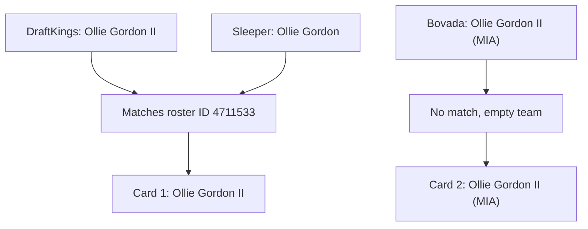
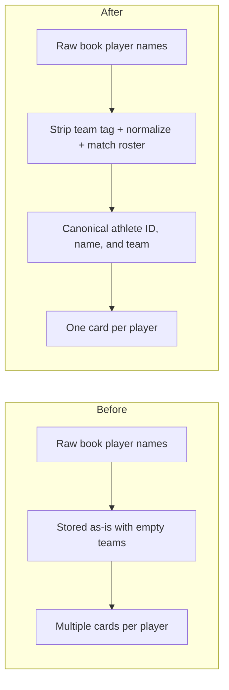

# Unify player identity across sportsbooks

## Context

At launch, the same player appeared multiple times as separate player sections on the pick board. For example, Ollie
Gordon (`game_id = 401873059`) appeared under three distinct `(player_name, team)` forms in stored prod odds:

- `"Ollie Gordon II"` (`team = MIA`, `80` rows — DraftKings, FanDuel, BetMGM, etc.)
- `"Ollie Gordon"` (`team = MIA`, `13` rows — Sleeper, Underdog)
- `"Ollie Gordon II (MIA)"` (`team = ""`, `6` rows — Bovada)

Because sportsbook team suffixes like `(MIA)` are not stripped before player matching, Bovada rows fail to resolve a
team or ESPN athlete ID (affecting Ollie Gordon, Brock Purdy, Bryce Young, Dak Prescott, and others). Board grouping
keys on athlete ID when matched and raw name + team when unmatched, splitting one player into separate cards. Casing
variants without a roster match (such as `DeMario` vs `Demario`) split too, and saved legs retain the raw book string
(`"Ollie Gordon"` on prod leg 19), which breaks later matching against DraftKings (`"Ollie Gordon II"`).

## Goals and non-goals

**Goals:**

- Resolve every incoming prop row to one canonical player identity (ESPN athlete ID when known, canonical display name,
  and resolved team) at ingest time.
- Strip book-added metadata such as `(TEAM)` tags and normalize suffixes and casing before matching.
- Guarantee that every player has at most one player card on a game's pick board.

**Non-goals:**

- Removing alternate, goblin, or demon prop lines (covered by `single-standard-prop-line`).
- Handling post-pick line movement on saved legs and sportsbook deep links (covered by `dynamic-line-tracking`).

## Decision

Normalize and resolve player identity once during prop ingest (stripping trailing `(TEAM)` tags, normalizing
punctuation/suffixes/casing, and matching against team rosters) so stored odds and board grouping share one canonical
player ID, name, and team rather than raw provider strings.

Merging player cards only in the UI template would leave empty `team` fields in stored odds and leave saved legs and
sportsbook export broken. Canonicalizing at ingest fixes the pick board, research links, and export from one place.

The `effort` rating is `medium` because it coordinates name normalization, roster matching, prop ingest persistence, and
board grouping across several seams without accidentally merging distinct players who share a name.

## Consequences

- **Easier:** Sportsbook name variants (dropped suffixes, casing differences, accents, and trailing `(TEAM)` tags)
  resolve to one canonical athlete ID, display name, and team at ingest time, keeping the pick board, saved legs,
  research links, and sportsbook export consistent.
- **Easier:** Prop ingest resolves players in memory from one per-game batch load of rosters and cached matches rather
  than issuing sequential per-row SQLite queries.
- **Harder:** Debugging raw provider player strings requires inspecting the raw response archive rather than the `odds`
  table, since stored rows now hold canonicalized names.
- **Revisit:** If future providers add non-parenthetical decorations or sport-specific tags, move provider-specific
  stripping into each ingest adapter ahead of shared normalization.

## Alternatives considered

- **Merge player cards only in `board.go` at render time:** Rejected because `odds.team` would stay empty on tagged
  rows, saved `legs` would keep un-canonical book strings, and research or export lookups would remain fragmented.
- **Pure SQL migration for existing rows:** Rejected because SQLite cannot replicate Go's accent folding, suffix
  stripping, and `(TEAM)` tag extraction without duplicating normalization logic.

## Implementation notes

- `StripPlayerTag` strips any non-empty trailing parenthetical `(...)` from the cleaned name, but only returns a
  `teamHint` when the inner token is 2–4 uppercase ASCII letters.
- Players absent from ESPN rosters have no athlete ID; their casing is unified per game batch (and during migration)
  rather than across separate refreshes, and they still depend on a resolved team to group onto one card.
- When two rostered players on the opposing teams share a normalized name without a disambiguating `teamHint`,
  auto-matching intentionally leaves the row unmatched so distinct players are not merged; `manual = 1` overrides in
  `player_matches` remain authoritative.

## Follow-ups

None.
