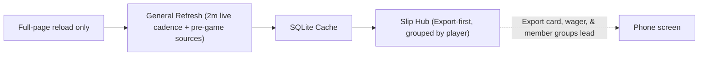
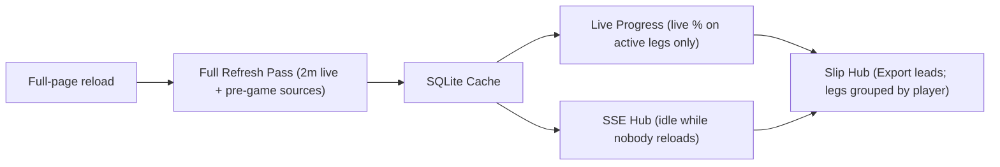
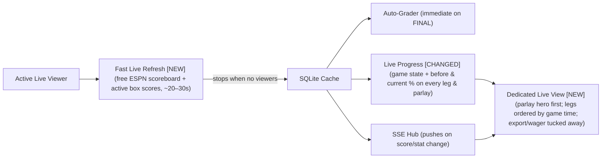
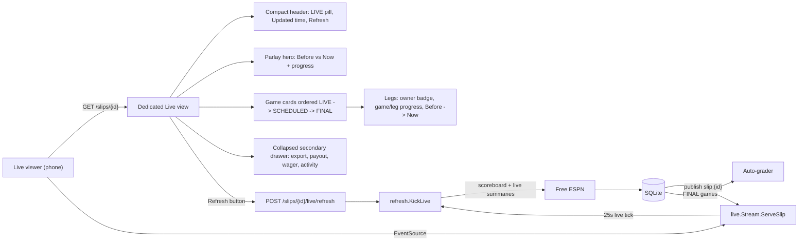

# Dedicated Live view for locked parlays

## Context

Once a parlay locks in and the first game kicks off, the slip hub still treats the group as if they have not placed
their bets yet. The page stays in the `export` step ("Ready to place"), leads with the sportsbook export card, and
stacks the payout calculator, wager form, and member-grouped leg lists ahead of the live action. On a phone, friends
have to scroll past pre-game chrome and jump across different players' sections just to follow the games on TV right
now.

Live data updates are also sluggish during a game. Today, live ESPN scores and box scores only refresh when someone
triggers a full-page reload, sit behind a 2-minute staleness window, and run alongside slower pre-game sources like
weather, rosters, and projections. A friend watching an open slip page waits for someone else to reload before the SSE
stream nudges the screen.

Finally, live probability and game state are uneven across the slip. The parlay card shows a live chance beside a muted
pre-game chance, while leg rows only show a slim live strip once a game starts—omitting game-progress boxes and not
consistently pairing before (pre-game) and current (live) hit chances on every leg and on the full parlay.

## Goals and non-goals

**Goals:**

- Automatically switch a `LOCKED` slip into a dedicated **Live** view as soon as its first game starts, assuming every
  player has placed their bet and putting live progress first on phone screens.
- Speed up live game and bet status updates using only free ESPN endpoints: add a fast, viewer-driven live refresh path
  that fetches only live scoreboard and active-game box scores while a viewer has the Live view open, and stops as soon
  as viewers leave or go idle so Cloud Run still scales to zero.
- Display clear progress bars and boxes for the current state of each game, each leg's progress, and the whole parlay,
  showing both **before (pre-game) %** and **current (live) %** hit chances on every leg and on the full parlay.
- Reorder legs in the Live view by **game time** (active live games and earliest kickoffs first, then upcoming games,
  with settled legs clearly badged) instead of grouping by the player who picked them, while keeping player attribution
  visible on each leg.
- Keep secondary controls (sportsbook export, wager logging, payout calculator, manual grade overrides, and activity)
  reachable in a collapsed or secondary section without crowding the live screen.

**Non-goals:**

- Buying or polling live in-game sportsbook odds from paid providers (Parlay API or The Odds API); live tracking stays
  100% free and deterministic.
- Adding a background cron job or always-on poller that keeps the server warm when nobody is watching.
- Building a play-by-play feed, drive chart, or field-position tracker.
- Changing how `OPEN` slips build parlays, how `FINAL` auto-grading settles legs, or how the Record Book records
  results.
- Blocking manual grade overrides or removing access to export links if someone still wants to check them late.

## Decision

Add a dedicated `live` slip view that activates automatically when a `LOCKED` slip's first game starts, backed by a
fast, viewer-scoped free ESPN refresh loop and a game-time-ordered progress UI that pairs before and current hit chances
on every leg and the parlay.

### Before

### After

Transitioning `LOCKED` slips into a dedicated Live view once the first game starts beats keeping live progress inside
the export-first hub because the group's job flips from *placing the bet* to *sweating the games*; collapsing export and
wager tools keeps them available without burying the live games below the fold on a phone.

Running a viewer-driven live-only refresh path over free ESPN endpoints beats both always-on background polling (which
breaks Cloud Run scale-to-zero and increases cost) and waiting for manual full-page reloads (which leaves the screen
stale for minutes). Deduplicating fetches per game across concurrent viewers keeps ESPN traffic light even when the
whole group watches together, while dropping pre-game sources cuts response latency down to just the live scoreboard and
active game summaries.

Ordering legs by game time instead of by player beats member-grouped lists during live play because friends watch games
chronologically—early window, late window, night game—and want every leg in the game currently on TV grouped together at
the top.

This change has `medium` complexity because it coordinates across multiple seams—slip lifecycle state, a fast
viewer-scoped live refresh path tied to SSE lifecycle, expanded game-state and before/current probability presentation,
and a phone-first Live view—requiring consistent contracts across modules without altering core storage or auth.

Its `risk` is `medium` because a live refresh loop tied to open streams carries a moderate blast radius around ESPN rate
limits and Cloud Run instance idle behavior if cleanup timers drift, and the new phone-first Live layout and HTMX
partial updates are only partially exercised by unit tests.

## Overview

A locked slip now leaves the export hub as soon as any leg's game starts. `/slips/{id}` renders the parlay hero first,
groups legs by game in live urgency order, and tucks export, payout, wager, and activity into one collapsed drawer.
While a live stream is open, its SSE tick runs a free-ESPN-only refresh every 25 seconds; leaving the page stops the
tick.

## Consequences

- Easier: Friends following games see the parlay chance and the current game first on a phone instead of scrolling past
  the export card and other people's picks.
- Easier: Live scores, box scores, and auto-grading update in about 20 seconds while anyone watches, with no paid odds
  credits and no background poller keeping Cloud Run warm.
- Easier: Every leg now shows its game-elapsed progress and a before/current hit chance, so a scheduled leg explains why
  its chance has not moved yet.
- Harder: The slip page now has two layouts and a mode-flip reload path. Template changes must keep `slip-wager` outside
  `#slip-panel` and keep `data-live-mode` on both the page section and the panel.
- Revisit: The live tick starts only inside the 30-minute pre-kickoff `liveLead` window. A viewer who opens the slip
  earlier sits in the export layout until a reload or another event refreshes the panel.

## Alternatives considered

- **SSE-attached ticks instead of a background loop:** A cron or global ticker would keep the instance warm and spend
  CPU while nobody watches. Ticks tied to active `ServeSlip` connections reuse the existing visibility, idle, deadline,
  and shutdown cleanup.
- **Automatic Live mode on `/slips/{id}` instead of a `/live` URL:** Keeping the canonical URL means old links, push
  notifications, and open tabs arrive in the right mode without redirects or split bookmarks.
- **Free ESPN model instead of paid live odds:** Live sportsbook odds would burn monthly credits and still leave
  suspended markets; the deterministic ESPN model covers every leg without paid calls.
- **Game-time ordering instead of member grouping:** During play friends watch games chronologically, so the live window
  groups every leg in the game on TV; owner badges keep player attribution.
- **Dedicated Live layout instead of adding progress to the export hub:** Collapsing export and wager tools keeps the
  live action above the fold while the secondary controls stay one tap away.

## Implementation notes

- `StepLive` is decided from the slip's own leg games, not the whole slate, so a Sunday Main slip with only late games
  stays in `export` while an early slate game runs.
- `SyncLive` touches only `espn:scoreboard` and live `espn:summary` keys. The 20-second `sync_state` gate and
  `singleflight` mean concurrent viewers share one fetch, and `failureBackoff` still applies. `ForceLiveRefresh` has a
  10-second per-slip cooldown. Sandbox mode omits `WithLiveTick` entirely.
- The live tick uses the existing stream timers: it fires on connect and every 25 seconds, and stops on disconnect,
  `bye`, or `Shutdown`. Nothing keeps running after the last viewer leaves.
- A manual refresh reloads the slip before rendering, so a refresh that auto-grades the slip flips `data-live-mode` to
  false and the browser reloads into the graded view. `app.js` does the same whenever an HTMX panel swap changes the
  mode.
- The 375px phone check showed no horizontal overflow, the parlay hero at 192px, and the first live game card at 349px,
  both above the fold. The export drawer stays collapsed and below the panel.
- The final review removed a stray compiled `server` binary from the branch and is recorded as a manual final review.

## Follow-ups

- Add a client-side reload at the first leg's kickoff, or start the SSE tick for locked slips outside the 30-minute
  window, so a page opened early still enters Live mode without a manual reload.
- Add a browser viewport test at 375px for the Live layout so no-overflow and above-the-fold placement stay covered in
  CI.
- Consider sharing the `espn:scoreboard` source key from one package so the `internal/web` freshness stamp and
  `internal/refresh` gating cannot drift.
