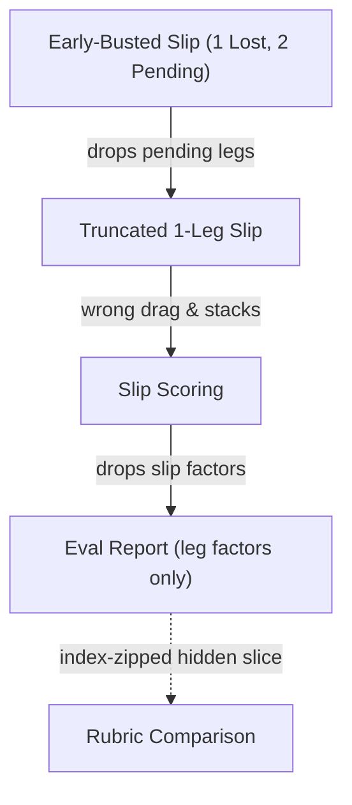
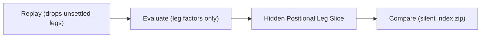
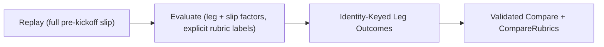
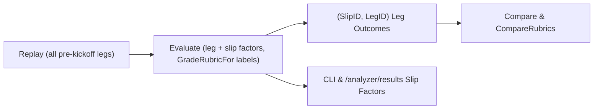

# Deepen eval replay and comparison fidelity

## Context

Three subtle gaps in the eval module skew historical calibration and limit rubric tuning:

1. **Truncated early-busted slips:** A parlay settles as lost as soon as any single leg loses, even while later games on
   the same slip are still pending or ungraded. Historical replay includes that graded slip but drops its unsettled legs
   before scoring. Passing a shortened leg list into slip grading changes parlay length drag, drops chalk legs, and
   breaks multi-leg stacks and script conflicts compared to what live grading saw before kickoff.
2. **Unmeasured slip-level factors:** The eval runner loads slip-factor labels from the rubric documentation, then never
   accumulates slip-level factors (positive stacks, script conflicts, parlay length drag, chalk drag) during evaluation.
   There is no way to tell whether slip-level bonuses and penalties predict parlay outcomes.
3. **Fragile rubric comparison:** Comparing two eval reports zips an unexported slice of leg outcomes strictly by slice
   index, with no leg identity or length check. Comparing reports from different datasets or deserialized JSON silently
   produces empty or mismatched migration matrices.

## Goals and non-goals

**Goals:**

- Retain all pre-kickoff legs on replayed slips so slip grading evaluates the exact leg set that existed before kickoff,
  while excluding unsettled legs only from leg-band and leg-factor outcome metrics.
- Track slip-level factor attribution on eval reports so parlay-level rules (stacks, conflicts, parlay drag, chalk drag)
  are measured against actual slip outcomes alongside leg-level factors.
- Harden rubric comparison by keying leg outcomes to stable slip and leg identities and providing a dataset-driven
  rubric comparison entry point that cannot silently zip mismatched reports.
- Surface slip-factor attribution in the eval CLI and Grading Results page where factor attribution is shown.

**Non-goals:**

- Re-grading unsettled legs or changing how slips settle on early losses.
- Tuning or shipping a new rubric version in this change.
- Changing the leak-free pre-kickoff archive rules.

## Decision

### Before

### After

Preserve all pre-kickoff legs on every replayed slip (filtering unsettled legs only at leg-metric aggregation), record
slip-level factor attribution against parlay outcomes using the evaluated rubric's own labels, and replace index-based
migration zipping with identity-keyed outcomes and a dataset-level comparison entry point.

This beats dropping slip-factor attribution or leaving comparison index-based because parlay-level drag and correlation
rules are central to rubric tuning, and identity-checked comparison prevents silent corruption as eval datasets and
saved reports grow.

`complexity: medium` fits because the change coordinates full-slip replay semantics, slip-factor aggregation,
identity-keyed rubric diffs, and CLI/web display updates on top of the unified signal and analyzer seams. `risk: low`
fits because evals are strictly read-only with no schema changes or live-grading impact, and every edge case
(early-busted slips, slip-factor attribution, mismatched reports) is verified by deterministic unit tests.

## Overview

## Consequences

- **Easier:** Measuring parlay-level rules (stacks, script conflicts, parlay drag, chalk drag) against actual slip outcomes without early-busted slips distorting leg counts or dropping slip factors.
- **Easier:** Comparing two rubrics on a shared dataset without silent positional mismatching.
- **Harder:** Reading `SlipFactors` lift and ROI on small datasets, because slip sample counts (`N`) are smaller than leg counts.
- **Revisit:** Exporting leg-level outcome keys in JSON reports if comparing saved JSON files offline becomes a requirement.

## Alternatives considered

- **Dropping slip-factor attribution or keeping positional comparison:** Rejected because parlay-level drag and correlation rules are central to rubric tuning, and unvalidated index zipping silently corrupts migration matrices.
- **Excluding early-busted slips from replay:** Rejected because early-busted parlays are real settled losses; omitting them would introduce survivorship bias into slip calibration.
- **Exporting `legOutcomes` in JSON `Report`:** Rejected to keep JSON reports compact and focused on aggregate metrics, using `CompareRubrics` for dataset-level diffs and `(SlipID, LegID)` joins for in-memory `Compare`.

## Implementation notes

- The design referenced `web/templates/analyzer-results.html`; the actual template path in the repository is `web/templates/analyzer_results.html`.
- Migration matching falls back to `(SlipID, legIdx)` when `LegID == 0` so synthetic fixtures without database leg IDs still compute migrations.
- `CombinedOdds` during replay and fallback `slipDecimalOdds` during evaluation only include counting settled legs, matching live settlement math while passing all pre-kickoff legs to `ScoreSlipWithRubric`.
- JSON-deserialized reports still omit `legOutcomes`, so passing deserialized reports to `Compare` yields empty migration matrices.

## Follow-ups

None.
