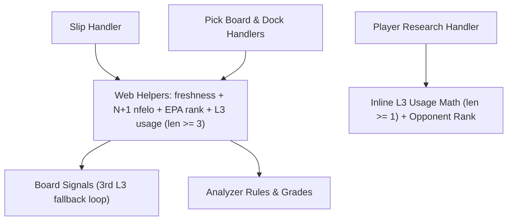
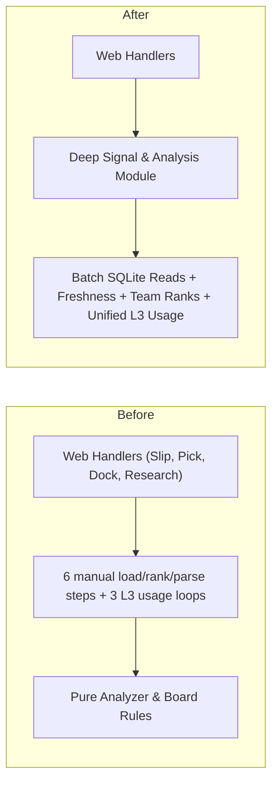

# Deepen analyzer and board signal loading

## Context

The sharp-friend analyzer and the pick board's suggestion engine are pure functions, which keeps their rule evaluation
deterministic. However, because no domain module owns loading and aggregating their inputs from storage, all signal
assembly, freshness windows, league rankings, and rolling usage math currently live in the web handler layer:

- **Three divergent player-usage implementations:** The web analyzer helper computes last-3-week and season snap/target
  averages only when a player has at least 3 games; the player research handler bypasses that helper and re-computes
  last-3-week averages inline for 1 or more games; and the pick board's signal scorer maintains a third set of fallback
  loops over weekly usage slices.
- **Domain logic and staleness constants in HTTP handlers:** The 72-hour `nfelo` and 7-day `nflverse` freshness windows,
  postseason-to-regular-season stat merging, 32-team defensive EPA ranking, ESPN injury JSON parsing, and game-log JSON
  unmarshaling are all implemented inside web handlers and sequenced by hand across the slip page, pick board, pick
  dock, and player research views.
- **Per-game N+1 queries:** Loading `nfelo` projections for a slip or dock checks `sync_state` and then issues a
  separate query for each game on the slate.

## Goals and non-goals

**Goals:**

- Move signal loading, source freshness checks, 32-team EPA ranking, rolling player usage aggregation, game-log
  decoding, and injury parsing out of the web layer into a deep domain seam.
- Unify last-3-week and season usage math so the analyzer, pick board badges, and player research screen read from one
  calculation.
- Replace the per-game `nfelo` projection loop with a single batch query per slate.

**Non-goals:**

- Changing any analyzer warning threshold, letter-grade rubric, or pick-board badge priority.
- Changing how or when the background refresh service fetches `nfelo`, `nflverse`, or ESPN data.

## Decision

Deepen the analyzer and signal domain seam so callers ask one module for slip analysis, game board signals, or player
research context, hiding storage queries, freshness windows, batch projection loading, team EPA ranking, and rolling
player usage math inside the implementation.

Giving the domain module ownership of both signal loading and pure rule evaluation beats keeping assembly helpers in the
web package because domain invariants—such as postseason stat merging, 72-hour/7-day freshness cutoffs, and rolling
usage averages—become directly testable through one domain interface without spinning up HTTP handlers.

The `effort` rating is `medium` because the refactor spans storage batching, analyzer input assembly, pick-board signal
wiring, and player research views while preserving exact scoring and badge behavior.

## Consequences

- **Domain invariants are testable without HTTP:** Freshness windows (72 hours for `nfelo`, 7 days for `nflverse`),
  postseason-to-regular-season stat merging, 32-team EPA ranking, and rolling usage math now live in `internal/analyzer`
  behind `LoadSlipSignals`, `LoadGameSignals`, and `LoadPlayerResearchSignals`.
- **Single source of rolling usage math:** The analyzer, pick board badges, and player research views now share
  `BuildPlayerUsage` and `SummarizeRecentUsage` instead of maintaining three separate loops.
- **Batched `nfelo` reads:** `Store.NfeloForGames` loads projections for an entire slate in one `IN (...)` query,
  replacing the per-game query loop.
- **New package boundary to guard:** `internal/analyzer` now imports `internal/db` for its signal-loading entry points
  while keeping `AnalyzeSlip`, `ScoreLeg`, and `ScoreSlip` pure. Maintainers must keep DB and clock access out of the
  pure rule and grading functions.
- **Fallback accessors on `PlayerUsage`:** `EffectiveTargetShare`, `EffectiveSnapAvg`, `EffectiveSeasonSnapAvg`,
  `RecentWOPR`, and `AverageCarries` fall back to scanning `Weeks` when precomputed fields are zero. This keeps existing
  table-driven tests concise, at the cost of a small fallback path to maintain.

## Alternatives considered

- **Keep signal assembly in `internal/web`:** Rejected because freshness rules, postseason merging, EPA ranking, and
  usage aggregation were duplicated across slip, pick board, and research handlers and could not be tested without HTTP
  setup.
- **Rewrite all `internal/board` test literals to set precomputed `PlayerUsage` fields:** Rejected in favor of
  fallback-aware accessor methods on `PlayerUsage`, avoiding boilerplate in table-driven tests while routing production
  callers through `BuildPlayerUsage`.
- **Merge `BuildPlayerUsage` and `SummarizeRecentUsage` behind one game-count threshold:** Rejected because analyzer
  rules and board badges require at least 3 weeks of data (`BuildPlayerUsage`), whereas player research shows
  1-to-3-week averages (`SummarizeRecentUsage`). Splitting them shares the field definitions while preserving each
  view's threshold.

## Implementation notes

- `design.md` named `internal/analyzer/nflverse_grade_test.go` for the new signal-loader tests; they were placed in
  `internal/analyzer/signals_test.go` alongside the test moved from `internal/web/analyzer_internal_test.go`.
- When a `PlayerUsage` has a true precomputed average of `0` alongside non-empty `Weeks`, the accessor methods still
  scan `Weeks` once.
- `proposal.md` included moving injury parsing out of the web layer, but `parseGameInjuries` remained in
  `internal/web/pick.go` because `design.md` scoped the `LoadGameSignals` return values to team defense profiles and
  player usage.

## Follow-ups

- Move `parseGameInjuries` from `internal/web/pick.go` into the domain signal loader (`LoadGameSignals` or
  `internal/board`) so ESPN injury JSON parsing leaves the web layer.
- Update `internal/board/signals_test.go` literals to construct usage via `BuildPlayerUsage` (or a test helper) and
  remove the `Weeks`-scanning fallback branches from `PlayerUsage` accessors.
