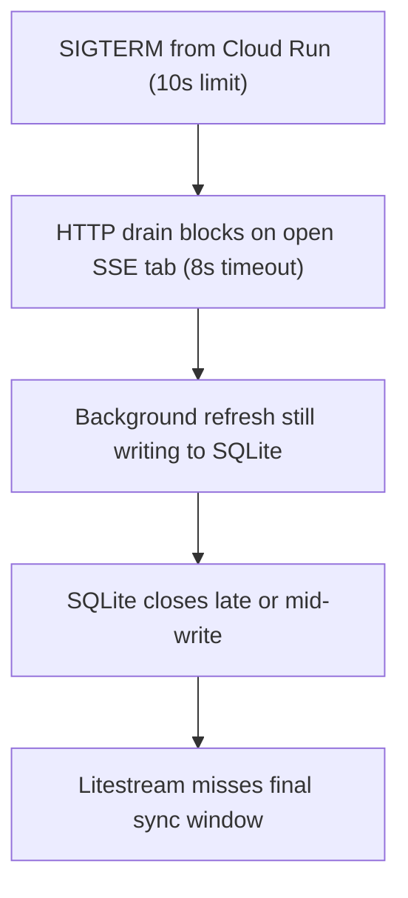
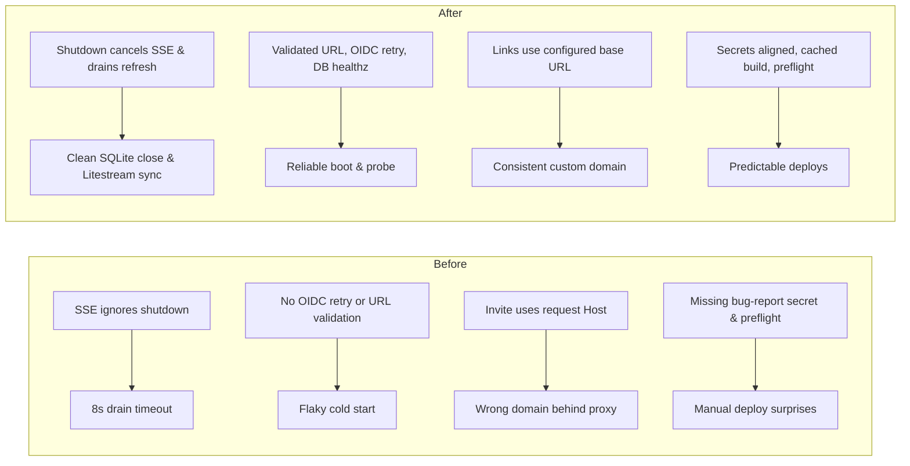

# Deployment readiness and hardening

## Context

The app is ready for its first Cloud Run deployment on paper, but several runtime and pipeline gaps put uptime, writes,
and smooth rollouts at risk.

Cloud Run gives a stopping container 10 seconds on `SIGTERM` before killing it. The server sets an 8-second HTTP drain
window so Litestream has 2 seconds for its final sync to Cloud Storage. Today, open live-update SSE streams do not close
on shutdown, so a single open browser tab forces the drain to time out at 8 seconds and exit non-zero. At the same time,
background refresh workers run on a detached context and are never waited on before closing SQLite.

Cold starts and proxy routing carry similar risks:

- Startup discovers Google's OpenID configuration synchronously with no retry, so a brief network blip fails the boot.
- Production requires a public base URL, but startup does not verify that it is a valid `http` or `https` URL, and the
  health probe does not check SQLite.
- Behind Cloudflare, the incoming `Host` header is rewritten to the Cloud Run hostname, so group invite links built from
  the request host point friends away from the custom domain.
- The setup script and deploy workflow omit the optional GitHub token secret that in-app bug reports need to file
  issues, offer no pre-flight check before deploying, and rebuild the container without layer caching.

## Goals and non-goals

**Goals:**

- Drain open SSE streams and background refresh workers cleanly on `SIGTERM` so SQLite closes and Litestream syncs well
  within Cloud Run's 10-second window.
- Make cold starts and configuration fail fast on bad inputs and ride out brief Google OIDC hiccups, with a health check
  that verifies database readiness.
- Build public links, including group invites, from the configured public base URL so custom domains behind proxies stay
  consistent.
- Align GCP setup and the deploy workflow with all documented runtime secrets, speed up container builds with caching,
  and add a pre-flight check before shipping.

**Non-goals:**

- Moving off single-instance Cloud Run, SQLite, or Litestream, or removing the game-window deploy blackout.
- Adding scheduled background jobs, external monitoring stacks, or multi-region failover.
- Automating Google OAuth console clicks or Cloudflare dashboard rules that require interactive login.

## Decision

Harden the server lifecycle, startup checks, proxy URL handling, and deploy pipeline in one focused pass before the
first production launch.

Coordinating shutdown across SSE streams, background refresh, and SQLite stops write loss during deploys and
scale-to-zero without changing the single-instance architecture. Checking configuration, proxy URLs, secrets, and build
caching together removes the most likely first-deploy failures rather than discovering them piecemeal on Cloud Run.

The `medium` effort rating fits because the work touches several independent seams—server shutdown, startup resilience,
proxy-aware URL generation, and CI/GCP wiring—while keeping every existing architectural boundary intact.

## Consequences

**What got easier:**

- Cloud Run `SIGTERM` drains finish within the 8-second window without waiting on open SSE tabs or cutting off SQLite
  writes mid-sync, leaving Litestream time for its final sync.
- Cold starts ride out brief Google OIDC discovery hiccups, reject malformed `BASE_URL` values immediately, and expose
  real SQLite readiness through `/healthz`.
- Group invite links stay on the configured public domain behind Cloudflare's `Host` rewrite.
- Deploys catch missing variables, unreadable or empty secrets, and missing GCP resources before building an image, and
  reuse Go and Docker build layers via GitHub Actions cache.

**What got harder:**

- Any new background goroutine that writes to SQLite must join the refresh or sandbox shutdown wait groups, or the drain
  will not wait for it before closing the database.
- A hung Google OIDC endpoint now takes ~15.7 seconds to fail startup (three 5-second attempts plus 700 ms of backoff)
  instead of failing on a single request.
- Existing GCP projects must re-run `deploy/setup.sh` so `parlay-deployer` gains `roles/secretmanager.viewer` and
  `roles/storage.bucketViewer` before the new workflow's pre-flight passes.

**What we would revisit:**

- Returning from `Stream.Shutdown()` without `event: bye` relies on browser `EventSource` auto-reconnect; if clients
  ever move to a custom reconnect loop, revisit how server-initiated disconnects are signaled.
- Narrowing OIDC discovery retries to 5xx and transport errors if permanent 4xx/malformed-document failures need to fail
  fast without the ~700 ms backoff.

## Alternatives considered

- **Cancel `http.Server.BaseContext` on `SIGTERM` instead of a dedicated `Stream.Shutdown()`:** Rejected because
  cancelling the base request context would abort in-flight `POST` handlers mid-write instead of letting
  `http.Server.Shutdown` drain them.
- **Send `event: bye` during server shutdown:** Rejected because the client treats `bye` as a planned stream end and
  pauses reconnects until tab visibility changes, whereas silent close triggers `EventSource` auto-reconnect to the new
  Cloud Run revision.
- **Derive one cancellable pass context in `refresh.Service.KickContext`:** Rejected because `KickContext` returns as
  soon as it spawns child source goroutines; cancelling at the per-source timeout chokepoint aborts active fetches
  without prematurely killing child work.
- **Trust `X-Forwarded-Host` for group invite URLs:** Rejected to avoid trusting multi-hop proxy headers (Cloudflare to
  Cloud Run) and to match how OAuth callbacks and bug report links already use `BASE_URL`.
- **Store Docker build cache layers in Artifact Registry:** Rejected because cache layers would consume Artifact
  Registry's 0.5 GB free tier; GitHub Actions cache (`type=gha`) avoids registry storage costs.

## Implementation notes

- **Workflow variable name:** GitHub reserves the `GITHUB_` prefix for configuration variables, so the workflow reads
  `vars.ISSUES_REPO` (falling back to `github.repository`) and passes it to the container as `GITHUB_REPO`.
- **Action versions:** The workflow uses `docker/setup-buildx-action@v4` and `docker/build-push-action@v7` rather than
  `v3`/`v6` to stay off the deprecated Node 20 runner runtime.
- **Zero-value `Stream`:** `Stream` assumes construction via `NewStream` so `done` is allocated; a zero-value `Stream`
  would panic on `Shutdown()` and block in `ServeSlip`.
- **Bounded drain-timeout waiter:** When `Shutdown(ctx)` hits its caller deadline while a stuck source ignores context
  cancellation, one waiter goroutine stays alive until that source returns.
- **Pre-flight not tested live:** The GCP pre-flight and deploy workflow were verified with `actionlint`, `bash -n`, and
  a stubbed `gcloud`, not against a live GCP project.
- **Health probe scope:** `/healthz` runs a read-only `PingContext` under a 2-second timeout; it does not detect write
  locks or Litestream replication lag.

## Follow-ups

- Re-run `deploy/setup.sh` against the live GCP project and run a real workflow deploy to verify the pre-flight,
  `github-token` conditional secret wiring, and GHA build cache end-to-end.
- Decide whether `docs/reference/config.md` should note that Cloud Run deploys always override `GITHUB_REPO` via
  `ISSUES_REPO` or `github.repository` rather than using the binary's `kalverra/parlay-club` fallback.
