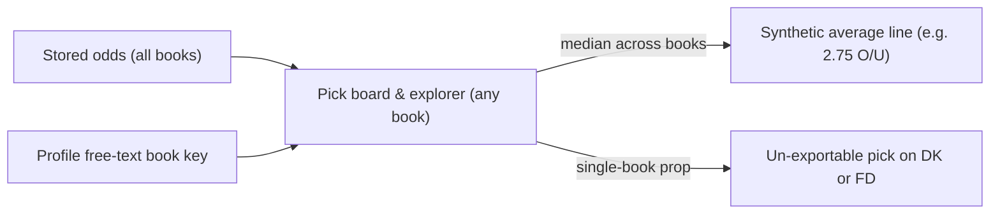
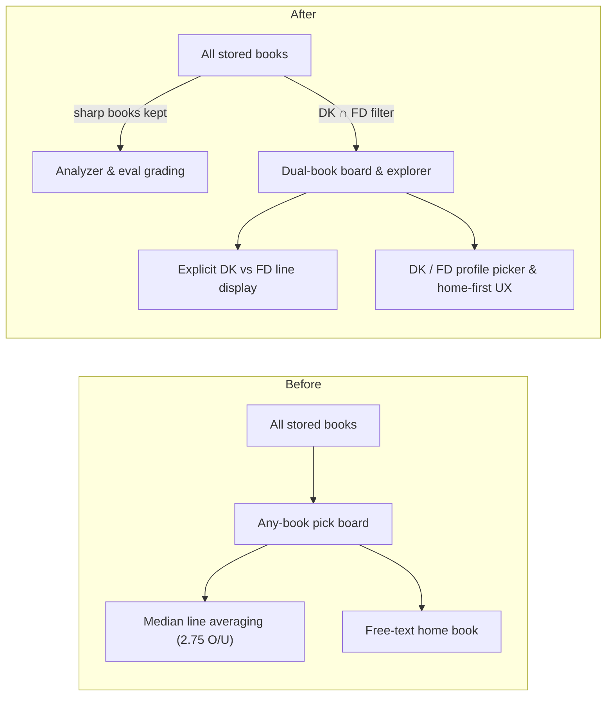
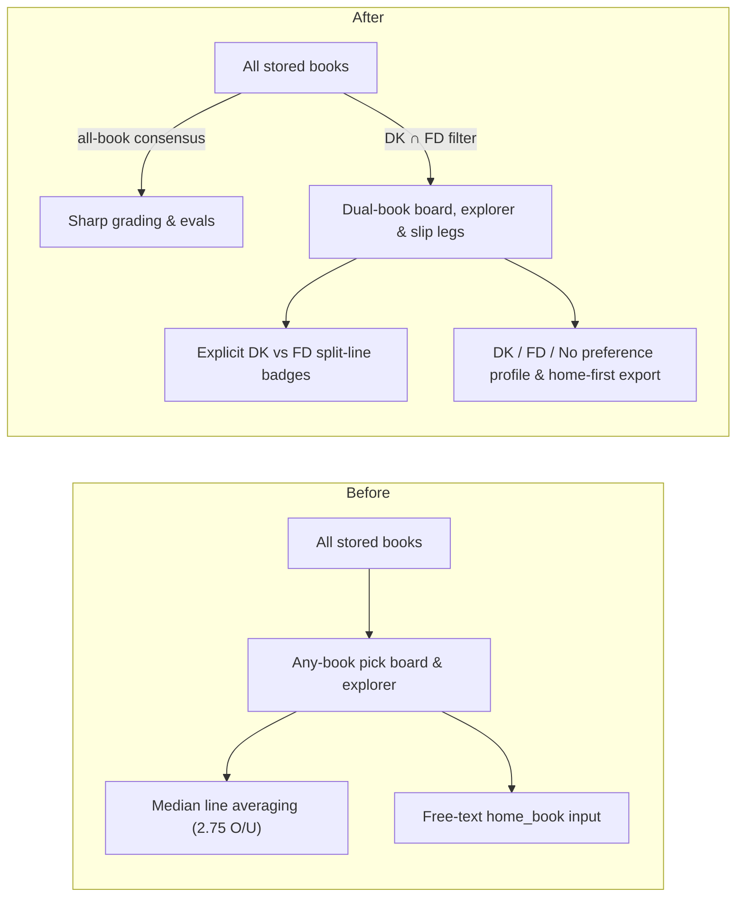

# DK and FD dual-book board and split-line display

## Context

Club members only place bets on DraftKings and FanDuel, but the pick board and research explorer still treat every book
in the odds feed equally. Any selection quoted by BetMGM, BetRivers, Bovada, or a DFS feed appears as pickable, even
when DraftKings or FanDuel does not offer it. Members pick those props and only discover the gap after locking the slip,
when export drops them to manual entry.

Line display also breaks when books disagree. Without a home book set (or when the home book is missing), the board
takes the arithmetic median of stored lines. When DraftKings posts `2.5` and FanDuel posts `3.0`, the app displays
`2.75 O/U`—a line that exists on neither book. Even in Week 12 production slips, DraftKings and FanDuel frequently
differed by a point or two on the same player prop (for example, DeVonta Smith at `68.5` on DK vs `66.5` on FD, or
Patrick Mahomes at `229.5` on DK vs `228.5` on FD). Meanwhile, setting a home book in Profile still asks users to type a
raw bookmaker key into a free-text input.

## Goals and non-goals

**Goals:**

- Show only selections available on **both** DraftKings and FanDuel on all pickable views (pick board, game detail,
  research explorer).
- Carry both DraftKings and FanDuel lines and prices on every pickable selection, and never average differing lines into
  a synthetic number.
- Display differing lines clearly at phone width (for example, `DK 2.5 (-115) · FD 3.0 (-110)`) when DraftKings and
  FanDuel disagree, while keeping identical lines compact.
- Optimize home-book and slip UX around the two-book assumption: replace the free-text profile input with a DraftKings /
  FanDuel picker, highlight the viewer's preferred book first, and show clear DK/FD context on picks.
- Keep all stored books intact in the database so sharp-book grading and historical evals continue to work unchanged.

**Non-goals:**

- Removing non-DK/FD books from ingestion or storage.
- Adding retail support or export for a third sportsbook.
- Blocking manual `OTHER` legs or changing how past slips are graded.

## Decision

Keep all books in storage for sharp-book grading, but filter user-facing pickable boards to the DraftKings ∩ FanDuel
intersection, attach both books' quotes to each selection, and render split lines explicitly whenever the two books
disagree.

This beats filtering out non-DK/FD books at ingest time, which would break sharp-book grading (Pinnacle, Circa, LowVig,
BetOnline) and market-consensus benchmarks. It also beats picking an arbitrary single book's line when DK and FD differ,
which hides real point differences that matter to whoever places the bet on the other book.

- **Complexity: medium** — Spans board selection grouping, dual-book quote modeling, pick/explorer/slip/profile UI, and
  the invariant that sharp books remain untouched for grading and evals.
- **Risk: medium** — Tightening selection filtering and changing board/template line rendering affects every pick screen
  on mobile, where unit tests cover the pure grouping logic but phone layout and edge-case player-name matching need
  careful review.

## Overview

## Consequences

- **Easier:** Members only see selections quoted by both DraftKings and FanDuel, avoiding picks that drop to manual entry on export.
- **Easier:** Differing DK and FD lines render side by side with the viewer's home book first instead of a synthetic median average.
- **Easier:** Setting a home book uses a validated DraftKings / FanDuel / No preference selector, and the export card puts that book first.
- **Harder:** Props quoted on only one of the two books—or mismatched across feeds by player name—stay hidden until both DK and FD quotes exist.
- **Harder:** Maintainers adding board callers must choose explicitly between dual-book mode (`board.BuildDualBook`) and all-book consensus (`board.BuildWithOptions`).
- **Revisit:** Adding a third retail sportsbook will require generalizing the two-book intersection, the `DK`/`FD` quote fields on `board.Row`, and the Profile/Export UI.

## Alternatives considered

- **Drop non-DK/FD books at ingest time:** Rejected because sharp-book grading and market-consensus evals rely on Pinnacle, Circa, LowVig, BetOnline, and other stored books remaining in `db.Odds`.
- **Show only one book's line silently when DK and FD disagree:** Rejected because hiding a 1–2 point difference misleads members placing the bet on the other book.
- **Switch `board.Build` globally to dual-book mode:** Rejected because offline market evals need all-book consensus; exposing `BuildDualBook` and `BuildWithOptions` keeps both modes explicit.

## Implementation notes

- The plan referenced `docs/concepts/pick-board.md`, which does not exist in this repo; pick board and Research behavior is documented in `docs/concepts/slips.md`.
- `board.LineKey` was aligned with `db.SameLineGroup` (`TOTAL` keyed by market alone and `TEAM_TOTAL` by `TEAM_TOTAL|<team>`) so split Over/Under rows stay paired in one `LineGroup` across half-point differences.
- When a viewer has no home book set, `Row.Line` and `Row.Odds` default deterministically to FanDuel while split-line badges still show both books.
- Legacy `home_book` values outside `""`, `"draftkings"`, and `"fanduel"` display as "No preference" on `GET /me` without breaking existing profiles, while `POST /me` rejects invalid values with `422`.

## Follow-ups

None.
