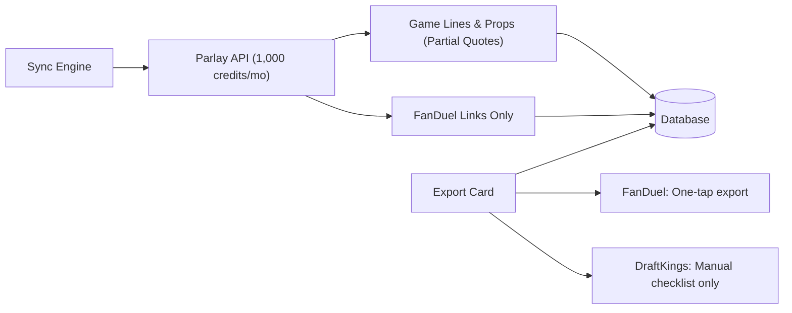
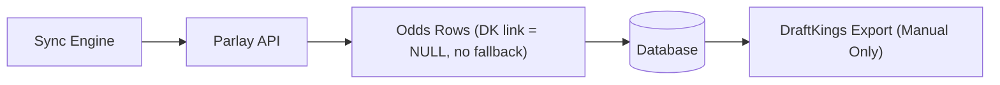
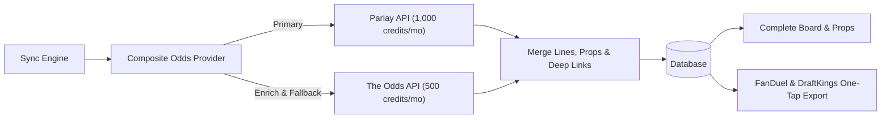

# The Odds API fallback and enrichment

## Context

Parlay API supplies NFL game lines, bulk player props (flat 3 credits per game across all 9 markets), and FanDuel deep
links within its 1,000 monthly free credits. However, relying on Parlay API alone leaves three gaps:

1. **Missing DraftKings links:** Parlay API returns null deep links and selection IDs for DraftKings. When a group locks
   a slip, every DraftKings pick falls into the manual checklist (`no link`), even though the export card already has a
   phone-verified DraftKings combiner and single-leg link builder.
2. **Incomplete quotes:** Parlay API occasionally omits specific bookmakers, early-week moneylines, or one side of a
   two-way market.
3. **Single-vendor fragility:** If Parlay API has an outage, returns an empty board, or hits its credit floor during a
   busy week, odds and prop syncs stall completely.

Meanwhile, The Odds API provides 500 free monthly credits that currently sit unused. It returns complete US bookmaker
lines, validated deep links and selection IDs for both DraftKings and FanDuel, and per-event player props. Because The
Odds API bills game lines by region and market rather than by bookmaker (3 credits for `h2h`, `spreads`, and `totals`
across all US books), a single game-line call returns both DraftKings links and full US bookmaker quotes at no extra
credit cost.

## Goals and non-goals

**Goals:**

- Use Parlay API as the primary odds and props provider and The Odds API as an automatic enrichment and fallback source,
  combining both free tiers (1,500 monthly credits total).
- **Enrich game lines and deep links:** Merge The Odds API's US game-line feed onto Parlay API syncs to populate
  DraftKings deep links, selection IDs, and event IDs, backfilling any FanDuel links or bookmaker lines that Parlay API
  omitted.
- **Fall back across events, lines, and props:** When Parlay API fails, returns no data for a game, or drops below its
  credit floor, automatically fall back to The Odds API for event lists, game lines, and per-game player props.
- **Degrade gracefully in either direction:** If The Odds API is unconfigured, unreachable, or below its credit floor,
  Parlay API syncs continue succeeding on their own.
- **Guard both credit budgets:** Track each provider's remaining credits independently with tiered floors so routine
  enrichment pauses before emergency fallback credits run out.

**Non-goals:**

- Paying for subscription tiers or requiring credit card billing on either provider.
- Making The Odds API the primary source for routine player props when Parlay API is healthy (The Odds API charges 1
  credit per prop market returned—up to 9 credits per game—versus Parlay API's flat 3 credits).
- Scraping sportsbooks or calling unofficial sportsbook APIs directly.
- Combining DraftKings selections across multiple games into one URL (DraftKings betslip links only combine selections
  within a single game event).

## Decision

Wrap Parlay API and The Odds API behind a composite odds provider that coordinates enrichment and fallback while keeping
the rest of the refresh and export pipeline unchanged.

For game lines, Parlay API runs first, and The Odds API accentuates the result. Because a full US game-line fetch on The
Odds API costs 3 credits whether filtered to DraftKings or queried across all US bookmakers, the accentuation call
fetches the full US board. The merger keeps Parlay API's primary prices while filling in missing deep links, selection
IDs, and event IDs (unlocking DraftKings one-tap and same-game combined exports) as well as any bookmaker lines or
outcomes that Parlay API skipped. If Parlay API fails or sits below its credit floor, The Odds API supplies the full
game-line slate directly.

For event matching and per-game player props, Parlay API stays the sole primary caller to preserve its flat 3-credit
bulk prop pricing. The Odds API acts as a live fallback whenever Parlay API errors out, returns no props for a matched
game, or drops below its prop credit floor—and can optionally enrich prop deep links for locked or active games when The
Odds API has ample credit headroom. Tiered credit floors on The Odds API ensure that routine enrichment stops well
before fallback reserves are touched.

### Before

### After

This beats single-provider switching because we get the best of both free tiers: Parlay API's 1,000-credit budget and
cheap bulk props, plus The Odds API's DraftKings deep links, wider book coverage, and automatic failover when either
service hiccups.

The medium effort rating fits because both providers share the same core event and game-line wire format, requiring only
cross-provider event matching, row-level merging, and separate credit-state tracking.

## Consequences

Odds sync now draws on both free tiers. Parlay API stays primary for events, game lines, and cheap bulk props. The Odds
API enriches each successful line sync with DraftKings deep links, selection IDs, and event IDs, and backfills any
bookmaker or outcome Parlay API skipped. When Parlay API fails, returns an empty slate, or falls below its 50-credit
floor, The Odds API can supply the whole game-line board down to its 25-credit fallback floor. DraftKings legs on locked
slips can now export as one-tap or same-game combined links instead of manual checklist items.

The cost is a second metered dependency and about 3 extra The Odds API credits per enriched line sync (~240/month), with
a 100-credit enrichment floor keeping 100 credits in reserve. Two balances, two archive labels, and per-provider event
matching make refresh harder to reason about than a single client. If `THE_ODDS_API_KEY` is unset, enrichment silently
turns off; nothing warns at startup.

The player-prop seam landed but is still unwired, so prop rows do not yet gain DraftKings links. What we would revisit
is live validation of the nine-market prop request, a startup or health signal when enrichment is disabled, and a clean
path to recompute `games.odds_event_id` if Parlay API is ever retired.

This change also reverses the earlier `parlay-api` decision against dual-provider credit tracking. The two providers now
run together, each with its own balance and floor.

## Alternatives considered

- **Filter The Odds API to DraftKings only.** Rejected because The Odds API bills by markets times regions, so
  `regions=us` costs the same 3 credits while also allowing FanDuel backfill and wider bookmaker coverage.
- **Make The Odds API primary for props.** Rejected because it charges 1 credit per market (up to 9 per game) versus
  Parlay API's flat 3, so props stay primary on Parlay and The Odds API is reserved for fallback.
- **Reconcile provider event IDs directly.** Rejected because both providers' events are matched to ESPN games first, so
  every row is keyed by canonical `GameID` and ESPN team abbreviations before merging.
- **Keep the primary line when attaching a secondary link.** Rejected because a link to a different number would open
  the wrong line in the sportsbook app and bypass export's line-moved check, so an unlinked row adopts the linked line
  and price.
- **Switch providers wholesale instead of enriching.** Rejected because combining both free tiers keeps Parlay API's
  larger budget and cheaper props while adding The Odds API's DraftKings links and failover.
- **Pay for higher tiers or scrape sportsbooks directly.** Rejected by product rules: free tiers only, no unofficial
  book APIs.

## Implementation notes

- A shared `fetchOdds` helper carries one provider's events-to-lines path. `syncOdds` chooses each provider's floor and
  combines the results; `writeOdds` receives one merged match map, so it stays provider-agnostic.
- `outcomeResponse` needed a `Description` field that the design did not name, because The Odds API names the prop
  subject there.
- `odds:theoddsapi` records a sync on every successful events and lines response, even when the floor skips the paid
  call. A failed balance write fails that provider closed, so a stale balance never gates the next paid call.
- The saved The Odds API prop fixture contains only `player_pass_yds`, so anytime-touchdown and team-total normalization
  are covered by synthetic responses. The other eight prop market keys are still unverified against a live key; one
  rejected market fails the whole per-event call.
- `MergeProps` assumes one event's board and propagates `EventSid` by book. Callers must not combine boards from
  different games.
- `games.odds_event_id` keeps the primary's match. A fallback-only match lands only when the game has no primary match
  and no stored ID, so a transient primary outage does not churn it.
- The full test suite runs a live Parlay API call when `ODDS_API_KEY` is set. An expired or invalid key makes
  `go test ./...` fail with 401; `go test -short` skips the live test.

## Follow-ups

- Wire `Client.EventProps` and `MergeProps` into prop sync when `props-research` lands, and validate the full
  nine-market request string with a live `THE_ODDS_API_KEY`.
- Emit a startup warning or health signal when `THE_ODDS_API_KEY` is empty so operators know enrichment is off.
- Add a path to recompute `games.odds_event_id` if Parlay API is retired or permanently unavailable.
- Rotate or remove the stale local `ODDS_API_KEY` so the live odds test stops returning 401.
- Clear the remaining stale-doc warnings reported by `good-vibes docs lint`.
